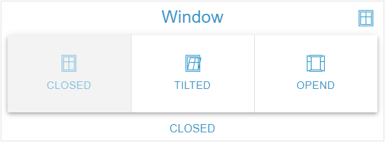

# ButtonGroup Widget

## Beschreibung

Das ButtonGroup Widget stellt die Zustandszeilen einer OID als Button-Gruppe dar. Ein Klick schreibt den Wert des Buttons an die OID. Es akzeptiert die Datentypen boolean, number, string und mixed und bietet flexible Styling-Optionen.

## Einstellungshierarchie

Dieses Widget nutzt alle **vis-2 Einstellungen** und **Common Einstellungen**. Siehe [Home](De-Home.md) für Details.

Die Widget-spezifischen und Value-spezifischen Einstellungen überschreiben die allgemeineren Einstellungen.

## Widget-spezifische Einstellungen

Die Felder stehen in der Gruppe **Button-Gruppe**. Die Gruppen **Aktiv** und **Werte** beschreibt [Value-spezifische Einstellungen](#value-spezifische-einstellungen).

| Feldname                              | Typ                               | Standard     | Beschreibung                                                                                                               | Bedingung                                        |
| ------------------------------------- | --------------------------------- | ------------ | -------------------------------------------------------------------------------------------------------------------------- | ------------------------------------------------ |
| Objekt-ID `oid`                       | id                                | -            | OID, deren Wert die Auswahl bestimmt und an die geschrieben wird; akzeptiert die Typen boolean, number, string und mixed   | -                                                |
| Einheit `unit`                        | text                              | ''           | Einheit (wird aus dem Objekt übernommen, hier überschreibbar, Leeren entfernt sie); erscheint an Beschriftungen ohne Alias | Nur wenn eine OID gewählt ist                    |
| Nur Anzeige `onlyDisplay`             | checkbox                          | false        | Sperrt die Buttons, es wird nichts geschrieben. Jede OID-Wahl setzt das Feld neu: true bei `write: false`, sonst false     | Ausgeblendet, wenn das Objekt `write: false` hat |
| Nur Icon `onlyIcon`                   | checkbox                          | -            | Blendet die Beschriftung aus                                                                                               | Ausgeblendet bei aktivem `onlyText`              |
| Nur Text `onlyText`                   | checkbox                          | -            | Blendet die Icons der Buttons aus                                                                                          | Ausgeblendet bei aktivem `onlyIcon`              |
| Variante `buttonGroupVariant`         | select (`text`, `outlined`)       | `text`       | Darstellung, siehe [Varianten](#varianten)                                                                                 | -                                                |
| Orientierung `buttonGroupOrientation` | select (`horizontal`, `vertical`) | `horizontal` | Anordnung, siehe [Orientierung](#orientierung)                                                                             | -                                                |
| Farbe `buttonGroupColor`              | color                             | -            | Nur Vollfarbe. Farbe der Trennlinien und Rahmen. Ohne Wert die Textfarbe des Themes, siehe [Farbe](#farbe)                 | -                                                |

**Hinweis:** Zusätzlich zu den oben genannten Einstellungen sind die **Wert schreiben**-Einstellungen (Verzögerung/Intervall) verfügbar. Diese steuern, wie Wertänderungen an die OID geschrieben werden. Siehe [Common Einstellungen - Wert schreiben](De-Home.md#wert-schreiben) für Details.

### Schreibverhalten

- **Klick**: Schreibt den Wert des Buttons mit den **Wert schreiben**-Einstellungen, gewandelt in den Typ der OID (siehe [Datentypen](#datentypen)). Die Auswahl springt sofort auf den Button.
- **Erneuter Klick**: Ein Klick auf einen schon ausgewählten Button sendet den Wert erneut. Abwählen lässt sich ein Button nicht.
- **Auswahl**: Ausgewählt ist jeder Button, dessen Wert dem aktuellen Wert der OID entspricht, auch nach einer Änderung von außen. Mehrere Zeilen mit demselben Wert sind alle ausgewählt. Passt keine Zeile, ist kein Button ausgewählt.
- **Sperre**: Bei aktivem `onlyDisplay` oder `write: false` am Objekt sind alle Buttons deaktiviert und es wird nichts geschrieben. Die Auswahl folgt weiter dem Wert.

## Varianten

### Text (Standard)

- Buttons ohne Rahmen, zwischen ihnen eine 1 px breite Trennlinie in der Farbe `buttonGroupColor`; sie bleibt auch auf Buttons mit Hintergrund sichtbar
- Niedrigste visuelle Priorität
- Empfohlen für tertiäre Aktionen oder dichte Layouts

### Outlined

- Buttons mit Rahmen in der Farbe `buttonGroupColor`, Hintergrund wie bei Text aus den `background`-Feldern
- Empfohlen für sekundäre Aktionen

## Anzeigeoptionen

### Nur Icon

- `onlyIcon` blendet die Beschriftung aus
- Nützlich für kompakte Anzeigen; die Icons sollten selbsterklärend sein
- Eine Zeile ohne Icon ergibt einen leeren Button

### Nur Text

- `onlyText` blendet die Icons der Buttons aus, das Eck-Icon bleibt
- Nützlich, wenn der Platz begrenzt ist, und für Barrierefreiheit

## Orientierung

### Horizontal (Standard)

- Buttons werden nebeneinander angeordnet (von links nach rechts), die Trennlinie läuft senkrecht
- Platzsparend in der Höhe
- Standard für die meisten Anwendungsfälle

### Vertikal

- Buttons werden untereinander angeordnet (von oben nach unten) und teilen sich die Höhe zu gleichen Teilen, die Trennlinie läuft waagerecht
- Platzsparend in der Breite
- Gut für schmale Layouts oder viele Optionen

## Styling

### Farbe

`buttonGroupColor` färbt nur die Trennlinien (Variante Text) beziehungsweise die Rahmen (Variante Outlined), immer mit Alpha 0,6. Ohne Wert gilt die Textfarbe des Themes; `textColor` und vis-2 `color` wirken hier nicht. Die Hintergründe und Texte ausgewählter Buttons steuern die Felder der Gruppe **Aktiv**.

### Button-Hintergrund

Im ButtonGroup Widget färben `background`, `background{n}` und `backgroundActive` die Buttons, nicht die Inhaltsfläche. Die Inhaltsfläche behält die Widget-Fläche des Themes, bei `noCard` ist sie transparent. Die Reaktion des Buttons hängt von der Farbangabe ab:

- **Hex oder rgb(a)**: Beim Überfahren um 50 % aufgehellt, ausgewählt um 30 %
- **Gradient**: Nicht aufgehellt, sondern beim Überfahren und im aktiven Zustand mit 80 % Deckkraft gezeichnet
- **Andere Farbangabe** (etwa ein Farbname oder eine CSS-Variable): Malt den Button, ohne eigene Tönung beim Überfahren oder Auswählen

### Gruppenenden

Mit `basePadding` `0` oder ohne Wert sind die Enden der Gruppe eckig, sonst abgerundet.

## Datentypen

Die Buttons kommen aus den Zustandszeilen. Eine Zeile passt zum Wert der OID, wenn beide als Text gleich sind; `1` und `'1'` sind also derselbe Zustand. Beim Schreiben gilt je Typ:

### Boolean

- Zwei feste Zeilen mit den Werten `true` und `false`: `value{n}` ist ausgeblendet, Zeilen lassen sich nicht hinzufügen, klonen oder löschen
- Der Alias kommt aus `common.states`, sonst `TRUE` und `FALSE`
- Typische Anwendung: Ein/Aus, Ja/Nein

### Number

- Mehrere Buttons für numerische Werte, geschrieben als Zahl
- Eine nicht numerische Zeile wird nie aktiv und schreibt nichts
- Beispiel: Lüfterstufen (0, 1, 2, 3)

### String

- Mehrere Buttons für Textwerte, geschrieben als Text
- Beispiel: Modi (Auto, Manuell, Eco, Comfort)

### Mixed

- Beliebige Werte: `true` und `false` (ohne Rücksicht auf Groß-/Kleinschreibung) werden als Boolean geschrieben, zahlenförmige Werte als Zahl (aus `007` wird `7`), alles andere als Text
- Eine Zeile, deren Text sich dabei ändert (`007`, `TRUE`), passt danach nicht zum Wert der OID und wird nicht aktiv

## Value-spezifische Einstellungen

Jeder Button ist eine Zeile im Zustandseditor, der Gruppe **Werte** (Felder siehe [Value-spezifische Einstellungen](De-Home.md#value-spezifische-einstellungen)). Bei der OID-Wahl werden die Zustände aus `common.states` als Zeilen ergänzt, vorhandene Zeilen bleiben erhalten. **Aus common.states neu anlegen** ersetzt alle Zeilen. Ohne Zeile mit Wert zeigt das Widget keine Buttons. Im Widget wirken die Felder so:

- **Beschriftung**: `alias{n}`, sonst der Wert mit Einheit. HTML ist erlaubt, der Text bleibt einzeilig und wird abgeschnitten. Größe aus `valueSize{n}`, Farbe aus `textColor{n}` (Gradient möglich)
- **Icon**: `icon{n}` oder `iconSmall{n}`, sonst das Basis-Icon. Die OID-Wahl setzt `icon` aus dem Objekt; es erscheint dann auf jedem Button ohne eigenes Icon
- **Icongröße**: `iconSize{n}` in Prozent des Icon-Bereichs, ohne Wert 100 %. Das Basisfeld `iconSize` gilt nur für das Eck-Icon
- **Hintergrund**: `background{n}` färbt den Button, siehe [Button-Hintergrund](#button-hintergrund)
- **Rahmen**: `header{n}`, `headerSize{n}`, `footer{n}`, `footerSize{n}` und `frameBackground{n}` gelten, solange die Zeile aktiv ist; bei mehreren aktiven Zeilen die erste
- **Gruppe Aktiv**: Die Felder mit Suffix `Active` gelten für jeden aktiven Button und für den Rahmen

## Anwendungsbeispiele

- **Lüfterstufen**: number-OID mit den Werten 0, 1, 2, 3 (`horizontal`, `text`)
- **Betriebsmodi**: string-OID mit den Werten Auto, Manuell, Eco, Comfort (`horizontal`, `outlined`)
- **Favoriten**: string-OID, Auswahl aus vordefinierten Szenen (`vertical`, `text`)
- **Lichtszenen**: number-OID mit Szenennummern und den Aliasen Lesen, Film, Entspannung, Party (`horizontal`, `text`)
