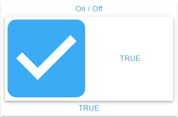

# Checkbox Widget

## Beschreibung

Das Checkbox Widget zeigt eine OID vom Typ boolean als Checkbox mit Label. Das Label ist der angezeigte Text des aktiven Zustands, seine Platzierung ist konfigurierbar. Ein Klick schreibt die Gegenstellung, verzögert über die **Wert schreiben**-Einstellungen.

## Einstellungshierarchie

Dieses Widget nutzt alle **vis-2 Einstellungen** und **Common Einstellungen**. Siehe [Home](De-Home.md) für Details.

Die Widget-spezifischen und Value-spezifischen Einstellungen überschreiben die allgemeineren Einstellungen. Was davon hier anders wirkt, steht unter [Icon](#icon) und [Label-Text](#label-text).

## Widget-spezifische Einstellungen

| Feldname                                  | Typ                                      | Standard | Beschreibung                                                                                                                                 | Bedingung                       |
| ----------------------------------------- | ---------------------------------------- | -------- | -------------------------------------------------------------------------------------------------------------------------------------------- | ------------------------------- |
| Objekt-ID `oid`                           | id                                       | -        | Der Objektdialog bietet nur den Typ boolean an. Ein Objekt anderen Typs wird verworfen, der Rahmen zeigt dann den Hinweis                    | -                               |
| Einheit `unit`                            | text                                     | `''`     | Einheit (wird aus dem Objekt übernommen, hier überschreibbar, Leeren entfernt sie). Wirkt im Text von Label und Fußzeile, und nur ohne Alias | Nur wenn eine OID gewählt ist   |
| Ohne Label `withoutLabel`                 | checkbox                                 | false    | Checkbox ohne Label anzeigen                                                                                                                 | -                               |
| Labelplatzierung `checkboxLabelPlacement` | select (`top`, `bottom`, `start`, `end`) | `end`    | Position des Labels relativ zur Checkbox                                                                                                     | Ausgeblendet bei `withoutLabel` |
| Nur Anzeige `onlyDisplay`                 | checkbox                                 | false    | Sperrt die Checkbox, siehe [Gesperrt](#gesperrt). Jede Wahl der OID setzt das Feld neu: `true` bei `write: false`, sonst `false`             | Ausgeblendet bei `write: false` |

**Hinweis:** Zusätzlich zu den oben genannten Einstellungen sind die **Wert schreiben**-Einstellungen (Verzögerung/Intervall) verfügbar. Diese steuern, wie Wertänderungen an die OID geschrieben werden. Siehe [Common Einstellungen - Wert schreiben](De-Home.md#wert-schreiben) für Details.

### Stellung und Umschalten

- Angehakt ist die Checkbox genau bei `true` und dem Text `"true"`. Jeder andere Wert zeigt sie nicht angehakt, auch `"TRUE"`, `1` oder `null`.
- Solange die OID keinen Wert geliefert hat, zeigt das Widget weder Checkbox noch Label.
- Ein Klick auf Checkbox oder Label schreibt das Gegenteil der angezeigten Stellung, immer als boolean: Aus `"false"` oder `1` wird `true`.
- Die Stellung wechselt sofort, das Schreiben folgt nach der Wartezeit aus [Wert schreiben](De-Home.md#wert-schreiben).
- Mehrere Klicks innerhalb der Wartezeit ergeben einen Schreibvorgang mit dem letzten Wert, auch wenn er dem Ausgangswert entspricht.

### Gesperrt

Mit `onlyDisplay` oder einer OID mit `write: false` ist die Checkbox deaktiviert. Ihr Aussehen ändert sich dabei nicht, sie reagiert nur nicht mehr auf Klicks. Ein Binding auf `onlyDisplay` liefert Text, dort gelten `false` und `0` als aus.

### Zustandszeilen

Der Zustandseditor hat zwei feste Zeilen für `true` und `false`: Hinzufügen, Klonen und Löschen entfallen. Die Wahl der OID legt fehlende Zeilen an, der Alias kommt aus `common.states`, ohne Eintrag `TRUE` oder `FALSE`. Vorhandene Zeilen bleiben.

### Icon

- Die Checkbox zeigt das Icon des aktiven Zustands: `icon{n}`, `iconSmall{n}`, sonst `icon`, `iconSmall`. Ohne Icon zeigt sie ein Kästchen mit Haken oder ein leeres Kästchen.
- Ein Icon in `icon` oder `iconSmall` gilt für beide Stellungen, dann unterscheiden nur Label und Farbe sie. Auch die Wahl der OID kann `icon` füllen. Ein eigenes Icon je Stellung kommt aus `icon{n}`. Ein gesetztes Icon erscheint außerdem als Eck-Icon, außer `noHeaderIcon` ist aktiv.
- Die Größe folgt `iconSize{n}`, `iconSize`, sonst 100, jeweils in Prozent der Checkbox-Fläche. `iconSize` steuert zugleich das Eck-Icon, dort in Prozent von 24 px.
- Die Farbe folgt `iconColor{n}`, `iconColor`, sonst der Primärfarbe des Themes. Die Kästchen werden immer gefärbt.
- Die Checkbox hat keinen Ripple.

## Label-Platzierung

Die Position des Labels wird über `checkboxLabelPlacement` gesteuert:

### Oben

- Wert `top`: Label oberhalb der Checkbox
- Vertikale Anordnung

### Unten

- Wert `bottom`: Label unterhalb der Checkbox
- Vertikale Anordnung

### Anfang

- Wert `start`: Label links von der Checkbox (bei LTR-Layout)
- Horizontale Anordnung

### Ende (Standard)

- Wert `end`: Label rechts von der Checkbox (bei LTR-Layout)
- Horizontale Anordnung

### Ohne Label

- `withoutLabel` zeigt nur die Checkbox, sie nimmt dann die ganze Fläche ein
- Nützlich für kompakte Darstellungen oder wenn Kopf- oder Fußzeile die Beschriftung tragen

### Label-Text

- Das Label zeigt den Alias der aktiven Zeile (HTML erlaubt), sonst ihren Wert, sonst den aktuellen Wert der OID, die beiden letzten mit Einheit. Ein Alias aus Leerzeichen zählt nicht.
- Ohne aktive Zeile bleibt das Label bei `false` leer, die Fußzeile zeigt dagegen `false`.
- Die Fußzeile zeigt ohne `footer` denselben Text. Der Text steht also doppelt, außer `noFooter` ist aktiv oder `footer` gesetzt.
- Größe und Farbe folgen `valueSize{n}`, `valueSize` und `textColor{n}`, `textColor`. Der Text steht in jeder Platzierung linksbündig in seinem Bereich.

## Anwendungsbeispiele

- **Einstellungen**: Aktivieren/Deaktivieren von Optionen, die Aliasse nennen die Option
- **Checklisten**: Aufgaben abhaken, mit `icon{n}` für erledigt und offen
- **Filter**: Auswahl von Filterkriterien als boolean-State, den ein Skript auswertet
- **Zustimmungen**: Bestätigungen/Einverständniserklärungen mit HTML im Alias
- **Benachrichtigungen**: Enable/Disable-Schalter mit Beschriftung, mit `noFooter`, damit der Text nicht doppelt steht
