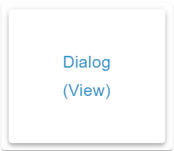

# Dialog Widget



## Beschreibung

Das Dialog Widget zeigt einen Button mit Icon und Text. Ein Klick öffnet ein modales Fenster mit einer ausgewählten View. Optional schließt es nach einer eingestellten Zeit von selbst und folgt einer booleschen Sitzungs-OID, die es bei eigenen Aktionen auch schreibt.

## Einstellungshierarchie

Dieses Widget nutzt alle **vis-2 Einstellungen** und **Common Einstellungen**. Siehe [Home](De-Home.md) für Details.

Die Widget-spezifischen Einstellungen überschreiben die allgemeineren Einstellungen.

Das Widget hat keine Haupt-OID, also weder `oid` noch `unit`, und keine Value-spezifischen Einstellungen.

Die Common Einstellungen gelten für zwei Rahmen: den Rahmen des Buttons und den Ansichtsrahmen im geöffneten Dialog. Abweichend von [Home](De-Home.md) gilt:

- **Icon:** Der Rahmen des Buttons zeigt das Icon zweimal, als Eck-Icon und im Button. `noHeaderIcon` blendet nur das Eck-Icon aus, `onlyText` nur das Icon im Button. Der Ansichtsrahmen hat kein Eck-Icon.
- **Icongröße:** `iconSize` bedeutet im Button Prozent der Icon-Fläche, ohne Wert 100 %.
- **Header ohne Text:** Es erscheint der Name des Objekts der Sitzungs-OID.
- **Textfarbe und Schriftgröße:** `textColor` färbt auch den Button-Text und die Titelzeile, `valueSize` setzt die Schriftgröße des Button-Texts.
- **CSS Hintergrund:** `background-color` hat auf der Inhaltsfläche des Ansichtsrahmens Vorrang vor `background`. Außerdem tönt es dort die Scrollbar und färbt die Trennlinien.

## Widget-spezifische Einstellungen

Alle Felder stehen in der Gruppe **Dialog**.

### View und Titel

| Feldname                               | Typ          | Standard | Beschreibung                                                                                          | Bedingung |
| -------------------------------------- | ------------ | -------- | ----------------------------------------------------------------------------------------------------- | --------- |
| Ansicht `view`                         | select-views | -        | View, die der Dialog zeigt, siehe [View-Auswahl](#view-auswahl)                                       | -         |
| Header als Titel `dialogHeaderAsTitle` | checkbox     | false    | Zeigt den Header in der Titelzeile statt in der Rahmen-Kopfzeile, siehe [Dialog-Titel](#dialog-titel) | -         |

### Größeneinstellungen

| Feldname                               | Typ            | Standard | Beschreibung                       | Bedingung |
| -------------------------------------- | -------------- | -------- | ---------------------------------- | --------- |
| Breite `dialogWidth`                   | slider (1-100) | 100      | Breite des Dialogs                 | -         |
| Höhe `dialogHeight`                    | slider (1-100) | 100      | Höhe des Dialogs                   | -         |
| Breite / Höhe in Pixel `dialogInPixel` | checkbox       | false    | Beide Werte in Pixel statt Prozent | -         |

### Dialog-Hintergrund

| Feldname                                 | Typ   | Standard | Beschreibung                                                                                                          | Bedingung |
| ---------------------------------------- | ----- | -------- | --------------------------------------------------------------------------------------------------------------------- | --------- |
| Hintergrundfarbe `dialogBackgroundColor` | color | -        | Fläche hinter dem Dialog, unter dem MUI-Backdrop (Gradient möglich). Ohne Wert transparent, die View scheint hindurch | -         |

### Button

Im Panel unter dem Trenner **Button**. Der Button füllt die Inhaltsfläche seines Rahmens. Ohne `onlyIcon` und `onlyText` teilen sich Icon und Text die Fläche nebeneinander; ein fehlendes Icon oder ein leerer Text lässt seinen Teil leer.

| Feldname            | Typ      | Standard | Beschreibung                                          | Bedingung                   |
| ------------------- | -------- | -------- | ----------------------------------------------------- | --------------------------- |
| Text `dialogText`   | html     | -        | Text des Buttons, HTML erlaubt. Steht nicht im Dialog | Wirkt nicht bei `onlyIcon`  |
| Nur Icon `onlyIcon` | checkbox | false    | Button nur mit Icon                                   | Ausgeblendet bei `onlyText` |
| Nur Text `onlyText` | checkbox | false    | Button nur mit Text                                   | Ausgeblendet bei `onlyIcon` |

### Close-Button

Im Panel ebenfalls unter dem Trenner **Button**, die Felder betreffen aber den Dialog.

| Feldname                                         | Typ      | Standard | Beschreibung                                                                      | Bedingung |
| ------------------------------------------------ | -------- | -------- | --------------------------------------------------------------------------------- | --------- |
| Schließen Button oben `dialogCloseButtonTop`     | checkbox | false    | Schließen-Button in der Titelzeile                                                | -         |
| Schließen Button unten `dialogCloseButtonBottom` | checkbox | false    | Schließen-Button unter der View                                                   | -         |
| Schließen Button Farbe `dialogCloseButtonColor`  | color    | -        | Farbe des Schließen-Buttons, nur Vollfarbe. Wirkt nur mit einem der beiden Felder | -         |

### Auto-Close

| Feldname                                     | Typ                           | Standard | Beschreibung                                                     | Bedingung |
| -------------------------------------------- | ----------------------------- | -------- | ---------------------------------------------------------------- | --------- |
| Automatisch schließen [ms] `dialogAutoClose` | slider (0-30000, Schritt 100) | -        | Schließt den Dialog nach dieser Zeit. Ohne Wert oder mit `0` aus | -         |

### OID-Steuerung

| Feldname             | Typ | Standard | Beschreibung                                                                                                                | Bedingung |
| -------------------- | --- | -------- | --------------------------------------------------------------------------------------------------------------------------- | --------- |
| Objekt-ID `dialogId` | id  | -        | Sitzungs-OID: `true` öffnet, `false` schließt, eigene Aktionen schreiben sie. Der Objektdialog bietet nur boolean-States an | -         |

## View-Auswahl

- Das Panel bietet alle Views des Projekts an, außer der gerade bearbeiteten
- Die View wird vollständig im Dialog gerendert, im Editor wie zur Laufzeit
- Alle Widgets in der View sind interaktiv
- Die View entsteht erst beim Öffnen und verschwindet beim Schließen
- Ragt die View über die Fläche hinaus, scrollt sie innerhalb des Dialogs
- Ohne gewählte oder vorhandene View bleibt die Fläche leer

**Hinweis:** Wähle Views, die für die Dialog-Darstellung optimiert sind (kompakte Layouts).

## Größeneinstellungen

### Prozent (Standard)

- `dialogInPixel = false`
- Breite und Höhe in Prozent des Browserfensters
- Beispiel: 80 = 80 % der Fensterbreite bzw. -höhe
- Folgt der Fenstergröße

### Pixel

- `dialogInPixel = true`
- Breite und Höhe in Pixeln
- Beispiel: 800 = 800 px Breite. Der Slider endet bei 100, größere Werte nimmt das Zahlenfeld daneben an
- Bezieht sich nicht auf die Fenstergröße
- Das Umschalten rechnet die Werte nicht um

**Empfehlung:** Nutze Prozent für responsive Designs, Pixel für fixe Layouts.

## Close-Button

### Position

- **Schließen Button oben**: rechts in der Titelzeile, darunter eine Trennlinie
- **Schließen Button unten**: rechts unter der View, darüber eine Trennlinie
- Beide zugleich sind möglich

### Farbe

- Über `dialogCloseButtonColor` einstellbar
- Ohne Wert gilt `background-color` aus CSS Hintergrund, sonst die Farbe `background.default` des Themes
- Das Icon wird zusätzlich mit `brightness(1.5)` aufgehellt
- Die Trennlinien nutzen dieselbe Folge ohne `dialogCloseButtonColor`

### Ohne Button

- Sind beide Felder aus (Standard), hat der Dialog keinen Schließen-Button
- Nutzer kann den Dialog dann über den Backdrop, Escape, Auto-Close oder die Sitzungs-OID schließen

## Auto-Close

- Dialog schließt automatisch nach konfigurierten Millisekunden, egal ob ein Klick oder die Sitzungs-OID ihn geöffnet hat
- Beispiel: 5000 = Dialog schließt nach 5 Sekunden
- Nützlich für Benachrichtigungen oder temporäre Anzeigen
- Ohne Wert oder mit `0` bleibt der Dialog offen, bis er anders geschlossen wird
- Beim Ablauf schreibt das Widget `false` auf eine beschreibbare Sitzungs-OID
- Ein laufender Timer behält seine Dauer, auch wenn sich `dialogAutoClose` ändert. Schließen auf anderem Weg oder Entfernen des Widgets löscht ihn
- Das Zahlenfeld neben dem Slider und Bindings erlauben weitere Werte: unter 60 zählt als Sekunden (20 = 20 s), ab 60 als Millisekunden, `true` als 10 s, ein Text ohne Zahl als 1 s

## OID-Steuerung

Mit `dialogId` folgt die Dialog-Sitzung einer booleschen OID, der Sitzungs-OID.

Das Widget schreibt die OID nur beim eigenen Öffnen und Schließen (Klick, X/Backdrop/Escape, Auto-Close) — nie als Reaktion auf den State, auch nicht beim Laden der View. Nur boolesche Werte steuern den Dialog; andere Werte werden ignoriert. Ein schreibgeschützter State wird nur gelesen.

| Ereignis                                     | Dialog      | Schreibt |
| -------------------------------------------- | ----------- | -------- |
| Klick auf den Button                         | öffnet      | `true`   |
| Schließen-Button, Backdrop, Escape           | schließt    | `false`  |
| Ablauf von Auto-Close                        | schließt    | `false`  |
| State wird `true`, auch beim Laden der View  | öffnet      | nichts   |
| State wird `false`, auch beim Laden der View | schließt    | nichts   |
| Anderer Wert                                 | unverändert | nichts   |

Geschrieben wird direkt mit `ack=false`, ohne Verzögerung und Intervall aus [Wert schreiben](De-Home.md#wert-schreiben); das Widget hat diese Felder nicht. Als schreibgeschützt gilt ein Objekt mit `common.write = false` beim Auswählen. Ohne gültiges Objekt in `dialogIdObject` folgt das Widget dem State ebenfalls nur. Die Wahl der OID speichert nur `dialogIdObject` und lässt `icon` und die übrigen Felder unberührt.

### Dialog öffnen

- Setze die OID auf `true`
- Dialog öffnet sich automatisch, auch wenn der Wert beim Laden der View schon anliegt
- Der Editor hat keine Sonderbehandlung: Auch dort öffnet `true` den Dialog

### Dialog schließen

- Setze die OID auf `false`
- Dialog schließt sich automatisch, ohne dass das Widget zurückschreibt
- Steht eine schreibgeschützte OID nach dem Schließen noch auf `true`, bleibt der Dialog zu. Erst ein neuer Wechsel auf `true` oder ein Klick öffnet ihn wieder
- Wird das Widget bei offenem Dialog entfernt, schreibt es kein `false`. Die OID bleibt auf `true`, beim nächsten Laden öffnet der Dialog wieder
- Zwei Dialog Widgets an derselben OID öffnen und schließen gemeinsam

**Anwendungsfall:** Öffne Dialog bei bestimmten Ereignissen (z.B. Alarme, Benachrichtigungen)

**Beispiel:**

```
dialogId = "javascript.0.showAlarmDialog"
```

Skript setzt `showAlarmDialog = true` bei Alarm → Dialog öffnet sich. Mit Auto-Close schreibt das Widget nach Ablauf `false`, der nächste Alarm kann wieder `true` setzen

## Dialog-Titel

### Mit dialogHeaderAsTitle

- `dialogHeaderAsTitle = true`
- Der Header steht in der Titelzeile des Ansichtsrahmens, dessen Rahmen-Kopfzeile entfällt
- Einzeilig, HTML erlaubt, Größe `headerSize`, Farbe `textColor`
- Wirkt auch bei `noHeader`. Der Rahmen des Buttons richtet sich weiter nach `noHeader`

### Ohne dialogHeaderAsTitle

- `dialogHeaderAsTitle = false`
- Der Header steht wie am Button in der Rahmen-Kopfzeile, bei `noHeader` gar nicht
- Die Titelzeile bleibt leer und trägt nur einen Schließen-Button oben
- Eigene Titel lassen sich innerhalb der View platzieren

## Anwendungsbeispiele

- **Detailansichten**: Klick auf den Button öffnet eine detaillierte View
- **Einstellungen**: Öffne eine Einstellungs-View für komplexe Konfigurationen
- **Benachrichtigungen**: Automatisches Öffnen bei Alarmen über die Sitzungs-OID, Schließen mit Auto-Close
- **Formulare**: Eingabe-Views für Benutzereingaben
- **Mediaplayer**: Detaillierte Steuerung in separatem Dialog
