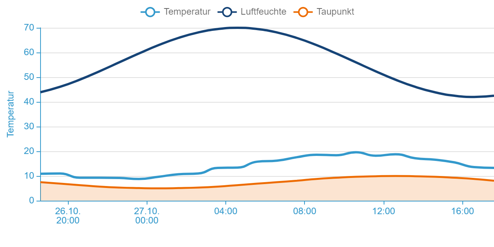
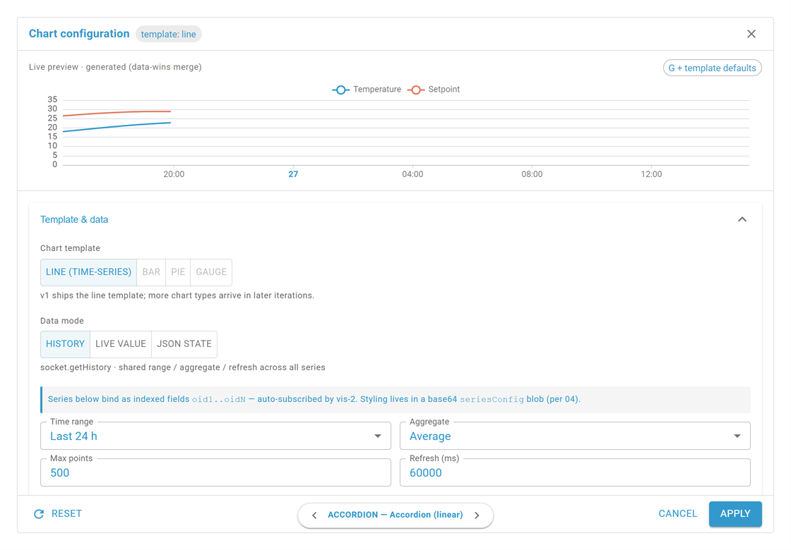

# ECharts Widget

## Beschreibung

Das ECharts Widget („Diagramm (ECharts)") rendert Apache-ECharts-Diagramme in vis-2: Liniendiagramme, Balkendiagramme, Punktwolken und Torten-/Ringdiagramme. Alle diagrammspezifischen Einstellungen liegen im Konfigurator, den **Diagramm-Konfiguration bearbeiten** im vis-2-Attributspanel öffnet.

Das Widget kennt zwei Datenquellen-Modi:

- **Verlauf** — ruft Historie über einen History-Adapter ab (history, SQL, InfluxDB …). Zeitfenster, Abruf und Aktualisierung gelten je Diagramm; Aggregation, Differenz und Null-Werte lassen sich je Serie überschreiben.
- **JSON** — ein Datenpunkt liefert die Daten als JSON-Payload. Die Strukturen beschreibt [ECharts JSON-Formate](De-Echarts-JSON-Formate.md).

## Einstellungshierarchie

Dieses Widget verwendet alle **vis-2 Einstellungen** und **Common Einstellungen**. Siehe [Home](De-Home.md) für Details. Abweichung: Die Blöcke [Icon](De-Home.md#icon) und [Wert](De-Home.md#wert) sowie Kein Headericon `noHeaderIcon` sind hier wirkungslos und im Panel ausgeblendet.

Die widgetspezifischen Einstellungen überschreiben die allgemeineren Einstellungen.

> **Konfigurator statt Panel:** Fast alle ECharts-Einstellungen liegen im Konfigurator, nicht im vis-2-Attributspanel. Das Panel zeigt nur den Öffnen-Trigger und die vier Padding-Slider (siehe [unten](#vis-2-paneleeinstellungen)).

## Konzepte

### Diagramm-Familien

Der **Diagrammtyp** (oben im Konfigurator gepinnt) wählt zugleich die Familie:

| Typ        | Familie    | Beschreibung                                                                                                       |
| ---------- | ---------- | ------------------------------------------------------------------------------------------------------------------ |
| Linie      | Kartesisch | Serien als Linie; Flächenfüllung ist eine Serien-Eigenschaft, kein eigener Typ                                     |
| Balken     | Kartesisch | Serien als Balken; im Verlauf optional Kalender-Bucketing über das Balken-Intervall                                |
| Punktwolke | Kartesisch | Serien als Streupunkte                                                                                             |
| Torte      | Torte      | Verlauf und Fertige Serien: eine Serie = ein Segment. Tabelle/Spalten: eine Y-Spalte = ein Ring, Zeilen = Segmente |

Innerhalb der kartesischen Familie kann jede Serie den Typ übersteuern: Das Feld **Typ** erscheint ab zwei Serien und zeigt den Diagrammtyp, solange die Serie keinen eigenen Typ trägt. Die Wahl des Diagrammtyps speichert keine Übersteuerung.

### Datenmodi und Payload-Familien

Der **Datenmodus** (zweite gepinnte Auswahl) gilt für das ganze Diagramm:

- **Verlauf** — jede Serie bindet ihren eigenen Datenpunkt; abgerufen wird über `getHistory` mit Zeitfenster, Aggregation und maximaler Punktzahl. Voraussetzung: ein History-Adapter am Datenpunkt.
- **JSON** — genau ein JSON-Datenpunkt liefert alle Serien. Unter dem Modus erscheint die dritte gepinnte Auswahl, die **Payload-Familie**:
    - **Fertige Serien** — der Payload trägt fertige Serien (`{ series: […] }`, Arrays …). Anzahl und Werte bestimmt allein der Payload; im Konfigurator lassen sie sich nach Namen gestalten, an Achsen binden und ausblenden.
    - **Tabelle/Spalten** — der Payload ist eine Zeilenliste; Zeilenpfad, X-Spalte und Y-Spalten (in der Sektion Serien) leiten die Serien daraus ab. Hier bestimmt der Nutzer die Struktur, der Payload die Werte.

> **Grenz-Wechsel löschen:** Familien-Wechsel (z. B. Linie → Torte), Datenmodus-Wechsel (Verlauf ↔ JSON) und Payload-Familien-Wechsel (Fertige Serien ↔ Tabelle/Spalten) setzen den Datenpfad zurück: Serien, Y-Achsen, Stil und Ausblenden der Payload-Serien, JSON-Datenpunkt, Zuordnung und Markierungen fallen. Titel, Legende, Tooltip, Farben, Toolbox, X-Karte und Zoom bleiben. Nach dem Wechsel nennt eine Meldung, was fiel (Serien, Achsen, Markierungen, JSON-Datenpunkt, aktive Vorlagen; ohne Verlust keine Meldung), ihr **Rückgängig** stellt den Stand in einem Schritt wieder her. Der JSON-Datenpunkt selbst bleibt beim Payload-Familien-Wechsel erhalten (derselbe Zustand, anders gelesen). Linie ↔ Balken ↔ Punktwolke löscht nichts.

Die JSON-Payload-Formate mit Beispielen: [ECharts JSON-Formate](De-Echarts-JSON-Formate.md).

### Werte-Verarbeitung je Serie (Wert-Kette)

Jeder Wert durchläuft auf dem Weg in das Diagramm eine feste Kette. Die Stufen sind Serien-Eigenschaften im Tab **Daten** der Serienkarte:

1. **Wert-Zuordnung** (`valueMap`) — trifft der Rohwert als Text exakt, gilt die zugeordnete Zahl; ein leeres Ziel ist eine **bewusste Lücke**, die nie aufgefüllt wird. Nicht zugeordnete Werte laufen unverändert weiter.
2. **Plottbarer Wert** — Booleans und `"true"`/`"false"` werden 1/0, Texte werden als Zahl am Textanfang gelesen (`23.5 °C`). Ein Komma ohne Punkt gilt als Dezimaltrennzeichen (`23,5`; `1.234,5` ergibt 1.234). Nicht Interpretierbares und leere Texte werden zur Lücke.
3. **Null-Werte** — Lücken belassen, mit dem letzten Wert auffüllen oder mit 0 füllen. Bewusste Lücken bleiben immun.
4. **Y-Versatz** — addiert einen festen Offset auf den Wert.
5. **Formel** — Rechenformel über das Symbol `val` (expr-eval-Syntax, z. B. `val / 1000 + 3`); die Kontext-Symbole `smin`, `smax`, `savg`, `sfirst`, `slast` liefern Min/Max/Durchschnitt/ersten/letzten Wert der Serie vor Y-Versatz und Formel, Lücken übersprungen. Ungültige Formel ⇒ Werte nur mit Y-Versatz, Hinweis am Feld. Nicht endliches oder werfendes Ergebnis ⇒ Lücke.
6. **Bucketing** — nur Kategorie-Balken im Verlauf, samt Differenz.
7. **Gleitender Mittelwert** — zentriertes Fenster über N Punkte; am Rand abgeschnitten, Lücken übersprungen, aber nicht gefüllt.
8. **Kumulativ** — laufende Summe über die nicht-null Werte; Lücken bleiben, kein Reset.

Im Verlauf-Modus kommt davor der Abruf (Aggregation, Punkte-Limit). **Zukünftige Werte ausblenden** schneidet vor Y-Versatz und Formel und wirkt nur auf Punkte mit Zeit-X; bei Tabelle/Spalten mit Kategorie- oder Index-X bleibt es wirkungslos.

### Achsen-Modell (kartesisch)

- **Serien folgen Achsen:** Eine Achse existiert, solange mindestens eine Serie sie bindet. Jede neue Serie bekommt eine eigene Achse; die Achsen wechseln sich links und rechts auf einem 80-px-Raster ab.
- **Y-Achse wählen:** Jede Serie bindet an genau eine Y-Achse (Tab **Basis** der Serienkarte); der letzte Eintrag **Neue Achse** legt eine an. Eine duplizierte Serie bekommt eine eigene Achse, solange jede Serie ihre eigene hat, sonst die Achse der Quelle. Verlässt die letzte Serie eine Achse, fällt die Achse mitsamt Konfiguration: Beim Entfernen und Umbinden bietet eine Meldung **Rückgängig**, verschwindet die Serie aus dem Payload, informiert sie nur.
- **Struktur-Ereignisse:** Hinzufügen, Duplizieren, Entfernen und Umbinden ordnen die gebundenen Achsen neu. Von Hand gesetzte Seite und Versatz gelten bis zum nächsten Ereignis.
- **Namensgeber:** Zeigen mehrere Serien auf eine Achse, zeigt die Achse Name und Farbe ihres Namensgebers; eine neu umgebundene Serie übernimmt die Rolle nicht. Zieht er weiter, übernimmt die erste verbleibende Serie.
- **Platz-Gedächtnis:** Jede Seite (links/rechts) merkt sich die Pixelwerte ihrer Plätze. Der Versatz hängt am Platz: Eine ankommende Achse übernimmt den gemerkten Wert, ein neuer Platz den Rasterwert.
- **Legenden-Folge:** Sind alle Serien einer Achse in der Legende abgewählt, verschwindet die Achse samt reserviertem Platz, nur in der Anzeige.
- **Ticks ausrichten** ist eine Wahl je Achse, Standard aus. Der Schalter erscheint nur auf Folgeachsen ab zwei angezeigten Achsen; Bezug ist die erste angezeigte Achse. Ein eigener Wertebereich oder Tick-Einstellungen heben die Ausrichtung für diese Achse auf, der Konfigurator warnt.

Die Torte hat keine Achsen; die Sektion „Achsen & Zoom" existiert dort nicht.

## Der Konfigurator

Öffnen: vis-2-Attributspanel → Gruppe **Diagramm** → **Diagramm-Konfiguration bearbeiten**.

- **Links:** Sektionen-Schiene. Oben gepinnt: **Diagrammtyp**, **Datenmodus** und (im JSON-Modus) **Payload-Familie**. Darunter die aufklappbaren Sektionen, in dieser Reihenfolge:
    1. Datenquelle
    2. Serien
    3. _familienabhängig:_ Achsen & Zoom (kartesisch) **oder** Torten-Optionen (Torte)
    4. Titel
    5. Legende
    6. Tooltip
    7. Farben
    8. Toolbox
    9. Verhalten
- Jede Sektion startet eingeklappt mit einer Zusammenfassungszeile; ein ⚠-Zähler im Titel meldet Validierungsprobleme (fehlende OID, fehlende oder Text-Y-Spalte, veraltete Achsenbindung, Y Min ≥ Max, Skala min ≥ max, Stapel-Zeitachse). Sie blockieren **Anwenden** nie.
- **Rechts:** Vorschau mit echten Daten, höchstens 200 Punkte je Serie, Polling ja, kein Neuabruf bei Wertänderung. Der Splitter zwischen Konfiguration und Vorschau ist ziehbar und per Tastatur bedienbar (320–720 px, Start 440, gemerkt; Doppelklick setzt zurück).
- **Kopf:** **Rückgängig** und Wiederholen (Strg+Z, Strg+Umschalt+Z, Strg+Y), **Maximieren** (gilt nur für die Sitzung), **Schließen**, ein Punkt für offene Änderungen.
- **Fußzeile:** **Zurücksetzen** führt in einem rückgängig machbaren Schritt zum geladenen Stand zurück; der Probleme-Zähler springt zur ersten betroffenen Sektion und deren Tab; **Abbrechen** verwirft; **Anwenden** schreibt den rxData-Patch. **Zurücksetzen** und **Anwenden** sind ohne Änderung deaktiviert. Jeder Schließweg fragt bei offenen Änderungen nach; alles wird erst mit **Anwenden** im Widget wirksam.

### Gepinnte Auswahl

| Auswahl         | Werte                               | Beschreibung                                                                      |
| --------------- | ----------------------------------- | --------------------------------------------------------------------------------- |
| Diagrammtyp     | Linie · Balken · Punktwolke · Torte | Familien- und Typwahl in einem (siehe [Konzepte](#diagramm-familien))             |
| Datenmodus      | Verlauf · JSON                      | Chart-global, nicht pro Serie (siehe [Konzepte](#datenmodi-und-payload-familien)) |
| Payload-Familie | Fertige Serien · Tabelle/Spalten    | Nur sichtbar im JSON-Modus                                                        |

## Sektion Datenquelle

Gilt chart-global. Aggregation samt Parametern, Differenz und Null-Werte sind **Voreinstellung für alle Serien**: Jede Serie kann sie auf ihrer Karte überschreiben (Erben-Overrides). Zeitfenster, Zeitschrittweite, Max. Punkte, Aktualisierungsintervall und Balken-Intervall gelten für alle Serien. Bei der Torte formen diese Felder die Punkte, die Segment-Aggregation verdichtet sie danach.

### Modus Verlauf

Tabs: **Zeitfenster** | **Datenabruf**.

**Tab Zeitfenster**

| Einstellung  | Werte / Typ                                                                                                                                                                    | Standard | Beschreibung                                                                                                                                                                      |
| ------------ | ------------------------------------------------------------------------------------------------------------------------------------------------------------------------------ | -------- | --------------------------------------------------------------------------------------------------------------------------------------------------------------------------------- |
| Zeitfenster  | Relativ · Statisch                                                                                                                                                             | Relativ  | Relativ = bewegtes Fenster; Statisch = feste Start-/Endezeiten. Statisch blendet Zeitraum, Ende und Aktualisierungsintervall aus, Polling und Neuabruf bei Wertänderung entfallen |
| Zeitraum     | 10/30 Minuten · 1/2/3/6/12 Stunden · 1/2/3/7/14 Tage · 1/2/3/6 Monate · 1/2 Jahre                                                                                              | 1 Tag    | Monate und Jahre zählen kalendarisch, ein Monatsende wird geklemmt (`1m` vor dem 31.3. landet auf dem 28./29.2.)                                                                  |
| Ende         | Jetzt · Minutenende · Ende von 5/10/30 Minuten · Stundenende · Ende von 2/3/4/6/8/12 Stunden · Tagesende · Ende der Woche (So) · Ende der Woche (Sa) · Monatsende · Jahresende | Jetzt    | Rundet das Fenster-Ende auf die nächste Grenze auf; der Zeitraum zählt von dort zurück                                                                                            |
| Start / Ende | Datum/Zeit                                                                                                                                                                     | –        | Nur bei Statisch. Unvollständig oder Start ≥ Ende ⇒ es gilt das Standardfenster (jetzt − 24 h), der Konfigurator weist darauf hin                                                 |

**Tab Datenabruf**

| Einstellung                                | Werte / Typ                                                                                               | Standard         | Beschreibung                                                                                                                                                                                                                                                                                                                                                                                                                                                                      |
| ------------------------------------------ | --------------------------------------------------------------------------------------------------------- | ---------------- | --------------------------------------------------------------------------------------------------------------------------------------------------------------------------------------------------------------------------------------------------------------------------------------------------------------------------------------------------------------------------------------------------------------------------------------------------------------------------------- |
| Aggregation                                | Durchschnitt · Min–Max · Minimum · Maximum · Summe · Anzahl · Bei Änderung · Keine · Perzentil · Integral | Durchschnitt     | `getHistory`-Aggregation; Perzentil/Integral bringen eigene Parameter (unten)                                                                                                                                                                                                                                                                                                                                                                                                     |
| Perzentil (%)                              | 0–100                                                                                                     | 50 (Server)      | Nur sichtbar unter Aggregation Perzentil                                                                                                                                                                                                                                                                                                                                                                                                                                          |
| Einheit (Sekunden)                         | Zahl                                                                                                      | 60 (Server)      | Nur unter Integral: Integrations-Intervall                                                                                                                                                                                                                                                                                                                                                                                                                                        |
| Interpolation                              | Keine · Linear                                                                                            | Keine (Server)   | Nur unter Integral                                                                                                                                                                                                                                                                                                                                                                                                                                                                |
| Zeitschrittweite (Sekunden, statt Punkten) | Zahl                                                                                                      | –                | Ersetzt die Punktanzahl durch ein festes Raster in Sekunden; ein zu kleiner Wert wird auf Spanne ÷ 5000 angehoben                                                                                                                                                                                                                                                                                                                                                                 |
| Max. Punkte                                | Zahl                                                                                                      | 500              | Obergrenze pro Serie (Hartlimit des Widgets: 5000). Deaktiviert bei gesetzter Zeitschrittweite                                                                                                                                                                                                                                                                                                                                                                                    |
| Balken-Intervall                           | Auto (Zeitachse) · 15 Minuten · 1 Stunde · 1 Tag · 30 Tage                                                | Auto (Zeitachse) | Nur Diagrammtyp Balken: erzwingt Kalender-Buckets (`30d` = Kalendermonate, 1.–1.), die Punktanzahl folgt den Buckets; reduziert wird clientseitig per Durchschnitt, Minimum, Maximum oder Summe, sonst gilt der letzte Wert. Die Auswahl folgt dem Zeitraum (bis 1 h: 15 Minuten; bis 1 Tag: + 1 Stunde; bis 30 Tage: + 1 Tag; sonst und bei Statisch alle); ein gespeicherter, ausgefilterter Wert bleibt sichtbar. Balken-Serien in einem Liniendiagramm bleiben ohne Bucketing |
| Differenz zum vorherigen Balken            | Boolean                                                                                                   | aus              | Nur bei gewähltem Balken-Intervall: bildet die Differenz zum vorherigen Bucket, dafür wird ein Bucket mehr abgerufen; der erste Balken entfällt                                                                                                                                                                                                                                                                                                                                   |
| Null-Werte                                 | Lücken belassen · Lücken auffüllen (letzter Wert) · Lücken mit 0 füllen                                   | Lücken belassen  | Voreinstellung der Stufe Null-Werte; jede Serie kann überschreiben                                                                                                                                                                                                                                                                                                                                                                                                                |
| Aktualisierungsintervall (ms)              | Zahl                                                                                                      | 60000            | Periodischer Neuabruf; 0 = nie. Zusätzlich ruft das Widget 1,5 s nach einer Wertänderung neu ab                                                                                                                                                                                                                                                                                                                                                                                   |

> **Balken-Stapel-Zeitachse:** Ohne Balken-Intervall stapelt echarts nach Datenindex statt nach Zeitstempel, abweichende Zeitstempel zeichnen falsch zugeordnete Stapel. Im Verlauf meldet der Konfigurator das bei Stapelung und mindestens einer gestapelten Balken-Serie, der Knopf **Balken-Intervall setzen** wählt es nach der Spanne (bis 12 h 15 Minuten, ab 3 Tagen 1 Tag, ab 60 Tagen 30 Tage, sonst 1 Stunde).

> **Server-Aggregation zuerst:** Aggregation und Punktanzahl werden serverseitig ausgeführt — große Historien schonen den Client. „Keine"/„Bei Änderung" laden rohe Punkte; bei sehr großen Zeiträumen empfiehlt sich eine explizite Schrittweite oder Punktgrenze.

### Modus JSON

Mit Familie **Fertige Serien** zeigt die Sektion nur den Datenpunkt. Mit Familie **Tabelle/Spalten** erscheinen Tabs **Datenpunkt** | **Zuordnung**:

| Einstellung           | Werte / Typ | Standard        | Beschreibung                                                                                                                                                                                                                                                                                                      |
| --------------------- | ----------- | --------------- | ----------------------------------------------------------------------------------------------------------------------------------------------------------------------------------------------------------------------------------------------------------------------------------------------------------------- |
| JSON-Datenpunkt (OID) | id          | –               | Der Datenpunkt, dessen **String-Wert** den JSON-Payload liefert                                                                                                                                                                                                                                                   |
| Zeilenpfad            | Chips       | (oberste Ebene) | Chips für die oberste Ebene und jedes über Objektschlüssel erreichbare Array samt Länge (`anlage.strings`). Oberste Ebene = der Payload selbst muss das Array sein. Ist er keines, trägt der längste Pfad das Badge **Vorschlag**, gesetzt wird er nicht. Die Laufzeit liest auch Array-Indizes (`rows[0].werte`) |
| X-Spalte              | Spalte      | (Zeilenindex)   | Spalte für die X-Dimension; ohne Spalten deaktiviert. Datumsspalte (Badge **Zeitachse**) ⇒ Zeitachse, aufsteigend sortiert, nicht lesbare X-Werte verwerfen die Zeile; sonst Kategorie in Payload-Reihenfolge, Duplikate bleiben; ohne Spalte ⇒ Zeilenindex                                                       |

Der Konfigurator analysiert den aktuellen Payload: Spalten erscheinen mit Typ-Badge (Datum/Zahl/Text/Boolean/…), die X-Spalte mit Beispielwerten („z. B. …"). Die Suche ist auf 10 Verschachtelungsebenen begrenzt und meldet das; die Laufzeit löst jede Tiefe. Ein nicht mehr im Payload enthaltener Zeilenpfad bleibt als Warn-Chip „Nicht mehr im Payload" stehen.

Drift zur Laufzeit: Fehlt der Zeilenpfad, zeigt das Widget einen Fehler; fehlt die X-Spalte, gilt der Zeilenindex; eine fehlende Y-Spalte rendert eine leere Serie, eine Text-Spalte nur ihre als Zahl lesbaren Werte (beides mit Warnung im Konfigurator).

Die Y-Spalten werden in der Sektion Serien als eigene Karten gebunden (siehe unten). Formate und Regeln: [ECharts JSON-Formate](De-Echarts-JSON-Formate.md).

## Sektion Verhalten

Tabs: **Bewegung** | **Renderer**.

| Einstellung          | Werte / Typ                                              | Standard | Beschreibung                                                                                         |
| -------------------- | -------------------------------------------------------- | -------- | ---------------------------------------------------------------------------------------------------- |
| Animation            | Boolean                                                  | an       | Animation beim Zeichnen                                                                              |
| Animationsdauer (ms) | 0–2000 (Slider, 50er-Schritte)                           | 600      | Deaktiviert ohne Animation                                                                           |
| Easing               | Standard · Linear · Cubic out · Cubic in-out · Elastisch | Standard | ECharts-Easing-Kurve; deaktiviert ohne Animation                                                     |
| Renderer             | Canvas · SVG                                             | Canvas   | Canvas = schneller bei Live-Daten und großen Datenmengen; SVG = scharf bei Druck, Export, Skalierung |

## Sektion Titel

Tabs: **Text** | **Position** | **Stil** | **Vorlagen**.

| Einstellung        | Werte / Typ                                                                                                                         | Standard    | Beschreibung                                                                                                     |
| ------------------ | ----------------------------------------------------------------------------------------------------------------------------------- | ----------- | ---------------------------------------------------------------------------------------------------------------- |
| Diagrammtitel      | Text                                                                                                                                | –           | Darf vis-2-Bindungen `{oid.val}` enthalten (z. B. `{0.0.temperature.val}`); sie löst vis-2 auf, nicht das Widget |
| Titel-Position     | Oben/Unten × links/mittig/rechts (3×2)                                                                                              | Oben mittig | Liegen Titel und Legende an derselben Kante, rücken Legende und Plot am Titel vorbei                             |
| X-Versatz          | px                                                                                                                                  | 0           | Nur an den linken Ankern (Oben links, Unten links)                                                               |
| Y-Versatz          | px                                                                                                                                  | 0           | An jedem Anker; positiv nach unten                                                                               |
| Titelfarbe         | Farbe                                                                                                                               | geerbt      | Leer = Theme-Textfarbe                                                                                           |
| Titel-Schriftgröße | Zahl                                                                                                                                | geerbt      |                                                                                                                  |
| Schriftstärke      | Normal · Fett · Fetter · Dünner · 100 Dünn · 200 Extraleicht · 300 Leicht · 500 Mittel · 600 Halbfett · 800 Extrafett · 900 Schwarz | Normal      |                                                                                                                  |
| Schriftstil        | Normal · Kursiv · Schief                                                                                                            | Normal      |                                                                                                                  |

Der Tab **Vorlagen** trägt das [Erweiterte JSON](#vorlagen--erweitertes-json) des Titels; es wirkt auch ohne Titeltext.

## Sektion Serien

Der Aufbau der Sektion hängt von Datenmodus, Payload-Familie und Diagrammtyp ab:

| Kontext                               | Ansicht                                                                                                                                    |
| ------------------------------------- | ------------------------------------------------------------------------------------------------------------------------------------------ |
| Verlauf (kartesisch)                  | Serien-Karten mit Tabs **Basis \| Daten \| Stil \| Format \| JSON**; Aktionen Sortieren ▲▼, Duplizieren, Entfernen                         |
| JSON, Fertige Serien (kartesisch)     | Karten pro Payload-Serie mit denselben Tabs, **Daten** ohne Abruf-Felder; einzige Aktion Ausblenden. Der Payload bestimmt Anzahl und Namen |
| JSON, Tabelle/Spalten (kartesisch)    | Karten pro gebundener Y-Spalte mit denselben Tabs, **Daten** ohne Abruf-Felder; Aktionen wie Verlauf                                       |
| Torte (Verlauf & JSON Fertige Serien) | Segment-Zeilen: Name, Serienfarbe, (Verlauf: OID je Segment)                                                                               |
| Torte, Tabelle/Spalten                | Ring-Karten je Y-Spalte mit Tabs **Basis \| Daten \| JSON**; die X-Spalte benennt die Segmente                                             |

**Erste Serie hinzufügen** bzw. **Serie hinzufügen** öffnet die OID-Auswahl (im Verlauf nur History-fähige OIDs), die Serie entsteht erst mit der Wahl. Bei Tabelle/Spalten heißt die Aktion **Spalte als Serie hinzufügen**.

Beim Diagrammtyp Balken steht über den Karten in allen Datenmodi der Stapelmodus:

| Einstellung       | Werte / Typ                         | Standard | Beschreibung                                                                                                                                                                           |
| ----------------- | ----------------------------------- | -------- | -------------------------------------------------------------------------------------------------------------------------------------------------------------------------------------- |
| Stapelung         | Keine · Gestapelt · 100 % gestapelt | Keine    | Wirkt auf Balken ohne eigene Stapel-Gruppe. Bei 100 %: negative Werte können einen Anteil von 0 % zeigen, absolute Serien auf derselben Achse laufen gegen die 0–100-%-Skala (Hinweis) |
| Summe über Stapel | an/aus                              | aus      | Nur bei Gestapelt: Summe je Kategorie als Beschriftung über jedem Stapel mit mindestens zwei sichtbaren Serien                                                                         |

### Serien-Karte im Verlauf

**Tab Basis**

| Einstellung     | Beschreibung                                                                                                                   |
| --------------- | ------------------------------------------------------------------------------------------------------------------------------ |
| OID             | Datenpunkt der Serie; im Verlauf auf History-fähige OIDs beschränkt                                                            |
| History-Instanz | Auto (aus der Datenpunkt-Konfiguration) oder fest gewählte Instanz (z. B. `sql.0`); ohne History-Adapter nur Auto, mit Hinweis |
| Name            | Anzeigename (Legende, Tooltip)                                                                                                 |
| Serienfarbe     | Farb-Feld; leer = Palettenplatz                                                                                                |
| Typ             | Linie · Balken · Punktwolke — ab zwei Serien sichtbar; zeigt ohne eigenen Typ den Diagrammtyp                                  |
| Y-Achse         | Bindung an eine Achse; letzter Eintrag **Neue Achse**                                                                          |

**Tab Daten** — Abruf-Overrides (erben die Datenquelle-Voreinstellung, der Eintrag nennt das Erbe-Ziel) **und** die Stufen der Wert-Kette:

| Einstellung                    | Beschreibung                                                                                                                                                                                                                                    |
| ------------------------------ | ----------------------------------------------------------------------------------------------------------------------------------------------------------------------------------------------------------------------------------------------- |
| Aggregation                    | Erben (→ Chart-Aggregation) oder eigener Wert. Perzentil (%), Einheit (Sekunden) und Interpolation erscheinen mit und erben nur bei gleichem Chart-Aggregat                                                                                     |
| Differenz                      | Erben · Differenzieren · Roh — nur Diagrammtyp Balken, wirkt nur mit Balken-Intervall. Bei gemischter Differenz bleibt der erste Bucket, in der Differenz-Serie ohne Wert                                                                       |
| X-Versatz                      | Sekunden (Zahl) · ±1/2/3/6 Monate · ±1/2 Jahre (Kalender; positiv = in die Vergangenheit) — verschiebt das Anfrage-Fenster, um z. B. Vorjahreswerte zu überlagern. Im Kategorie-Balkendiagramm landet die Serie außerhalb der Buckets (Hinweis) |
| Formel                         | Rechenformel über `val` (und `smin`/`smax`/`savg`/`sfirst`/`slast`), z. B. `val / 1000 + 3`. Ungültige Formel ⇒ Werte nur mit Y-Versatz (Hinweis am Feld)                                                                                       |
| Y-Versatz                      | Zahlen-Offset vor der Formel: `f(val + yVersatz)`                                                                                                                                                                                               |
| Null-Werte                     | Erben (→ Chart-Einstellung) · Lücken belassen · Lücken auffüllen (letzter Wert) · Lücken mit 0 füllen                                                                                                                                           |
| Wert-Zuordnung                 | Rohwert → Zahl (leer = Lücke); exakter Textvergleich. **Zuordnung hinzufügen** legt die nächste freie Ganzzahl auf sich selbst an, geleerter Rohwert löscht die Zeile                                                                           |
| Zukünftige Werte ausblenden    | Schneidet Punkte nach „jetzt" ab                                                                                                                                                                                                                |
| Gleitender Mittelwert (Punkte) | Zentriertes gleitendes Fenster, ungerade 3–51, Einschalten setzt 5; Ränder abgeschnitten, Lücken bleiben, nie interpoliert                                                                                                                      |
| Kumulativ summieren            | Laufende Summe; nach dem gleitenden Mittelwert, kein Reset                                                                                                                                                                                      |

**Tab Stil** — nach Typ gruppiert: Linie und Fläche bei Linien, Balken bei Balken. **Farbskala** und **Nur in Legende** gibt es bei allen Typen, bei Punktwolke nur diese:

| Einstellung                             | Beschreibung                                                                                                                                                |
| --------------------------------------- | ----------------------------------------------------------------------------------------------------------------------------------------------------------- |
| Kurve glätten                           | Geschmeidige Kurve (spline)                                                                                                                                 |
| Symbole anzeigen / Symbolgröße          | Punktsymbole auf der Linie / 2–20 px, Standard 6                                                                                                            |
| Wertbeschriftung                        | Linie: hängt an den Symbolen und hält sie sichtbar (Hinweis). Balken: siehe Beschriftungsposition                                                           |
| Lücken verbinden                        | Linie über Null-Lücken hinwegzeichnen (unabhängig von der Stufe Null-Werte)                                                                                 |
| Linienbreite                            | 0,5–8 px, Standard 2                                                                                                                                        |
| Linienschatten                          | Weichzeichnen in Serienfarbe, 0–30 px                                                                                                                       |
| Linienstil                              | Durchgezogen · Gestrichelt · Gepunktet                                                                                                                      |
| Stufe                                   | Keine · Stufe (Start) · Stufe (Mitte) · Stufe (Ende) — Treppendarstellung                                                                                   |
| Flächenfüllung                          | Aus · Flächig · Verlauf                                                                                                                                     |
| Flächen-Deckkraft                       | Standard 0,15 bei Flächig, 0,8 bei Verlauf                                                                                                                  |
| Flächen-Verlauf                         | CSS-`linear-gradient` für Flächenfüllung Verlauf                                                                                                            |
| Stapel-Gruppe                           | Balken: Erben (→ Stapelung) · Kein Stapel · Gruppe A/B/C — eigene Gruppen stapeln unabhängig vom Chart-Modus. Linie: Kein Stapel · Gruppe A/B/C, ohne Erben |
| Beschriftungsposition                   | Aus · Über dem Balken · Im Balken oben · Im Balken unten · Im Balken Mitte; ungesetzt = Mitte                                                               |
| Beschriftungsgröße / Beschriftungsfarbe | 6–24 px, Standard 12 / leer = Auto-Kontrast                                                                                                                 |
| Balkenbreite (px/%)                     | z. B. `20` oder `30 %`; leer = auto                                                                                                                         |
| Balken-Abstand / Kategorie-Abstand      | 0–1 (ECharts `barGap`/`barCategoryGap`), Standard 0,1 / 0,2                                                                                                 |
| Balken-Eckradius                        | 0–30 px                                                                                                                                                     |
| Nach Wert färben                        | Farbskala: ersetzt die Serienfarbe nach Wert; die Fläche behält ihren Verlauf                                                                               |
| Skala min / Skala max                   | Leer erbt die Achsengrenze, sonst den Datenbereich. Min ≥ Max ⇒ keine Skala, Warnung; deaktiviert solange **Nach Wert färben** aus ist                      |
| Skalen-Verlauf                          | Leer = abgeleitet von der Serienfarbe, von hell (niedrig) bis dunkel (hoch); deaktiviert solange **Nach Wert färben** aus ist                               |
| Nur in Legende                          | Serie ausblenden, Legenden-Eintrag bleibt (abwählbar)                                                                                                       |

**Tab Format** — Wert-Präsentation. **Text bei wahr / Text bei falsch** und **Zustandsnamen** erscheinen nur, wenn die OID der Serie den Typ liefert, also nur im Verlauf:

| Einstellung                     | Beschreibung                                                                                                                                                                                             |
| ------------------------------- | -------------------------------------------------------------------------------------------------------------------------------------------------------------------------------------------------------- |
| Einheit                         | Suffix im Tooltip, Legendenwert und Beschriftung; eine Achse erbt sie, wenn alle gebundenen Serien dieselbe Einheit tragen                                                                               |
| Nachkommastellen                | Klemmt die Serien-Werte; 0 ist eine Angabe, nicht „unset"                                                                                                                                                |
| Text bei wahr / Text bei falsch | Boolean-OIDs: Texte für 1/0, aus `common.states` vorbelegt; fehlt einer, gilt `TRUE` bzw. `FALSE`. Ein Text-Treffer unterdrückt Einheit und Nachkommastellen                                             |
| Zustandsnamen                   | OIDs mit `common.states` und ohne Einheit: Wert → Text, vorbelegt, **Zustand hinzufügen** ergänzt; trifft Tooltip/Legende/Beschriftung exakt (Fehltreffer bleibt leer), Achsen-Ticks den nächstliegenden |

**Tab JSON** — [Erweitertes JSON](#vorlagen--erweitertes-json) der Serie: Deep-Merge **unter** die GUI-Einträge (GUI gewinnt jede Kollision); Datenpunkte sind force-set. Escape-Hatch für ECharts-Schlüssel, die die GUI nicht freilegt (`markPoint`, `emphasis`, `label.formatter` …).

### JSON: Fertige Serien (kartesisch)

Der Payload legt die Serien fest — Hinzufügen und Entfernen gibt es nicht, nur **gestalten** (Tabs wie im Verlauf; **Basis** ohne OID und History-Instanz, leerer Name fällt auf den Payload-Namen zurück; **Daten** ohne Aggregation, Differenz und X-Versatz) und **ausblenden** („Ausgeblendete Serien" sind als Chips reaktivierbar). Serien mit gleichem Namen teilen sich Stil, Achsen-Bindung und Ausblenden — im Payload eindeutige Namen vergeben (der Konfigurator warnt).

### JSON: Tabelle/Spalten (kartesisch)

Eine Karte pro gebundener Y-Spalte: **Basis** mit Y-Spalte (Auswahl aus der erkannten Spaltenliste, leerer Name fällt auf das letzte Pfadsegment zurück), Name, Serienfarbe, Typ und Y-Achse; **Daten** ohne Aggregation, Differenz und X-Versatz; **Stil**, **Format** und **JSON** wie im Verlauf. Zeilenpfad und X-Spalte liegen in der Sektion Datenquelle. Eine im Payload fehlende Y-Spalte rendert eine leere Serie (Warnung, kein Fehler); eine Text-Spalte zeichnet nur die als Zahl interpretierbaren Werte.

### Torte: Segment-Zeilen

- **Verlauf:** eine Zeile pro Segment — Name, OID, Serienfarbe, Entfernen, aufklappbar Erweitertes JSON. Die Werte verdichtet die **Segment-Aggregation** (Sektion Torten-Optionen).
- **JSON Fertige Serien:** Zeilen pro Payload-Serie — Name (aus Payload), Serienfarbe, Ausblenden, Erweitertes JSON je Segment.
- **JSON Tabelle/Spalten:** eine Ring-Karte je Y-Spalte, Ring-Icon statt Farbmuster, Tabs **Basis \| Daten \| JSON**, ohne Serienfarbe, Typ und Y-Achse; Aktionen wie Verlauf. Die X-Spalte benennt die Segmente und bestimmt die Farbe — gleicher Name = gleiche Farbe in allen Ringen; ohne X-Spalte heißen Segmente „Zeile n".

## Sektion Achsen & Zoom (kartesisch)

Tabs: **Achsen** | **Markierungen** | **Zoom**.

### X-Karte

Die einzige, nicht löschbare Karte der gemeinsamen X-Achse, mit dem Titel **X-Achse** an erster Stelle im Tab Achsen. Tabs: **Basis** | **Beschriftung** | **Ticks & Gitter** | **Erweitert**.

**Tab Basis**

| Einstellung  | Standard | Beschreibung                                                                                |
| ------------ | -------- | ------------------------------------------------------------------------------------------- |
| Achsenname   | –        | Name mittig an der Achse                                                                    |
| Versatz (px) | 0        | Bewegt Linie, Ticks und Beschriftung in Richtung der Position vom Diagramm weg (Feinjustur) |
| Position     | Unten    | Unten · Oben. Oben spiegelt die Achse über das Diagramm                                     |

**Tab Beschriftung**

| Einstellung             | Standard               | Beschreibung                                                                                                                                                                                                                                                                                                                                                                                                                                                                                                                          |
| ----------------------- | ---------------------- | ------------------------------------------------------------------------------------------------------------------------------------------------------------------------------------------------------------------------------------------------------------------------------------------------------------------------------------------------------------------------------------------------------------------------------------------------------------------------------------------------------------------------------------- |
| Achsenfarbe             | Primärfarbe des Themes | Linie, Ticks und Beschriftung; den Achsennamen nur als gesetzter Wert                                                                                                                                                                                                                                                                                                                                                                                                                                                                 |
| Zeitformat              | Automatisch            | Auswahl aus 26 Vorlagen, nach Zweck gruppiert, oder freie Eingabe von [moment.js](https://momentjs.com/docs/#/displaying/format/)-Token (z. B. `HH:mm`, `ddd`, `HH:mm   DD.MM.`) mit Live-Beispiel. Gilt für Achse **und** Tooltip-Kopf, die Sprache folgt dem Host. Automatisch = adaptiv: Sekunden unter 30 min Spanne, Datum am Diagrammbeginn und bei Tageswechsel, ab 7 Tagen nur Datum; der Tooltip-Kopf zeigt dann `ddd, DD.MM.yyyy HH:mm`. Bei JSON-Tabellen mit Kategorie-X ausgeblendet (Labels sind der Payload-Text) |
| Beschriftung drehen     | 0°                     | −90° bis 90° in 5er-Schritten; schräge Zeit-Labels für schmale Widgets                                                                                                                                                                                                                                                                                                                                                                                                                                                                |
| Beschriftungsgröße (px) | 12                     | 6–32                                                                                                                                                                                                                                                                                                                                                                                                                                                                                                                                  |

**Tab Ticks & Gitter**

| Einstellung                                   | Standard                     | Beschreibung                                                                                                                               |
| --------------------------------------------- | ---------------------------- | ------------------------------------------------------------------------------------------------------------------------------------------ |
| Ticks anzeigen                                | an                           |                                                                                                                                            |
| Gitterlinien                                  | aus                          | Vertikale Gitter                                                                                                                           |
| Gitterfarbe / Gitterbreite / Gitterlinienstil | Divider-Token / 1 / Standard | Nur bei eingeschalteten Gitterlinien; die Werte bleiben beim Ausschalten erhalten. Stil: Standard · Durchgezogen · Gestrichelt · Gepunktet |
| Tick-Segmente                                 | 6 (ECharts)                  | Ziel-Tick-Anzahl; ohne Wirkung bei Kategorie-X und Balken-Intervall                                                                        |
| Min. Intervall                                | –                            | Millisekunden (z. B. 3600000 = 1 h); ohne Wirkung bei Kategorie-X und Balken-Intervall                                                     |
| Tick-Farbe                                    | Achsenfarbe                  |                                                                                                                                            |
| Namensdrehung (°)                             | 0                            | −90° bis 90° in 5er-Schritten; Feinjustur                                                                                                  |

Eine Achsenlinie ohne Versatz ersetzt die Gitterlinie an ihrer Kante; mit Versatz zeichnen beide.

**Tab Erweitert:** [Erweitertes JSON](#vorlagen--erweitertes-json) der X-Karte.

### Y-Achsen-Karten

Eine Karte je Achse, in Zeichenreihenfolge: erst die linke Seite, dann die rechte, Platz 1 (am Diagramm) jeweils oben. Solange keine Serie existiert, gibt es keine Karte. Kartenkopf: Farbfeld, Achsenname, `Seite · Platz/Gesamt`, die Pfeile **Achse näher ans Diagramm** und **Achse weiter weg vom Diagramm** (ausgegraut an den Grenzen und bei einer Achse allein auf der Seite), **Achse entfernen**. Tabs: **Basis** | **Werte** | **Skala & Ticks** | **Darstellung** | **Erweitert**.

**Tab Basis**

| Einstellung  | Standard                     | Beschreibung                                                                                                     |
| ------------ | ---------------------------- | ---------------------------------------------------------------------------------------------------------------- |
| Achsenname   | Name des Namensgebers        | Geleert erbt die Achse den Namen wieder                                                                          |
| Seite        | Links (erste Achse) / Rechts | Links · Rechts. Ein Wechsel setzt die Achse auf ihren Platz der Zielseite, die dortigen Achsen rücken nach außen |
| Serienfarbe  | Farbe des Namensgebers       | Färbt Linie, Beschriftung und Name der Achse gemeinsam                                                           |
| Versatz (px) | aus dem Raster               | Stapelung auf derselben Seite, siehe [Achsen-Modell](#achsen-modell-kartesisch)                                  |

**Tab Werte**

| Einstellung           | Standard | Beschreibung                                                                                                                                                                                    |
| --------------------- | -------- | ----------------------------------------------------------------------------------------------------------------------------------------------------------------------------------------------- |
| Y min / Y max         | auto     | Fester Wertebereich. Min ≥ Max meldet der Konfigurator. Eine Achse mit 100-%-Balken zeigt ohne Angabe 0–100 %                                                                                   |
| Y-Beschriftungsformat | –        | String-Template `{value} kW`; schlägt die geerbte Einheit und die Zustandstexte. Ohne Format erbt die Achse beides, wenn alle gebundenen Serien es gleich tragen; Nachkommastellen erbt sie nie |

**Tab Skala & Ticks**

| Einstellung                                   | Standard                               | Beschreibung                                                                      |
| --------------------------------------------- | -------------------------------------- | --------------------------------------------------------------------------------- |
| Logarithmische Y-Achse                        | aus                                    | `type: 'log'`                                                                     |
| Gitterlinien                                  | erste angezeigte Achse: an · sonst aus | Horizontale Gitter                                                                |
| Skala ab Datenbereich (ohne 0)                | aus                                    | `scale`: Achse muss 0 nicht enthalten                                             |
| Ticks ausrichten                              | aus                                    | Nur auf Folgeachsen, siehe [Achsen-Modell](#achsen-modell-kartesisch)             |
| Ticks anzeigen                                | an                                     |                                                                                   |
| Gitterfarbe / Gitterbreite / Gitterlinienstil | Divider-Token / 1 / Standard           | Nur bei eingeschalteten Gitterlinien; die Werte bleiben beim Ausschalten erhalten |
| Tick-Segmente / Min. Intervall                | auto                                   | Tick-Dichte bzw. z. B. 1 für Ganzzahl-Achsen                                      |
| Beschriftungsgröße (px)                       | 12                                     | 6–32                                                                              |
| Tick-Farbe                                    | Farbe der Achse                        |                                                                                   |

**Tab Darstellung**

| Einstellung        | Standard | Beschreibung                                                                          |
| ------------------ | -------- | ------------------------------------------------------------------------------------- |
| Namensdrehung (°)  | 90       | −90° bis 90° in 5er-Schritten. Ungesetzt richtet ECharts den Namen nach der Seite aus |
| Namensposition     | Mittig   | Unten (Anfang) · Mittig · Oben (Ende)                                                 |
| Namensabstand (px) | 18       | 0–60                                                                                  |

**Tab Erweitert:** [Erweitertes JSON](#vorlagen--erweitertes-json) der Achse: Deep-Merge unter die GUI (GUI gewinnt).

> **Achse entfernen:** Im Verlauf und bei Tabelle/Spalten bleiben die Serien erhalten und binden auf eine verbleibende Achse mit gleichem Y-Beschriftungsformat um, sonst auf die erste Achse mit dem Hinweis, die Skala zu prüfen. Bei der letzten Achse binden sie auf eine neue Standardachse um. Bei Fertige Serien blendet **Achse entfernen** alle gebundenen Payload-Serien aus, die Achse fällt mit ihnen im selben Rückgängig-Schritt. Verschwindet eine Payload-Serie aus dem Payload, fällt ihre Achse mit, und die Meldung bietet kein **Rückgängig**: Der nächste Abgleich entfernte die Achse wieder. Markierungen der gefallenen Achse ziehen auf eine verbleibende Achse um. Eine gespeicherte Achse, die keine Serie bindet, fällt beim Öffnen des Konfigurators still.

### Markierungen

Bezugslinien und Bänder mit Stil und Beschriftung, an einer Y-Achse verankert. **Markierung hinzufügen** legt eine gestrichelte Linie mit Obere Grenze 0 an. Pro Markierung:

| Einstellung                                                  | Beschreibung                                                                                                                                                                                                                                                                                                                                                        |
| ------------------------------------------------------------ | ------------------------------------------------------------------------------------------------------------------------------------------------------------------------------------------------------------------------------------------------------------------------------------------------------------------------------------------------------------------- |
| Obere Grenze (Wert oder OID) / Untere Grenze (Wert oder OID) | Zahl **oder** Datenpunkt (löst live per Abonnement). Eine reine Zahl, auch mit Komma, wird als Zahl gespeichert, alles andere gilt als OID. Beide Grenzen ⇒ Band (Fläche) plus zwei gestaltete Kantenlinien; genau eine ⇒ Linie; keine aufgelöste Grenze ⇒ keine Zeichnung                                                                                          |
| Achse                                                        | Y-Achse, an der die Markierung hängt; wählbar ab zwei Achsen                                                                                                                                                                                                                                                                                                        |
| Bandfüllung                                                  | Deckkraft 0–1 in 0,05-Schritten, Standard 0,2; nur mit beiden Grenzen                                                                                                                                                                                                                                                                                               |
| Serienfarbe                                                  | Farbe von Kantenlinie und Band; leer = Divider-Token                                                                                                                                                                                                                                                                                                                |
| Linienstil                                                   | Durchgezogen · Gestrichelt · Gepunktet                                                                                                                                                                                                                                                                                                                              |
| Linienbreite                                                 | 0,5–8 px, Standard 2                                                                                                                                                                                                                                                                                                                                                |
| Linienschatten                                               | 0–30 px                                                                                                                                                                                                                                                                                                                                                             |
| Beschriftung obere Grenze / Beschriftung untere Grenze       | Je gesetzter Grenze eine eigene Gruppe: Beschriftung (leer = die aufgelöste Grenze als Label), Position (Standard (Ende), 12 ECharts-Plätze: Links, Mitte, Rechts sowie Innen Anfang, Innen Mitte, Innen Ende, jeweils auch oben und unten), X-Versatz (−100 bis 100), Schriftgröße (6–32, Standard 12), Textfarbe (leer = Markierungsfarbe bzw. Achsen-Text-Token) |

Die Markierung zeichnet über die erste aktive Serie ihrer Achse. Sind alle Serien der Achse in der Legende abgewählt, ruht sie und kehrt mit der ersten aktiven Serie zurück.

### Zoom

| Einstellung                     | Standard | Beschreibung                                                                                                                                                                       |
| ------------------------------- | -------- | ---------------------------------------------------------------------------------------------------------------------------------------------------------------------------------- |
| Zoom-Schieber                   | aus      | dataZoom-Slider unter dem Diagramm                                                                                                                                                 |
| Maus/Touch-Zoom                 | aus      | Scroll/Pinch-Zoom ohne sichtbares Element                                                                                                                                          |
| Zoom nach Leerlauf zurücksetzen | Aus      | Sichtbar, sobald ein Zoom an ist: 10 s · 15 s · 30 s · 1 min · 90 s · 2 · 3 · 5 · 10 · 20 · 30 min. Jede Zoom-Änderung startet die Frist neu, danach gilt wieder das volle Fenster |

## Sektion Torten-Optionen (Torte)

Tabs: **Form** | **Werte** | **Erweitert**.

**Tab Form**

| Einstellung             | Werte / Typ                     | Standard | Beschreibung                       |
| ----------------------- | ------------------------------- | -------- | ---------------------------------- |
| Donut-Innenradius (0–1) | 0–0,9 (Slider, 0,05er-Schritte) | 0        | 0 = volle Torte; 0,5 ≈ Ring        |
| Rose-Modus              | Keine · Radius · Fläche         | Keine    | Radius-/Flächen-proportionale Rose |

**Tab Werte**

| Einstellung          | Werte / Typ                                             | Standard         | Beschreibung                                                                                                                                                                                                                                                      |
| -------------------- | ------------------------------------------------------- | ---------------- | ----------------------------------------------------------------------------------------------------------------------------------------------------------------------------------------------------------------------------------------------------------------- |
| Segment-Aggregation  | Letzter Wert · Summe · Durchschnitt · Minimum · Maximum | Letzter Wert     | Verlauf und Fertige Serien: verdichtet die abgerufenen Punkte je Serie zu einem Segmentwert. Die Summe über das ganze Zeitfenster liefert nur **Summe**, **Letzter Wert** nur das letzte Intervall. Bei Tabelle/Spalten ausgeblendet: Jede Zeile **ist** der Wert |
| Segment-Beschriftung | Keine · Name · Prozent · Name + Prozent                 | Name + Prozent   |                                                                                                                                                                                                                                                                   |
| Beschriftungsfarbe   | Farbe                                                   | Erbt (Textfarbe) | Ausgeblendet bei Segment-Beschriftung Keine. Immer explizit gesetzt, das verhindert den ECharts-Auto-Kontrast-Halo auf transparentem Grund                                                                                                                        |

**Tab Erweitert:** [Erweitertes JSON](#vorlagen--erweitertes-json) der ganzen Torte, in allen Datenmodi hier (Ziel für `labelLine`, `emphasis`, `startAngle`, `selectedMode` …). Pro Segment: Erweitertes JSON auf der Segment-Zeile; bei Tabelle/Spalten pro Ring der Tab **JSON** der Ring-Karte, das vor dem Torten-JSON gewinnt.

## Sektion Legende

Tabs: **Anzeige** | **Stil** | **Vorlagen**.

**Tab Anzeige**

| Einstellung                   | Standard    | Beschreibung                                                                                                                                                                                                                                                  |
| ----------------------------- | ----------- | ------------------------------------------------------------------------------------------------------------------------------------------------------------------------------------------------------------------------------------------------------------- |
| Legende anzeigen              | an          | Aus deaktiviert Werte, Position und Anordnung                                                                                                                                                                                                                 |
| Werte in der Legende anzeigen | aus         | `Name [Wert]`: letzter nicht leerer Wert der fertig verarbeiteten Serie, formatiert mit Einheit und Nachkommastellen der Serie und dem Komma-Schalter; Einheiten-Suffix und Nachkommastellen des Tooltips gelten hier nicht. Ohne Wert bleibt der Name allein |
| Legenden-Position             | Oben mittig | 3×3-Raster                                                                                                                                                                                                                                                    |
| Anordnung                     | Auto        | Auto · In einer Reihe · Untereinander. Auto: Mitte links und Mitte rechts untereinander, sonst in einer Reihe                                                                                                                                                 |
| X-Versatz / Y-Versatz         | 0           | Nudge von der Kante, positiv nach rechts bzw. unten. X-Versatz nur in der linken und rechten Spalte sichtbar, Y-Versatz nur in der oberen und unteren Reihe                                                                                                   |

**Tab Stil** — Gruppen **Text** · **Symbol** · **Rahmen / Panel**:

| Einstellung                                                         | Standard                                | Beschreibung                                                                                |
| ------------------------------------------------------------------- | --------------------------------------- | ------------------------------------------------------------------------------------------- |
| Textfarbe / Schriftgröße / Schriftstärke / Schriftstil              | geerbt                                  | `textStyle` der Legende                                                                     |
| Symbolform                                                          | Geerbt                                  | Geerbt · Kreis · Rechteck · Abgerundetes Rechteck · Dreieck · Raute · Nadel · Pfeil · Keine |
| Symbolbreite / Symbolhöhe / Abstand zwischen Einträgen              | 25 · 14 · 10 (ECharts)                  |                                                                                             |
| Farbe inaktiver Einträge                                            | Divider-Token                           | Abgewählte Serien                                                                           |
| Hintergrund / Rahmenfarbe / Rahmenstärke / Eckradius / Innenabstand | transparent / Divider-Token / 0 / 0 / 5 | Legende als Panel. Die Rahmenfarbe zeichnet erst mit einer Rahmenstärke über 0              |

**Tab Vorlagen:** [Erweitertes JSON](#vorlagen--erweitertes-json) der Legende, auch für `selectedMode`, `selector` und Blättern, die die GUI nicht führt.

Legenden-Selektion steuert die sichtbaren Serien und übersteht jeden Datenneubau; Achsen folgen der Auswahl (eine Achse ohne sichtbare Serie verschwindet).

## Sektion Tooltip

Tabs: **Verhalten** | **Werte** | **Vorlagen**.

**Tab Verhalten**

| Einstellung                | Standard                             | Beschreibung                                                                                                                                                                                                                                                                                                                                                                   |
| -------------------------- | ------------------------------------ | ------------------------------------------------------------------------------------------------------------------------------------------------------------------------------------------------------------------------------------------------------------------------------------------------------------------------------------------------------------------------------ |
| Tooltip-Auslöser           | Achse (kartesisch) / Element (Torte) | Achse · Element · Keine, bei der Torte nur Element · Keine. Achse = alle Serien am Zeitpunkt; Keine = aus                                                                                                                                                                                                                                                                      |
| Tooltip-Vorlage ({b}: {c}) | –                                    | String-Template `{a}` Serienname · `{b}` Zeitpunkt im Zeitformat bzw. Kategorie · `{c}` Messwert mit Einheit und Nachkommastellen · `{d}` Anteil (nur Torte). Kartesisch: eine Zeile je Serie, ersetzt den Zeit-Kopf, unbekannte Token bleiben stehen, Live-Beispiel darunter. Torte: wertet ECharts aus. Darf vis-2-Bindungen enthalten; sie löst vis-2 auf, nicht das Widget |

**Tab Werte**

| Einstellung                      | Standard               | Beschreibung                                                                                                                                                   |
| -------------------------------- | ---------------------- | -------------------------------------------------------------------------------------------------------------------------------------------------------------- |
| Nachkommastellen                 | 0                      | Voreinstellung für Serien ohne eigene Nachkommastellen, in Tooltip-Zeilen und Wertbeschriftungen. 0 rundet auf ganze Zahlen; eine Angabe auf der Serie gewinnt |
| Einheiten-Suffix                 | –                      | Voreinstellung für Serien ohne eigene Einheit, z. B. `kW`; das Leerzeichen setzt das Widget                                                                    |
| Tooltip-Hintergrundfarbe         | Paper-Token des Themes |                                                                                                                                                                |
| Keine Interpolation im Tooltip   | aus                    | Nur kartesisch: verwirft Zeilen, deren Punkt nicht am gehoverten Zeitpunkt liegt; der Kopf bleibt                                                              |
| Null-Werte im Tooltip ausblenden | aus                    | Nur kartesisch: verwirft Zeilen ohne Wert; der Kopf bleibt                                                                                                     |
| Komma als Dezimaltrennzeichen    | aus                    | Wirkt auf alle Diagramm-Werte (Tooltip, Legende, Wertbeschriftungen, Standard-Y-Labels); ein explizites Achsenformat bleibt                                    |

Zeilen 100-%-gestapelter Balken zeigen Anteil und Absolutwert (`25 % (10 W)`).

**Tab Vorlagen:** [Erweitertes JSON](#vorlagen--erweitertes-json) des Tooltips (z. B. `axisPointer`).

## Sektion Farben

Tabs: **Palette** | **Zeichenfläche** | **Rahmen**. Die **Farbskala** gehört zur Serie, siehe Tab **Stil** der [Serien-Karte](#serien-karte-im-verlauf).

| Einstellung                | Standard            | Beschreibung                                                                                                                                                                                                                                                                                  |
| -------------------------- | ------------------- | --------------------------------------------------------------------------------------------------------------------------------------------------------------------------------------------------------------------------------------------------------------------------------------------- |
| Palette-Quelle             | Theme (auto)        | Theme (auto) folgt dem Collection-Theme; Vorgaben `tableau`, `vibrant`, `pastel`, `warm`, `cool`, `accessible`, `dark`, `gray`, `vintage`, `macarons`, `infographic`, `shine`, `roma`, `azul`, `blue`, `royal`, `red`, `green`; Eigene Palette. Darüber die aufgelöste Palette als Farbfelder |
| Eigene Farben (;-getrennt) | –                   | Nur bei Eigene Palette; leer gilt die Theme-Palette                                                                                                                                                                                                                                           |
| Dunkelmodus                | Auto (Theme folgen) | Hell erzwingen · Dunkel erzwingen                                                                                                                                                                                                                                                             |
| Hintergrund                | transparent         | Farbe der Diagrammfläche. Leer und im vom Host abweichenden erzwungenen Modus: `#ffffff` bzw. `#1e1e1e`                                                                                                                                                                                       |
| Rahmen anzeigen            | aus                 | CSS-Rahmen **um** die Diagrammfläche (kein ECharts-Objekt), in allen Familien                                                                                                                                                                                                                 |
| Rahmenbreite (px)          | 1                   | 0–10 in 0,5er-Schritten; 0 zeichnet keinen Rahmen. Deaktiviert ohne Rahmen                                                                                                                                                                                                                    |
| Rahmenstil                 | Durchgezogen        | Durchgezogen · Gestrichelt · Gepunktet · Doppelt · Groove (vertieft) · Ridge (erhaben) · Inset (eingelassen) · Outset (hervorstehend)                                                                                                                                                         |
| Rahmenfarbe                | Divider-Token       | Folgt dem Host-Modus, auch unter einem erzwungenen Dunkelmodus                                                                                                                                                                                                                                |
| Innenabstand (px)          | 0                   | 0–32, zwischen Rahmen und Diagramm. Deaktiviert ohne Rahmen                                                                                                                                                                                                                                   |

## Sektion Toolbox

**Toolbox anzeigen**, Standard aus: Dann gibt es keinen Toolbox-Block. Das erste Einschalten aktiviert Als Bild speichern, Zurücksetzen, Datenansicht und Zoomen. Eingeschaltet: Tabs **Allgemein** | **Funktionen**.

**Tab Allgemein**

| Einstellung              | Standard      | Beschreibung                                |
| ------------------------ | ------------- | ------------------------------------------- |
| Position                 | Oben rechts   | 3×3-Raster, bündig am Rand                  |
| Ausrichtung              | Horizontal    | Horizontal · Vertikal                       |
| Icon-Größe               | 15            | 8–30                                        |
| Icon-Abstand             | 10            | 2–30                                        |
| Icon-Farbe / Hover-Farbe | ECharts-Token | Nach dem wirksamen Hell/Dunkel-Modus        |
| Rahmenbreite             | 0             | 0–6                                         |
| Rahmenfarbe              | ECharts-Token | Zeichnet erst mit einer Rahmenbreite über 0 |
| Eckradius                | 0             | 0–12                                        |
| Innenabstand             | 15            | 0–24                                        |
| Hintergrund              | transparent   |                                             |
| Beschriftung bei Hover   | an            |                                             |

**Tab Funktionen** (die fünf ECharts-Features):

| Funktion             | Optionen                                                                                                                                                    |
| -------------------- | ----------------------------------------------------------------------------------------------------------------------------------------------------------- |
| Als Bild speichern   | Format (png · jpeg · svg, Standard png), Dateiname (leer = Diagrammtitel), Pixel-Ratio                                                                      |
| Zurücksetzen         | Zoom- und Typ-Wechsel des Nutzers zurücknehmen                                                                                                              |
| Datenansicht         | Tabelle der Rohdaten; Schreibgeschützt Standard **an**                                                                                                      |
| Zoomen               | Icons für Bereichs-Zoom mit eigenen internen Zoom-Komponenten, unabhängig vom Tab **Zoom**; Filtermodus filter · weakFilter · empty · none, Standard filter |
| Diagrammtyp wechseln | Nur kartesisch: Typen line · bar · stack · tiled, Standard line und bar, einer bleibt immer aktiv                                                           |

## Vorlagen & Erweitertes JSON

Titel, Legende und Tooltip (Tab **Vorlagen**), X-Karte, Y-Achsen-Karten und Torte (Tab **Erweitert**), Serien (Tab **JSON**) und Torten-Segmente (Segment-Zeile) tragen je ein aufklappbares **Erweitertes JSON**: ein freies JSON für ECharts-Optionen **dieser Komponente**. Toolbox und Markierungen haben keines. Regeln:

- **Deep-Merge unter die GUI** — die GUI gewinnt jede Kollision; nur Schlüssel wirken, die die GUI nicht selbst verwaltet. Objekte verschmelzen, Arrays ersetzen sich als Ganzes. Ungültiges JSON meldet der Editor, zur Laufzeit bleibt es ohne Wirkung.
- **Vorlagen-Menü:** kuratierte Bausteine (nach Kategorie gruppiert, durchsuchbar nach Label und JSON-Schlüsseln). Das Menü bleibt für weitere Häkchen offen. Aktive Vorlagen erscheinen als Chips und verschmelzen in Aktivierungsreihenfolge mit dem eigenen Text, die letzte gewinnt.
- **Chips folgen dem Text:** wer die Schlüssel einer Vorlage im Editor löscht, verliert ihren Chip; ungültiges JSON sperrt das Menü und lässt die Aktivierungen unangetastet.
- **Katalog:** Serien erhalten ihn nach wirksamem Typ, Torten-Segmente und Ringe je eigenen. Eine Aktivierung, die der Katalog nicht kennt, fällt beim Laden und Anwenden still weg, ihre Schlüssel bleiben als eigener Text.
- Ein [Grenz-Wechsel](#datenmodi-und-payload-familien) löscht Serien und Y-Achsen samt ihrem JSON (die Meldung zählt die Vorlagen der Serien); das JSON von Titel, Legende, Tooltip, X-Karte und Torte bleibt.

## vis-2-Paneleeinstellungen

Im vis-2-Attributspanel (außerhalb des Konfigurators) trägt das Widget in der Gruppe **Diagramm**:

| Feldname                                        | Typ                        | Standard | Beschreibung                                                                                                                                                                           |
| ----------------------------------------------- | -------------------------- | -------- | -------------------------------------------------------------------------------------------------------------------------------------------------------------------------------------- |
| Diagramm-Konfiguration bearbeiten `chartConfig` | custom                     | –        | Der Button öffnet den Konfigurator                                                                                                                                                     |
| Innenabstand oben `paddingTop`                  | slider (0-10, Schritt 0.1) | 0        | Diagramm-Padding in MUI-Spacing-Einheiten (1 = 8 px), außen am [Rahmen](#sektion-farben), **additiv** unter dem allgemeinen `basePadding`. Die Vorschau im Konfigurator zeigt es nicht |
| Innenabstand unten `paddingBottom`              | slider (0-10, Schritt 0.1) | 0        | Wie `paddingTop`                                                                                                                                                                       |
| Innenabstand links `paddingLeft`                | slider (0-10, Schritt 0.1) | 0        | Wie `paddingTop`                                                                                                                                                                       |
| Innenabstand rechts `paddingRight`              | slider (0-10, Schritt 0.1) | 0        | Wie `paddingTop`                                                                                                                                                                       |

Alle übrigen Einstellungen (Modi, Serien, Achsen, …) sind versteckte rxData-Felder, die allein der Konfigurator schreibt — inklusive der indizierten `oid1`…`oidN` und der base64-Konfigurations-Blobs (`seriesConfig`, `chartConfig`, `legendConfig`, `toolboxConfig`, `markLines`, `yAxes`, `xAxis`, `axisSlotMemory`, `jsonSeriesStyle`, `jsonHidden`). Diese Blobs sind ein Speicherformat des Editors, kein dokumentierter Kontrakt — von Hand editieren ist unsupported.

## Verwandte Seiten

- [ECharts JSON-Formate](De-Echarts-JSON-Formate.md) — Datenpunkt-Payloads mit Beispielen
- [Home](De-Home.md) — Common-Einstellungen aller Widgets
