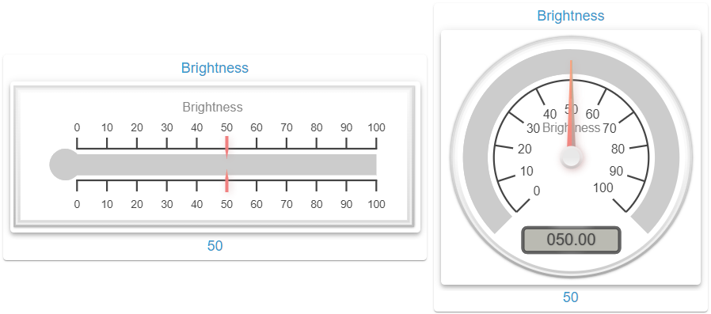

# Gauge Widget

## Beschreibung

Das Gauge Widget zeigt den Wert einer OID vom Typ `number` als lineares oder radiales Instrument. Es zeichnet auf einem Canvas mit der Bibliothek canvas-gauges und schreibt nie in die OID, deshalb hat es keine Felder aus [Wert schreiben](De-Home.md#wert-schreiben).

**Hinweis:** Die Felder liegen in der Gruppe **Gauge**. Das Panel zeigt die Abschnitte des gewählten Gauge-Typs, die Abschnitte unter [Gemeinsame Einstellungen](#gemeinsame-einstellungen) immer. Die Tabellen stehen in der Reihenfolge des Panels, nur die Felder der beiden Typen stehen hier getrennt.

## Einstellungshierarchie

Dieses Widget nutzt alle **vis-2 Einstellungen** und **Common Einstellungen**. Siehe [Home](De-Home.md) für Details.

Die Widget-spezifischen Einstellungen überschreiben die allgemeineren Einstellungen. Die Zustandszeilen bilden hier [Highlight-Zonen](#highlight-zonen). Abweichend von [Home](De-Home.md) gilt:

- **Canvas-Titel**: Das Canvas zeichnet den Text aus `header` zusätzlich als Titel, ohne HTML und mit dem Objektnamen als Rückfall. `noHeader` blendet nur die Kopfzeile des Rahmens aus, der Titel bleibt. Besteht `header` nur aus Markup wie `&nbsp;`, entfällt der Titel.
- **Eck-Icon**: Es zeigt das Icon der aktiven Highlight-Zone. Ohne aktive Zone gibt es keines, auch nicht mit gesetztem `icon`.
- **Icon-Felder**: `iconSize`, `iconXOffset`, `iconYOffset` und `enableIconColorMask` betreffen nur das Eck-Icon.
- **Textfarbe**: `textColor` färbt Kopf- und Fußzeile und ist Rückfall für die Bögen der Zonen. Die Beschriftung auf dem Canvas folgt nicht `textColor`, siehe [Farben](#farben).
- **Schrift**: Die Felder aus [CSS Font & Text](De-Home.md#css-font--text) außer `color` erreichen das Canvas nicht, dort gelten die [Schriftart-Anpassungen](#schriftart-anpassungen).
- **Werttextgröße**: `valueSize` und `valueSize{n}` haben keine Wirkung, die Größe des Werts kommt aus `gaugeFontValueSize`.

## Grundeinstellungen

| Feldname                      | Typ                                 | Standard  | Beschreibung                                                                                                      | Bedingung                      |
| ----------------------------- | ----------------------------------- | --------- | ----------------------------------------------------------------------------------------------------------------- | ------------------------------ |
| Objekt-ID `oid`               | id                                  | -         | Haupt-OID, nur Typ `number`. Bei einem anderen Typ zeigt der Rahmen einen Hinweis statt des Instruments           | -                              |
| Einheit `unit`                | text                                | -         | Einheit auf dem Canvas. Die Wahl der OID setzt sie aus dem Objekt, das Feld überschreibt sie. Leer: keine Einheit | Nur sichtbar mit gewählter OID |
| Typ `gaugeType`               | select (`linear`, `radial`)         | `linear`  | Gauge-Typ. Gespeicherte Werte des anderen Typs bleiben erhalten                                                   | -                              |
| Minimalwert `gaugeMinValue`   | number                              | -         | Untere Grenze der Skala. Leer: `common.min` des Objekts, ohne Angabe dort 0                                       | -                              |
| Maximalwert `gaugeMaxValue`   | number                              | -         | Obere Grenze der Skala. Leer: `common.max` des Objekts, ohne Angabe dort 100                                      | -                              |
| Abstand `gaugePadding`        | number (ab 0)                       | 8         | Wird in px von Breite und Höhe der Inhaltsfläche abgezogen                                                        | -                              |
| Icon-Anpassung `gaugeIconFit` | select (`contain`, `cover`, `fill`) | `contain` | `object-fit` des Icons hinter dem Canvas, siehe [Highlight-Zonen](#highlight-zonen)                               | -                              |

- **Bereich aus dem Objekt**: Die Wahl der OID übernimmt `common.min` und `common.max` als Kopie. Eine spätere Änderung am Objekt gilt erst nach der nächsten OID-Wahl. Ein gesetztes `gaugeMinValue` oder `gaugeMaxValue` hat immer Vorrang, auch `0`.
- **Wert**: Ein numerischer String zählt als Zahl, alles andere als 0, auch ein fehlender Wert.
- **Wert außerhalb des Bereichs**: Zeiger und Balken stoppen am Bereichsende; radial mit `gaugeTicksAngle` 360 läuft der Zeiger weiter. Keine Highlight-Zone ist aktiv.
- **Leere Felder**: Ein leeres oder nicht numerisches Zahlenfeld gilt als sein Standard, ebenso ein leeres Auswahl- oder Schriftfeld. `0` bleibt `0`.
- **Größe**: Das Canvas füllt die Inhaltsfläche abzüglich `gaugePadding`. Sind Breite oder Höhe des Canvas 30 px oder kleiner, aktualisiert es sich nicht, auch nicht der Wert. Nach dem Vergrößern holt es den letzten Stand nach.
- **Neuzeichnen**: Das Canvas zeichnet nur neu, wenn sich der Inhalt der Einstellungen oder der Wert ändert, nicht schon beim Verschieben im Editor.

## Linear Gauge Einstellungen

### Rahmenoptionen (linear)

| Feldname                        | Typ           | Standard | Beschreibung                | Bedingung                    |
| ------------------------------- | ------------- | -------- | --------------------------- | ---------------------------- |
| Eckenradius `gaugeBorderRadius` | number (ab 0) | 0        | Eckenradius der Rahmenringe | Nur bei `gaugeType` `linear` |

### Fortschrittsbalken-Optionen (linear)

| Feldname                                       | Typ           | Standard | Beschreibung                                                  | Bedingung                    |
| ---------------------------------------------- | ------------- | -------- | ------------------------------------------------------------- | ---------------------------- |
| Anfangskreis des Balkens `gaugeBarBeginCircle` | number (ab 0) | 30       | Größe des Kreises am Balkenanfang in Prozent. `0`: kein Kreis | Nur bei `gaugeType` `linear` |
| Balkenlänge `gaugeBarLength`                   | number (ab 0) | 85       | Länge des Balkens in Prozent der Längsseite                   | Nur bei `gaugeType` `linear` |

### Farboptionen (linear)

| Feldname                                                        | Typ   | Standard | Beschreibung                                                      | Bedingung                    |
| --------------------------------------------------------------- | ----- | -------- | ----------------------------------------------------------------- | ---------------------------- |
| Balkenfarbe (Ende) `gaugeColorBarEnd`                           | color | -        | Endfarbe des Verlaufs ab `gaugeColorBar`. Leer: einfarbig         | Nur bei `gaugeType` `linear` |
| Farbe des Fortschrittsbalkens (Ende) `gaugeColorBarProgressEnd` | color | -        | Endfarbe des Verlaufs ab `gaugeColorBarProgress`. Leer: einfarbig | Nur bei `gaugeType` `linear` |

### Elementpositionierung (linear)

| Feldname                      | Typ                              | Standard | Beschreibung                      | Bedingung                    |
| ----------------------------- | -------------------------------- | -------- | --------------------------------- | ---------------------------- |
| Strichseite `gaugeTickSide`   | select (`both`, `left`, `right`) | `both`   | Seite des Balkens für die Striche | Nur bei `gaugeType` `linear` |
| Zeigerseite `gaugeNeedleSide` | select (`both`, `left`, `right`) | `both`   | Seite des Balkens für den Zeiger  | Nur bei `gaugeType` `linear` |
| Zahlenseite `gaugeNumberSide` | select (`both`, `left`, `right`) | `both`   | Seite des Balkens für die Zahlen  | Nur bei `gaugeType` `linear` |

### Skalenstrich-Optionen (linear)

| Feldname                                                | Typ           | Standard | Beschreibung                              | Bedingung                    |
| ------------------------------------------------------- | ------------- | -------- | ----------------------------------------- | ---------------------------- |
| Strichbreite `gaugeTicksWidth`                          | number (ab 0) | 10       | Ausdehnung der Hauptstriche in Prozent    | Nur bei `gaugeType` `linear` |
| Strichbreite der Zwischenstriche `gaugeTicksWidthMinor` | number (ab 0) | 5        | Ausdehnung der Zwischenstriche in Prozent | Nur bei `gaugeType` `linear` |
| Strichabstand `gaugeTicksPadding`                       | number (ab 0) | 5        | Abstand der Striche vom Balken in Prozent | Nur bei `gaugeType` `linear` |

## Radial Gauge Einstellungen

### Skalenstrich-Optionen (radial)

| Feldname                       | Typ            | Standard | Beschreibung                                                                | Bedingung                    |
| ------------------------------ | -------------- | -------- | --------------------------------------------------------------------------- | ---------------------------- |
| Skalenwinkel `gaugeTicksAngle` | number (0-360) | 270      | Länge des Skalenbogens in Grad                                              | Nur bei `gaugeType` `radial` |
| Startwinkel `gaugeStartAngle`  | number (0-360) | 45       | Beginn der Skala in Grad. 0 zeigt nach unten, gezählt wird im Uhrzeigersinn | Nur bei `gaugeType` `radial` |

### Farboptionen (radial)

| Feldname                                                                | Typ   | Standard  | Beschreibung                                   | Bedingung                    |
| ----------------------------------------------------------------------- | ----- | --------- | ---------------------------------------------- | ---------------------------- |
| Farbe des äußeren Zeigerkreises `gaugeColorNeedleCircleOuter`           | color | `#f0f0f0` | Startfarbe des Verlaufs im äußeren Zeigerkreis | Nur bei `gaugeType` `radial` |
| Farbe des äußeren Zeigerkreises (Ende) `gaugeColorNeedleCircleOuterEnd` | color | `#ccc`    | Endfarbe des Verlaufs im äußeren Zeigerkreis   | Nur bei `gaugeType` `radial` |
| Farbe des inneren Zeigerkreises `gaugeColorNeedleCircleInner`           | color | `#e8e8e8` | Startfarbe des Verlaufs im inneren Zeigerkreis | Nur bei `gaugeType` `radial` |
| Farbe des inneren Zeigerkreises (Ende) `gaugeColorNeedleCircleInnerEnd` | color | `#f5f5f5` | Endfarbe des Verlaufs im inneren Zeigerkreis   | Nur bei `gaugeType` `radial` |

### Zeigeroptionen (radial)

| Feldname                                     | Typ           | Standard | Beschreibung                                                                       | Bedingung                    |
| -------------------------------------------- | ------------- | -------- | ---------------------------------------------------------------------------------- | ---------------------------- |
| Zeigerkreisgröße `gaugeNeedleCircleSize`     | number (ab 0) | 10       | Größe des äußeren Kreises in Prozent, der innere hat drei Viertel. `0`: kein Kreis | Nur bei `gaugeType` `radial` |
| Innerer Zeigerkreis `gaugeNeedleCircleInner` | checkbox      | true     | Zeichnet den inneren Kreis                                                         | Nur bei `gaugeType` `radial` |
| Äußerer Zeigerkreis `gaugeNeedleCircleOuter` | checkbox      | true     | Zeichnet den äußeren Kreis                                                         | Nur bei `gaugeType` `radial` |

### Animationsoptionen (radial)

| Feldname                                  | Typ                        | Standard | Beschreibung                                                                                        | Bedingung                    |
| ----------------------------------------- | -------------------------- | -------- | --------------------------------------------------------------------------------------------------- | ---------------------------- |
| Animationsziel `gaugeAnimationTarget`     | select (`needle`, `plate`) | `needle` | `needle`: Der Zeiger bewegt sich. `plate`: Die Skala dreht sich, der Zeiger steht                   | Nur bei `gaugeType` `radial` |
| Kürzesten Weg verwenden `gaugeUseMinPath` | checkbox                   | false    | Der Zeiger nimmt den kürzeren Weg. Wirkt nur mit `gaugeTicksAngle` 360 und aktivem `gaugeAnimation` | Nur bei `gaugeType` `radial` |

## Gemeinsame Einstellungen

### Skalenstrich-Optionen

| Feldname                                               | Typ      | Standard | Beschreibung                                                                                                                      | Bedingung |
| ------------------------------------------------------ | -------- | -------- | --------------------------------------------------------------------------------------------------------------------------------- | --------- |
| Exakte Strichpositionen `gaugeExactTicks`              | checkbox | false    | Setzt die Hauptstriche nach ihrem Wert statt gleichmäßig. `gaugeMinorTicks` zählt dann als Abstand in Werteinheiten               | -         |
| Hauptstriche `gaugeMajorTicks`                         | number   | 10       | Anzahl der Abschnitte, gleichmäßig über den Bereich und auf zwei Stellen gerundet. `0` oder kleiner: nur Minimal- und Maximalwert | -         |
| Zwischenstriche `gaugeMinorTicks`                      | number   | 0        | Unterteilung je Abschnitt. `0`: keine Zwischenstriche                                                                             | -         |
| Strichlinie `gaugeStrokeTicks`                         | checkbox | true     | Zeichnet eine Linie entlang der Striche                                                                                           | -         |
| Vorkommastellen der Hauptstriche `gaugeMajorTicksInt`  | number   | 1        | Mindestzahl der Vorkommastellen. Wirkt nur bei `gaugeMajorTicks` `0` oder kleiner                                                 | -         |
| Nachkommastellen der Hauptstriche `gaugeMajorTicksDec` | number   | 0        | Zahl der Nachkommastellen. Wirkt nur bei `gaugeMajorTicks` `0` oder kleiner                                                       | -         |
| Breite der Hervorhebungen `gaugeHighlightsWidth`       | number   | 15       | Breite der Bögen der [Highlight-Zonen](#highlight-zonen) in Prozent. `0`: keine Bögen                                             | -         |
| Zahlenabstand `gaugeNumbersMargin`                     | number   | 1        | Abstand der Zahlen von den Strichen in Prozent                                                                                    | -         |

### Fortschrittsbalken-Optionen

| Feldname                                     | Typ           | Standard | Beschreibung                                                                                  | Bedingung |
| -------------------------------------------- | ------------- | -------- | --------------------------------------------------------------------------------------------- | --------- |
| Balkenbreite `gaugeBarWidth`                 | number (0-50) | 20       | Breite des Balkens in Prozent. Ein gespeicherter größerer Wert zählt als 50. `0`: kein Balken | -         |
| Randbreite des Balkens `gaugeBarStrokeWidth` | number (ab 0) | 0        | Breite des Balkenrands. Linear: Ab `gaugeBarWidth` gilt die Hälfte von `gaugeBarWidth`        | -         |
| Balkenfortschritt `gaugeBarProgress`         | checkbox      | true     | Füllt den Balken bis zum Wert                                                                 | -         |
| Balkenschatten `gaugeBarShadow`              | number (ab 0) | 0        | Unschärfe des Schattens im Balken. Wirkt nur radial                                           | -         |

### Animationsoptionen

| Feldname                                           | Typ                                                                                                                      | Standard | Beschreibung                                                                      | Bedingung |
| -------------------------------------------------- | ------------------------------------------------------------------------------------------------------------------------ | -------- | --------------------------------------------------------------------------------- | --------- |
| Animation `gaugeAnimation`                         | checkbox                                                                                                                 | true     | Animiert Wertänderungen. Aus: Die Anzeige springt auf den Wert                    | -         |
| Animationsdauer `gaugeAnimationDuration`           | number (ab 0)                                                                                                            | 500      | Dauer in Millisekunden                                                            | -         |
| Animationsregel `gaugeAnimationRule`               | select (`linear`, `quad`, `quint`, `cycle`, `bounce`, `elastic`, `dequad`, `dequint`, `decycle`, `debounce`, `delastic`) | `cycle`  | Verlauf der Animation                                                             | -         |
| Animierter Wert `gaugeAnimatedValue`               | checkbox                                                                                                                 | false    | Die Wertebox zählt während der Animation mit, sonst zeigt sie gleich den Zielwert | -         |
| Beim Initialisieren animieren `gaugeAnimateOnInit` | checkbox                                                                                                                 | false    | Animiert beim Anlegen des Canvas vom Minimalwert zum Wert                         | -         |

### Farboptionen

Das Verhalten beschreibt der Abschnitt [Farben](#farben).

| Feldname                                                     | Typ                                | Standard                 | Beschreibung                                                                       | Bedingung |
| ------------------------------------------------------------ | ---------------------------------- | ------------------------ | ---------------------------------------------------------------------------------- | --------- |
| Zifferblattfarbe `gaugeColorPlate`                           | color                              | `rgba(0,0,0,0)`          | Startfarbe des Zifferblatts                                                        | -         |
| Zifferblattfarbe (Ende) `gaugeColorPlateEnd`                 | color                              | `rgba(0,0,0,0)`          | Endfarbe des Zifferblatts. Für eine einfarbige Fläche beide Felder gleich setzen   | -         |
| Farbe der Hauptstriche `gaugeColorMajorTicks`                | color                              | -                        | Ohne Wert `color` des Widgets, sonst Textfarbe des Themes                          | -         |
| Farbe der Zwischenstriche `gaugeColorMinorTicks`             | color                              | -                        | Ohne Wert `color` des Widgets, sonst Textfarbe des Themes                          | -         |
| Farbe der Strichlinie `gaugeColorStrokeTicks`                | color                              | -                        | Ohne Wert `color` des Widgets, sonst Textfarbe des Themes                          | -         |
| Titelfarbe `gaugeColorTitle`                                 | color                              | -                        | Farbe des Canvas-Titels. Ohne Wert `color` des Widgets, sonst Textfarbe des Themes | -         |
| Einheitenfarbe `gaugeColorUnits`                             | color                              | -                        | Ohne Wert `color` des Widgets, sonst Textfarbe des Themes                          | -         |
| Zahlenfarbe `gaugeColorNumbers`                              | color                              | -                        | Ohne Wert `color` des Widgets, sonst Textfarbe des Themes                          | -         |
| Zeigerfarbe `gaugeColorNeedle`                               | color                              | -                        | Startfarbe des Zeigers. Ohne Wert die Primärfarbe des Themes                       | -         |
| Zeigerfarbe (Ende) `gaugeColorNeedleEnd`                     | color                              | -                        | Endfarbe des Zeigers. Ohne Wert die Primärfarbe des Themes                         | -         |
| Wertetextfarbe `gaugeColorValueText`                         | color                              | `#444`                   | Text in der Wertebox                                                               | -         |
| Schattenfarbe des Wertetextes `gaugeColorValueTextShadow`    | color                              | `rgba(0,0,0,0.3)`        | Wirkt mit `gaugeValueTextShadow`                                                   | -         |
| Rahmenschattenfarbe `gaugeColorBorderShadow`                 | color                              | `rgba(0,0,0,0.5)`        | Wirkt mit `gaugeBorderShadowWidth`                                                 | -         |
| Farbe des Außenrahmens `gaugeColorBorderOuter`               | color                              | `#ddd`                   | Startfarbe des Außenrahmens                                                        | -         |
| Farbe des Außenrahmens (Ende) `gaugeColorBorderOuterEnd`     | color                              | `#aaa`                   | Endfarbe des Außenrahmens                                                          | -         |
| Farbe des Mittelrahmens `gaugeColorBorderMiddle`             | color                              | `#eee`                   | Startfarbe des Mittelrahmens                                                       | -         |
| Farbe des Mittelrahmens (Ende) `gaugeColorBorderMiddleEnd`   | color                              | `#f0f0f0`                | Endfarbe des Mittelrahmens                                                         | -         |
| Farbe des Innenrahmens `gaugeColorBorderInner`               | color                              | `#fafafa`                | Startfarbe des Innenrahmens                                                        | -         |
| Farbe des Innenrahmens (Ende) `gaugeColorBorderInnerEnd`     | color                              | `#ccc`                   | Endfarbe des Innenrahmens                                                          | -         |
| Randfarbe der Wertebox `gaugeColorValueBoxRect`              | color                              | `#888`                   | Startfarbe des Wertebox-Rands                                                      | -         |
| Randfarbe der Wertebox (Ende) `gaugeColorValueBoxRectEnd`    | color                              | `#666`                   | Endfarbe des Wertebox-Rands                                                        | -         |
| Hintergrundfarbe der Wertebox `gaugeColorValueBoxBackground` | color                              | `#babab2`                | Fläche der Wertebox                                                                | -         |
| Schattenfarbe der Wertebox `gaugeColorValueBoxShadow`        | color                              | `rgba(0,0,0,1)`          | Schatten der Wertebox                                                              | -         |
| Zeigerschattenfarbe (oben) `gaugeColorNeedleShadowUp`        | color                              | `rgba(2,255,255,0.2)`    | Seitenfläche des Zeigers. Wirkt nur radial mit `gaugeNeedleType` `arrow`           | -         |
| Zeigerschattenfarbe (unten) `gaugeColorNeedleShadowDown`     | color                              | `rgba(188,143,143,0.45)` | Schatten des Zeigers, wirkt mit `gaugeNeedleShadow`                                | -         |
| Balkenrandfarbe `gaugeColorBarStroke`                        | color                              | `#222`                   | Wirkt mit `gaugeBarStrokeWidth`                                                    | -         |
| Balkenfarbe `gaugeColorBar`                                  | color                              | `#ccc`                   | Nicht gefüllter Teil des Balkens                                                   | -         |
| Farbe des Fortschrittsbalkens `gaugeColorBarProgress`        | color                              | -                        | Gefüllter Teil des Balkens. Ohne Wert die Primärfarbe des Themes                   | -         |
| Linienenden der Hervorhebungen `gaugeHighlightsLineCap`      | select (`butt`, `round`, `square`) | `butt`                   | Enden der Bögen der [Highlight-Zonen](#highlight-zonen). Wirkt nur radial          | -         |

### Zeigerkonfiguration

| Feldname                           | Typ                      | Standard | Beschreibung                      | Bedingung |
| ---------------------------------- | ------------------------ | -------- | --------------------------------- | --------- |
| Zeiger `gaugeNeedle`               | checkbox                 | true     | Zeichnet den Zeiger               | -         |
| Zeigerschatten `gaugeNeedleShadow` | checkbox                 | true     | Zeichnet den Schatten des Zeigers | -         |
| Zeigertyp `gaugeNeedleType`        | select (`arrow`, `line`) | `arrow`  | Form des Zeigers                  | -         |
| Zeigeranfang `gaugeNeedleStart`    | number (0-100)           | 5        | Beginn des Zeigers in Prozent     | -         |
| Zeigerende `gaugeNeedleEnd`        | number (0-100)           | 85       | Ende des Zeigers in Prozent       | -         |
| Zeigerbreite `gaugeNeedleWidth`    | number                   | 4        | Breite des Zeigers                | -         |

### Rahmenoptionen

| Feldname                                      | Typ           | Standard | Beschreibung                                                                                          | Bedingung |
| --------------------------------------------- | ------------- | -------- | ----------------------------------------------------------------------------------------------------- | --------- |
| Rahmen `gaugeBorders`                         | checkbox      | true     | Aus: Außen-, Mittel- und Innenrahmen entfallen, ihre Breiten bleiben gespeichert. Der Schatten bleibt | -         |
| Außenrahmenbreite `gaugeBorderOuterWidth`     | number (ab 0) | 3        | Breite in px                                                                                          | -         |
| Mittelrahmenbreite `gaugeBorderMiddleWidth`   | number (ab 0) | 3        | Breite in px                                                                                          | -         |
| Innenrahmenbreite `gaugeBorderInnerWidth`     | number (ab 0) | 3        | Breite in px                                                                                          | -         |
| Rahmenschattenbreite `gaugeBorderShadowWidth` | number (ab 0) | 3        | Unschärfe des Rahmenschattens                                                                         | -         |

### Wertebox-Optionen

| Feldname                                             | Typ                        | Standard | Beschreibung                                                       | Bedingung |
| ---------------------------------------------------- | -------------------------- | -------- | ------------------------------------------------------------------ | --------- |
| Wertebox `gaugeValueBox`                             | checkbox                   | true     | Zeichnet die Wertebox                                              | -         |
| Randbreite der Wertebox `gaugeValueBoxStroke`        | number (ab 0)              | 5        | Breite des Rands in Prozent. `0`: kein Rand                        | -         |
| Breite der Wertebox `gaugeValueBoxWidth`             | number (ab 0)              | 0        | Mindestbreite in Prozent. `0`: so breit wie der Text               | -         |
| Wertetext `gaugeValueText`                           | text                       | -        | Fester Text statt des Werts. Leer: der Wert                        | -         |
| Wertetext-Schatten `gaugeValueTextShadow`            | checkbox                   | true     | Zeichnet den Schatten des Texts                                    | -         |
| Eckenradius der Wertebox `gaugeValueBoxBorderRadius` | number (ab 0, Schritt 0.1) | 2.5      | Radius der Ecken in Prozent                                        | -         |
| Vorkommastellen des Wertes `gaugeValueInt`           | number (ab 0)              | 3        | Mindestzahl der Stellen, aufgefüllt mit Nullen: `21` wird zu `021` | -         |
| Nachkommastellen des Wertes `gaugeValueDec`          | number (ab 0)              | 2        | Zahl der Nachkommastellen                                          | -         |

### Schriftart-Anpassungen

| Feldname                                          | Typ                                                             | Standard                       | Beschreibung         | Bedingung |
| ------------------------------------------------- | --------------------------------------------------------------- | ------------------------------ | -------------------- | --------- |
| Schriftart der Zahlen `gaugeFontNumbers`          | fontname                                                        | `Arial, Helvetica, sans-serif` | Zahlen der Skala     | -         |
| Schriftart des Titels `gaugeFontTitle`            | fontname                                                        | `Arial, Helvetica, sans-serif` | Canvas-Titel         | -         |
| Schriftart der Einheit `gaugeFontUnits`           | fontname                                                        | `Arial, Helvetica, sans-serif` | Einheit              | -         |
| Schriftart des Wertes `gaugeFontValue`            | fontname                                                        | `Arial, Helvetica, sans-serif` | Wert in der Wertebox | -         |
| Schriftgröße der Zahlen `gaugeFontNumbersSize`    | number (ab 0)                                                   | 20                             | Zahlen der Skala     | -         |
| Schriftgröße des Titels `gaugeFontTitleSize`      | number (ab 0)                                                   | 24                             | Canvas-Titel         | -         |
| Schriftgröße der Einheit `gaugeFontUnitsSize`     | number (ab 0)                                                   | 22                             | Einheit              | -         |
| Schriftgröße des Wertes `gaugeFontValueSize`      | number (ab 0)                                                   | 26                             | Wert in der Wertebox | -         |
| Schriftstil der Zahlen `gaugeFontNumbersStyle`    | select (`normal`, `italic`, `oblique`)                          | `normal`                       | Zahlen der Skala     | -         |
| Schriftstil des Titels `gaugeFontTitleStyle`      | select (`normal`, `italic`, `oblique`)                          | `normal`                       | Canvas-Titel         | -         |
| Schriftstil der Einheit `gaugeFontUnitsStyle`     | select (`normal`, `italic`, `oblique`)                          | `normal`                       | Einheit              | -         |
| Schriftstil des Wertes `gaugeFontValueStyle`      | select (`normal`, `italic`, `oblique`)                          | `normal`                       | Wert in der Wertebox | -         |
| Schriftstärke der Zahlen `gaugeFontNumbersWeight` | select (`normal`, `bold`, `bolder`, `lighter`, `100` bis `900`) | `normal`                       | Zahlen der Skala     | -         |
| Schriftstärke des Titels `gaugeFontTitleWeight`   | select (`normal`, `bold`, `bolder`, `lighter`, `100` bis `900`) | `normal`                       | Canvas-Titel         | -         |
| Schriftstärke der Einheit `gaugeFontUnitsWeight`  | select (`normal`, `bold`, `bolder`, `lighter`, `100` bis `900`) | `normal`                       | Einheit              | -         |
| Schriftstärke des Wertes `gaugeFontValueWeight`   | select (`normal`, `bold`, `bolder`, `lighter`, `100` bis `900`) | `normal`                       | Wert in der Wertebox | -         |

## Gauge-Typen

### Linear Gauge

- Balken mit Fortschritt und Zeiger
- Ausrichtung nach dem Canvas: vertikal, wenn die Höhe mindestens der Breite entspricht, sonst horizontal
- Striche, Zeiger und Zahlen wahlweise auf einer oder beiden Seiten des Balkens
- Farbverlauf für Balken und Fortschritt
- Kreis am Balkenanfang über `gaugeBarBeginCircle`

### Radial Gauge

- Kreisförmiges Instrument (Tacho-Stil)
- Zeiger zeigt auf den aktuellen Wert
- Konfigurierbare Winkel (Standard: von 45° bis 315° = 270° Bogen)
- Striche mit Zahlen, Fortschrittsbogen in einer Farbe
- Animiert wahlweise den Zeiger oder die Skala

## Styling-Optionen

### Farben

- **Vollfarben**: Das Canvas zeichnet nur Vollfarben. Ein Gradient zeichnet die Farbe aus seiner Mitte, `var(…)` und andere vom Widget abhängige Farben berechnet das Widget vorher. Ein Wert, der sich nicht auflösen lässt, gilt als leer.
- **Standardfarben**: Ein leeres Farbfeld mit festem Standard nimmt diesen Standard, unabhängig vom Theme.
- **Geerbte Farben**: Hauptstriche, Zwischenstriche, Strichlinie, Titel, Einheit und Zahlen nehmen ohne Wert `color` aus [CSS Font & Text](De-Home.md#css-font--text), sonst die Textfarbe des Themes. Zeiger und Fortschrittsbalken nehmen die Primärfarbe des Themes.
- **Verläufe**: Zifferblatt, Zeiger, Zeigerkreise, Rahmenringe und Wertebox-Rand zeichnen einen Verlauf von der Start- zur Endfarbe. Das leere Zifferblatt-Ende fällt auf seinen Standard zurück, eine einzelne Zifferblattfarbe läuft deshalb ins Transparente aus.
- **Hintergrund**: Eigene Farbe `gaugeColorBar` für den nicht gefüllten Bereich. Mit dem transparenten Standard-Zifferblatt scheint die Inhaltsfläche durch.
- **Striche**: Eigene Farben für Hauptstriche, Zwischenstriche, Strichlinie und Zahlen.

### Schriftarten

- Je eigene Schriftart, Größe, Stil und Stärke für Zahlen, Titel, Einheit und Wert
- Die Schriftgrößen skalieren mit der Größe des Canvas
- Der Titel ist der Canvas-Titel, siehe [Einstellungshierarchie](#einstellungshierarchie)

### Animationen

- Für beide Gauge-Typen verfügbar
- Verschiedene Verläufe über `gaugeAnimationRule` (linear, quad, bounce, elastic, etc.)
- Konfigurierbare Dauer
- Nur radial: `gaugeAnimationTarget` und `gaugeUseMinPath`

### Highlight-Zonen

Die Zustandszeilen in der Gruppe **Werte** bilden die Highlight-Zonen, siehe [Value-spezifische Einstellungen](De-Home.md#value-spezifische-einstellungen). Ohne Zeile mit Wert gibt es keine Zone.

- **Bereich**: Eine Zone beginnt bei `value{n}` und reicht bis zum Wert der nächsten Zeile, die letzte bis zum Maximalwert. Die Zeilen müssen aufsteigend stehen, eine Zone mit kleinerer Obergrenze wird nie aktiv.
- **Grenzen**: Die Untergrenze gehört zur Zone, die Obergrenze zur nächsten. Der Maximalwert selbst gehört zur Zone, die dort endet; steht die letzte Zeile genau darauf, ist das die Zone davor. `0` ist eine echte Grenze.
- **Keine aktive Zone**: Unter der ersten Zeile und über dem Maximalwert gelten die Basisfarben, und beide Icons entfallen.
- **Bogen**: Jede Zone zeichnet einen Bogen in `textColor{n}`, ohne Wert in `textColor`, `color` oder der Textfarbe des Themes. Ein Wert, der sich nicht auflösen lässt, zeichnet transparent. Die Bögen werden nicht auf den Bereich begrenzt.
- **Flächen**: Die aktive Zone färbt Rahmenfläche und Inhaltsfläche mit `frameBackground{n}` und `background{n}`, ohne Wert gilt das Basisfeld.
- **Icon**: Die aktive Zone zeigt `icon{n}` oder `iconSmall{n}`, sonst `icon` oder `iconSmall`, als Eck-Icon und zentriert hinter dem Canvas. Dort scheint es nur durch ein transparentes Zifferblatt. `noHeaderIcon` blendet nur das Eck-Icon aus.
- **Icon hinter dem Canvas**: `iconSize{n}` setzt Breite und Höhe in Prozent, ohne Wert 100 %. `iconXOffset{n}` verschiebt positiv nach rechts, `iconYOffset{n}` positiv nach oben, `gaugeIconFit` legt die Einpassung fest. Die Farbe kommt aus `iconColor{n}` und `enableIconColorMask{n}`.
- **Nur bei exaktem Treffer**: `header{n}`, `headerSize{n}`, `footer{n}`, `footerSize{n}` und `alias{n}` folgen dem aktiven Zustand, nicht der Zone. Sie wirken nur, solange der Wert genau `value{n}` entspricht. Die Fußzeile einer Zeile erscheint also nur auf deren Grenze.
- **Wertebox**: Alias und Zeilenwert erreichen sie nicht, sie zeigt `gaugeValueText` oder den formatierten Wert.

## Anwendungsbeispiele

### Linear Gauge

- **Batteriestand**: `gaugeMinValue` 0, `gaugeMaxValue` 100, Verlauf `gaugeColorBarProgress` `#f44336` nach `gaugeColorBarProgressEnd` `#4caf50`
- **Lautstärke**: 0-100, `gaugeTickSide`, `gaugeNeedleSide` und `gaugeNumberSide` `left`, `gaugeValueBox` aus
- **Download-Fortschritt**: 0-100, `gaugeMajorTicks` 4 ergibt Striche bei 25/50/75
- **Füllstand**: 0-100, Widget höher als breit für die vertikale Ausrichtung, `gaugeBarBeginCircle` 0

### Radial Gauge

- **Temperatur**: `gaugeMinValue` -20, `gaugeMaxValue` 40, `gaugeMajorTicks` 6, Zonen `value1` -20 mit `textColor1` `#2196f3` und `value2` 25 mit `textColor2` `#f44336`
- **Geschwindigkeit**: 0-200 km/h, `gaugeMajorTicks` 10, `gaugeNeedleType` `arrow`
- **Leistung**: 0-3000 W, `gaugeMajorTicks` 6 ergibt Striche alle 500 W, `gaugeValueDec` 0
- **Luftfeuchtigkeit**: 0-100 %, `gaugeNeedleCircleSize` 15 für eine größere Kreis-Basis des Zeigers
