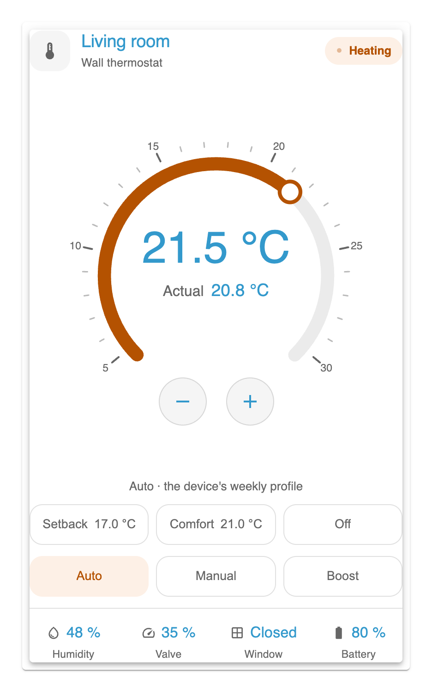

# Raumthermostat

## Beschreibung

Der Raumthermostat zeigt und stellt die Heizung eines Raums: Sollwert, Ist-Temperatur, Luftfeuchte, Ventil, Fenster, Batterie und den Zustand des Thermostats. Bedient wird über einen Ring, ± und Pills für Absenk-, Komfort- und Aus-Temperatur, Betriebsart und Boost. Er ist der erste Typ der Heizungs-Widgets.

Das Widget kennt keine Gerätetechnik. Es liest die gespeicherten Bindungen und Wertezuordnungen und schreibt nur in Datenpunkte, die schreibbar sind. Technikwissen steckt an genau einer Stelle, der Hinweistabelle, die beim Vorfüllen im Editor hilft (siehe [Rollen-Weg und Hinweistabelle](#rollen-weg-und-hinweistabelle)).

## Voraussetzungen und Palette

- **vis-2 2.20.5 oder neuer.** Die Heizungs-Widgets bilden ein eigenes Set, das ältere vis-2-Versionen nicht laden.
- **Palette:** Gruppe „Widget-Sammlung · Heizung“, technischer Name des Sets `vis-2-widgets-collection-heating`. Die übrigen Collection-Widgets und das Theme-Studio stehen weiter in der Gruppe „Widget-Sammlung“ (`vis-2-widgets-collection`).
- **Startgröße:** 440 × 700 px, unabhängig von der Breite der View. Damit startet das Widget in der vollen Anordnung. Im Raster-Layout belegt es eine Sektionsspalte, die Höhe von 700 px ergibt 11 Rasterzeilen.

## Einstellungshierarchie

Dieses Widget nutzt die **vis-2 Einstellungen** und die **Common Einstellungen** mit dem [Widget-Rahmen](De-Home.md#widget-rahmen), siehe [Home](De-Home.md). Einige Common-Einstellungen blendet es aus, siehe [Rahmen und ausgeblendete Felder](#rahmen-und-ausgeblendete-felder).

Eigene Einstellungen stehen in zwei Gruppen: der Bindung (Datenpunkte, Wertezuordnungen, Bezeichnung, Ventile) und den Widget-Werten (`komfort`, `absenk`, `ansicht`, `inhaltsabstand`).

## Binden und Vorfüllen

### Die Bedeutungen

Jede Bedeutung des Thermostats hat ein eigenes Datenpunkt-Feld. Pflicht ist nur der Sollwert `soll`, alle übrigen sind optional. Eine ungebundene Bedeutung entfällt in der Anzeige.

| Feld                   | Bedeutung                                | Werttyp        | Wertezuordnung     |
| ---------------------- | ---------------------------------------- | -------------- | ------------------ |
| `soll`                 | Sollwert (Pflicht)                       | Zahl           | –                  |
| `ist`                  | Ist-Temperatur                           | Zahl           | –                  |
| `luftfeuchte`          | Luftfeuchte                              | Zahl           | –                  |
| `betriebsart`          | Betriebsart, gelesen                     | beliebig       | ja                 |
| `betriebsartSetzen`    | Betriebsart, nur geschrieben             | beliebig       | ja                 |
| `boost`                | Boost an/aus                             | beliebig       | ja                 |
| `boostBeenden`         | beendet einen laufenden Boost            | beliebig       | ja                 |
| `boostRestzeit`        | Boost-Restzeit oder -Endzeitpunkt        | Zahl oder Text | Einheit/Zeitformat |
| `urlaub`               | Urlaub an/aus                            | beliebig       | ja                 |
| `urlaubEnde`           | Ende des Urlaubs                         | Zahl oder Text | Zeitformat         |
| `fenster`              | Fenster                                  | beliebig       | ja                 |
| `batterieSchwach`      | Batterie schwach                         | beliebig       | ja                 |
| `batteriestand`        | Batteriestand                            | Zahl           | –                  |
| `erreichbarkeit`       | Erreichbarkeit des Geräts                | beliebig       | ja                 |
| `ventil1`, `ventil2` … | Ventilöffnung, siehe [Ventile](#ventile) | Zahl           | –                  |

Ohne gebundenen Sollwert zeigt das Widget den Hinweis „Sollwert-Datenpunkt wählen“, bei einem Sollwert anderen Typs „Der Sollwert-Datenpunkt muss eine Zahl sein“. Der allgemeine OID-Hinweis des Rahmens erscheint hier nicht.

### Vorfüllen beim Pick des Sollwerts

Wählst du im Editor den Sollwert-Datenpunkt, liest das Widget alle Kanäle des Geräts, zu dem er gehört, und füllt die übrigen Bedeutungen samt Wertezuordnung vor. Dabei gilt:

- **Nur leere Felder:** Gesetzte Felder, Zuordnungen, Bezeichnung und Unterzeile bleiben, wie sie sind.
- **Nur beim Pick im Editor:** Lesen, Öffnen und Anzeigen schreiben nie Widget-Daten. Ein vom KI-Assistenten eingefügtes Widget wird nicht vorgefüllt (siehe [Vom KI-Assistenten eingefügte Widgets](#vom-ki-assistenten-eingefügte-widgets)).
- **Gerät und Kanal:** Kanal ist das Elternobjekt des Datenpunkts vom Typ Kanal oder Ordner, Gerät dessen Elternobjekt vom Typ Gerät oder Ordner. Ohne Gerät liest das Widget nur den Kanal, ohne Kanal gar nichts.
- **Ventile** werden nie vorgefüllt; sie bindest du von Hand.

Wählst du eine einzelne andere Bedeutung, füllt ihr Pick nur ihre eigene Wertezuordnung vor, wenn diese leer ist, über dieselben zwei Wege.

### Rollen-Weg und Hinweistabelle

Für jedes Feld und jede Zuordnung gilt der erste Weg, der etwas erkennt:

1. **Rollen-Weg:** Rolle und Werteliste des Datenpunkts nach den ioBroker-Standardrollen. Beispiele: `level.temperature` → Sollwert, `value.temperature` → Ist, `value.humidity` → Luftfeuchte, `level.mode.thermostat` mit AUTO/MANUAL/VACATION → Betriebsart, `switch.mode.boost` oder `switch.boost` → Boost, `value.window` mit CLOSED/TILTED/OPEN oder `sensor.window` → Fenster, `indicator.reachable`, `indicator.unreach` oder `indicator.maintenance.unreach` → Erreichbarkeit, `indicator.lowbat` → Batterie schwach, `value.battery` → Batteriestand. Eine Werteliste zählt nur, wenn sich jede ihrer Beschriftungen auf einen neutralen Wert abbilden lässt. `value.voltage` gilt beim Vorfüllen nur als Batteriestand, wenn das Gerät auch einen Datenpunkt für „Batterie schwach“ hat.
2. **Hinweistabelle:** Was der Rollen-Weg nicht erkennt, schlägt das Widget in einer Tabelle nach, die Datenpunktname und Kanaltyp (`native.TYPE` des Kanals) vergleicht, nie den Adapter-Namensraum. Sie enthält derzeit nur Homematic IP, Kanaltyp `HEATING_CLIMATECONTROL_TRANSCEIVER` (z. B. HmIP-WTH-2):

| Datenpunkt       | Bedeutung           | Zuordnung                                              |
| ---------------- | ------------------- | ------------------------------------------------------ |
| `SET_POINT_MODE` | `betriebsart`       | Auto `0`, Manuell `1`, Urlaub `2`                      |
| `CONTROL_MODE`   | `betriebsartSetzen` | Auto `0`, Manuell `1`                                  |
| `BOOST_TIME`     | `boostRestzeit`     | Einheit Minuten (Annahme, siehe [Annahmen](#annahmen)) |
| `PARTY_MODE`     | `urlaub`            | an `true`, aus `false` (nur lesbar)                    |
| `PARTY_TIME_END` | `urlaubEnde`        | Zeitformat `YYYY_MM_DD HH:mm`                          |

Die übrigen Datenpunkte des HmIP-WTH-2 (Sollwert, Ist, Luftfeuchte, `BOOST_MODE`, `WINDOW_STATE`, `UNREACH`, `LOW_BAT`, `OPERATING_VOLTAGE`) tragen Standardrollen und laufen über den Rollen-Weg. Einen eigenen Datenpunkt zum Beenden des Boosts hat das Gerät nicht; `boostBeenden` bleibt dort leer.

### Mehrdeutige Datenpunkte

Passen mehrere Datenpunkte des Geräts zu einer Bedeutung, gelten zuerst die im Kanal des Sollwerts. Bleiben dort oder geräteweit mehrere übrig, bleibt das Feld leer, und eine Hinweisbox unter dem Sollwert nennt je Bedeutung die Kandidaten. Du bindest dann den richtigen von Hand. Die Box verschwindet, sobald das Feld gesetzt ist; die Kandidaten stehen nicht in den Widget-Daten, ein Neuladen des Editors verwirft sie.

### Bezeichnung und Unterzeile

- **Bezeichnung** `bezeichnung`: Der Pick des Sollwerts füllt den Raum aus der Aufzählung „Räume“ ein (Datenpunkt, dann Kanal, dann Gerät; der erste Raum gewinnt) in der Sprache des Editors, sonst den Gerätenamen.
- **Unterzeile** `unterzeile`: der Gerätename, wenn die Bezeichnung aus dem Raum kam, sonst bleibt sie leer.

Beide Felder füllt der Pick nur, wenn sie leer sind. Sie bilden den Kartenkopf des Widgets; die Kopf- und Fußzeile des Rahmens bleiben davon unberührt. Ohne Bezeichnung zeigt der Kartenkopf keine Namenszeile.

### Ventile

Die Ventile stehen als kleine Liste unter den Bedeutungen: **Ventil hinzufügen** legt einen Eintrag an, je Eintrag wählst du den Datenpunkt der Ventilöffnung, ein Knopf je Zeile entfernt ihn. Gespeichert werden `ventil1`, `ventil2` … samt Objekt und die Anzahl `ventilAnzahl`. Angezeigt wird das Mittel aller gebundenen Ventile, die einen Wert gemeldet haben. Sind mehrere Widgets mit verschiedenen Ventillisten ausgewählt, sind Hinzufügen und Entfernen gesperrt, und eine Hinweisbox nennt den Grund.

## Wertezuordnung

Die Wertezuordnung übersetzt die Werte des Geräts in neutrale Werte, mit denen das Widget arbeitet, etwa `0` → Auto. Gespeichert wird sie je Bedeutung in `<bedeutung>Zuordnung` als ein Objekt: Schlüssel ist der neutrale Wert, Wert die Liste der Gerätewerte. Der erste Gerätewert ist der Schreibwert, eine leere Liste heißt „nicht vorhanden“, ein fehlender Schlüssel „noch nicht zugeordnet“. Beispiel für die Betriebsart des HmIP-WTH-2: `{"auto": [0], "manuell": [1], "urlaub": [2]}`.

### Zeilen im Panel

- **Je neutralem Wert eine Zeile** unter dem Datenpunkt-Feld, solange die Bedeutung gebunden ist. Die Zeilen zeigen den wirksamen Wert, auch den vorgefüllten.
- **Auswahl oder freie Eingabe:** Hat der Datenpunkt eine Werteliste (`common.states`), wählst du daraus, sonst gibst du frei ein; die Eingabe gilt mit Enter oder beim Verlassen des Felds. Mehrere Gerätewerte stehen als Chips nebeneinander, der erste ist der Schreibwert.
- **„Nicht vorhanden“** steht zuerst in der Auswahl und ersetzt alle Gerätewerte der Zeile. Entfernst du den letzten Chip, ist der Wert wieder nicht zugeordnet.
- **Wert umkehren:** Ein boolescher Datenpunkt zeigt statt der Zeilen einen Schalter. Ohne Umkehren gilt `true` als an (Boost, Urlaub), beenden, offen, erreichbar bzw. schwach. HmIP `UNREACH` steht damit auf „umgekehrt“.
- **Einheit oder Zeitformat** als eine Zeile: bei der Boost-Restzeit Sekunden, Minuten, Zeitstempel, ISO 8601 oder ein Muster, beim Urlaubsende Zeitstempel, ISO 8601 oder ein Muster. Ein Muster setzt sich aus `YYYY`, `MM`, `DD`, `HH`, `mm` und `ss` zusammen, z. B. `YYYY_MM_DD HH:mm`.
- **Hinweisbox:** Hat der Pick keine Zuordnung erkannt, sagt eine Hinweisbox, dass das Widget ohne Zuordnung den Rohwert des Geräts zeigt.
- **Mehrere Widgets:** Bei mehreren ausgewählten Widgets zeigt das Feld die Zuordnung des ersten; eine Änderung gilt mit der ganzen Zuordnung für alle.

### Neutrale Werte je Bedeutung

| Bedeutung           | neutrale Werte                    | Zusatz                                  |
| ------------------- | --------------------------------- | --------------------------------------- |
| `betriebsart`       | Auto, Manuell, Aus, Boost, Urlaub | –                                       |
| `betriebsartSetzen` | Auto, Manuell, Aus                | –                                       |
| `boost`             | An, Aus                           | –                                       |
| `boostBeenden`      | Beenden                           | –                                       |
| `boostRestzeit`     | –                                 | Einheit (`s`, `min`) oder Zeitformat    |
| `urlaub`            | An, Aus                           | –                                       |
| `urlaubEnde`        | –                                 | Zeitformat (`timestamp`, `iso`, Muster) |
| `fenster`           | Zu, Offen                         | –                                       |
| `erreichbarkeit`    | Erreichbar, Nicht erreichbar      | –                                       |
| `batterieSchwach`   | Schwach, OK                       | –                                       |

Gespeichert werden die Schlüssel `auto`, `manuell`, `aus`, `boost`, `urlaub`, `an`, `beenden`, `zu`, `offen`, `erreichbar`, `unerreichbar`, `schwach` und `ok`.

### Zur Laufzeit

- **Lesen** bildet mehrere Gerätewerte auf einen neutralen Wert ab, **Schreiben** nimmt den ersten Gerätewert.
- **Gerätewert ohne Zuordnung:** Er macht keine Pill aktiv; Chip und Messwertleiste zeigen die Beschriftung aus der Werteliste, sonst den Rohwert.
- **Pills** gibt es nur für neutrale Werte, die das Widget schreiben kann.

### Vom KI-Assistenten eingefügte Widgets

Der KI-Assistent setzt nur die Datenpunkt-IDs; der Pick läuft dabei nicht. Fehlen Objekt oder Wertezuordnung einer gebundenen Bedeutung, liest das Widget selbst, was der Pick dieses einen Felds gespeichert hätte, über dieselben zwei Wege. Es schreibt dabei nichts in die Widget-Daten und füllt keine anderen Bedeutungen vor. Das Panel zeigt diese wirksame Zuordnung; deine erste Änderung dort speichert sie.

## Widget-Werte

- **Komforttemperatur** `komfort` (Standard 21) und **Absenktemperatur** `absenk` (Standard 17): Die Pills Komfort und Absenk schreiben diese Werte in den Sollwert, auch außerhalb der Grenzen des Datenpunkts. Ein geleertes Feld gilt als Standard.
- **Ansicht** `ansicht`: `voll` (Standard) erlaubt alle Größenstufen, `einfach` begrenzt auf die einfache Stufe, siehe [Ansicht](#ansicht).
- **Inhaltsabstand** `inhaltsabstand` (Standard 1,5): Abstand zwischen Kartenrand und Inhalt, rundum, in Abstandseinheiten des Themes (0–4; beim Standard-Theme 1 = 8 px, also 12 px). In der vollen und der einfachen Stufe gilt der ganze Abstand, in der Kachel der halbe, im Mini-Dialog wieder der ganze. Das Rahmen-Attribut „Padding“ liegt dagegen außerhalb der Karte. Ein geleertes Feld gilt als Standard.

## Anzeige

### Status-Chip

Der Chip im Kartenkopf nennt den Zustand, von oben nach unten mit Vorrang:

1. „Nicht erreichbar“ (Störung)
2. „Fenster offen“ (kühl)
3. „Aus“
4. „Boost“, mit Restzeit, wo bekannt (heizt)
5. „Urlaub“
6. Mit gemeldetem Ventil: „Heizt“ bei einem Mittel über 0 (heizt), sonst „Hält“.
7. Sonst die Betriebsart, z. B. „Auto“ oder „Manuell“.

Ein „Heizt“ aus Sollwert größer als Ist gibt es nicht; ein gebundenes Ventil ohne gemeldeten Wert zählt wie kein Ventil. Ist nichts davon bekannt, zeigt das Widget keinen Chip. „Batterie schwach“ ändert den Chip nicht.

### Hinweiszeile

Die Hinweiszeile unter dem Ring nennt, ebenfalls mit Vorrang:

1. „Kein Funkkontakt seit 13:52“, die Zeit aus der letzten Änderung der Erreichbarkeit: heute nur die Uhrzeit, sonst Tag, Monat und Uhrzeit.
2. „Batterie schwach, bald wechseln“
3. „Fenster offen · abgesenkt auf 12,0 °C“, mit dem gemeldeten Sollwert
4. „Aus“
5. „Boost läuft · noch 4:59“, ohne bekannte Restzeit „Boost läuft“
6. „Urlaub bis So., 29.11., 18:00“, nur bei einem Ende in der Zukunft, sonst „Urlaub läuft“
7. Die Betriebsart: „Manuell · gilt bis zur nächsten Änderung“ bzw. „Auto · Wochenprofil des Geräts“

Nur Störung und Hinweis (1 und 2) färben die Zeile und tragen das Warndreieck. Das Wochenprofil liest der Raumthermostat nicht; Profiltexte mit Zeiten zeigt er deshalb nicht.

### Messwerte

- **Ist-Temperatur** unter dem Sollwert im Ring, in der einfachen Stufe statt der Hinweiszeile, in der Kachel in der Fußzeile. Eine Störung oder ein Hinweis ersetzt sie dort.
- **Messwertleiste** (nur in den Anordnungen Groß und Breit): Luftfeuchte, Ventil (Mittel der Ventile), Fenster (Zu/Offen, offen kühl gefärbt) und Batteriestand (bei „Batterie schwach“ als Hinweis gefärbt). Das Batterie-Element erscheint nur mit gebundenem `batteriestand`.
- **Format:** Temperaturen mit einer Nachkommastelle, Luftfeuchte und Ventil ganzzahlig, in der Sprache von vis-2, mit der Einheit des Datenpunkts (ohne Einheit °C bzw. %). Der Batteriestand steht wie gemeldet mit höchstens zwei Nachkommastellen und nur mit der Einheit des Datenpunkts.
- **Noch nicht gemeldet:** Ein gebundener Datenpunkt ohne Wert, mit dem Qualitätskennzeichen `0x20` oder mit dem Platzhalter des Hosts für einen State ohne Wert zeigt „–“, nie einen Ersatzwert des Geräts. Ein Alter oder eine Schwelle für veraltete Werte gibt es nicht.
- **Nicht erreichbar:** Sollwert und Ring erscheinen gedimmt und bleiben bedienbar.

## Bedienen

Jede Aktion schreibt genau einen Datenpunkt, über die Schreibkette der Collection (optimistisch). In einen nicht schreibbaren Datenpunkt schreibt das Widget nie; ein Bedienelement ohne schreibbares Ziel erscheint nicht.

- **Ring und ±:** Ziehen am Ring zeigt den Wert während des Ziehens und schreibt einmal beim Loslassen; ein abgebrochenes Ziehen oder Loslassen auf dem gemeldeten Wert schreibt nichts. Mit dem Fokus auf dem Ring wirken die Pfeiltasten wie ±. Mehrere schnelle Drücke auf ± ergeben einen Schreibvorgang.
- **Schritt und Grenzen:** Schritt ist der Schritt des Datenpunkts, sonst 0,5 K; ± rastet auf Vielfache davon ein. Grenzen sind Minimum und Maximum des Datenpunkts, eine fehlende Seite gilt als 5 bzw. 30.
- **Noch nicht gemeldeter Sollwert:** Ring und ± sind aus. Die Pills schreiben weiter, denn sie setzen absolute Werte.
- **Absenk und Komfort** schreiben `absenk` bzw. `komfort` in den Sollwert und leuchten, wenn der gemeldete Sollwert ihnen entspricht.
- **Aus** schreibt den zugeordneten Wert „Aus“ von `betriebsartSetzen`, ist dieses Feld ungebunden, den von `betriebsart`. Ohne zugeordnetes „Aus“ schreibt es das echte Minimum des Sollwert-Datenpunkts; gibt es keines, fehlt die Pill.
- **Betriebsart-Segment:** Auto und Manuell schreiben in `betriebsartSetzen`, ist es ungebunden, in `betriebsart`, soweit dort zugeordnet; sie leuchten nach der gelesenen Betriebsart. Boost schreibt `boost` = an; bei laufendem Boost schreibt ein Tipp `boostBeenden` = beenden, ohne dieses Feld `boost` = aus. Ist die nächste Aktion nicht schreibbar, fehlt die Boost-Pill.
- **Urlaub:** Eine eigene Zeile „Urlaub bis …“ erscheint nur, solange Urlaub läuft. Auto oder Manuell beenden ihn; ist `urlaub` schreibbar, schreibt ein Tipp auf die Zeile dort aus.
- **Ort:** Pills Absenk, Komfort und Aus nur in den Anordnungen Groß und Breit, das Betriebsart-Segment in Groß, Breit und in Quer ab ausreichender Höhe, ± im Ring, neben dem großen Sollwert und in der Kachel.

## Größenstufen

Das Widget wählt seine Anordnung nach der gemessenen Inhaltsfläche, also der Fläche nach Kopfzeile, Fußzeile und Padding des Rahmens und abzüglich des Inhaltsabstands, nicht nach dem Größenmodus des Hosts. Bis zur ersten Messung bleibt die Inhaltsfläche leer.

### Stufen und Anordnungen

| Stufe   | Anordnung | ab Inhaltsfläche | Inhalt                                                                                                                                               |
| ------- | --------- | ---------------- | ---------------------------------------------------------------------------------------------------------------------------------------------------- |
| Voll    | Groß      | 360 × 500 px     | Kartenkopf mit Symbol, Bezeichnung, Unterzeile und Chip; Ring mit Sollwert, Ist und ±; Hinweiszeile; Pills; Betriebsart-Segment; Messwertleiste      |
| Voll    | Breit     | 617 × 247 px     | Ring mit Sollwert, Ist und ± auf einer Seite; daneben Kartenkopf, Hinweiszeile, Pills, Betriebsart-Segment und Messwertleiste wie in Groß            |
| Voll    | Mittel    | 247 × 292 px     | Name und Chip; Ring mit Sollwert, Ist und ±; Hinweiszeile nur bei Störung oder Hinweis                                                               |
| Einfach | Quer      | 371 × 86 px      | Kopfblock oben (Kopf gestapelt mit Hinweiszeile, ± und großer Sollwert); Betriebsart-Segment unten, sobald es passt (ab 388 × 135 px)                |
| Einfach | Kompakt   | 232 × 112 px     | Name und Chip, ± und Sollwert, darunter Ist oder Meldung                                                                                             |
| Mini    | Kachel    | darunter         | Name, Warndreieck bei Störung oder Hinweis, Sollwert; ± ab 197 × 64 px; Fußzeile mit Ist ab 74 px Höhe, mit Meldung ab 84 px, neben ± ab 197 × 94 px |

Die Schwellen gelten für den Standard-Inhalt ohne Meldung; was der Inhalt zusätzlich zeigt, etwa eine Meldung oder die Urlaubszeile, hebt sie an (siehe [Maßstab](#maßstab)). Die Startgröße 440 × 700 px ergibt mit dem Standard-Rahmen etwa 416 × 636 px, nach dem Standard-Inhaltsabstand 392 × 612 px Inhaltsfläche und damit Voll, Anordnung Groß. Kartenkopf und Hinweiszeile stehen fest; wird die Mitte zu knapp, scrollt sie. Der Sollwert wächst und schrumpft im Ring mit dem Ring, in Quer und Kompakt mit dem Maßstab; in der Kachel füllt er seine Zeile neben ± und über der Fußzeile (siehe [Maßstab](#maßstab)). Übergänge und der Klick-Effekt entfallen, wenn das System reduzierte Bewegung verlangt.

### Maßstab

Jede Anordnung zeichnet ihre Teile mit einem stufenlosen Maßstab relativ zum Entwurf, abgeleitet aus dem Platz ihrer Fläche: Ring, Sollwert, Ist, ±, Abstände, Pills, Betriebsart und Messwerte wachsen und schrumpfen gemeinsam. Kartenkopf und Hinweiszeile folgen gedämpft (beim doppelten Maßstab etwa 1,3-fach), damit benachbarte Widgets ähnlich große Namen behalten. Der Maßstab reicht bis 2,0; nach unten endet er für jede Anordnung dort, wo ihre ± noch 40 px groß sind und keine ihrer Schriften kleiner als 11 px wird, Kartenkopf und Hinweiszeile gedämpft gerechnet. In Groß und Breit bindet die Beschriftung der Messwerte (12 px), in Mittel binden die ±. Die Zahlen am Ring erscheinen nur, solange sie 11 px groß bleiben, ab etwa 293 px Ring. Passt der ganze Inhalt einer Anordnung auch dann nicht, nimmt das Widget eine kleinere; die Schwellen in der Tabelle sind genau diese Stellen.

In Voll gewinnt unter Groß und Breit die Anordnung mit dem größeren Maßstab; Mittel erscheint nur, wenn keine der beiden passt. Der Ring füllt den Platz, den die übrigen Teile lassen (höchstens das Doppelte des Entwurfs, 640 px); Sollwert, Ist und ± im Ring wachsen mit ihm. Er ist mindestens so groß wie die Untergrenze des Entwurfs × Maßstab (Groß und Breit 240 px, Mittel 200 px), aber nie kleiner, als ± mit 40 px und Ist mit 11 px brauchen (etwa 246 px). Groß stellt Pills, Betriebsart und Messwerte in eine mittige Spalte von 392 px × Maßstab, Breit dieselbe Spalte samt Kartenkopf und Hinweiszeile neben den Ring. Gezählt wird, was der Inhalt gerade zeigt: eine Meldung oder die Urlaubszeile erst, wenn sie erscheinen. Dann kann das Widget den Maßstab oder die Anordnung wechseln.

Beispiele mit dem Standard-Rahmen und dem Standard-Inhaltsabstand:

| Widget        | Anordnung | Maßstab | Ring   |
| ------------- | --------- | ------- | ------ |
| 320 × 700 px  | Mittel    | 1,36    | 272 px |
| 380 × 800 px  | Mittel    | 1,66    | 332 px |
| 440 × 700 px  | Groß      | 1,00    | 339 px |
| 600 × 900 px  | Groß      | 1,41    | 446 px |
| 800 × 520 px  | Breit     | 1,17    | 281 px |
| 1200 × 600 px | Breit     | 1,79    | 430 px |

In Einfach zeichnen Quer und Kompakt ihre Teile im Maßstab: Sollwert, ± und Abstände wachsen mit der Fläche bis zum Doppelten des Entwurfs, Kartenkopf und Hinweiszeile gedämpft. Quer mit Betriebsart-Segment hat Vorrang, sobald es beim kleinsten Maßstab hineinpasst (ab 388 × 135 px), auch wenn Kompakt größer zeichnen könnte; so verschwindet beim Vergrößern kein Bedienteil. Dann teilen sich Kopfblock und Segment die Höhe, und Sollwert und ± wachsen mit der Höhe dazwischen. Sonst gewinnt unter Quer ohne Segment und Kompakt die Anordnung, die größer zeichnen kann — ein flaches, breites Widget zeigt Quer, ein schmales Kompakt. Kompakt richtet Sollwert und ± nach Breite und Höhe. Unter den genannten Flächen wären die ± kleiner als 40 px; dann zeigt das Widget die Kachel.

Die Kachel folgt derselben Regel: Sobald ± mit 40 px hineinpassen, erscheinen sie, danach die Fußzeile, sobald ihr Text 11 px behält (Ist in der Schrift des Themes, Meldung 12 px); dann wachsen ±, Sollwert und Fußzeile mit der Fläche, Name und Öffnen-Symbol gedämpft. Die Kachel-Werte gelten für die Fläche nach dem halben Inhaltsabstand.

### Ansicht

`ansicht` begrenzt die Stufe nach oben: Mit `einfach` zeigt das Widget nie Voll, auch wenn die Fläche reicht. Die Begrenzung hebt nie an; ein kleines Widget bleibt Mini. Im Mini-Dialog gilt sie nicht.

### Rahmen und Größenstufe

Es zählt die Fläche nach dem Rahmen und dem Inhaltsabstand, ohne Ausgleich. Ein großes Padding, Kopf- oder Fußzeilentexte, eine Rahmenvorgabe aus dem [Theme-Studio](De-Theme-Studio.md#sektion-widget-rahmen) mit großem Padding oder ein großer Inhaltsabstand können das Widget deshalb eine Größenstufe tiefer setzen. Vergrößere dann das Widget oder verringere Padding bzw. Inhaltsabstand. Beispiele: Mit dem Standard-Inhaltsabstand zeigt ein Widget unter etwa 408 px Breite Mittel statt Groß. Die schmalste Raster-Sektion (320 px) zeigt mit dem Standard-Inhaltsabstand Mittel mit einem Ring von 272 px, ohne Zahlen am Ring.

## Mini-Dialog

In der Stufe Mini ist die ganze Kachel ein Knopf: Tippen, Enter oder Leertaste öffnen den Mini-Dialog mit der vollen Anordnung.

- **Aufbau:** eine Titelzeile mit dem Typnamen „Raumthermostat“ und einem Schließen-Knopf, darunter der Inhalt. Für Screenreader trägt der Dialog die Bezeichnung als Namen, ohne Bezeichnung den Typnamen.
- **Größe:** 420 × 700 px, darin der Inhaltsabstand an den Seiten und unten, höchstens die Bildschirmgröße abzüglich eines Rands. Im Dialog gilt dieselbe Regel nach der gemessenen Fläche, aber ohne `ansicht`-Begrenzung und nie unter Einfach; einen Dialog im Dialog gibt es nicht.
- **Schließen:** Schließen-Knopf, Escape oder Tippen auf den Hintergrund. Der Fokus kehrt zur Kachel zurück. Wächst das Widget aus Mini heraus, bleibt ein offener Dialog offen.
- **Theme:** Der Dialog hat keinen Collection-Rahmen, zeigt aber das Theme der Collection.
- **Im Editor:** Mini zeigt die Kachel. Die Bearbeitungsfläche von vis-2 fängt Klicks ab; den Dialog öffnest du im Editor an einem gesperrten Widget, sonst in der Laufzeit-Ansicht.

## Farben

Die Heizungs-Widgets haben keine eigenen Farbfelder und keinen eigenen Theme-Schlüssel. Jede Färbung kommt aus der Palette des Themes, also aus dem Theme-Studio, sonst aus dem vis-2-Theme:

| Färbung | Theme-Farbe                                           | Wo                                                                                           |
| ------- | ----------------------------------------------------- | -------------------------------------------------------------------------------------------- |
| Störung | Fehlerfarbe `palette.error`, gefüllt, mit Warndreieck | Chip „Nicht erreichbar“, Hinweiszeile „Kein Funkkontakt …“, Statuszeichen der Kachel         |
| Hinweis | Fehlerfarbe `palette.error`, getönt, mit Warndreieck  | Hinweiszeile „Batterie schwach …“, Batteriewert der Messwertleiste, Statuszeichen der Kachel |
| heizt   | Warnfarbe `palette.warning`                           | Chip „Heizt“ und „Boost“                                                                     |
| kühl    | Infofarbe `palette.info`                              | Chip „Fenster offen“, Fensterwert der Messwertleiste                                         |
| neutral | Neutralstufe (siehe unten), ohne Kapsel               | übrige Chips, ruhige Hinweiszeile                                                            |

Was du einstellst oder wählst, trägt keine dieser Färbungen, sondern den **Bedienakzent** aus der Primärfarbe `palette.primary`: Ring (Bogen, Griff und Spur), die gewählte Pill und das Betriebsart-Segment, die ± und das Symbol im Kartenkopf (ohne eigene Fläche, in der Linienfarbe des Akzents). Er zeigt eine Einstellung, keinen Zustand, und bleibt deshalb in jedem Zustand gleich, auch bei offenem Fenster. Seine Stufen entstehen wie bei den Färbungen: die Primärfarbe selbst für Bogen und Griff (mindestens 3:1 zur Karte), getönt für Flächen, Zeichen und Schrift darauf mit mindestens 4,5:1. So passt das Widget im Standard-Theme wie in jeder Vorlage des Theme-Studios zu deinen übrigen Widgets.

Die Werte selbst — Bezeichnung, Sollwert, Ist-Wert und die Werte der Messwertleiste — nehmen die Textfarbe des Widgets: das vis-2-Attribut **Farbe** (CSS Font & Text), sonst die Textfarbe des Themes; das gilt auch in der Kachel und im Mini-Dialog. Beschriftungen wie „Ist“, die Skala und die Namen der Messwerte bleiben gedämpft, und ein Zustand mit Färbung (offenes Fenster, Batterie mit Hinweis) behält seine Färbung.

Die ruhigen Teile — Linien und Ränder, die Skala, Beschriftungen, die nicht gewählten Pills, der neutrale Chip und die ruhige Hinweiszeile — tragen die **Neutralstufe**: die gedämpfte Textfarbe des Themes mit einem leichten Hauch der Primärfarbe. Linien erreichen mindestens 2:1 zur Karte, die Striche der Skala 3:1, Beschriftungen 4,5:1; die nicht gewählten Pills liegen auf einer zarten Fläche in der Primärfarbe. Punkte gibt es nicht: Chip und Kachel zeigen ein Zeichen nur für eine Störung oder einen Hinweis, das Warndreieck.

Die Heizungs-Widgets nehmen `palette.error` für Störungen und Hinweise, `palette.warning` für Heizen (Wärme, keine Warnung) und `palette.info` für kühl, etwa ein offenes Fenster. Die Schrift auf diesen Färbungen erreicht in Hell und Dunkel mindestens 4,5:1: Gefüllt nimmt sie Schwarz oder Weiß, getönt wird die Farbe aufgehellt bzw. abgedunkelt, bis der Kontrast reicht.

- **Beispiel Rosa-Stich:** Der Entwurf zeigt Störungen in einem Rot mit Rosa-Stich. Das ist eine Theme-Wahl: Setze im [Theme-Studio](De-Theme-Studio.md#sektion-status--text) die Fehlerfarbe auf `#FF6B7F` (dunkles Theme) bzw. `#D12C4D` (helles Theme). Ohne eigene Wahl gilt die Fehlerfarbe des vis-2-Themes.
- **Geteilte Farben:** Fehler-, Warn- und Infofarbe gelten für alle Collection-Widgets. Eine neue Fehlerfarbe ändert auch die Reihenfarbe 6 im ECharts-Widget und die Fehleranzeigen der übrigen Widgets.
- **Theme-Studio öffnen:** Den Knopf **Theme-Studio** gibt es nur in der Palettengruppe „Widget-Sammlung“, nicht in „Widget-Sammlung · Heizung“. Das Theme gilt für beide Gruppen.

## Rahmen und ausgeblendete Felder

- **Kopf- und Fußzeile** des Rahmens (`header`, `footer` samt Größen) sind leer, solange du sie nicht setzt. Kein Header und Kein Footer blenden nur diese Zeilen aus, nie den Kartenkopf oder die Hinweiszeile.
- **Widget-Rahmen:** Alle acht Rahmen-Einstellungen sind deklariert. Sieben wirken wie bei den übrigen Widgets, mit Erben aus dem Theme-Studio (siehe [Widget-Rahmen](De-Home.md#widget-rahmen)). Kein Headericon wirkt hier nicht (siehe unten), deshalb nennt der KI-Leitfaden nur die sieben übrigen. Die Karte zeichnet der Rahmen der Collection.
- **Ausgeblendet**, weil sie hier nicht wirken: der Icon-Block samt Kein Headericon (der Rahmen zeigt kein Eck-Icon), Alias, Wert und Wertgröße (der Sollwert ist kein `oid`) sowie Quadrat, Ellipse und Kreis (eine runde Form schnitte Kartenkopf und Hinweiszeile ab). Gespeicherte Werte dieser Felder bleiben erhalten.

## KI-Assistent

Den Raumthermostat findet der KI-Assistent von vis-2 im Set `vis-2-widgets-collection-heating`. Nenne die Set-ID in der Anfrage wörtlich, wie auf der Seite [KI-Assistent](De-AI-Assistant.md#heizungs-widgets) beschrieben. Beispiel-Prompts:

- „Leg im Set `vis-2-widgets-collection-heating` einen Raumthermostat für das Bad an.“
- „Lege in der View ‚Heizung‘ einen Raumthermostat aus dem Set `vis-2-widgets-collection-heating` für das Wandthermostat im Wohnzimmer an.“
- „Stelle beim Raumthermostat ‚Bad‘ aus dem Set `vis-2-widgets-collection-heating` die Komforttemperatur auf 22 °C.“

Laut seinem Leitfaden setzt der Assistent die Datenpunkte der Bedeutungen selbst, lässt die Wertezuordnungen leer, schreibt den Raumnamen in `bezeichnung` und lässt Kopf- und Fußzeile leer, solange du sie nicht verlangst. Das Vorfüllen läuft dabei nicht; die Zuordnungen liest das Widget selbst (siehe [Vom KI-Assistenten eingefügte Widgets](#vom-ki-assistenten-eingefügte-widgets)).

## Annahmen

Zwei Angaben beruhen auf Annahmen, die an keinem Gerät beobachtet sind:

- **`BOOST_TIME` ist die Restzeit in Minuten.** Die Hinweistabelle ordnet dem Datenpunkt die Einheit Minuten zu. Meldet dein Gerät Sekunden, stelle die Einheit in der Wertezuordnung der Boost-Restzeit auf Sekunden.
- **Fenster offen:** Das Gerät meldet die abgesenkte Temperatur bei offenem Fenster als Sollwert. Das Widget rechnet nichts aus Geräteparametern und zeigt immer den gemeldeten Sollwert.

Welche Betriebsart ein HmIP-Gerät nach dem Ende eines Urlaubs meldet, ist offen; die Anzeige folgt den gemeldeten Werten.

## Verwandte Seiten

- [Home](De-Home.md) — Common-Einstellungen und [Widget-Rahmen](De-Home.md#widget-rahmen)
- [Theme-Studio](De-Theme-Studio.md) — Farben, Schrift und Rahmenvorgaben aller Collection-Widgets
- [KI-Assistent](De-AI-Assistant.md) — Set-ID, Beispiel-Prompts und Grenzen
