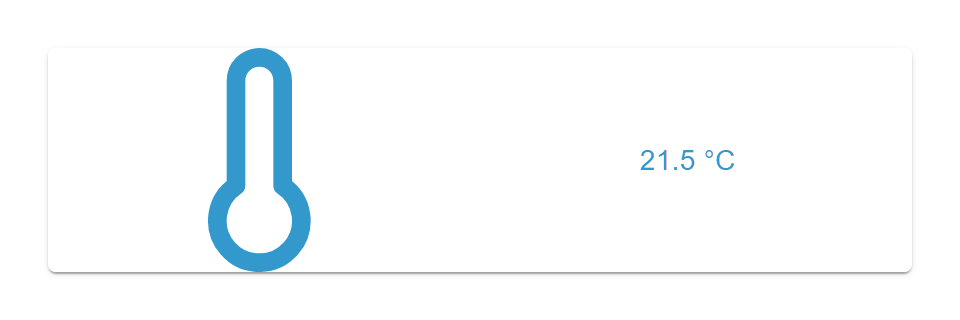

# Input Widget

## Beschreibung

Das Input Widget zeigt einen Text- oder Zahlenwert an, der an eine einzelne OID gebunden ist, und erlaubt die direkte Inline-Bearbeitung per Klick. Es akzeptiert die Datentypen string, number und mixed. Im Standardmodus geht jeder Tastenanschlag verzögert an die OID; mit aktiviertem OK-Button wird die Eingabe gepuffert und beim Bestätigen geschrieben oder beim Verlassen des Felds, wenn sie geändert wurde.

## Einstellungshierarchie

Dieses Widget nutzt alle **vis-2 Einstellungen** und **Common Einstellungen**. Siehe [Home](De-Home.md) für Details.

Die Widget-spezifischen und Value-spezifischen Einstellungen überschreiben die allgemeineren Einstellungen. Die Ausnahmen stehen unter [Common Einstellungen - Value-spezifische Einstellungen](De-Home.md#value-spezifische-einstellungen).

## Widget-spezifische Einstellungen

Diese Felder stehen in der Gruppe **Eingabe**.

### Objekt & Werte

| Feldname        | Typ  | Standard | Beschreibung                                                                                                                                                                                                                                                                | Bedingung                     |
| --------------- | ---- | -------- | --------------------------------------------------------------------------------------------------------------------------------------------------------------------------------------------------------------------------------------------------------------------------- | ----------------------------- |
| Objekt-ID `oid` | id   | -        | Akzeptiert string, number und mixed. Die Wahl ergänzt die Zeilen aus `common.states`, ersetzt `unit`, `minValue` und `maxValue` und setzt `onlyDisplay`. Das Leeren entfernt alle Zeilen und `unit`. Bei einem anderen Typ zeigt der Rahmen einen Hinweis statt der Anzeige | -                             |
| Einheit `unit`  | text | ''       | Wird aus dem Objekt übernommen und ist hier überschreibbar, Leeren entfernt sie, siehe [Einheit](#einheit)                                                                                                                                                                  | Nur wenn eine OID gewählt ist |

### Eingabe

| Feldname                          | Typ                        | Standard   | Beschreibung                                                                                                                                              | Bedingung |
| --------------------------------- | -------------------------- | ---------- | --------------------------------------------------------------------------------------------------------------------------------------------------------- | --------- |
| OK-Button anzeigen `showOkButton` | checkbox                   | false      | Puffert die Eingabe: Schreiben bei OK und Enter, beim Verlassen nur nach einer Änderung (sonst jeder Tastenanschlag), siehe [Schreibmodus](#schreibmodus) | -         |
| Eingabevariante `inputVariant`    | select                     | 'standard' | Variante des Textfelds (standard, outlined, filled)                                                                                                       | -         |
| Eingabe-Abstand `inputPadding`    | number (ab 0, Schritt 0.5) | 1          | Seitlicher Abstand um Eingabefeld und OK-Button während der Bearbeitung, in MUI-Spacing-Einheiten                                                         | -         |

### Zahlenbereich

Nur sichtbar, wenn die gebundene OID den Typ **number** hat. Der Bereich führt den Spinner und begrenzt die Eingabe nicht, siehe [Spinner und Bereich](#spinner-und-bereich).

| Feldname               | Typ           | Standard | Beschreibung                                                                         | Bedingung  |
| ---------------------- | ------------- | -------- | ------------------------------------------------------------------------------------ | ---------- |
| Schrittweite `step`    | number (ab 0) | 1        | Schrittweite des Spinners                                                            | Nur number |
| Mindestwert `minValue` | number        | -        | Untere Grenze des Spinners (aus `common.min` übernommen); leer bedeutet keine Grenze | Nur number |
| Maximalwert `maxValue` | number        | -        | Obere Grenze des Spinners (aus `common.max` übernommen); leer bedeutet keine Grenze  | Nur number |

### Anzeige

| Feldname                  | Typ      | Standard | Beschreibung                                                                                                                  | Bedingung                       |
| ------------------------- | -------- | -------- | ----------------------------------------------------------------------------------------------------------------------------- | ------------------------------- |
| Nur Anzeige `onlyDisplay` | checkbox | false    | Sperrt die Bearbeitung, siehe [Sperre](#sperre). Die OID-Wahl setzt das Feld: `true` bei `common.write: false`, sonst `false` | Ausgeblendet bei `write: false` |
| Kein Icon `noIcon`        | checkbox | -        | Kein Icon in der Anzeige und kein Eck-Icon                                                                                    | -                               |
| Kein Wert `noValue`       | checkbox | -        | Kein Text in der Anzeige. Die Fußzeile und das Eingabefeld zeigen ihn weiter                                                  | -                               |

**Hinweis:** Zusätzlich zu den oben genannten Einstellungen sind die **Wert schreiben**-Einstellungen (**Verzögerung**/**Intervall**) verfügbar. Diese steuern in beiden Schreibmodi, wie Wertänderungen an die OID geschrieben werden. Siehe [Common Einstellungen - Wert schreiben](De-Home.md#wert-schreiben) für Details.

## Datentypen

Das Input Widget unterstützt folgende Datentypen:

### String

- Textfeld. Der Text wird unverändert geschrieben, ein geleertes Feld als leerer Text
- Typische Anwendung: Statusmeldungen, Modi, Namen

### Number

- Zahlenfeld mit optionalem Spinner-Bereich (`minValue`, `maxValue`, `step`). Eine Eingabe, die keine Zahl ist, wird nicht geschrieben
- Typische Anwendung: Temperatur, Helligkeit, Prozentsätze

### Mixed

- Textfeld ohne Spinner, auch für Zahlen
- Getippte Eingaben werden in dem Typ geschrieben, nach dem sie aussehen: `true`/`false` in beliebiger Schreibweise als Boolean, zahlenförmige Eingaben als Zahl (aus `007` wird `7`), alles andere als Text, ein geleertes Feld als leerer Text
- Typische Anwendung: Universelle Eingabe

## Funktionsweise

### Display-first Inline-Bearbeitung

Das Widget zeigt den Wert (und wahlweise ein Icon) zentriert an. Ein Klick in die Anzeige wechselt inline in ein Textfeld, das den Fokus bekommt:

- Das Feld startet mit dem aktuellen Wert der OID, nicht mit dem Alias, und übernimmt danach keinen Wert von außen mehr
- Das Icon in der Anzeige wird während der Bearbeitung ausgeblendet; Eck-Icon, Kopf- und Fußzeile bleiben
- Bei einer **number**-OID wird ein Zahlenfeld mit Spinner verwendet, bei string und mixed ein Textfeld
- Die Einheit wird als Suffix rechts im Feld angezeigt
- Das Feld übernimmt `valueSize` und `textColor`. Ein Gradient erscheint als seine repräsentative Vollfarbe, die Farbe in seiner Mitte; ein Wert ohne repräsentative Vollfarbe (Farbname, `transparent`, CSS-Variable) ergibt die Textfarbe des Themes. Das Suffix übernimmt nur die Größe
- **Enter**, **Escape** oder ein Klick außerhalb beendet die Bearbeitung
- Im vis-2-Editor liegt ein Overlay über dem Widget, ein Klick startet dort keine Bearbeitung

### Schreibmodus

**Ohne OK-Button** (Standard): Jeder Tastenanschlag geht über die **Wert schreiben**-Einstellungen an die OID; mit **Verzögerung** also nur der letzte einer schnellen Folge. Enter, Escape und ein Klick außerhalb beenden nur die Bearbeitung und schreiben nichts Neues: Das Getippte bleibt geschrieben, ein noch wartender Wert geht trotzdem hinaus, und ohne Tastenanschlag wird nichts geschrieben.

**Mit OK-Button** (`showOkButton`): Die Eingabe wird gepuffert, beim Tippen wird nichts geschrieben. Was danach geschieht, hängt davon ab, ob die Eingabe vom Wert beim Start der Bearbeitung abweicht. 41 tippen und zurück auf 40 gilt bei einem Startwert von 40 als unverändert. Auch der Schreibvorgang dieses Modus läuft über die **Wert schreiben**-Einstellungen.

| Aktion          | Eingabe geändert | Eingabe unverändert                                                                                                |
| --------------- | ---------------- | ------------------------------------------------------------------------------------------------------------------ |
| Klick außerhalb | Wird geschrieben | Es wird nichts geschrieben                                                                                         |
| Enter oder OK   | Wird geschrieben | Wird erneut gesendet, außer die Konvertierung würde den Wert ändern oder verwerfen; dann endet nur die Bearbeitung |
| Escape          | Wird verworfen   | Es wird nichts geschrieben                                                                                         |

Enter und OK können einen Wert also bewusst erneut senden, während Hineinklicken und Wegklicken nie einen Schreibvorgang auslöst. Ein gespeicherter Text `007` auf einer mixed-OID würde zur Zahl `7`, ein `null` auf einer string-OID zu leerem Text, darum senden Enter und OK beide unverändert nicht.

In beiden Modi wird eine Eingabe, die keine Zahl ist (etwa ein geleertes Feld), nie an eine **number**-OID geschrieben: Das Objekt behält seinen Wert, auch wo dieser Abschnitt „wird geschrieben" sagt.

### Spinner und Bereich

Der Bereich führt den Spinner (die Pfeile des Zahlenfelds und die Pfeiltasten) und begrenzt die Eingabe nicht: Ein getippter Wert außerhalb des Bereichs wird geschrieben. Ohne OK-Button schreibt jeder Spinner-Schritt wie ein Tastenanschlag.

- **Wert außerhalb des Bereichs**: Die überschrittene Grenze gilt nicht mehr, der Spinner macht also einen Schritt, statt auf diese Grenze zu springen. Bei Maximum 100, Wert 500 und Schrittweite 1 ergibt Pfeil runter 499. Die andere Grenze wirkt weiter, und liegt die Eingabe wieder im Bereich, gilt auch die überschrittene wieder.
- **OID-Wahl**: Das Widget übernimmt nur den Bereich, den das Objekt wirklich angibt (`common.min`, `common.max`). Eine Grenze, die das Objekt nicht angibt, bleibt leer, eine frühere wird entfernt. Das Leeren der OID lässt den Bereich stehen.
- **Leeres Feld Mindestwert oder Maximalwert**: Bedeutet keine Grenze, nicht 0.
- **Gespeicherter Bereich**: Er wirkt auch, wenn das Objekt ihn nie angegeben hat, etwa 0 bis 100. Er lässt sich nicht von einem echten Bereich unterscheiden und bleibt, bis die Felder geleert werden oder die nächste OID-Wahl ihn ersetzt.

### Einheit

Die Einheit kommt aus dem gebundenen Objekt. Nach der OID-Wahl steht sie im Feld **Einheit** und ist dort überschreibbar; Leeren des Felds entfernt sie. Eine spätere OID-Wahl ersetzt sie, das Entfernen der OID leert das Feld.

Die Anzeige und die Fußzeile zeigen die Einheit ohne Leerzeichen hinter dem Wert, das Eingabefeld als Suffix, auch wenn der Wert zu keiner Zeile des Zustandseditors passt. Ein leerer Wert zeigt keine Einheit. Ein Alias in der passenden Zeile wird in Anzeige und Fußzeile stattdessen gezeigt.

Das Feld **Einheit** kann leer sein, obwohl die Einheit des Objekts angezeigt wird, denn die Anzeige liest die beim Wählen gespeicherte Einheit. Es füllt sich bei der nächsten OID-Wahl; bis dahin entfernt man die Einheit, indem man etwas in das Feld tippt und es wieder leert.

### Sperre

Wenn **Nur Anzeige** aktiv ist oder die OID nicht beschreibbar ist (`write: false`), startet ein Klick keine Bearbeitung, und die Anzeige folgt weiter dem Wert. Das Widget prüft das nur beim Start: Wird **Nur Anzeige** während einer laufenden Bearbeitung aktiv, läuft sie weiter und schreibt weiter.

### Konflikt-Anzeige

Die Linie des Eingabefelds wird rot, wenn ein Sitzungskonflikt vorliegt: Der Wert hat sich seit dem Klick ins Feld signifikant von außen geändert (z. B. durch einen Adapter oder ein Skript). Die Textfarbe bleibt.

- Eine Änderung vor dem Klick zählt nicht, auch wenn sie gerade erst kam.
- Bei Zahlen und zahlenförmigem Text färben Änderungen kleiner als 1 wie Sensorrauschen das Feld nicht und nehmen das Rot auch nicht weg. Verglichen wird mit dem zuletzt beobachteten Wert, kleine Schritte summieren sich also nicht. Bei anderem Text zählt jede Änderung.
- Ein Wert von außen färbt nicht, wenn er dem zuletzt getippten Wert entspricht, vor dem ersten Tastenanschlag und mit OK-Button dem Wert beim Start.
- Direkt nach dem eigenen Schreiben ignoriert das Widget Änderungen von außen für `delay` + 1500 ms, siehe [Wert schreiben](De-Home.md#wert-schreiben); eine solche Änderung in dieser Zeit färbt das Feld also nicht. Bei einer sehr langsamen Verbindung kann die späte Bestätigung eines älteren Tastenanschlags es rot färben.
- Das Feld bleibt rot, bis die Bearbeitung endet. Ohne OK-Button beendet der eigene nächste Tastenanschlag die Markierung, weil dann der eigene Wert im Objekt steht; eine Eingabe, die nicht geschrieben wird, etwa ein geleertes Zahlenfeld, beendet sie nicht. Die nächste Bearbeitung beginnt ohne Markierung mit dem dann aktuellen Wert.

Rot ist nur eine Warnung: Der Wert von außen ersetzt die Eingabe nicht. Mit OK-Button werden eine geänderte Eingabe und ein bewusstes Enter oder OK trotzdem geschrieben und überschreiben den Wert von außen, ein unverändertes Enter oder OK mit dem Wert beim Start; ein Klick außerhalb ohne Änderung und Escape lassen ihn stehen. Ohne OK-Button überschreibt ihn der nächste Tastenanschlag, während Enter, Escape und ein Klick außerhalb ihn stehen lassen.

## Value-spezifische Einstellungen

Für jeden Wert können individuelle Common-Einstellungen überschrieben werden (z. B. Icon, Hintergrundfarbe, Textfarbe). Das geschieht im Zustandseditor, der Gruppe **Werte**: eine durchsuchbare Liste mit einer Zeile pro Wert und darunter die Felder der gewählten Zeile. Zeilen lassen sich hinzufügen, klonen, verschieben, leeren und löschen. Typ, Standard und Vorrang der Felder stehen unter [Common Einstellungen - Value-spezifische Einstellungen](De-Home.md#value-spezifische-einstellungen).

Bei der OID-Wahl werden die Zustände aus `common.states` als Zeilen ergänzt, vorhandene Zeilen bleiben erhalten. **Aus common.states neu anlegen** ersetzt alle Zeilen.

Die Zeile, deren Wert zum aktuellen Wert passt, wendet ihre Einstellungen an; verglichen wird die Textform, und passen mehrere, gilt die erste. Dies entspricht dem Verhalten des [State Widgets](De-State-Widget.md#value-spezifische-einstellungen) und erlaubt z. B. eine eigene Hintergrundfarbe pro Zustandswert. Die Zeilen schränken die Eingabe nicht ein: Jeder Wert lässt sich weiter eintippen.

- **Anzeige**: `alias{n}` ersetzt den Wert samt Einheit, ohne Alias gilt `value{n}` mit Einheit. Das Eingabefeld zeigt immer den Wert der OID.
- **Eingabefeld**: `valueSize{n}` und `textColor{n}` gelten auch im Feld. Ohne OK-Button folgt die aktive Zeile sofort jedem Wert, der geschrieben wird.
- **Icon**: In der Anzeige ist die Größe ein Prozentwert des Platzes dort, ohne Wert 100 %. Ist keine Zeile aktiv, nehmen Größe, Versatz und Farbmaske dieses Icons die Basisfelder.

## Anwendungsbeispiele

- **Temperatur-Eingabe**: number-OID mit `minValue`, `maxValue`, `step` und °C-Einheit
- **Status-Text ändern**: string-OID für Statusmeldungen oder Szenen-Namen, mit OK-Button, damit kein halb getippter Text hinausgeht
- **Lautstärke-Direkteingabe**: Zahl statt Slider, mit OK-Button gegen zu häufiges Schreiben
- **Universeller Wert**: mixed-OID für flexible Eingaben: `true` schreibt einen Boolean, `21.5` eine Zahl, `an` einen Text
