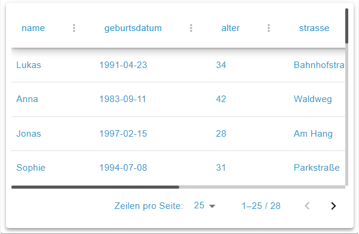

# JSON Table Widget



## Beschreibung

Das JSON Table Widget zeigt Tabellendaten aus dem JSON-Wert einer OID. Es verwendet TanStack Table v8 (headless) für Sortierung, Filterung, Seitenumbruch und Spaltenanpassung. Spalten werden aus der JSON-Struktur erkannt und im Spalten-Editor konfiguriert. Das Widget liest die OID nur und schreibt nie hinein, die Einstellungen [Wert schreiben](De-Home.md#wert-schreiben) gibt es hier nicht.

## Einstellungshierarchie

Dieses Widget verwendet alle **vis-2 Einstellungen** und **Allgemeinen Einstellungen**. Siehe [Home](De-Home.md) für Details.

Die widgetspezifischen Einstellungen überschreiben die allgemeineren Einstellungen.

## Datenquelle

| Feldname        | Typ | Standard | Beschreibung                                                                                                                                                                        | Bedingung |
| --------------- | --- | -------- | ----------------------------------------------------------------------------------------------------------------------------------------------------------------------------------- | --------- |
| Objekt-ID `oid` | id  | -        | OID für JSON-Daten (Typ: `string`, `mixed` oder `json`). Leeren der OID löscht `columnConfig` und alle anderen eigenen Felder aus den Abschnitten unten. Eine Einheit gibt es nicht | -         |

Die JSON-Daten können sein:

- **Array von Objekten**: Jedes Objekt ist eine Zeile
- **Einzelnes Objekt**: Wird als eine Zeile angezeigt
- **Verschachtelte Objekte**: Werden bis zur Flattening-Tiefe `tableMaxDepth` flachgeklopft
- **JSON-String**: Wird automatisch geparst
- **Array-Elemente, die keine Objekte sind**: Landen in der Spalte `_value` (`[1,2]` ergibt `_value`, `[[1,2]]` ergibt `_value[0]` und `_value[1]`)

Alles andere — eine einzelne Zahl, ein Text oder ein Wahrheitswert (auch als JSON), ungültiges JSON, `[]`, `{}`, `[{}]` — zeigt _Keine Daten verfügbar_. Sind alle Spalten auf `visible: false` gesetzt, steht dort _Alle Spalten sind ausgeblendet_. Ohne OID oder mit einem anderen Objekttyp zeigt das Widget statt der Tabelle einen Hinweis.

## Spaltenkonfiguration

### Spalten-Editor

| Feldname               | Typ    | Standard | Beschreibung                                                                                                                                                                      | Bedingung |
| ---------------------- | ------ | -------- | --------------------------------------------------------------------------------------------------------------------------------------------------------------------------------- | --------- |
| Spalten `columnConfig` | custom | -        | Der Button **Spalten konfigurieren** öffnet den Editor, darunter steht die Zahl sichtbarer und aller Spalten. Gespeichert als `b64:` + Base64-JSON, reines JSON wird auch gelesen | -         |

Der Spalten-Editor bietet:

- **Spaltenliste**: Suche, Neuanordnung durch Ziehen (nicht während einer Suche), Sichtbarkeit per Checkbox oder Taste `v`, Wechsel der Spalte per Pfeiltasten
- **Sammelaktionen**: **Spalten von OID aktualisieren**, **Alle anzeigen**, **Alle ausblenden**, **Alle Spalten auf Standardwerte zurücksetzen** (mit Rückfrage)
- **Spalteneinstellungen**: Abschnitte **Grundeinstellungen**, **Formatierung**, **Bedingte Formatierung** und **Erweitert**, jeder mit **Auf Standard zurücksetzen**
- **Erweitert**: Zeigt die **Tabellenfunktionen**, das Ergebnis der Spalte und die **Analyse-Informationen** (Typ, **Konfidenz**, **Null-Werte**, **Eindeutige Werte**, **Wertebereich**, **Erkanntes Eingabeformat**)
- **Datentyperkennung**: Erkennt `string`, `number`, `boolean`, `date`, `image`, `array`, `object`, `null` und `mixed`. Der **erkannte Typ** ist ein Hinweis, der **Formattyp** kann frei davon abweichen.
- **Speichern**: **Speichern** ist nur bei einer Änderung aktiv. **Abbrechen** und das X verwerfen ohne Rückfrage, ein Klick neben den Dialog lässt ihn bei Änderungen offen und warnt.

> **Welche Spalten die Tabelle zeigt:** Die gespeicherte Spaltenkonfiguration und die in den Daten gefundenen Spalten werden nach einer Regel zusammengeführt, im Editor wie zur Laufzeit (Spalten-Merge): Gespeicherte Spalten, die noch in den Daten sind, behalten Reihenfolge und Einstellungen; ein Feld, das die Daten neu bekommen, erscheint sofort als neue sichtbare Spalte am Ende (Standardeinstellungen) — ohne vorheriges Speichern im Editor; eine gespeicherte Spalte, die die Daten nicht mehr enthalten, wird ausgelassen. Ohne gespeicherte Konfiguration zeigt die Tabelle alle gefundenen Spalten. Neu gefundene Pfade stehen nach Byte-Reihenfolge (Großbuchstaben zuerst), nicht in JSON-Reihenfolge. Der Editor öffnet mit genau dieser Liste; blendet man dort eine neue Spalte aus, wird das mit dem nächsten _Speichern_ übernommen.

### Spalteneigenschaften

Jede Spalte kann konfiguriert werden mit:

| Eigenschaft                | Beschreibung                                                                                                                  |
| -------------------------- | ----------------------------------------------------------------------------------------------------------------------------- |
| `path`                     | Spaltenkennung: der flachgeklopfte Pfad in den Daten                                                                          |
| Überschrift `headerName`   | Anzeigename in der Kopfzeile. Standard ist das letzte Pfadsegment (`u.n.d` ergibt `d`), eine leere Überschrift zeigt den Pfad |
| Breite `width`             | Spaltenbreite in px, Eingabe ab 30, ohne Wert 150. Ziehen in der Kopfzeile: 40–2000                                           |
| Ausrichtung `align`        | `left` (Standard), `center`, `right`. Eine erkannte Bild-Spalte ohne Wert ist `center`                                        |
| Sichtbar `visible`         | Spalte ein-/ausblenden                                                                                                        |
| Sortierbar `sortable`      | Sortierung für diese Spalte — `true` / `false` / `'auto'`                                                                     |
| Filterbar `filterable`     | Filterung für diese Spalte — `true` / `false` / `'auto'`                                                                      |
| Ausblendbar `enableHiding` | Spalte über das Spaltenmenü ausblendbar — `true` / `false` / `'auto'`                                                         |

> **Smart-Defaults (`'auto'`):** Im Modus **Auto (typbasiert)** (Voreinstellung) folgen Sortier- und Filterbarkeit dem **Effektiven Typ** der Spalte — ihrem Formattyp, wenn einer gesetzt ist, sonst dem erkannten Typ: `string`/`number`/`date`/`mixed`/`null` → sortier- und filterbar, `boolean` → nur filterbar, `image`/`array`/`object` → weder noch. Ausblendbar ist per Voreinstellung jede Spalte. Eine Überschreibung erlaubt nie mehr als die Tabelle: Solange Sortieren, Spaltenfilter oder Ausblenden für die ganze Tabelle aus sind, bewirkt `true` nichts. Der Bereich _Erweitert_ im Spalten-Editor zeigt das Ergebnis pro Spalte.

### Spaltenformatierung

Jede Spalte hat höchstens einen aktiven **Formattyp** `format.type`, der bestimmt, wie der Rohwert gerendert wird. Standard ist **Auto** (dahinter der erkannte Typ in Klammern), dann ist kein Formattyp gesetzt: Die Zelle zeigt den Rohwert als Text ohne Formatierung, auch eine erkannte Datums-Spalte (sie sortiert und filtert trotzdem als Datum). Einzige Ausnahme ist die erkannte Bild-Spalte, sie rendert als Grafik. Der Editor zeigt die Optionen des erkannten und des gewählten Typs; das Ändern einer Option setzt deren Typ als Formattyp, ein Typwechsel löscht die Optionen des alten Typs.

| Formattyp | Wert      | Beschreibung                             | Wichtigste Optionen                                                                                       |
| --------- | --------- | ---------------------------------------- | --------------------------------------------------------------------------------------------------------- |
| Text      | `string`  | Textanzeige                              | `stringCase`, `stringPrefix`, `stringSuffix`, `stringTrim`, `stringMaxLength`, `stringRegex`, Schriftstil |
| Zahl      | `number`  | Zahlenformatierung mit Tausendertrennung | `numberDecimals`, `numberPrefix`, `numberSuffix`, `numberThousandsSeparator`                              |
| Boolean   | `boolean` | Boolean als Text                         | `booleanTrue`, `booleanFalse`                                                                             |
| Datum     | `date`    | Datum/Zeit-Formatierung                  | `dateFormat` (vordefiniert)                                                                               |
| Bild      | `image`   | Rohwert als Grafik rendern               | `imageSize`, `imageObjectFit`, `imageVariant`, `imageTint`, `imagePadding`, …                             |

Details zu den formattypspezifischen Optionen finden sich in den folgenden Unterabschnitten.

### Textformatierung

Die Schritte laufen in dieser Reihenfolge: Leerzeichen, Regex, Schreibweise, Länge, Präfix/Suffix.

| Eigenschaft                                                                                                        | Beschreibung                                                                                                      |
| ------------------------------------------------------------------------------------------------------------------ | ----------------------------------------------------------------------------------------------------------------- |
| Leerzeichen entfernen `stringTrim`                                                                                 | Leerzeichen am Anfang/Ende entfernen                                                                              |
| Regex-Muster `stringRegex`                                                                                         | Regex-Teiltreffer extrahieren. Ungültiges Muster, kein Treffer oder mehr als 200 Zeichen: Wert bleibt unverändert |
| Erfassungsgruppe `stringRegexGroup`, Flags `stringRegexFlags`                                                      | Zu verwendende Capture-Gruppe (0 = voller Treffer) und Regex-Flags                                                |
| Groß-/Kleinschreibung `stringCase`                                                                                 | `none`, `upper`, `lower`, `title`                                                                                 |
| Maximale Länge `stringMaxLength`                                                                                   | auf N Zeichen kürzen (mit „…")                                                                                    |
| Präfix `stringPrefix`, Suffix `stringSuffix`                                                                       | Prä-/Suffix an dem Wert                                                                                           |
| Fett `stringFontWeight`, Kursiv `stringFontStyle`, Schriftgröße (px) `stringFontSize`, Textfarbe `stringTextColor` | Statische Schriftvorgabe (durch bedingte Regeln übersteuerbar). Schriftgröße 8–72                                 |

> **Hinweis – HTML-Rendering:** Alle Zellen außer Grafiken rendern ihren Anzeigewert als HTML (z. B. `<b>`, `<br>`, `<span style="…">`), nicht nur der Formattyp Text. Die Werte stammen aus dem eigenen ioBroker-State und gelten als vertrauenswürdig. Bindest du fremde Daten ein, beachte das XSS-Risiko ungefilterten HTMLs.

### Zahl und Boolean

| Eigenschaft                                                       | Standard        | Beschreibung                                                                                                                      |
| ----------------------------------------------------------------- | --------------- | --------------------------------------------------------------------------------------------------------------------------------- |
| Dezimalstellen `numberDecimals`                                   | 2               | 0–10. Auch als Text gespeicherte Zahlen werden formatiert, ein Wert, der keine Zahl ist, und eine leere Zelle bleiben unverändert |
| Präfix `numberPrefix`, Suffix `numberSuffix`                      | -               | Prä-/Suffix an dem Wert                                                                                                           |
| Tausendertrennzeichen `numberThousandsSeparator`                  | false           | Komma als Trennzeichen, der Dezimalpunkt ist immer `.`, kein Gebietsschema                                                        |
| Wahr-Bezeichnung `booleanTrue`, Falsch-Bezeichnung `booleanFalse` | `true`, `false` | Gilt nur für echte Booleans, alles andere erscheint als Text                                                                      |

### Datums-Spalten (Formattyp `date`)

Eine Datums-Spalte liest jeden Rohwert als Zeitpunkt und zeigt ihn im **Ausgabeformat** `dateFormat` (Standard `yyyy-MM-dd`) in der Ortszeit des Browsers. **Erkanntes Eingabeformat** ist nur eine Anzeige und wird nicht gespeichert.

- **Erkannte Datums-Spalten** (erkannter Typ `date`) lesen genau die Muster, die die Erkennung kennt: ISO-8601 mit Zone (`2024-12-01T10:00:00Z`, `…+02:00`), `YYYY-MM-DD`, `dd.MM.yyyy( HH:mm(:ss))`, `MM/dd/yyyy( HH:mm(:ss))` und Epoch-Zahlen (≥ 1e11 → Millisekunden, ≥ 1e9 → Sekunden). Eine Zahlenspalte mit Werten ab 1e9 gilt deshalb als `date`, soll sie Zahl bleiben, Formattyp `number` setzen.
- **Selbst auf `date` gestellte Spalten** lesen zusätzlich, als Ortszeit: ISO ohne Zone (`2024-12-01T10:00`, `…:00`, `…:00.000`), `YYYY-MM-DD HH:mm(:ss)` und Epoch-Strings (nur Ziffern, gleiche Schwellen).
- **Alles andere ist kein Datum** und erscheint als Rohtext — z. B. `1.12.2024`, `Dec 1, 2024`, `2024/12/01`. Der Browser rät nicht mit.

Sortierung, Datumsfilter, Schnellfilter und bedingte Regeln lesen Daten genauso und vergleichen den **lokalen Kalendertag**. Werte, die kein Datum sind, sortieren vor allen Daten. Das Ausgabeformat `ISO-8601 (UTC)` zeigt UTC und kann deshalb um Mitternacht einen anderen Tag zeigen.

### Bild-Spalte (Formattyp `image`)

Eine **Bild-Spalte** rendert jeden Rohwert als Grafik statt als Text. Der Rohwert wird dabei als **visuelle Referenz** gelesen — niemals als Icon-_Name_ (`mdi-*`, `fa-*`); es gibt keine Namensauflösung. Unterstützt werden:

- **URL oder Dateipfad** (Bild oder SVG)
- **`data:image/…`-URI**
- **UTF-8-Zeichen** (ein Nicht-ASCII-Zeichen aus höchstens 2 UTF-16-Einheiten, z. B. 💡; ein Emoji mit Variationszeichen ist länger und bleibt Text)

**Icon vs. Bild** ist eine Unterscheidung auf Wert-Ebene zur Laufzeit, kein eigener Spaltentyp: Ein _Icon_ ist ein kleiner monochromer Glyph (SVG-Data-URI oder UTF-8-Zeichen), ein _Bild_ ein Rasterfoto (png/jpg/webp/…). Ein konfigurierter Farb-**Tint** wirkt auf beide über eine CSS-Maske (Alpha-Kanal der Quelle) — exakt für monochrome Icons.

| Eigenschaft                                                     | Standard | Beschreibung                                                                                                                      |
| --------------------------------------------------------------- | -------- | --------------------------------------------------------------------------------------------------------------------------------- |
| Bildgröße `imageSize`                                           | 64       | Rendergröße in px (8–256), durch die Zellhöhe begrenzt                                                                            |
| Objektanpassung `imageObjectFit`                                | contain  | `contain`, `cover`, `fill` (CSS `object-fit`)                                                                                     |
| Form `imageVariant`                                             | square   | `square`, `rounded`, `circular` (Avatar-Form)                                                                                     |
| Hintergrund `imageBgColor`                                      | -        | Avatar-Hintergrundfarbe                                                                                                           |
| Rahmenfarbe `imageBorderColor`, Rahmenbreite `imageBorderWidth` | - / -    | Avatarrahmen, nur mit Farbe und Breite > 0 (0–16)                                                                                 |
| Einfärben `imageTint`                                           | -        | Farbton via CSS-Maske                                                                                                             |
| Wert als Tooltip anzeigen `imageTooltip`                        | true     | Rohwert als Hover-Tooltip anzeigen                                                                                                |
| Platzhalter für defekte Bilder anzeigen `imageShowBroken`       | true     | Platzhalter-Icon bei fehlgeschlagener URL, nur ohne `imageTint`: Die Maske meldet keinen Ladefehler. `false` lässt die Zelle leer |
| Innenabstand `imagePadding` (top/right/bottom/left)             | 0 8 0 8  | Innenabstand pro Seite in px (0–64). Sobald eine Seite gesetzt ist, gilt für ungesetzte Seiten 0                                  |

**Automatische Erkennung:** Als erkannter Typ `image` gelten nur Spalten mit `data:image/…`-URIs und mit Pfaden oder URLs mit Bildendung (png, jpg, jpeg, gif, svg, webp, avif, bmp, ico, apng, tif, tiff). Sie werden ohne manuelle Konfiguration als Grafik gerendert, auch wenn daneben Text in der Spalte steht. UTF-8-Zeichen und URLs ohne Endung brauchen den Formattyp `image`.

**Fallback:** Lässt sich ein Wert nicht als Grafik auflösen, wird er als Text gerendert. Ein leerer Wert zeigt eine leere Zelle, eine defekte URL den Platzhalter. Mit `imageTint` kann ein Bild von einem fremden Origin leer bleiben. Die Grafik wird XSS-sicher gerendert (nie via `innerHTML`).

### Bedingte Formatierung

Dynamische Stile im Abschnitt **Bedingte Formatierung**, je Regel eine **Vorschau**:

- **Bedingungen**: Vergleich mit festen Werten oder Schwellwerten (json-logic-Regeln), mehrere Bedingungen per **UND**/**ODER** verknüpft. Eine Regel ohne vollständige Bedingung greift nie. Der Regel-Editor folgt dem Effektiven Typ der Spalte; bei einer Datums-Spalte — erkannt oder selbst gesetzt — vergleichen Regeln den lokalen Kalendertag des Werts als `YYYY-MM-DD`.
- **Vergleich**: Text-Operatoren unterscheiden Groß-/Kleinschreibung, **ist gleich** vergleicht lose (`1` trifft `"1"`). Leer sind `null`, ein fehlender Wert und `""`, `0` und `false` nicht. Eine leere Zelle trifft keine Regel mit größer oder kleiner, ein unlesbarer Wert in einer Datums-Spalte zählt als leer.
- **Stile**: **Hintergrundfarbe** `backgroundColor` und **Textfarbe** `textColor` (beide Gradient möglich), **Fett** `fontWeight`, **Kursiv** `fontStyle`. Eine neue Regel steht auf `normal`, das zählt als gesetzt und übersteuert ein statisches Fett oder Kursiv der Spalte.
- **Auswertung** `cellStyleMode`:

| Modus                                | Beschreibung                                                                                                          |
| ------------------------------------ | --------------------------------------------------------------------------------------------------------------------- |
| Erste Regel `first-match` (Standard) | Stoppt bei der ersten treffenden Regel.                                                                               |
| Alle Regeln `all-match`              | Alle treffenden Regeln werden angewendet; bei Konflikten gewinnt die Regel mit höherer Priorität (niedrigerer Index). |

Der Regel-Editor bietet je Effektivem Typ:

| Effektiver Typ   | Operatoren (neben **ist leer** und **ist nicht leer**)                                                                   |
| ---------------- | ------------------------------------------------------------------------------------------------------------------------ |
| `number`, `date` | **ist gleich**, **ist ungleich**, **ist größer als**, **ist größer gleich**, **ist kleiner als**, **ist kleiner gleich** |
| `string`         | **ist gleich**, **ist ungleich**, **enthält**, **enthält nicht**, **beginnt mit**, **endet mit**                         |
| `boolean`        | **ist wahr**, **ist falsch**                                                                                             |
| `mixed`          | **ist gleich**, **ist ungleich**, **enthält**                                                                            |
| übrige           | **ist gleich**, **ist ungleich**                                                                                         |

## Funktionen

> **Persistenz:** Der Ansichtszustand — Sortierung, aktive Filter, Suchbegriff, Seite und Zeilen pro Seite, Spaltenbreiten und Spaltensichtbarkeit — bleibt über Seiten-Reloads erhalten (pro Widget-ID lokal im Browser gespeichert, bei nicht lesbarem Speicher nur für die Sitzung). Die Zeilenauswahl gehört nicht dazu. Ein Teil, dessen Funktion ausgeschaltet ist, wird geparkt: weder angewendet noch gelöscht, er kehrt mit der Funktion zurück. Ebenso der Filter einer Spalte, die nicht filterbar (Überschreibung oder Typstandard aus) oder nicht gezeigt ist; die Sortierung einer nicht gezeigten Spalte wird ausgelassen. Gezogene Breiten bleiben bei ausgeblendeter Kopfzeile wirksam, nur `tableAutoSize` parkt sie. Eine gewählte Seitengröße oder eine gezogene Spaltenbreite gilt, bis der konfigurierte Wert (`tablePageSize` bzw. die Spaltenbreite im Editor) geändert wird oder die Seitengröße nicht mehr angeboten wird. Die Seite bleibt bei Live-Updates der Daten erhalten, wird auf die letzte vorhandene begrenzt und springt nur bei Änderung von Sortierung, Filtern, Suchbegriff oder Seitengröße auf Seite 1 zurück.

> **Kopfzeile und Spaltenmenü:** Sortieren, Spaltenfilter, Ausblenden und das Spaltenmenü leben in der Kopfzeile. Ist die Kopfzeile ausgeblendet (`tableShowHeader`), sind sie alle aus; ist das Spaltenmenü aus, sind auch Spaltenfilter und Ausblenden aus (beide sind nur über das Menü erreichbar). Schnellfilter, Seitenumbruch und Zeilenauswahl hängen nicht an der Kopfzeile.

### Sortierung

| Feldname                                    | Typ      | Standard | Beschreibung                                        | Bedingung                                |
| ------------------------------------------- | -------- | -------- | --------------------------------------------------- | ---------------------------------------- |
| Sortierung `tableSorting`                   | checkbox | true     | Spaltensortierung aktivieren                        | Kopfzeile sichtbar                       |
| Mehrspaltige Sortierung `tableSortingMulti` | checkbox | false    | Mehrspaltige Sortierung aktivieren (Umschalt+Klick) | Kopfzeile sichtbar und `tableSorting` an |

Eine Spalte sortiert nach ihrem **Effektiven Typ**:

- `date` chronologisch,
- `number` numerisch — auch als Text gespeicherte Zahlen, wenn der Formattyp der Spalte `number` ist (Werte, die keine Zahl sind, sortieren wie 0),
- `string` in natürlicher Textreihenfolge ohne Groß-/Kleinschreibung (`Raum 2` vor `Raum 10`) — auch Zahlenwerte, wenn der Formattyp der Spalte `string` ist,
- jeder andere Typ in der Standard-Reihenfolge.

Der erste Klick auf den Spaltenkopf sortiert Text aufsteigend und alles andere absteigend, maßgeblich ist der Wert der ersten Zeile. Das Spaltenmenü bietet **Aufsteigend sortieren**, **Absteigend sortieren** und **Sortierung aufheben**; seine Sortierung ersetzt die ganze bisherige.

### Filterung

| Feldname                         | Typ      | Standard | Beschreibung                                                                                                                                     | Bedingung                    |
| -------------------------------- | -------- | -------- | ------------------------------------------------------------------------------------------------------------------------------------------------ | ---------------------------- |
| Filterung `tableFiltering`       | checkbox | true     | Spaltenfilter aktivieren. Fehlt der Schlüssel in den Widget-Daten, ist er aus                                                                    | Kopfzeile und Spaltenmenü an |
| Schnellfilter `tableQuickFilter` | checkbox | false    | Globales Suchfeld anzeigen                                                                                                                       | -                            |
| Spaltenmenü `tableColumnMenu`    | checkbox | true     | Spaltenmenü anzeigen. Der Button erscheint nur an Spalten, die sortier-, filter- oder ausblendbar sind                                           | Kopfzeile sichtbar           |
| Spalten ausblenden `tableHiding` | checkbox | true     | **Spalte ausblenden** und **Alle Spalten anzeigen** im Menü erlauben. Das ist Ansichtszustand des Browsers, `visible` im Editor bleibt unberührt | Kopfzeile und Spaltenmenü an |

> **Spaltenfilter vergleichen nach dem Effektiven Typ der Spalte:** Textspalten als Text ohne Groß-/Kleinschreibung (`gleich „Raum 1"` trifft nicht `Raum 01`), Zahlenspalten nur numerisch (eine Zelle, die keine Zahl ist, trifft bei Wert-Operatoren nie), Datumsspalten nach lokalem Kalendertag, Boolean-Spalten nach `true`/`false` (auch `'true'`/`'false'` und `1`/`0`). Andere Typen (gemischt, Objekt, Array, Bild) vergleichen als Text, Objekte als JSON. Eine fehlende Zelle trifft nur **Ist leer**. Der Filter-Dialog bietet die Operatoren dieses Typs an; ein gespeicherter Filter, dessen Operator der Typ nicht mehr anbietet (z. B. nach Änderung des Formattyps), wird verworfen.

| Effektiver Typ   | Operatoren im Filter-Dialog (neben **Ist leer** und **Ist nicht leer**)                                            |
| ---------------- | ------------------------------------------------------------------------------------------------------------------ |
| `string`, übrige | **Enthält** (Start), **Beginnt mit**, **Endet mit**, **Gleich**, **Ungleich**                                      |
| `number`         | **Gleich** (Start), **Ungleich**, **Größer als**, **Größer oder gleich**, **Kleiner als**, **Kleiner oder gleich** |
| `date`           | **Gleich** (Start), **Nach**, **Am oder nach**, **Vor**, **Am oder vor**                                           |
| `boolean`        | **Gleich** (Start), **Ungleich**                                                                                   |

Enter wendet den Filter an, eine leere Eingabe bedeutet keinen Filter. Der Schnellfilter sucht einen Teilstring ohne Groß-/Kleinschreibung im Rohwert (Text, Zahl, Boolean, keine Objekte) aller Spalten, auch der über das Menü ausgeblendeten, nicht aber der im Editor ausgeblendeten. In Spalten mit Formattyp `date` trifft er auch den Anzeigewert.

### Seitenumbruch

| Feldname                                               | Typ      | Standard       | Beschreibung                                                                                                                           | Bedingung |
| ------------------------------------------------------ | -------- | -------------- | -------------------------------------------------------------------------------------------------------------------------------------- | --------- |
| Seitenumbruch aktivieren `tablePagination`             | checkbox | true           | Seitenumbruch aktivieren                                                                                                               | -         |
| Seitengröße `tablePageSize`                            | number   | 25             | Initiale Seitengröße, ab 1. Wirkt nur mit Seitenumbruch                                                                                | -         |
| Seitengrößen-Optionen `tablePageSizeOptions`           | text     | '10,25,50,100' | Verfügbare Seitengrößen (komma-getrennt, positive Ganzzahlen, eindeutig, aufsteigend; unlesbar: Standard). Wirkt nur mit Seitenumbruch | -         |
| Virtualisierungsschwellwert `tableVirtualizeThreshold` | number   | 50             | Ohne Seitenumbruch rendert der Tabellenkörper über dieser Zeilenzahl nur die sichtbaren Zeilen. `0` = nie                              | -         |

### Zeilenauswahl

| Feldname                                     | Typ      | Standard | Beschreibung                                                                                                                                 | Bedingung |
| -------------------------------------------- | -------- | -------- | -------------------------------------------------------------------------------------------------------------------------------------------- | --------- |
| Zeilenauswahl (Checkbox) `tableRowSelection` | checkbox | false    | Zeilenauswahl aktivieren (Checkboxen). Die Kopf-Checkbox wählt die Seite. Die Auswahl gilt nur für die Sitzung und wird nirgends geschrieben | -         |

### Analyse

| Feldname                                       | Typ    | Standard | Beschreibung                                   | Bedingung |
| ---------------------------------------------- | ------ | -------- | ---------------------------------------------- | --------- |
| Maximale Verschachtelungstiefe `tableMaxDepth` | number | 10       | Flattening-Tiefe (1–50, 1 = oberste Schlüssel) | -         |

Bei Tiefe N bleibt ein Wert auf Ebene N+1 stehen: Ein Objekt oder Array erscheint als JSON-Text mit Chip `JSON` und erkanntem Typ `object` bzw. `array`. Über der Tabelle und im Editor steht dann eine Warnung, auch wenn auf Ebene N+1 nur einfache Werte liegen; die dort genannte Tiefe ist auf N+1 gedeckelt.

## Layout

### Tabellen-Layout

| Feldname                                       | Typ      | Standard   | Beschreibung                                                                                                 | Bedingung          |
| ---------------------------------------------- | -------- | ---------- | ------------------------------------------------------------------------------------------------------------ | ------------------ |
| Dichte `tableDensity`                          | select   | 'standard' | Zeile/Kopfzeile in px: `compact` 36/36, `standard` 52/56, `comfortable` 68/68                                | -                  |
| Zeilenhöhe (px) `tableRowHeight`               | number   | -          | Feste Zeilenhöhe ab 20, überschreibt die Dichte                                                              | -                  |
| Kopfzeile anzeigen `tableShowHeader`           | checkbox | true       | Kopfzeile anzeigen. Abhängigkeiten siehe [Funktionen](#funktionen)                                           | -                  |
| Kopfzeilenhöhe (px) `tableHeaderHeight`        | number   | -          | Kopfzeilenhöhe ab 20                                                                                         | Kopfzeile sichtbar |
| Kopfzeilen-Schattierung `tableHeaderElevation` | slider   | 6          | Schatten der Kopfzeile (0-24), bei `noCard` flach und transparent                                            | Kopfzeile sichtbar |
| Spalten automatisch anpassen `tableAutoSize`   | checkbox | false      | Spalten automatisch an Container anpassen. Kein Ziehen, konfigurierte und gezogene Breiten wirken dann nicht | -                  |
| Tabellen-Abstand `jsonTablePadding`            | number   | 1          | Innenabstand in MUI-Spacing-Einheiten, Schritt 0,5                                                           | -                  |

### Tabellenrahmen

| Feldname                    | Typ    | Standard | Beschreibung                                                                                  | Bedingung |
| --------------------------- | ------ | -------- | --------------------------------------------------------------------------------------------- | --------- |
| Rahmenbreite `borderWidth`  | slider | 0        | Außenrahmen-Breite (0-20), nur über 0 gibt es einen Rahmen                                    | -         |
| Rahmenstil `borderStyle`    | select | 'solid'  | `none`, `dotted`, `dashed`, `solid`, `double`, `groove`, `ridge`, `inset`, `outset`, `hidden` | -         |
| Rahmenfarbe `borderColor`   | color  | -        | Rahmenfarbe. Ohne Wert die Divider-Farbe des Themes                                           | -         |
| Rahmenradius `borderRadius` | text   | -        | Eckenradius (CSS-Wert)                                                                        | -         |

### Kopfzeilen-Stil

| Feldname                                      | Typ    | Standard | Beschreibung                                                                                           | Bedingung          |
| --------------------------------------------- | ------ | -------- | ------------------------------------------------------------------------------------------------------ | ------------------ |
| Kopfzeilen-Hintergrund `tableHeaderBgColor`   | color  | -        | Hintergrundfarbe der Kopfzeile (Gradient möglich). Ohne Wert die Papierfarbe, bei `noCard` transparent | Kopfzeile sichtbar |
| Kopfzeilen-Textfarbe `tableHeaderTextColor`   | color  | -        | Textfarbe der Kopfzeile. Ohne Wert geerbt                                                              | Kopfzeile sichtbar |
| Kopfzeilen-Schriftgröße `tableHeaderFontSize` | number | -        | Schriftgröße der Kopfzeile in px, ab 8                                                                 | Kopfzeile sichtbar |
| Kopfzeilen-Rahmenbreite `headerBorderWidth`   | slider | 0        | Rahmenbreite unten der Kopfzeile (0-10)                                                                | Kopfzeile sichtbar |
| Kopfzeilen-Rahmenfarbe `headerBorderColor`    | color  | -        | Rahmenfarbe der Kopfzeile. Ohne Wert die Divider-Farbe des Themes                                      | Kopfzeile sichtbar |

### Rahmen vertikal / horizontal

| Feldname                                       | Typ      | Standard | Beschreibung                                                    | Bedingung                           |
| ---------------------------------------------- | -------- | -------- | --------------------------------------------------------------- | ----------------------------------- |
| Vertikale Zellrahmen `tableShowCellBorders`    | checkbox | false    | Vertikale Zellrahmen anzeigen, nicht nach der letzten Spalte    | -                                   |
| Rahmendicke `verticalCellBorderWidth`          | slider   | 1        | Vertikale Rahmenbreite (0-10)                                   | `tableShowCellBorders` an           |
| Rahmenfarbe `verticalCellBorderColor`          | color    | -        | Vertikale Rahmenfarbe                                           | `tableShowCellBorders` an           |
| Horizontale Zeilenrahmen `tableShowRowBorders` | checkbox | true     | Horizontale Zeilenrahmen anzeigen, nicht nach der letzten Zeile | -                                   |
| Rahmendicke `horizontalCellBorderWidth`        | slider   | 1        | Horizontale Rahmenbreite (0-10)                                 | `tableShowRowBorders` nicht `false` |
| Rahmenfarbe `horizontalCellBorderColor`        | color    | -        | Horizontale Rahmenfarbe                                         | `tableShowRowBorders` nicht `false` |

### Zeilen-Stil

| Feldname                            | Typ   | Standard | Beschreibung                                                                                  | Bedingung |
| ----------------------------------- | ----- | -------- | --------------------------------------------------------------------------------------------- | --------- |
| Gerade Zeilen Farbe `evenRowColor`  | color | -        | Hintergrundfarbe für gerade Zeilen (Gradient möglich). Je Seite gezählt, die erste ist gerade | -         |
| Ungerade Zeilen Farbe `oddRowColor` | color | -        | Hintergrundfarbe für ungerade Zeilen (Gradient möglich)                                       | -         |

> Hinweis: Die Schriftgröße der Zellen kommt aus **Werttextgröße** `valueSize` in [Wert](De-Home.md#wert), je Spalte übersteuert sie der Formattyp **Text** (`stringFontSize`); es gibt kein separates Tabellen-Feld für die Zellenschriftgröße.

## JSON-Datenformate

### Einfaches Array

```json
[
    { "name": "Max", "age": 30, "city": "Berlin" },
    { "name": "Anna", "age": 25, "city": "München" }
]
```

### Verschachtelte Objekte

```json
[
    {
        "user": { "name": "Max", "email": "max@example.com" },
        "stats": { "logins": 42, "lastLogin": "2024-01-15" }
    }
]
```

Verschachtelte Pfade werden zu `user.name`, `stats.logins` usw. flachgeklopft.

### Array-Werte

```json
[
    { "id": 1, "tags": ["dringend", "arbeit"] },
    { "id": 2, "tags": ["privat"] }
]
```

Arrays werden zu Indexspalten `tags[0]` und `tags[1]` flachgeklopft, die zweite Zeile hat in `tags[1]` den Wert `null`. Ein leeres Array oder Objekt ergibt ebenfalls `null`.

### Bilder & Icons

Die Spalte `bild` ist hier eine erkannte Bild-Spalte, `icon` braucht den Formattyp `image`:

```json
[
    { "name": "Lampe", "icon": "💡" },
    { "name": "Sensor", "icon": "🌡" },
    { "name": "Kamera", "bild": "https://example.com/cam1.png" },
    { "name": "Logo", "bild": "data:image/svg+xml,%3Csvg …%3E" }
]
```

URLs, `data:image/…`-URIs und UTF-8-Zeichen rendert der Formattyp gleichermaßen, die Erkennung ist strenger (siehe [Bild-Spalte](#bild-spalte-formattyp-image)).

## Anwendungsfälle

### Geräteliste

```
oid: javascript.0.deviceList
tableSorting: true
tableFiltering: true
tableQuickFilter: true
tablePagination: true
tablePageSize: 25
```

JSON-Struktur:

```json
[
    { "device": "Wohnzimmer Licht", "type": "bulb", "state": "on", "battery": 100 },
    { "device": "Küchen Sensor", "type": "motion", "state": "idle", "battery": 85 }
]
```

### Log-Tabelle

```
oid: javascript.0.logs
tableSorting: true
tableSortingMulti: true
tableFiltering: true
tablePagination: true
tablePageSize: 50
tableDensity: compact
```

### Status-Dashboard

```
oid: javascript.0.statusData
tableAutoSize: true
tablePagination: false
tableShowRowBorders: true
evenRowColor: #f5f5f5
```

### Beispiel für bedingte Formatierung

Spalte `battery` im Spalten-Editor, **Auswertung** auf **Erste Regel**:

- Regel 1: **ist größer als** `80`, grüner Hintergrund
- Regel 2: **ist größer gleich** `50`, gelber Hintergrund
- Regel 3: **ist kleiner als** `50`, roter Hintergrund

Eine leere Zelle trifft keine der drei Regeln. Die Reihenfolge lässt sich mit **Regel nach oben** und **Regel nach unten** ändern.

## Performance-Tipps

1. **Virtualisierung**: Greift nur ohne Seitenumbruch, für Tabellen mit mehr als `tableVirtualizeThreshold` Zeilen nach dem Filtern
2. **Seitenumbruch**: Bei großen Datensätzen verwenden, um die Render-Performance zu verbessern
3. **Max Depth**: Niedrigeren `tableMaxDepth` für tief verschachteltes JSON verwenden, um Verarbeitungszeit zu reduzieren
4. **Spaltensichtbarkeit**: Unnötige Spalten ausblenden, um DOM-Elemente zu reduzieren

## Integration mit ioBroker

### JSON-Daten erstellen

Ein JavaScript-Adapter-Skript verwenden, um JSON-Daten zu generieren:

```javascript
// Beispiel: Gerätedaten zu JSON aggregieren
const tableData = [];
$('channel[state.id=*.state]').each(id => {
    tableData.push({
        name: getObject(id).common.name,
        state: getState(id).val,
        lastUpdate: new Date(getState(id).ts).toISOString(),
    });
});
setState('javascript.0.deviceTable', JSON.stringify(tableData), true);
```

### Auf Zeilenauswahl reagieren

Die Zeilenauswahl hat keine Ausgabe: `tableRowSelection` schreibt in keinen State und löst kein Ereignis aus, ein Skript kann darauf nicht reagieren.
