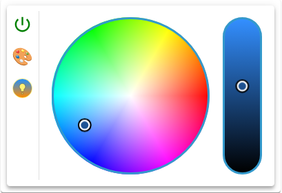

# Light Widget



## Beschreibung

Das Light Widget steuert eine Lampe mit Farbauswahl, Helligkeitsregelung und Farbtemperatursteuerung: eine Schalter-OID plus bis zu acht Kanäle, bedient über iro.js-Picker. Es unterstützt RGB, HSV und CCT (Color Temperature). Der Lichttyp legt fest, welche Kanäle das Widget bindet und welche Ansichten es zeigt. Das Lampen-Bedienelement aus Power-Button, Ansichtswechsel und Pickern steht direkt im Widget oder im Button-Modus in einem Modal.

Nur eine Schalter-OID vom Typ boolean macht das Widget lauffähig. Ohne sie zeigt der Rahmen auch bei gesetzten Kanälen nur den Hinweis „Bitte eine gültige Objekt-ID auswählen“.

## Einstellungshierarchie

Dieses Widget nutzt alle **vis-2 Einstellungen** und **Common Einstellungen**. Siehe [Home](De-Home.md) für Details.

Die Widget-spezifischen Einstellungen überschreiben die allgemeineren Einstellungen.

Zustandszeilen gibt es nur im Button-Modus, siehe [Werte](#werte). Ohne Button-Modus wirkt keine Zustandszeile, die Gruppe Icon betrifft dann nur das Eck-Icon, und die Kopfzeile hat ohne `header` keinen Text. Die Fußzeile hat ohne `footer` nur im Button-Modus einen Text, den Alias der aktiven Zeile. `valueSize` wirkt nie, weil das Widget keinen Werttext zeigt.

## Farblicht-Konfiguration

Alle Felder stehen in der Gruppe **Licht**.

### UI-Komponente

| Feldname                              | Typ      | Standard | Beschreibung                                                                         | Bedingung                                         |
| ------------------------------------- | -------- | -------- | ------------------------------------------------------------------------------------ | ------------------------------------------------- |
| UI-Komponente `colorLightUIComponent` | select   | 'wheel'  | Picker der Farbansicht (wheel, box, slider), siehe [UI-Komponenten](#ui-komponenten) | Nur bei Farbansicht: Lichttyp nicht none oder cct |
| Wheel abdunkeln `colorWheelLightness` | checkbox | false    | Das Farbrad dunkelt mit dem Helligkeitsregler ab, sonst bleibt es unverändert hell   | Nur bei Farbansicht und UI-Komponente wheel       |

### Lichttyp

| Feldname                  | Typ    | Standard | Beschreibung                                                                                                                                                                                                | Bedingung |
| ------------------------- | ------ | -------- | ----------------------------------------------------------------------------------------------------------------------------------------------------------------------------------------------------------- | --------- |
| Lichttyp `colorLightType` | select | 'none'   | Was das Widget von der Lampe steuert (none, cct, rgb, rgbcct, r/g/b, r/g/b/cct, h/s/v, h/s/v/cct). Das Panel zeigt rgbcct als `rgb & cct`, die anderen beiden entsprechend. Siehe [Lichttypen](#lichttypen) | -         |

### Farbtemperatur (CCT)

| Feldname                                  | Typ                | Standard | Beschreibung                               | Bedingung                                              |
| ----------------------------------------- | ------------------ | -------- | ------------------------------------------ | ------------------------------------------------------ |
| Farbtemperatur `colorLightTemperatureOid` | id                 | -        | Kanal der Farbtemperatur in Kelvin         | Nur bei cct, rgbcct, r/g/b/cct, h/s/v/cct              |
| Farbtemperatur (min) `colorLightCtMin`    | number (500-10000) | 2000     | Untere Grenze des Kelvin-Pickers in Kelvin | Nur bei diesen Lichttypen und gesetzter Farbtemperatur |
| Farbtemperatur (max) `colorLightCtMax`    | number (500-10000) | 6500     | Obere Grenze des Kelvin-Pickers in Kelvin  | Nur bei diesen Lichttypen und gesetzter Farbtemperatur |

### RGB-Konfiguration

| Feldname                        | Typ | Standard | Beschreibung                  | Bedingung                |
| ------------------------------- | --- | -------- | ----------------------------- | ------------------------ |
| RGB (hex) `colorLightRgbHexOid` | id  | -        | Kanal des Hex-Werts (#rrggbb) | Nur bei rgb, rgbcct      |
| Rot `colorLightRedOid`          | id  | -        | Kanal für Rot (0-255)         | Nur bei r/g/b, r/g/b/cct |
| Grün `colorLightGreenOid`       | id  | -        | Kanal für Grün (0-255)        | Nur bei r/g/b, r/g/b/cct |
| Blau `colorLightBlueOid`        | id  | -        | Kanal für Blau (0-255)        | Nur bei r/g/b, r/g/b/cct |

### HSV-Konfiguration

| Feldname                             | Typ | Standard | Beschreibung                                                        | Bedingung                                        |
| ------------------------------------ | --- | -------- | ------------------------------------------------------------------- | ------------------------------------------------ |
| Farbe (HUE) `colorLightHueOid`       | id  | -        | Kanal des Farbtons (0-360)                                          | Nur bei h/s/v, h/s/v/cct                         |
| Sättigung `colorLightSaturationOid`  | id  | -        | Kanal der Sättigung (0-100, auf der [Hue-Skala](#hue-skala) 0-254)  | Nur bei h/s/v, h/s/v/cct                         |
| Helligkeit `colorLightBrightnessOid` | id  | -        | Kanal der Helligkeit (0-100, auf der [Hue-Skala](#hue-skala) 0-254) | Nur bei cct, rgbcct, r/g/b/cct, h/s/v, h/s/v/cct |

### Button-Modus

| Feldname                                              | Typ              | Standard | Beschreibung                                                                                           | Bedingung           |
| ----------------------------------------------------- | ---------------- | -------- | ------------------------------------------------------------------------------------------------------ | ------------------- |
| Schalter (UI) `colorLightButton`                      | checkbox         | false    | Button-Modus: Klick schaltet, langer Druck öffnet das Modal. Blendet auch die Gruppe **Werte** ein     | -                   |
| Verzögerung (langer Druck) `colorLightDelayLongPress` | number (0-10000) | 500      | Ab dieser Druckdauer in Millisekunden gilt der Druck als lang. Bei `0` zählt fast jeder Druck als lang | Nur im Button-Modus |
| Modalbreite `colorLightModalWidth`                    | number (0-5000)  | -        | Breite des Modals in px. Ohne Wert oder mit `0`: Modalhöhe + Reglerbreite + 52 px                      | Nur im Button-Modus |
| Modalhöhe `colorLightModalHeight`                     | number (0-5000)  | 300      | Höhe des Modals in px. Ohne Wert oder mit `0`: 300 px                                                  | Nur im Button-Modus |

### Styling

| Feldname                                    | Typ                           | Standard | Beschreibung                                                                                                                | Bedingung |
| ------------------------------------------- | ----------------------------- | -------- | --------------------------------------------------------------------------------------------------------------------------- | --------- |
| Schiebereglerbreite `colorLightSliderWidth` | slider (0-10, Schritt 0.1)    | 1        | Breite der Regler, `1` entspricht 28 px. `0` zählt wie `1`                                                                  | -         |
| Rahmenbreite `colorLightBorderWidth`        | slider (0-100)                | 3        | Rahmenbreite der Picker in px                                                                                               | -         |
| Rahmenfarbe `colorLightBorderColor`         | color                         | -        | Rahmenfarbe der Picker, nur Vollfarbe. Ohne Wert sowie bei Farbnamen, `transparent` und `var(…)` die Primärfarbe des Themes | -         |
| Padding `colorLightPadding`                 | number (min: 0, Schritt: 0.5) | 1        | Innenabstand um die Picker in MUI-Spacing-Einheiten                                                                         | -         |

### Schalter-OID

| Feldname                                | Typ | Standard | Beschreibung                                                                                                         | Bedingung |
| --------------------------------------- | --- | -------- | -------------------------------------------------------------------------------------------------------------------- | --------- |
| Schalter (ON/OFF) `colorLightSwitchOid` | id  | -        | An/Aus der Lampe. Der Objektdialog bietet auch number, string und mixed an, lauffähig ist das Widget nur mit boolean | -         |

Die Wahl der Schalter-OID startet die [Kanalerkennung](#oid-erkennung) und legt die Zustandszeilen an.

### Werte

Die Gruppe **Werte** erscheint nur im Button-Modus und hat immer die zwei festen Zeilen `true` und `false`. Die Felder erklärt [Value-spezifische Einstellungen](De-Home.md#value-spezifische-einstellungen).

- Die Wahl der Schalter-OID legt fehlende Zeilen an: Power-Icon, `iconSize{n}` 100, `iconColor{n}` rot für `true` und grün für `false`, Alias aus `common.states`, sonst TRUE und FALSE.
- Vorhandene Zeilen behalten Reihenfolge, Alias und Stil.
- Entstehen beide Zeilen neu, setzt die Wahl `iconSize` auf `0` und blendet so das Eck-Icon aus.

**Hinweis:** Zusätzlich zu den oben genannten Einstellungen sind die **Wert schreiben**-Einstellungen (Verzögerung/Intervall) verfügbar. Diese steuern, wie Wertänderungen an die OID geschrieben werden. Siehe [Common Einstellungen - Wert schreiben](De-Home.md#wert-schreiben) für Details. Sie gelten hier für die Schalter-OID und für jeden Kanal einzeln.

## Lichttypen

### Übersicht

| Lichttyp  | Ansichten                | Kanäle der Farbansicht         | Kanäle der CCT-Ansicht     |
| --------- | ------------------------ | ------------------------------ | -------------------------- |
| none      | keine                    | -                              | -                          |
| cct       | CCT-Ansicht              | -                              | Farbtemperatur, Helligkeit |
| rgb       | Farbansicht              | RGB (hex)                      | -                          |
| rgbcct    | Farbansicht, CCT-Ansicht | RGB (hex)                      | Farbtemperatur, Helligkeit |
| r/g/b     | Farbansicht              | Rot, Grün, Blau                | -                          |
| r/g/b/cct | Farbansicht, CCT-Ansicht | Rot, Grün, Blau                | Farbtemperatur, Helligkeit |
| h/s/v     | Farbansicht              | Farbton, Sättigung, Helligkeit | -                          |
| h/s/v/cct | Farbansicht, CCT-Ansicht | Farbton, Sättigung, Helligkeit | Farbtemperatur, Helligkeit |

Das Panel zeigt nur die Kanäle des gewählten Lichttyps. Bei none hat das Lampen-Bedienelement weder Power-Button noch Picker; im Button-Modus schaltet der Klick trotzdem, das Widget ist dann ein reiner An/Aus-Button.

### RGB

- **RGB Hex**: Kompletter Farbwert als Hex-String (z. B. `#ff0000` für Rot)
- **Separate Kanäle**: Rot, Grün, Blau jeweils 0-255
- **Verwendung**: Standard für die meisten RGB-Lichter

### CCT (Color Temperature)

- **Farbtemperatur**: Warmweiß bei `colorLightCtMin` bis Kaltweiß bei `colorLightCtMax`, in Kelvin
- **Nur Weißtöne**: Keine Farbsteuerung
- **Verwendung**: Weiße LED-Strips, Deckenleuchten

### HSV (Hue, Saturation, Value)

- **Hue (Farbton)**: 0-360° (Farbkreis)
- **Saturation (Sättigung)**: 0-100% (Grau bis volle Farbe)
- **Value (Helligkeit)**: 0-100%
- **Verwendung**: Philips Hue, einige Smart-Lichter

## UI-Komponenten

Die UI-Komponente gilt nur in der Farbansicht. Sie wechselt die Darstellung, nicht die Kanäle: Was geschrieben wird, entscheidet der Lichttyp.

### Wheel (Farbrad)

- Kreisförmige Farbauswahl für Farbton und Sättigung
- Daneben ein Helligkeitsregler
- Mit `colorWheelLightness` dunkelt das Farbrad mit dem Regler ab

### Box (Farbfeld)

- Rechteckige Farbauswahl
- Helligkeit und Sättigung in einem Feld
- Farbton über Slider

### Slider

- Immer drei Regler Rot, Grün und Blau, auch bei h/s/v
- Kein eigener Helligkeitsregler
- Bei h/s/v schreibt ein Regler die Komponenten, die sich durch ihn ändern, in die Kanäle Farbton, Sättigung und Helligkeit

### CCT-Ansicht

- Ersetzt die UI-Komponente durch zwei Regler: Kelvin-Picker und Helligkeits-Picker
- Der Kelvin-Picker reicht von `colorLightCtMin` bis `colorLightCtMax`
- Kelvin-Kopplung: Der Helligkeits-Picker zeigt immer den Weißton des Kelvin-Pickers bei seiner eigenen Helligkeit. Das schreibt nichts

## OID-Erkennung

Das Widget kann automatisch die Kanäle einer Lampe erkennen:

### Automatische Erkennung

1. Wähle eine Schalter-OID (`colorLightSwitchOid`)
2. Das Widget liest alle States unterhalb des Elternobjekts der Schalter-OID
3. Es füllt jedes leere Kanalfeld aus dem State mit der passenden Rolle, siehe Tabelle, unabhängig vom Lichttyp
4. Der Lichttyp (`colorLightType`) bleibt deine Wahl; bereits gewählte Kanäle bleiben unberührt

| Rolle                                                                            | Kanal                                     |
| -------------------------------------------------------------------------------- | ----------------------------------------- |
| `level.color.rgb`                                                                | RGB (hex) `colorLightRgbHexOid`           |
| `level.color.red`, `level.color.green`, `level.color.blue`                       | Rot, Grün, Blau                           |
| `level.color.hue`, `level.color.saturation`                                      | Farbe (HUE), Sättigung                    |
| `level.brightness`, `level.dimmer`, `level.color.luminance`, `level.color.white` | Helligkeit `colorLightBrightnessOid`      |
| `level.color.temperature`                                                        | Farbtemperatur `colorLightTemperatureOid` |

- Passen mehrere States auf einen Kanal, gewinnt der erste.
- Eine neu erkannte Farbtemperatur übernimmt `common.min` und `common.max` nach `colorLightCtMin` und `colorLightCtMax`, soweit vorhanden und nicht `0`.
- Um einen Kanal neu erkennen zu lassen: Feld leeren und die Schalter-OID erneut wählen.
- Liefert die Wahl kein brauchbares Objekt, läuft keine Erkennung; die Zustandszeilen bleiben.

### Manuelle Konfiguration

- Alle Kanäle können manuell gesetzt werden
- Nützlich bei ungewöhnlichen Geräten
- Ermöglicht individuelle Zuordnung
- Die Wahl eines Kanals speichert nur dessen Objekt, sonst ändert sie nichts

## Farbsteuerung

Jede Bewegung eines Reglers läuft über die Einstellungen [Wert schreiben](De-Home.md#wert-schreiben). Ein Kanal ohne gespeichertes Objekt bekommt keinen Wert. Zahlen gehen ganzzahlig an den State.

### Power-Button

- Schreibt den umgekehrten Wert der Schalter-OID, ohne Wert `true`
- Das Icon ist rot bei `true` und grün sonst

### RGB-Steuerung

**Option 1: RGB Hex**

- Setze nur `colorLightRgbHexOid`
- Widget schreibt den Hex-Wert in Kleinbuchstaben (z. B. `#ff0000`)
- Einfachste Konfiguration

**Option 2: Separate Kanäle**

- Setze `colorLightRedOid`, `colorLightGreenOid`, `colorLightBlueOid`
- Widget schreibt bei jeder Änderung alle drei Werte (0-255)
- Fehlt einer der drei, schreibt das Widget die anderen weiter, der Picker folgt der Lampe aber nicht

### HSV-Steuerung

- Setze `colorLightHueOid`, `colorLightSaturationOid`, `colorLightBrightnessOid`
- Widget schreibt nur die Komponente, die sich geändert hat
- Fehlt einer der drei, schreibt das Widget die anderen weiter, der Picker folgt der Lampe aber nicht

### Hue-Skala

Ein Kanal für Sättigung oder Helligkeit, dessen Objekt beim Auswählen `common.max` 254 hatte, liegt auf der Hue-Skala: Die Picker arbeiten in Prozent, das Widget rechnet beim Lesen und Schreiben auf 0-254 um. Der Farbton und andere Maximalwerte als 254 werden nicht umgerechnet. Maßgeblich ist das beim Auswählen gespeicherte `common.max`.

### Farbtemperatur (CCT)

- Setze `colorLightTemperatureOid`
- Definiere Min/Max in Kelvin
- Slider zeigt Warmweiß → Kaltweiß
- Widget schreibt den Kelvin-Wert ganzzahlig; eine Umrechnung etwa aus Mired gibt es nicht

### Ansichtswechsel (rgbcct, r/g/b/cct, h/s/v/cct)

Zwei Knöpfe unter dem Power-Button schalten zwischen Farbansicht (Farbrad) und CCT-Ansicht (Weiß). Der Wechsel schaltet die Lampe, weil er den gespeicherten Zustand der Zielansicht erneut schreibt:

- Wechsel in die CCT-Ansicht schreibt die gespeicherte Farbtemperatur (ganzzahlig; ohne brauchbaren Wert 2000 K) – die Lampe schaltet auf Weiß. Die Helligkeit wird dabei nicht geschrieben. Ohne Kanal Farbtemperatur schreibt er nichts
- Wechsel zurück in die Farbansicht schreibt die gespeicherten Farbwerte (Hex, R/G/B oder H/S/V) – die Lampe schaltet wieder auf Farbe. Ein Kanal ohne OID, Objekt oder brauchbaren Wert wird übersprungen
- Ein Klick auf die aktive Ansicht schreibt nichts
- Das Widget startet immer in der Farbansicht, auch wenn die Lampe gerade weiß leuchtet. Der Start schreibt nichts

### Änderungen von außen

- Eine Fremdänderung bewegt die Picker der aktiven Ansicht: In der Farbansicht folgen sie den Farbkanälen, in der CCT-Ansicht der Farbtemperatur und der Helligkeit. Das Nachführen schreibt nichts
- Eine Fremdänderung um weniger als 1 bei Zahlen bewegt nichts
- Die andere Ansicht liest ihre Kanäle erst beim Wechsel
- Ohne brauchbaren Wert zeigt der Picker 2000 K, `#ffffff` oder bei R/G/B den Wert 0

## Helligkeitsregelung

- Separater Kanal: `colorLightBrightnessOid`
- Wert: 0-100%, auf der [Hue-Skala](#hue-skala) 0-254
- Slider im Widget
- Genutzt von den Lichttypen `cct`, `h/s/v` und `h/s/v/cct` sowie in der CCT-Ansicht von `rgbcct` und `r/g/b/cct`
- In der Farbansicht von `rgb`, `rgbcct`, `r/g/b` und `r/g/b/cct` steckt die Helligkeit im geschriebenen Farbwert, der Kanal bleibt unberührt
- Bei `h/s/v/cct` nutzen beide Ansichten denselben Kanal
- Ohne Kanal bewegt sich der Regler, schreibt aber nichts

## Button-Modus

Mit `colorLightButton = true`:

- Das Widget zeigt einen Button mit dem Icon der aktiven Zustandszeile der Schalter-OID, samt deren Größe, Versatz und Farbmaske, ohne Werttext
- Click schaltet `colorLightSwitchOid` ein/aus, wie der [Power-Button](#power-button)
- Langer Druck öffnet das Modal mit dem Lampen-Bedienelement und schreibt nichts
- Long-Press-Verzögerung über `colorLightDelayLongPress` konfigurierbar
- Verlässt der Zeiger den Button vorzeitig oder bricht der Browser den Druck ab, etwa weil eine Berührung in Scrollen übergeht, schaltet nichts und das Modal bleibt zu

## Modal-Dialog

Nur im Button-Modus, nach langem Druck:

- Öffnet das Lampen-Bedienelement im Rahmen des Widgets
- Größe über `colorLightModalWidth/Height` einstellbar
- Vollständige Steuerung mit Power-Button, Ansichtswechsel und Pickern, beginnend in der Farbansicht
- Schließt per Click außerhalb oder Escape; ein noch wartender Wert geht dabei sofort an die OID

## Anwendungsbeispiele

### RGB LED-Strip

```
colorLightType: rgb
colorLightUIComponent: wheel
colorLightSwitchOid: hue.0.strip.on
colorLightRgbHexOid: hue.0.strip.rgb
```

### Philips Hue (HSV)

Mit `common.max` 254 an `sat` und `bri` greift die [Hue-Skala](#hue-skala).

```
colorLightType: h/s/v
colorLightUIComponent: wheel
colorLightSwitchOid: hue.0.lamp.on
colorLightHueOid: hue.0.lamp.hue
colorLightSaturationOid: hue.0.lamp.sat
colorLightBrightnessOid: hue.0.lamp.bri
```

### CCT Deckenleuchte

Kein Ansichtswechsel, der Start schreibt nichts.

```
colorLightType: cct
colorLightSwitchOid: zigbee.0.lamp.state
colorLightTemperatureOid: zigbee.0.lamp.color_temp
colorLightBrightnessOid: zigbee.0.lamp.brightness
colorLightCtMin: 2700
colorLightCtMax: 6500
```

### RGB im Button-Modus

Die Zustandszeilen entstehen mit der Wahl der Schalter-OID.

```
colorLightType: rgb
colorLightUIComponent: box
colorLightSwitchOid: hue.0.strip.on
colorLightRgbHexOid: hue.0.strip.rgb
colorLightButton: true
colorLightDelayLongPress: 1000
```
