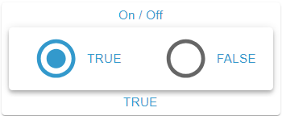

# RadioGroup Widget

## Beschreibung

Das RadioGroup Widget stellt die Zustandszeilen einer OID als Radio-Buttons dar und schreibt beim Anwählen den Wert der Zeile an die OID. Es akzeptiert die Datentypen boolean, number, string und mixed. Alle Optionen sind gleichzeitig sichtbar, was die Auswahl erleichtert.

## Einstellungshierarchie

Dieses Widget nutzt alle **vis-2 Einstellungen** und **Common Einstellungen**. Siehe [Home](De-Home.md) für Details.

Die Widget-spezifischen und Value-spezifischen Einstellungen überschreiben die allgemeineren Einstellungen.

## Widget-spezifische Einstellungen

Die Felder stehen in der Gruppe **Radio-Gruppe**.

| Feldname                                           | Typ                               | Standard     | Beschreibung                                                                                                                | Bedingung                                       |
| -------------------------------------------------- | --------------------------------- | ------------ | --------------------------------------------------------------------------------------------------------------------------- | ----------------------------------------------- |
| Objekt-ID `oid`                                    | id                                | -            | OID, deren Wert die Auswahl bestimmt und an die geschrieben wird; akzeptiert die Typen boolean, number, string und mixed    | -                                               |
| Einheit `unit`                                     | text                              | ''           | Einheit (wird aus dem Objekt übernommen, hier überschreibbar, Leeren entfernt sie); erscheint an Labels ohne Alias          | Nur wenn eine OID gewählt ist                   |
| Orientierung `radioOrientation`                    | select (`horizontal`, `vertical`) | `horizontal` | Ausrichtung der Radio-Gruppe, siehe [Orientierung](#orientierung)                                                           | -                                               |
| Label ausblenden `hideLabels`                      | checkbox                          | false        | Blendet die Labels aus, siehe [Label ausblenden](#label-ausblenden)                                                         | -                                               |
| Labelposition `labelPlacement`                     | select (`start`, `end`)           | `end`        | Position des Labels relativ zum Radio-Button                                                                                | Ausgeblendet bei aktivem `hideLabels`           |
| Unchecked Iconfarbe `radioGroupUncheckedIconColor` | color                             | -            | Nur Vollfarbe. Farbe der nicht ausgewählten Radio-Buttons. Ohne Wert die sekundäre Textfarbe des Themes                     | -                                               |
| Nur Anzeige `onlyDisplay`                          | checkbox                          | false        | Sperrt die Radio-Buttons, es wird nichts geschrieben. Jede OID-Wahl setzt das Feld neu: true bei `write=false`, sonst false | Ausgeblendet, wenn das Objekt `write=false` hat |

**Hinweis:** Zusätzlich zu den oben genannten Einstellungen sind die **Wert schreiben**-Einstellungen (Verzögerung/Intervall) verfügbar. Diese steuern, wie Wertänderungen an die OID geschrieben werden. Siehe [Common Einstellungen - Wert schreiben](De-Home.md#wert-schreiben) für Details.

### Schreibverhalten

- **Anwählen**: Schreibt den Wert der Zeile mit den **Wert schreiben**-Einstellungen, gewandelt in den Typ der OID (siehe [Datentypen](#datentypen)). Die Auswahl springt sofort auf den Radio-Button.
- **Erneuter Klick**: Ein Klick auf einen schon ausgewählten Radio-Button schreibt nichts.
- **Auswahl**: Ausgewählt ist jeder Radio-Button, dessen Wert dem aktuellen Wert der OID entspricht, auch nach einer Änderung von außen. Mehrere Zeilen mit demselben Wert sind alle ausgewählt. Passt keine Zeile, ist keiner ausgewählt.
- **Sperre**: Bei aktivem `onlyDisplay` oder `write=false` am Objekt sind alle Radio-Buttons deaktiviert und es wird nichts geschrieben. Die Auswahl folgt weiter dem Wert.

## Orientierung

### Horizontal (Standard)

- Radio-Buttons werden nebeneinander angeordnet (von links nach rechts), gleichmäßig verteilt und vertikal zentriert
- Jeder Radio-Button ist quadratisch und höchstens so hoch wie der gemessene Platz im Rahmen
- Platzsparend in der Höhe
- Gut für 2-4 Optionen

### Vertikal

- Radio-Buttons werden untereinander angeordnet (von oben nach unten) und teilen sich den gemessenen Platz im Rahmen zu gleichen Teilen
- Nur der Wert `horizontal` ordnet nebeneinander an; fehlt der Wert im Widget, stapelt es ebenfalls
- Platzsparend in der Breite
- Gut für mehr als 4 Optionen oder lange Beschriftungen

## Label-Einstellungen

### Label ausblenden

- Aktiviere `hideLabels`, um nur die Radio-Buttons ohne Beschriftung anzuzeigen; `labelPlacement` ist dann ausgeblendet
- Nützlich für kompakte Darstellungen
- Radio-Buttons werden zentriert ausgerichtet

### Labelposition

Die Position des Labels wird über `labelPlacement` gesteuert (nur sichtbar, wenn `hideLabels` deaktiviert ist). Der Text selbst ist in beiden Fällen linksbündig:

#### Start

- Label wird links vom Radio-Button angezeigt (bei LTR-Layout)

#### End (Standard)

- Label wird rechts vom Radio-Button angezeigt (bei LTR-Layout)

## Icon-Farben

### Ausgewählter Radio-Button

- Wird in `iconColor{n}` angezeigt, sonst in `iconColor`, sonst in der Primärfarbe des Themes; auch gesperrt
- Dieselbe Farbe hat die Klick-Animation (Ripple)

### Nicht ausgewählte Radio-Buttons

- Farbe über `radioGroupUncheckedIconColor` einstellbar; `iconColor{n}` wirkt hier nicht
- Standard: Sekundäre Textfarbe des Themes, gesperrt die Farbe `action.active` des Themes
- Hilft bei der visuellen Unterscheidung

## Datentypen

Die Radio-Buttons kommen aus den Zustandszeilen. Eine Zeile passt zum Wert der OID, wenn beide als Text gleich sind; `1` und `'1'` sind also derselbe Zustand. Beim Schreiben gilt je Typ:

### Boolean

- Zwei feste Zeilen mit den Werten `true` und `false`: `value{n}` ist ausgeblendet, Zeilen lassen sich nicht hinzufügen, klonen oder löschen. Der Alias kommt aus `common.states`, sonst `TRUE` und `FALSE`
- Alternative zu Switch/Checkbox mit expliziter Beschriftung
- Typische Anwendung: Ja/Nein-Fragen

### Number

- Mehrere Radio-Buttons für numerische Werte, geschrieben als Zahl. Eine nicht numerische Zeile wird nie aktiv und schreibt nichts
- Beispiel: Lüfterstufen (0, 1, 2, 3)
- Gut für diskrete Werte mit klarer Bedeutung

### String

- Mehrere Radio-Buttons für Textwerte, geschrieben als Text
- Beispiel: Betriebsmodi (Auto, Manuell, Eco, Comfort)
- Standard-Anwendungsfall

### Mixed

- Mehrere Radio-Buttons für beliebige Werte: `true` und `false` (ohne Rücksicht auf Groß-/Kleinschreibung) werden als Boolean geschrieben, zahlenförmige Werte als Zahl (aus `007` wird `7`), alles andere als Text
- Eine Zeile, deren Text sich dabei ändert (`007`, `TRUE`), passt danach nicht zum Wert der OID und wird nicht aktiv

## Value-spezifische Einstellungen

Jeder Radio-Button ist eine Zeile im Zustandseditor, der Gruppe **Werte** (Felder siehe [Value-spezifische Einstellungen](De-Home.md#value-spezifische-einstellungen)). Bei der OID-Wahl werden die Zustände aus `common.states` als Zeilen ergänzt, vorhandene Zeilen bleiben erhalten. **Aus common.states neu anlegen** ersetzt alle Zeilen. Ohne Zeile mit Wert zeigt das Widget keine Radio-Buttons. Im Widget wirken die Felder so:

- **Label**: `alias{n}`, sonst der Wert mit Einheit. HTML ist erlaubt, nach zwei Zeilen wird der Text abgeschnitten. Größe aus `valueSize{n}`, Farbe aus `textColor{n}` (Gradient möglich)
- **Icon**: Nur der ausgewählte Radio-Button zeigt ein Icon, im Ring statt des Punkts: `icon{n}` oder `iconSmall{n}`, sonst das Basis-Icon. Nicht ausgewählte zeigen den leeren Ring. Die OID-Wahl setzt `icon` aus dem Objekt
- **Icongröße**: Breite ist die Hälfte von `iconSize{n}` in Prozent des Rings, ohne Wert 50 %. Das Basisfeld `iconSize` gilt nur für das Eck-Icon
- **Rahmen**: `background{n}` (Inhaltsfläche), `frameBackground{n}`, `header{n}`, `headerSize{n}`, `footer{n}` und `footerSize{n}` gelten, solange die Zeile aktiv ist, nicht am Radio-Button; bei mehreren aktiven Zeilen die erste

**Hinweis:** Das Label kommt aus `alias{n}`, nicht aus dem Header.

## Anwendungsbeispiele

- **Heizmodus**: string-OID mit den Werten Auto, Heizen, Kühlen, Eco (`vertical`)
- **Lichtszenen**: number-OID mit Szenennummern und den Aliasen Lesen, Film, Party, Entspannung (`horizontal`)
- **Priorität**: number-OID mit `common.states` Niedrig, Mittel, Hoch (`horizontal`)
- **Wochentag-Auswahl**: string-OID mit den Werten Mo, Di, Mi, Do, Fr, Sa, So (`horizontal`)
- **Zahlungsart**: string-OID mit den Werten Kreditkarte, PayPal, Rechnung, Vorkasse (`vertical`)

## Vorteile gegenüber Select

- **Alle Optionen sichtbar**: Keine Interaktion nötig, um Optionen zu sehen
- **Schnellere Auswahl**: Ein Klick genügt
- **Bessere Übersicht**: Besonders bei 2-5 Optionen

## Nachteile gegenüber Select

- **Mehr Platz**: Alle Optionen benötigen Raum
- **Nicht für viele Optionen**: Wird unübersichtlich bei >7 Optionen
- **Icons**: Nur der ausgewählte Radio-Button zeigt sein Icon, das Select zeigt es bei jeder Option
