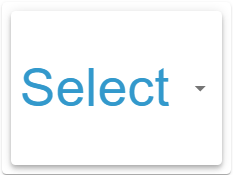

# Select Widget

## Beschreibung

Das Select Widget bietet eine Dropdown-Auswahl für verschiedene Datentypen. Es ist platzsparend und übersichtlich, besonders bei vielen Optionen.

## Einstellungshierarchie

Dieses Widget nutzt alle **vis-2 Einstellungen** und **Common Einstellungen**. Siehe [Home](De-Home.md) für Details.

Die Widget-spezifischen Einstellungen überschreiben die allgemeineren Einstellungen.

## Widget-spezifische Einstellungen

| Feldname    | Typ      | Standard                         | Beschreibung                                                                                                | Bedingung                                          |
| ----------- | -------- | -------------------------------- | ----------------------------------------------------------------------------------------------------------- | -------------------------------------------------- |
| onlyDisplay | checkbox | false                            | Nur Anzeige (Auswahl gesperrt, es wird nichts geschrieben)                                                  | Ausgeblendet, wenn das Schreibziel write=false hat |
| cid         | id       | -                                | Steuer ID: optionale zweite OID, an die die Auswahl geschrieben wird (Typen boolean, number, string, mixed) | -                                                  |
| arrowColor  | color    | Textfarbe des ausgewählten Werts | Farbe des Dropdown-Pfeils                                                                                   | -                                                  |

**Hinweis:** Zusätzlich zu den oben genannten Einstellungen sind die **Wert schreiben**-Einstellungen (Verzögerung/Intervall) verfügbar. Diese steuern, wie Wertänderungen an das Schreibziel geschrieben werden. Siehe [Common Einstellungen - Wert schreiben](De-Home.md#wert-schreiben) für Details.

### Steuer ID (Status und Befehl getrennt)

Viele Geräte trennen den Status (z. B. `…mode`) vom Befehl (z. B. `…setMode`). Dafür hat das Select Widget die **Steuer ID**:

- **Anzeige**: Das Select zeigt immer den Wert der OID (Status).
- **Schreiben**: Ist eine Steuer ID gesetzt, geht jede Auswahl ausschließlich an die Steuer ID — die OID wird nicht beschrieben. Ohne Steuer ID wird wie gewohnt die OID beschrieben.
- **Schreibziel**: Die OID, an die geschrieben wird, heißt Schreibziel — also die Steuer ID, wenn gesetzt, sonst die OID.
- **Sperre**: Die Auswahl ist gesperrt, wenn **Nur Anzeige** aktiv ist oder das Schreibziel `write=false` hat. Eine schreibgeschützte Status-OID sperrt das Select also nicht, solange eine beschreibbare Steuer ID gesetzt ist. Hat das Schreibziel `write=false`, wird **Nur Anzeige** ausgeblendet, weil die Auswahl ohnehin gesperrt ist.
- **Werte**: Die Optionen werden nur einmal definiert. Die gewählte Option schreibt ihren Wert unverändert an die Steuer ID — sie muss also dieselben Werte verstehen, die der Status meldet.

## Datentypen

Das Select Widget unterstützt verschiedene Datentypen:

### Boolean

- Dropdown mit zwei Optionen: true und false
- Kompakte Alternative zu Switch oder Checkbox
- Typische Anwendung: Ein/Aus-Auswahl in Listen

### Number

- Dropdown mit numerischen Werten
- Beispiel: Temperaturstufen (18, 20, 22, 24°C)
- Gut für diskrete Werte mit klarer Bedeutung

### String

- Dropdown mit Textwerten
- Beispiel: Betriebsmodi (Auto, Manuell, Eco, Comfort, Sport)
- Standard-Anwendungsfall für Auswahlmenüs

### Mixed

- Dropdown mit beliebigen Werten
- Flexible Anwendung für verschiedene Datentypen
- Beispiel: Gemischte Listen mit Zahlen und Texten

## Funktionsweise

### Geschlossener Zustand

- Zeigt den aktuell ausgewählten Wert an
- Dropdown-Pfeil in der konfigurierten Farbe (`arrowColor`), sonst in der Textfarbe des ausgewählten Werts
- Kompakte Darstellung

### Geöffneter Zustand

- Liste aller verfügbaren Optionen
- Aktueller Wert ist hervorgehoben
- Click außerhalb schließt das Dropdown

## Value-spezifische Einstellungen

Für jede Option im Dropdown können individuelle Einstellungen vorgenommen werden:

- Icon (groß und klein)
- Text (Header, Footer)
- Farben (Icon, Text, Hintergrund)
- Alle Common-Felder mit Suffix (z.B. icon1, header2, ...)

**Hinweis:** Icons und zusätzliche Texte werden in der Dropdown-Liste angezeigt, nicht im geschlossenen Zustand.

## Anwendungsbeispiele

- **Thermostat-Modi**: Auto, Heizen, Kühlen, Eco, Comfort
- **Lüfterstufen**: Aus, 1, 2, 3, Auto
- **Lichtszenen**: Aus, Lesen, Film, Party, Entspannung
- **Alarmmodus**: Scharf, Teilscharf, Unscharf, Urlaub
- **Playlist-Auswahl**: Liste aller verfügbaren Playlists

## Vorteile

- **Platzsparend**: Nur eine Zeile im geschlossenen Zustand
- **Übersichtlich**: Alle Optionen in sortierter Liste
- **Skalierbar**: Geeignet für viele Optionen (>5)
- **Standard-UI**: Vertrautes Bedienelement
