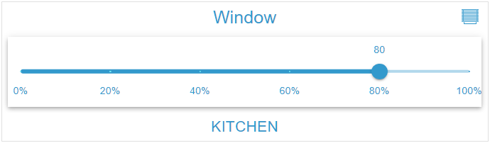
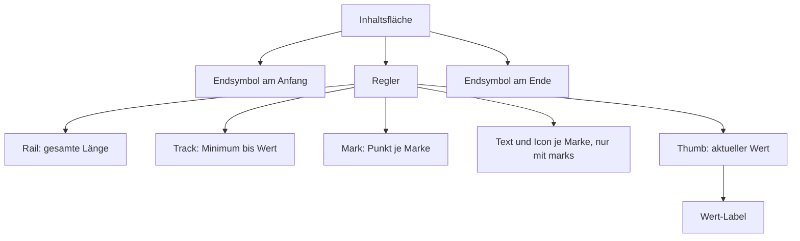

# Slider Widget

## Beschreibung

Das Slider Widget ist ein Schieberegler für eine OID vom Typ number. Beim Bewegen schreibt es den Wert nach den **Wert schreiben**-Einstellungen. Orientierung, Marken, Endsymbole und alle Teile des Reglers sind einzeln konfigurierbar.

## Einstellungshierarchie

Dieses Widget nutzt alle **vis-2 Einstellungen** und **Common Einstellungen**. Siehe [Home](De-Home.md) für Details.

Die Gruppe **Schieberegler** betrifft Regler, Marken und Endsymbole. Bei den Marken gehen ihre Marker-Felder den Basisfeldern vor, siehe [Styling](#styling). Der Slider hat keine Wert-Anzeige: `valueSize` gilt für das Wert-Label und die Marken, `textColor` zusätzlich für Kopf- und Fußzeile. Die Gruppe **Aktiv** wirkt wie unter [Value-spezifische Einstellungen](De-Home.md#value-spezifische-einstellungen) beschrieben, ihre Besonderheiten stehen unter [Ausgewählte Marke](#ausgewählte-marke).

## Widget-spezifische Einstellungen

### Grundeinstellungen

| Feldname                                    | Typ                               | Standard     | Beschreibung                                                                                                                                                                                                          | Bedingung                                        |
| ------------------------------------------- | --------------------------------- | ------------ | --------------------------------------------------------------------------------------------------------------------------------------------------------------------------------------------------------------------- | ------------------------------------------------ |
| Objekt-ID `oid`                             | id                                | -            | Nimmt nur den Typ number an. Die Wahl setzt `minValue` und `maxValue` auf `common.min` und `common.max`, ohne Angabe auf 0 und 100, und ergänzt Zustandszeilen aus `common.states`. `common.step` übernimmt sie nicht | -                                                |
| Einheit `unit`                              | text                              | -            | Einheit an den Marken und in der Fußzeile, nicht im Wert-Label. Kommt aus dem Objekt, hier überschreibbar, Leeren entfernt sie                                                                                        | Nur wenn eine OID gewählt ist                    |
| Nur Anzeige `onlyDisplay`                   | checkbox                          | false        | Sperrt den Regler. Die OID-Wahl setzt das Feld auf true, wenn das Objekt `write: false` hat, sonst auf false                                                                                                          | Ausgeblendet, wenn das Objekt `write: false` hat |
| Größe `sliderSize`                          | select (`small`, `medium`)        | `medium`     | MUI-Größe des Reglers. Die Maße von Thumb, Track und Rail kommen aus ihren eigenen Feldern                                                                                                                            | -                                                |
| Orientierung `sliderOrientation`            | select (`horizontal`, `vertical`) | `horizontal` | Siehe [Orientierung](#orientierung). Ohne Wert horizontal                                                                                                                                                             | -                                                |
| Abstand Slider - Icon (min/max) `sliderGap` | number (0-100, Schritt 0.1)       | 0            | Abstand zwischen Regler und Endsymbolen in MUI-Spacing-Einheiten                                                                                                                                                      | -                                                |
| Label `valueLabelDisplay`                   | select (`on`, `off`, `auto`)      | `off`        | Wert-Label am Thumb: `on` immer, `auto` bei Hover, Fokus und beim Ziehen, `off` nie. Es zeigt die Zahl ohne Einheit                                                                                                   | -                                                |
| Labelposition `labelPosition`               | text                              | `-5px`       | CSS-Länge: `top` des Wert-Labels bei horizontalem, `right` bei vertikalem Regler                                                                                                                                      | Ausgeblendet bei `valueLabelDisplay` = `off`     |
| Farbe `sliderColor`                         | color                             | -            | Farbe (Gradient möglich) aller Teile des Reglers ohne eigene Farbe. Ohne Wert die Primärfarbe des Themes                                                                                                              | -                                                |
| Padding `sliderPadding`                     | number (ab 0, Schritt 0.5)        | 1            | Innenabstand der Inhaltsfläche in MUI-Spacing-Einheiten                                                                                                                                                               | -                                                |

### Wertebereich

| Feldname                  | Typ      | Standard | Beschreibung                                                                                                                            | Bedingung                                        |
| ------------------------- | -------- | -------- | --------------------------------------------------------------------------------------------------------------------------------------- | ------------------------------------------------ |
| Mindestwert `minValue`    | number   | 0        | Untere Grenze. Leer: der kleinste Wert der Zustandszeilen, ohne Zeilen 0. Wirkungslos bei `onlyStates`                                  | -                                                |
| Maximalwert `maxValue`    | number   | 100      | Obere Grenze. Leer: der größte Wert der Zustandszeilen, ohne Zeilen 100. Wirkungslos bei `onlyStates`                                   | -                                                |
| Schrittweite `step`       | number   | 10       | Raster des Thumbs, gezählt ab `minValue`. Leer: 1. Bei `0` rastet der Thumb beim Ziehen an den Marken ein. Wirkungslos bei `onlyStates` | -                                                |
| Nur Zustände `onlyStates` | checkbox | false    | Siehe [Diskrete Werte](#diskrete-werte-onlystates)                                                                                      | Nur sichtbar, wenn das Widget Zustandszeilen hat |

### Markierungen

| Feldname                            | Typ            | Standard | Beschreibung                                                                                               | Bedingung                  |
| ----------------------------------- | -------------- | -------- | ---------------------------------------------------------------------------------------------------------- | -------------------------- |
| Markierungen `marks`                | checkbox       | false    | Zeigt Text und Icon der Marken und reserviert Platz dafür. Die Punkte auf der Rail erscheinen auch ohne    | -                          |
| Markierungsposition `markPosition`  | text           | `30px`   | CSS-Länge: `top` der Beschriftung bei horizontalem, `left` bei vertikalem Regler                           | Nur wenn `marks` aktiv ist |
| Markierungsschrittweite `markStep`  | number         | 10       | Abstand der Zwischenmarken. Ein gespeicherter Wert bestimmt auch bei ausgeblendetem Feld, wo Punkte liegen | Nur wenn `marks` aktiv ist |
| Zustandstextfarbe `markerTextColor` | color          | -        | Textfarbe der Marken (Gradient möglich)                                                                    | Nur wenn `marks` aktiv ist |
| Zustandstextgröße `markerTextSize`  | slider (0-500) | -        | Textgröße der Marken. `100` entspricht 0,875 rem                                                           | Nur wenn `marks` aktiv ist |
| Zustandsiconfarbe `markerIconColor` | color          | -        | Iconfarbe der Marken, nur Vollfarbe                                                                        | Nur wenn `marks` aktiv ist |
| Zustandsicongröße `markerIconSize`  | slider (1-500) | -        | Iconbreite der Marken in Prozent von 24 px                                                                 | Nur wenn `marks` aktiv ist |

### Start-Icon (Min)

| Feldname                            | Typ    | Standard | Beschreibung                                                                                                                | Bedingung                                     |
| ----------------------------------- | ------ | -------- | --------------------------------------------------------------------------------------------------------------------------- | --------------------------------------------- |
| Kleines Icon Minimum `iconSmallMin` | icon64 | -        | SVG aus dem Icon-Wähler, als Base64-Wert gespeichert                                                                        | Ausgeblendet, wenn `iconMin` gesetzt ist      |
| Icon Minimum `iconMin`              | image  | -        | Bilddatei, hat Vorrang vor `iconSmallMin`                                                                                   | Ausgeblendet, wenn `iconSmallMin` gesetzt ist |
| Icongröße `iconSizeStart`           | text   | `24px`   | Breite als CSS-Länge. Leer: 24 px                                                                                           | Nur mit einem der beiden Icons                |
| Iconfarbe `startIconColor`          | color  | -        | Nur Vollfarbe. Färbt jedes Icon, ein Bild als Silhouette. Ohne Wert: Base64-Icon in der Primärfarbe, Bild in eigenen Farben | Nur mit einem der beiden Icons                |

### End-Icon (Max)

| Feldname                            | Typ    | Standard | Beschreibung                                                                                                                | Bedingung                                     |
| ----------------------------------- | ------ | -------- | --------------------------------------------------------------------------------------------------------------------------- | --------------------------------------------- |
| Kleines Icon Maximum `iconSmallMax` | icon64 | -        | SVG aus dem Icon-Wähler, als Base64-Wert gespeichert                                                                        | Ausgeblendet, wenn `iconMax` gesetzt ist      |
| Icon Maximum `iconMax`              | image  | -        | Bilddatei, hat Vorrang vor `iconSmallMax`                                                                                   | Ausgeblendet, wenn `iconSmallMax` gesetzt ist |
| Icongröße `iconSizeEnd`             | text   | `24px`   | Breite als CSS-Länge. Leer: 24 px                                                                                           | Nur mit einem der beiden Icons                |
| Iconfarbe `endIconColor`            | color  | -        | Nur Vollfarbe. Färbt jedes Icon, ein Bild als Silhouette. Ohne Wert: Base64-Icon in der Primärfarbe, Bild in eigenen Farben | Nur mit einem der beiden Icons                |

### Erweiterte Styling-Optionen

Der Slider besteht aus mehreren Komponenten, die individuell gestylt werden können:

#### Thumb (Knopf)

| Feldname                             | Typ            | Standard | Beschreibung                                                                                                                            | Bedingung |
| ------------------------------------ | -------------- | -------- | --------------------------------------------------------------------------------------------------------------------------------------- | --------- |
| Thumbbreite `thumbWidth`             | number (ab 0)  | 20       | Breite in px                                                                                                                            | -         |
| Thumbhöhe `thumbHeight`              | number (ab 0)  | 20       | Höhe in px                                                                                                                              | -         |
| Thumbfarbe `thumbColor`              | color          | -        | Farbe des Thumbs (Gradient möglich). Ohne Wert `sliderColor`. Der Schein bei Hover und beim Ziehen nutzt diese Farbe mit 32 % Deckkraft | -         |
| Thumbrahmenbreite `thumbBorderWidth` | number (0-100) | 0        | Rahmenbreite in px. Nur ein positiver Wert zeichnet einen Rahmen                                                                        | -         |
| Thumbrahmenfarbe `thumbBorderColor`  | color          | -        | Rahmenfarbe (Gradient möglich). Ohne Wert `thumbColor`, dann `sliderColor`                                                              | -         |

#### Track (Aktiver Bereich)

| Feldname                             | Typ            | Standard | Beschreibung                                                 | Bedingung |
| ------------------------------------ | -------------- | -------- | ------------------------------------------------------------ | --------- |
| Trackdicke `trackLength`             | number (ab 0)  | 4        | Dicke quer zum Regler in px                                  | -         |
| Trackfarbe `trackBackgroundColor`    | color          | -        | Farbe des Tracks (Gradient möglich). Ohne Wert `sliderColor` | -         |
| Trackrahmenbreite `trackBorderWidth` | number (0-100) | 1        | Rahmenbreite in px. Ohne Wert 0                              | -         |
| Trackrahmenfarbe `trackBorderColor`  | color          | -        | Rahmenfarbe (Gradient möglich). Ohne Wert `sliderColor`      | -         |

#### Rail (Gesamte Länge)

| Feldname                           | Typ            | Standard | Beschreibung                                               | Bedingung |
| ---------------------------------- | -------------- | -------- | ---------------------------------------------------------- | --------- |
| Raildicke `railLength`             | number (ab 0)  | 4        | Dicke quer zum Regler in px                                | -         |
| Railfarbe `railBackgroundColor`    | color          | -        | Farbe der Rail (Gradient möglich). Ohne Wert `sliderColor` | -         |
| Railrahmenbreite `railBorderWidth` | number (0-100) | 0        | Rahmenbreite in px                                         | -         |
| Railrahmenfarbe `railBorderColor`  | color          | -        | Rahmenfarbe (Gradient möglich). Ohne Wert `sliderColor`    | -         |

#### Mark (Markierungspunkte)

| Feldname                        | Typ           | Standard | Beschreibung                                                                 | Bedingung |
| ------------------------------- | ------------- | -------- | ---------------------------------------------------------------------------- | --------- |
| Mark Breite `markWidth`         | number (ab 0) | 2        | Maß des Punkts längs des Reglers in px. Ohne Wert 2, bei vertikalem Regler 3 | -         |
| Mark Höhe `markHeight`          | number (ab 0) | 2        | Maß des Punkts quer zum Regler in px. Ohne Wert 2, bei vertikalem Regler 16  | -         |
| Markfarbe `markBackgroundColor` | color         | -        | Farbe der Punkte (Gradient möglich). Ohne Wert `sliderColor`                 | -         |

### Wert schreiben

**Hinweis:** Zusätzlich zu den oben genannten Einstellungen sind die **Wert schreiben**-Einstellungen (Verzögerung/Intervall) verfügbar. Diese steuern, wie Wertänderungen an die OID geschrieben werden. Siehe [Common Einstellungen - Wert schreiben](De-Home.md#wert-schreiben) für Details.

- **Bedienung**: Der Thumb folgt sofort. Das Widget schreibt eine Zahl, und nur nach einer Bedienung, nie beim Laden. Eine Bewegung, die den Wert nicht ändert, schreibt nichts.
- **Sperre**: Mit `onlyDisplay` oder einem Objekt mit `write: false` ist der Regler deaktiviert.
- **Änderung von außen**: Sie setzt den Thumb auf den neuen Wert, auch bei kleinen Schritten wie 0,5. Das Echo des eigenen Schreibens zählt nicht, siehe [Wert schreiben](De-Home.md#wert-schreiben).
- **Kein Zahlenwert**: Solange die OID keine Zahl liefert, erscheint kein Regler. Eine Änderung von außen auf einen Nicht-Zahlenwert entfernt ihn wieder.
- **Anderer OID-Typ**: Der Rahmen zeigt statt des Reglers einen Hinweis.
- **Wert außerhalb des Bereichs**: Der Thumb steht an der Grenze, geschrieben wird dadurch nichts.
- **OID-Wechsel**: Der Thumb springt sofort auf den Wert der neuen OID.

## Terminologie

Der Slider besteht aus mehreren Komponenten:

- **Thumb**: Der bewegliche Knopf des Sliders, er steht auf dem aktuellen Wert
- **Track**: Der ausgefüllte Bereich vom Minimum bis zum aktuellen Wert
- **Rail**: Die Schiene über die gesamte Länge unter dem Track. MUI zeichnet sie mit Deckkraft 0,38, sie wirkt daher blasser als ihr Farbfeld
- **Mark**: Der Punkt einer Marke auf der Rail. Punkte im Bereich des Tracks sind heller: `brightness(2.5)` und MUI-Deckkraft 0,8
- **Marke**: Punkt, Text und Icon an einem Wert, als Zustandsmarke oder Zwischenmarke, siehe [Arten](#arten)
- **Endsymbol**: Das Icon an einem Ende des Reglers, siehe [Min/Max Icons](#minmax-icons)
- **Wert-Label**: Die Zahl am Thumb. Farbe und Größe folgen `textColorActive` und `valueSizeActive`, dann der aktiven Zustandszeile, dann `textColor` und `valueSize`, nie den Marker-Feldern

### Gradient-Unterstützung

Die folgenden Slider-Felder unterstützen CSS-Gradienten zusätzlich zu einfachen Farben. Rahmen und der Schein des Thumbs zeichnen nur Vollfarben, dort gilt die Farbe in der Mitte des Gradienten:

- `sliderColor`
- `thumbColor`
- `thumbBorderColor`
- `trackBackgroundColor`
- `trackBorderColor`
- `railBackgroundColor`
- `railBorderColor`
- `markBackgroundColor`
- `markerTextColor`

Siehe [Gradient-Syntax](De-Home.md#gradient-syntax) für Details. Der Farbwähler erzeugt nur kreisförmige Radial-Gradienten, siehe [Radial-Gradienten](De-Home.md#radial-gradienten).

## Orientierung

### Horizontal

- Schieberegler von links nach rechts
- Standard-Ausrichtung
- Wert steigt nach rechts
- Mindestbreite des Reglers 200 px

### Vertikal

- Schieberegler von unten nach oben
- Platzsparend für schmale Layouts: Der Regler braucht nur 200 px Höhe, keine Mindestbreite
- Wert steigt nach oben
- Das Wert-Label und die Beschriftung der Marken stehen seitlich

## Markierungen

Markierungen helfen bei der Orientierung auf dem Schieberegler. Die Punkte erscheinen immer, Text und Icon nur mit `marks`.

### Arten

- **Zustandsmarke**: Je Zustandszeile mit einem Zahlenwert innerhalb des Bereichs. Beschriftung ist `alias{n}` (HTML erlaubt), sonst der Wert mit Einheit
- **Zwischenmarke**: `minValue`, `maxValue` und die Schritte von `markStep`, wo keine Zustandsmarke liegt. Beschriftung ist der Wert mit Einheit
- **Icon**: `icon{n}`, sonst das Basis-Icon. Die OID-Wahl setzt `icon`, ein Objekt mit Icon zeigt es also an jeder Marke

### Schrittweite

- `markStep` definiert den Abstand zwischen Zwischenmarken, gezählt ab `minValue`. Ein negativer Wert zählt als Betrag, leer oder `0` als 1
- Beispiel: Bei `minValue`=0, `maxValue`=100, `markStep`=10 werden Markierungen bei 0, 10, 20, ... 100 angezeigt
- `maxValue` ist immer eine Marke, auch wenn der Schritt nicht aufgeht
- Sind beide Bereichsfelder leer und gibt es keine Zustandszeilen, entstehen keine Marken
- Das Raster des Thumbs setzt `step`, nicht `markStep`

### Position

- `markPosition` setzt den Abstand der Beschriftung von der Oberkante eines horizontalen und der linken Kante eines vertikalen Reglers
- Mit `marks` reserviert das Widget Platz für die Beschriftung: 20 px unter einem horizontalen, 44 px rechts von einem vertikalen Regler
- Das verschiebt die Rail um die Hälfte davon, die Endsymbole folgen ihr

### Styling

Text und Icons an Markierungen können separat gestylt werden. Es gilt je Eigenschaft der erste gesetzte Wert, eine Zwischenmarke hat keine Stufe `{n}`, die Stufe `Active` gilt nur für aktive Marken:

- **Textfarbe**: `textColorActive`, `textColor{n}`, `markerTextColor`, `textColor`, `color` aus [CSS Font & Text](De-Home.md#css-font--text), Textfarbe des Themes
- **Textgröße**: `valueSizeActive`, `valueSize{n}`, `markerTextSize`, `valueSize`, `font-size` aus [CSS Font & Text](De-Home.md#css-font--text)
- **Iconfarbe**: `iconColorActive`, `iconColor{n}`, `markerIconColor`, `iconColor`, Primärfarbe des Themes
- **Iconbreite**: `iconSizeActive`, `iconSize{n}`, `markerIconSize`, `iconSize`, 24 px. Anders als sonst im Inhalt fällt `iconSize{n}` hier auf das Basisfeld zurück
- **Versatz und Farbmaske**: Eine Zustandsmarke nimmt `iconXOffset{n}`, `iconYOffset{n}` und `enableIconColorMask{n}` ohne Rückfall auf das Basisfeld. Eine Zwischenmarke nimmt die Basisfelder, die auch das Eck-Icon nutzt

### Ausgewählte Marke

Eine Marke ist aktiv, wenn ihr Wert dem aktuellen Wert der OID entspricht. Die ausgewählte Marke ist die erste aktive Marke; liegt der Wert zwischen zwei Marken, gibt es keine.

- **Alias `aliasActive`**: Ersetzt die Beschriftung der ausgewählten Marke, HTML erlaubt. Das ist seine einzige Wirkung: Er zeigt sich nur mit `marks`, weitere aktive Marken behalten ihre Beschriftung, und die Fußzeile nimmt weiter `alias{n}`
- **Versatz `iconXOffsetActive`, `iconYOffsetActive`**: Ein Wert außer `0px` gilt. Ein geleertes Feld behält den Versatz der Marke, ein nie gesetztes Feld und `0px` ergeben `0px`. Das weicht von der Reihenfolge der übrigen Felder ab
- **Zustandsmarke**: Jede aktive Zustandsmarke nimmt die Felder der Gruppe **Aktiv**, auch `iconActive`
- **Zwischenmarke**: Die ausgewählte nimmt `iconSizeActive`, `iconColorActive`, `enableIconColorMaskActive`, `textColorActive` und `valueSizeActive`. Ihr Icon bleibt das Basis-Icon, `iconActive` wirkt hier nicht

## Min/Max Icons

Icons an den Enden des Schiebereglers visualisieren den Wertebereich. Icon, Farbe und Größe folgen dem Quell-Icon, nur die Position wechselt mit der Orientierung:

### Start-Icon (Minimum)

- Wird am Anfang des Schiebereglers angezeigt (links bei horizontal, unten bei vertikal)
- Beispiel: Lautsprecher-Symbol für Lautstärke-Minimum

### End-Icon (Maximum)

- Wird am Ende des Schiebereglers angezeigt (rechts bei horizontal, oben bei vertikal)
- Beispiel: Lautsprecher-Symbol mit Schallwellen für Lautstärke-Maximum

## Diskrete Werte (onlyStates)

Die Einstellung `onlyStates` ist nur sichtbar, wenn das Widget Zustandszeilen hat.

### Funktionsweise

Wenn `onlyStates` aktiviert ist:

- Der Bereich reicht vom kleinsten bis zum größten Zustandswert, `minValue` und `maxValue` wirken nicht
- Der Thumb rastet nur an den Zustandsmarken ein, `step` wirkt nicht; Zwischenwerte sind nicht möglich
- Es entstehen keine Zwischenmarken, `markStep` wirkt nicht
- Es zählen nur Zeilen mit einem Zahlenwert. Eine einzige solche Zeile ergibt keinen Bereich
- Ohne `marks` rastet der Thumb weiter ein, die Marken zeigen dann nur ihre Punkte

### Beispiel

Bei `values_count`=3 mit den Werten 0, 50 und 100:

- **onlyStates=false**: Bereich und Raster kommen aus `minValue`, `maxValue` und `step`, die Zeilen sind nur Marken
- **onlyStates=true**: Slider kann nur die Werte 0, 50 oder 100 annehmen (diskret)

### Anwendungsfälle

- **Lüfterstufen**: Aus (0), Niedrig (1), Mittel (2), Hoch (3)
- **Helligkeitsstufen**: 0%, 25%, 50%, 75%, 100%
- **Voreinstellungen**: Vordefinierte Temperaturwerte

## Anwendungsbeispiele

- **Lautstärkeregler**: `iconSmallMin` = leiser Lautsprecher, `iconSmallMax` = lauter Lautsprecher
- **Helligkeitsregler**: `iconSmallMin` = Mond, `iconSmallMax` = Sonne
- **Temperatur**: `iconSmallMin` = Schneeflocke, `iconSmallMax` = Flamme, `step` = 0.5
- **Jalousie**: `sliderOrientation` = `vertical`, Min = geschlossen, Max = offen
- **Dimmer mit Bereich 0 bis 1**: `minValue` = 0, `maxValue` = 1, `step` = 0.01
