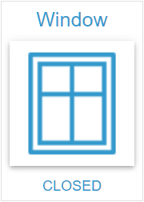

# State Widget

## Beschreibung

Das State Widget zeigt einen Zustand der Datentypen boolean, number, string oder mixed als Button an und schreibt ihn per Klick, als Taster oder über einen Änderungsdialog. Icon und Wert lassen sich einzeln ausblenden.

## Einstellungshierarchie

Dieses Widget nutzt alle **vis-2 Einstellungen** und **Common Einstellungen**. Siehe [Home](De-Home.md) für Details.

Die Widget-spezifischen und Value-spezifischen Einstellungen überschreiben die allgemeineren Einstellungen. Die Ausnahmen stehen unter [Common Einstellungen - Value-spezifische Einstellungen](De-Home.md#value-spezifische-einstellungen).

## Widget-spezifische Einstellungen

Diese Felder stehen in der Gruppe **Zustand**.

| Feldname                  | Typ      | Standard | Beschreibung                                                                                                                                                                                                                                   | Bedingung                                                        |
| ------------------------- | -------- | -------- | ---------------------------------------------------------------------------------------------------------------------------------------------------------------------------------------------------------------------------------------------- | ---------------------------------------------------------------- |
| Objekt-ID `oid`           | id       | -        | Akzeptiert boolean, number, string und mixed. Die Wahl ergänzt die Zeilen aus `common.states`, ersetzt `unit` und setzt `onlyDisplay`. Das Leeren entfernt alle Zeilen. Bei einem anderen Typ zeigt der Rahmen einen Hinweis statt des Buttons | -                                                                |
| Einheit `unit`            | text     | ''       | Wird aus dem Objekt übernommen und ist hier überschreibbar, Leeren entfernt sie. Eine spätere OID-Wahl ersetzt sie                                                                                                                             | Nur wenn eine OID gewählt ist                                    |
| Nur Zustände `onlyStates` | checkbox | false    | Bedienung nur über die Zeilen, siehe [Verhalten beim Klick](#verhalten-beim-klick). Der Dialog zeigt keinen Slider                                                                                                                             | Nur sichtbar mit mindestens einer Zeile, leere Zeilen zählen mit |
| Taster `statePushButton`  | checkbox | false    | Taster-Modus: Wert[1] beim Drücken, Wert[2] am Ende der Betätigung, siehe [Push-Button-Funktionalität](#push-button-funktionalität)                                                                                                            | Nur bei `onlyStates` und genau 2 Zeilen mit Wert                 |
| Nur Anzeige `onlyDisplay` | checkbox | false    | Sperrt das Widget, die Anzeige folgt weiter dem Wert. Die OID-Wahl setzt das Feld: `true` bei `common.write: false`, sonst `false`                                                                                                             | Ausgeblendet bei `write: false`                                  |
| Kein Icon `noIcon`        | checkbox | -        | Kein Icon im Button und kein Eck-Icon                                                                                                                                                                                                          | -                                                                |
| Kein Wert `noValue`       | checkbox | -        | Kein Text im Button. Die Fußzeile zeigt ihn weiter                                                                                                                                                                                             | -                                                                |

**Hinweis:** Zusätzlich zu den oben genannten Einstellungen sind die **Wert schreiben**-Einstellungen (**Verzögerung**/**Intervall**) verfügbar. Diese steuern, wie Wertänderungen an die OID geschrieben werden. Siehe [Common Einstellungen - Wert schreiben](De-Home.md#wert-schreiben) für Details. Im aktiven Taster-Modus sind sie ausgeblendet, siehe [Sofort schreiben](#sofort-schreiben). Wird das Widget entfernt, etwa durch einen Ansichtswechsel, sendet es einen noch wartenden Wert sofort.

## Datentypen

Das State Widget unterstützt folgende Datentypen. Eine Zeile ist aktiv, wenn die Textform ihres Werts der Textform des OID-Werts entspricht: `1` und `"1"` sind derselbe Zustand.

### Boolean

- Zwei feste Zeilen: true (Wert[1]) und false (Wert[2]), in der Reihenfolge von `common.states`, wenn es beide nennt. Der Alias kommt aus `common.states`, sonst `TRUE` und `FALSE`
- **Zeile hinzufügen**, **Zeile klonen** und **Zeile löschen** gibt es nicht, `value{n}` ist ausgeblendet
- Typische Anwendung: Ein/Aus-Schalter, Statusanzeige

### Number

- Numerische Werte mit Einheit, ohne weitere Formatierung
- Nur dieser Typ bekommt im Dialog den [Slider](#slider). Ein Zeilenwert, der keine Zahl ist, wird nie aktiv und schreibt nichts
- Typische Anwendung: Temperatur, Helligkeit, Prozentsätze

### String

- Textwerte, der Zeilenwert wird als Text geschrieben
- Ohne Zeilen tut ein Klick nichts
- Typische Anwendung: Statusmeldungen, Modi

### Mixed

- Geschrieben wird in dem Typ, nach dem der Zeilenwert aussieht: `true`/`false` als Boolean, zahlenförmige Werte als Zahl, alles andere als Text. Aus `007` wird `7`, die Zeile wird danach nicht aktiv, weil `007` und `7` als Text verschieden sind
- Ohne Zeilen tut ein Klick nichts
- Typische Anwendung: Universelle Statusanzeige

## Verhalten beim Klick

Was ein Klick auf den Button tut, hängt von **Nur Zustände** und der Zahl der Zeilen mit Wert ab. Zeilen ohne Wert oder nur mit Leerzeichen zählen nicht, `false` und `0` sind Werte.

| Konfiguration               | Klick                                                                                |
| --------------------------- | ------------------------------------------------------------------------------------ |
| Nur Zustände aus            | Öffnet den [Änderungsdialog](#änderungsdialog)                                       |
| Nur Zustände an, 1 Zeile    | Schreibt den Wert dieser Zeile, auch wenn die OID ihn schon hat                      |
| Nur Zustände an, 2 Zeilen   | Schaltet um: Ist die erste Zeile aktiv, wird die zweite geschrieben, sonst die erste |
| Nur Zustände an, mehr als 2 | Öffnet den [Änderungsdialog](#änderungsdialog)                                       |
| Taster-Modus                | Schreibt nichts, siehe [Push-Button-Funktionalität](#push-button-funktionalität)     |

Hätte der Dialog weder eine Liste noch einen Slider, öffnet er sich nicht, und der Klick tut nichts. Das trifft auch eine number-OID ohne Zeilen, wenn **Nur Zustände** gespeichert ist: Das Feld ist dann ausgeblendet und wirkt weiter. Ein gesperrtes Widget (**Nur Anzeige** oder eine OID mit `write: false`) reagiert nicht auf den Klick.

Ein Klick schreibt über die Einstellungen [Wert schreiben](De-Home.md#wert-schreiben). Mehrere Klicks innerhalb der Wartezeit senden nur den letzten Wert.

## Push-Button-Funktionalität

Der Taster-Modus ist aktiv, wenn **Nur Zustände** und **Taster** eingeschaltet sind und das Widget genau **2 Zeilen mit Wert** hat. Wert[1] und Wert[2] sind diese beiden Zeilen in ihrer Reihenfolge.

Dies ermöglicht z.B. Rollladensteuerung (Drücken = Auf, Loslassen = Stop) oder Fernbedienungsfunktionen.

**Hinweis:** **Taster** wird nur angezeigt, wenn **Nur Zustände** aktiviert ist und genau 2 Zeilen einen Wert haben. Zwei Zeilen, von denen eine leer ist, ergeben keinen Taster. Eine Zeile mit Binding zählt im Editor als Zeile mit Wert, auch wenn das Binding zur Laufzeit leer auflöst.

### Eine Betätigung

- **Drücken** mit der Haupttaste, per Touch oder mit dem Stift: Wert[1] wird an die OID gesendet.
- **Loslassen**: Wert[2] wird an die OID gesendet.
- **Verlassen des ganzen Buttons beim Halten**: Wirkt wie Loslassen. Ein Wechsel zwischen Icon und Text innerhalb des Buttons zählt nicht. Ein vom Button gleitender Finger zählt ebenso als Verlassen; das ist in der Touch-Emulation von Chromium geprüft, auf echten Geräten noch nicht.
- **Abbruch** eines Touches durch den Browser: Wirkt wie Loslassen.
- **Kurzer Tipp**: Sendet beide Werte kurz hintereinander, zuerst Wert[1], dann Wert[2]. Es gibt keine Mindestdauer.

Wert[2] kommt nur aus einer laufenden Betätigung und je Betätigung genau einmal. Nichts gesendet wird daher in diesen Fällen:

- **Überfahren** mit der Maus, ohne zu drücken.
- **Gedrückt zurückkommen**, nachdem der Zeiger den Button verlassen hat. Erst ein neuer Druck sendet wieder Wert[1].
- **Rechte und mittlere Maustaste**.
- **Weiterer Finger**, solange eine Betätigung läuft. Nur der erste Zeiger zählt.
- **Enter und Leertaste**. Der Taster-Modus reagiert nicht auf die Tastatur.

### Ende von außen

- **Ansichtswechsel**: Wird das Widget beim Halten entfernt, sendet es Wert[2].
- **Einsetzende Sperre**: Wird das Widget beim Halten mit **Nur Anzeige** gesperrt, endet die Betätigung und Wert[2] wird gesendet. Ein späteres Loslassen sendet nichts mehr, auch wenn die Sperre dann wieder aufgehoben ist.
- **OID mit `write: false`**: Eine solche OID nimmt keinen Wert an, auch nicht Wert[2].
- **Ende des Taster-Modus**: Ist das Widget beim Halten kein Taster mehr, etwa weil eine Zeile per Binding ihren Wert verliert, sendet das Loslassen nichts. Die OID bleibt auf Wert[1].

Ein gesperrtes Widget startet keine Betätigung.

### Sofort schreiben

Beide Werte gehen sofort an die OID, ein kurzer Tipp verliert so seinen Wert[1] nicht. Ein noch wartender Wert aus Verzögerung oder Intervall wird dabei verworfen. Darum sind **Intervall**, **Intervallwert** und **Verzögerung** samt ihrer Überschrift „Wert schreiben" im aktiven Taster-Modus ausgeblendet. Die gespeicherten Werte bleiben erhalten und wirken wieder, sobald der Taster-Modus aus ist.

### Touch und Kontextmenü

Im Taster-Modus scrollt die Fläche des Buttons nicht (`touch-action: none`), und das Kontextmenü des Browsers bleibt aus, auch unter der Sperre. Außerhalb des Taster-Modus bleibt der Button unverändert.

## Änderungsdialog

Der Klick öffnet den Dialog, wenn **Nur Zustände** aus ist oder mehr als 2 Zeilen einen Wert haben, siehe [Verhalten beim Klick](#verhalten-beim-klick). Er zeigt oben den Slider und darunter die Liste, je nachdem, was vorhanden ist. Er schließt über das Kreuz, Escape oder einen Klick neben den Dialog, nicht durch eine Wahl.

- **Titel**: Der Header-Text der aktiven Zeile, sonst der des Widgets, sonst der Name der OID, sonst „Wert ändern". HTML wird dargestellt. **Kein Header** wirkt hier nicht.
- **Farben**: Die Fläche nimmt `background-color` aus [CSS Hintergrund](De-Home.md#css-hintergrund), sonst `background{n}` der aktiven Zeile, sonst `background`. Ohne Wert bleibt die Fläche des Themes. Titel und Liste nehmen die Textfarbe des Buttons. Bei einem Gradienten als Textfarbe zeigt der Titel den Gradienten, die Liste eine Vollfarbe daraus.
- **Schreiben**: Liste und Slider schreiben über die Einstellungen [Wert schreiben](De-Home.md#wert-schreiben), nur der Taster geht daran vorbei. Das Schließen des Dialogs verwirft einen wartenden Wert nicht.
- **Einsetzende Sperre**: Sperrt sich das Widget bei offenem Dialog, schreiben Liste und Slider nichts mehr und zeigen weiter den Wert. Der Dialog bleibt offen und lässt sich schließen.

### Liste

- **Einträge**: Je Zeile mit Wert ein Eintrag, in der Reihenfolge der Zeilen. Zeilen mit gleichem Wert bleiben eigene Einträge.
- **Text**: Der Alias der Zeile, HTML wird dargestellt. Ist er leer oder besteht nur aus Leerzeichen, steht dort der Wert mit Einheit.
- **Markierung**: Markiert sind alle Einträge, die dem aktuellen Wert der OID entsprechen, auch Zeilen mit gleichem Wert. Die Markierung folgt auch Änderungen von außen.
- **Wahl**: Ein Klick schreibt den Wert des Eintrags, der Dialog bleibt offen.

### Slider

Der Slider erscheint nur bei einer OID vom Typ **number**, mit **Nur Zustände** aus und wenn das Minimum unter dem Maximum liegt. Bei Minimum ≥ Maximum gibt es keinen Slider.

- **Bereich**: Bei der OID-Wahl legt das Widget eine Kopie der Objektdaten an und übernimmt dorthin `common.min` und `common.max`. Eine Grenze, die das Objekt nicht angibt, wird dort mit 0 beziehungsweise 100 vorbelegt. Eine Zahl-OID ohne Bereich zeigt deshalb einen Slider von 0 bis 100. Der Bereich lässt sich im Widget nicht einstellen und begrenzt nur den Slider, nicht die Listeneinträge. Beide Grenzen stehen als Beschriftung am Slider.
- **Schritt**: `common.step` des Objekts, ebenfalls aus der Kopie. Ohne Angabe oder bei einem Wert von 0 oder kleiner ist der Schritt 1.
- **Spätere Änderungen am Objekt**: Die Kopie entsteht nur bei der OID-Wahl. Ein geänderter Bereich oder Schritt gilt erst nach der nächsten OID-Wahl. Eine Kopie ohne Schritt bleibt bis dahin bei Schritt 1.
- **Ziehen**: Der Slider schreibt schon beim Ziehen, nicht erst beim Loslassen. Die Anzeige folgt sofort, an die OID gehen die Werte nach den Einstellungen [Wert schreiben](De-Home.md#wert-schreiben).
- **Position**: Beim Öffnen steht der Slider auf dem aktuellen Wert, ein numerischer String zählt als Zahl. Bei einem anderen Wert steht er auf 0 und bleibt dort, bis eine Zahl kommt. Ändert sich der Wert von außen, folgt der Slider, solange der Dialog offen ist, auch bei Änderungen kleiner als 1. Die Wahl eines Listeneintrags mit Zahl setzt ihn auf diese Zahl. Das Echo eines eigenen Werts bewegt ihn nicht, ebenso wenig eine Änderung innerhalb des Echo-Fensters aus [Wert schreiben](De-Home.md#wert-schreiben).

## Value-spezifische Einstellungen

Für jeden Wert können Common-Einstellungen überschrieben werden. Das geschieht im Zustandseditor, der Gruppe **Werte**: eine durchsuchbare Liste mit einer Zeile pro Wert und darunter die Felder der gewählten Zeile. Zeilen lassen sich hinzufügen, klonen, verschieben, leeren und löschen. Typ, Standard und Vorrang der Felder stehen unter [Common Einstellungen - Value-spezifische Einstellungen](De-Home.md#value-spezifische-einstellungen).

Bei der OID-Wahl werden die Zustände aus `common.states` als Zeilen ergänzt, vorhandene Zeilen bleiben erhalten. **Aus common.states neu anlegen** ersetzt alle Zeilen.

Die Zeile, deren Wert zum aktuellen Wert passt, wendet ihre Einstellungen an. Passen mehrere, gilt für Button, Rahmen und Dialogtitel die erste. Die Felder wirken im State Widget so:

| Feldname (Suffix)                                              | Beschreibung                                                                                              |
| -------------------------------------------------------------- | --------------------------------------------------------------------------------------------------------- |
| Zeilen `values_count`                                          | Anzahl der Zeilen, Standard 0                                                                             |
| Icon `icon{n}`                                                 | Großes Icon im Button und als Eck-Icon                                                                    |
| Kleines Icon `iconSmall{n}`                                    | Kleines Icon (SVG) im Button und als Eck-Icon, gilt bei leerem `icon{n}`                                  |
| Icongröße `iconSize{n}`                                        | Größe des Icons im Button in Prozent des Platzes dort, ohne Wert 100 %. Das Eck-Icon nimmt nur `iconSize` |
| Farbmaske aktivieren `enableIconColorMask{n}`                  | Färbt auch ein URL-Icon im Button. Das Eck-Icon nimmt nur `enableIconColorMask`                           |
| Iconfarbe `iconColor{n}`                                       | Farbe des Icons im Button und des Eck-Icons                                                               |
| Icon X Offset `iconXOffset{n}`, Icon Y Offset `iconYOffset{n}` | Versatz des Icons im Button. Das Eck-Icon nimmt nur `iconXOffset` und `iconYOffset`                       |
| Headertext `header{n}`                                         | Text der Kopfzeile und des Dialogtitels                                                                   |
| Headertextgröße `headerSize{n}`                                | Schriftgröße der Kopfzeile                                                                                |
| Alias `alias{n}`                                               | Text im Button und in der Liste des Dialogs                                                               |
| Wert `value{n}`                                                | Wert, den die Zeile schreibt und an dem sie als aktiv erkannt wird                                        |
| Werttextgröße `valueSize{n}`                                   | Schriftgröße im Button                                                                                    |
| Footertext `footer{n}`                                         | Text der Fußzeile                                                                                         |
| Footertextgröße `footerSize{n}`                                | Schriftgröße der Fußzeile                                                                                 |
| Textfarbe `textColor{n}`                                       | Text im Button und im Dialog, nicht in Kopf- und Fußzeile                                                 |
| Hintergrund `background{n}`                                    | Inhaltsfläche und Fläche des Dialogs                                                                      |
| Rahmenhintergrund `frameBackground{n}`                         | Rahmenfläche                                                                                              |

Ist keine Zeile aktiv, nehmen Größe, Versatz und Farbmaske des Icons im Button die Basisfelder.

**Beispiel:** Für einen Boolean-Zustand mit 2 Werten (true/false):

- `icon1` = Glühbirne leuchtend (für true)
- `icon2` = Glühbirne aus (für false)
- `background1` = `#ffc107` (für true)
- `background2` = `#9e9e9e` (für false)

So erhält jeder Zustandswert eine individuelle visuelle Darstellung.
