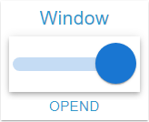

# Switch Widget

## Beschreibung

Das Switch Widget ist ein Schalter für eine OID vom Typ boolean, dargestellt als MUI-Switch mit einstellbaren Größen und Farben je Stellung. Ein Klick schreibt die Gegenstellung, verzögert über die **Wert schreiben**-Einstellungen. Der Knopf trägt das Icon des aktiven Zustands.

## Einstellungshierarchie

Dieses Widget nutzt alle **vis-2 Einstellungen** und **Common Einstellungen**. Siehe [Home](De-Home.md) für Details.

Die Widget-spezifischen und Value-spezifischen Einstellungen überschreiben die allgemeineren Einstellungen. Was davon hier anders wirkt, steht unter [Zustandszeilen](#zustandszeilen) und [Icon auf dem Knopf](#icon-auf-dem-knopf).

## Widget-spezifische Einstellungen

| Feldname                             | Typ            | Standard | Beschreibung                                                                                                                           | Bedingung                                      |
| ------------------------------------ | -------------- | -------- | -------------------------------------------------------------------------------------------------------------------------------------- | ---------------------------------------------- |
| Objekt-ID `oid`                      | id             | -        | Der Objektdialog bietet nur den Typ boolean an. Ein Objekt anderen Typs wird verworfen, der Rahmen zeigt dann den Hinweis              | -                                              |
| Einheit `unit`                       | text           | `''`     | Einheit (wird aus dem Objekt übernommen, hier überschreibbar, Leeren entfernt sie). Wirkt nur im Text der Fußzeile, und nur ohne Alias | Nur wenn eine OID gewählt ist                  |
| Nur Anzeige `onlyDisplay`            | checkbox       | false    | Sperrt den Schalter, siehe [Gesperrt](#gesperrt). Jede Wahl der OID setzt das Feld neu: `true` bei `write: false`, sonst `false`       | Ausgeblendet bei `write: false`                |
| Knopfgröße `thumbSize`               | slider (0-500) | 62       | Breite und Höhe des Knopfs in px, begrenzt auf die Höhe der Inhaltsfläche. Bei `0` gibt es keinen sichtbaren Knopf                     | -                                              |
| Knopffarbe (true) `thumbColorTrue`   | color          | -        | Knopf bei eingeschaltetem Schalter (Gradient möglich). Ohne Wert die Primärfarbe des Themes                                            | -                                              |
| Knopffarbe (false) `thumbColorFalse` | color          | -        | Knopf bei ausgeschaltetem Schalter (Gradient möglich). Ohne Wert Weiß im hellen, `grey[300]` im dunklen Theme                          | -                                              |
| Trackgröße `trackSize`               | slider (1-100) | 10       | Höhe der Track-Zeile in Prozent der Inhaltsfläche. `0` oder kein Wert gilt als 10                                                      | -                                              |
| Trackfarbe (true) `trackColorTrue`   | color          | -        | Track bei eingeschaltetem Schalter (Gradient möglich). Ohne Wert `trackColor`, sonst die Primärfarbe des Themes                        | -                                              |
| Trackfarbe (false) `trackColorFalse` | color          | -        | Track bei ausgeschaltetem Schalter (Gradient möglich). Ohne Wert `trackColor`, sonst Schwarz im hellen, Weiß im dunklen Theme          | -                                              |
| Trackfarbe `trackColor`              | color          | -        | Eine Farbe für beide Stellungen (Gradient möglich). Gilt, wo `trackColorTrue` oder `trackColorFalse` leer ist                          | Nur sichtbar, solange ein Wert gespeichert ist |

**Hinweis:** Zusätzlich zu den oben genannten Einstellungen sind die **Wert schreiben**-Einstellungen (Verzögerung/Intervall) verfügbar. Diese steuern, wie Wertänderungen an die OID geschrieben werden. Siehe [Common Einstellungen - Wert schreiben](De-Home.md#wert-schreiben) für Details.

## Boolean-Optionen

Die Stellung folgt dem aktuellen Wert der OID: Eingeschaltet ist der Schalter genau bei `true` und dem Text `"true"`. Jeder andere Wert zeigt ihn ausgeschaltet, auch `"TRUE"`, `1` oder `null`. Solange die OID keinen Wert geliefert hat, zeigt das Widget keinen Schalter.

### True-Zustand

- Schalter ist eingeschaltet
- Knopf in `thumbColorTrue`, Track in `trackColorTrue`
- Knopf am rechten Ende des Tracks

### False-Zustand

- Schalter ist ausgeschaltet
- Knopf in `thumbColorFalse`, Track in `trackColorFalse`
- Knopf am linken Ende des Tracks

### Umschalten

- Ein Klick schreibt das Gegenteil der angezeigten Stellung, immer als boolean: Aus `"false"` oder `1` wird `true`.
- Die Stellung wechselt sofort, das Schreiben folgt nach der Wartezeit aus [Wert schreiben](De-Home.md#wert-schreiben).
- Mehrere Klicks innerhalb der Wartezeit ergeben einen Schreibvorgang mit dem letzten Wert, auch wenn er dem Ausgangswert entspricht.
- Die Klickfläche reicht über die Breite der Track-Zeile und ist so hoch wie der Knopf.

### Gesperrt

Mit `onlyDisplay` oder einer OID mit `write: false` ist der Schalter deaktiviert. Ein Binding auf `onlyDisplay` liefert Text, dort gelten `false` und `0` als aus. Ein Knopf ohne eigene Farbe zeigt dann das Deaktiviert-Grau von MUI: ausgeschaltet `grey[100]` (hell) oder `grey[600]` (dunkel), eingeschaltet die aufgehellte (hell) oder abgedunkelte (dunkel) Primärfarbe. Eigene Knopffarben und die Trackfarben bleiben, der Track nimmt die gesperrte Deckkraft, siehe [Track](#track).

### Zustandszeilen

Der Zustandseditor hat zwei feste Zeilen für `true` und `false`: Hinzufügen, Klonen und Löschen entfallen. Die Wahl der OID legt fehlende Zeilen an, der Alias kommt aus `common.states`, ohne Eintrag `TRUE` oder `FALSE`. Vorhandene Zeilen bleiben.

Das Widget zeigt selbst keinen Wert: Alias und Einheit erscheinen nur in der Fußzeile. `valueSize`, `valueSize{n}` und `textColor{n}` wirken hier nicht.

## Visuelle Darstellung

Das Widget besteht aus zwei Hauptkomponenten:

### Knopf

- Beweglicher Teil des Schalters
- Größe einstellbar über `thumbSize`, begrenzt auf die Höhe der Inhaltsfläche
- Farbe abhängig von der Stellung (`thumbColorTrue`/`thumbColorFalse`)
- Steht in beiden Stellungen 4 px über das Ende des Tracks hinaus
- Der Ripple beim Klick hat die Iconfarbe des aktiven Zustands

### Track

- Hintergrund-Schiene, auf der sich der Knopf bewegt
- Höhe einstellbar über `trackSize`, Breite ist die der Inhaltsfläche abzüglich 8 px je Seite
- Farbe abhängig von der Stellung (`trackColorTrue`/`trackColorFalse`, sonst `trackColor`)
- Deckkraft ist fest und gilt auch für eigene Farben: ausgeschaltet 0,38 (hell) oder 0,3 (dunkel), eingeschaltet 0,5, gesperrt in beiden Stellungen 0,12 (hell) oder 0,2 (dunkel)

### Icon auf dem Knopf

- Der Knopf zeigt in beiden Stellungen das Icon des aktiven Zustands: `icon{n}`, `iconSmall{n}`, sonst `icon`, `iconSmall`. Dasselbe Icon erscheint als Eck-Icon, außer `noHeaderIcon` ist aktiv.
- Die Größe kommt aus `iconSize{n}` in Prozent der Knopfbreite, ohne Wert 100 %. `iconSize` wirkt auf den Knopf nur, solange keine Zeile aktiv ist, sonst nur auf das Eck-Icon.
- Die Farbe folgt `iconColor{n}`, `iconColor`, sonst der Primärfarbe des Themes. Ein gefärbtes Icon ohne eigene Farbe verschwindet deshalb auf dem eingeschalteten Knopf ohne `thumbColorTrue`, denn beide haben die Primärfarbe.

## Anwendungsbeispiele

- **Lichtsteuerung**: Ein/Aus-Schalter für Lampen, mit `icon{n}` für die beiden Stellungen
- **Gerätesteuerung**: Aktivieren/Deaktivieren von Geräten, mit `delay` `0`, wenn der Befehl ohne Wartezeit raus soll
- **Modus-Umschaltung**: Automatik/Manuell, Tag/Nacht, etc., der Alias nennt den Modus in der Fußzeile
- **Benachrichtigungen**: Enable/Disable-Schalter auf einem boolean-State, den ein Skript auswertet
