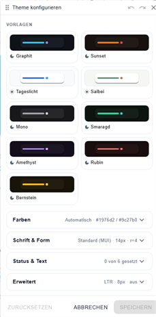

# Theme-Studio



## Beschreibung

Das Theme-Studio ist der collection-weite Theme-Editor der Widget Collection: Es gestaltet Farben, Schrift, Formen und Abstände **aller** Widgets dieser Sammlung (State, Switch, …, ECharts) gleichzeitig — live auf der offenen vis-2-Ansicht.

Es ist bewusst **kein Widget**: Man zieht es nicht auf die Canvas, sondern öffnet es im vis-2-Edit-Modus über den Button **Theme-Studio** in der Widget-Palette (Eintrag „Theme-Studio" der Sammlungs-Gruppe). Es erscheint als schwebendes, verschieb- und größenänderbares Fenster.

Das fertige Theme wird als JSON im ioBroker-Datenpunkt `vis-2-widgets-collection.0.theme` gespeichert (siehe [unten](#das-theme-im-datenpunkt)); jedes Collection-Widget liest ihn und legt ihn über das vis-2-Theme. Mitgelieferte Vorlagen liefern Startpunkte.

## Öffnen und Bedienung

- **Öffnen:** vis-2-Edit-Modus → Widget-Palette → Sammlungs-Gruppe → **Theme-Studio**. Das Fenster öffnet sich sofort mit dem zuletzt bekannten Theme; alle Sektionen sind zugeklappt.
- **Unabhängig von der Palette:** Das Studio bleibt offen, wenn die Palette eingeklappt, gefiltert oder ausgeblendet wird, beim Wechsel der Ansicht und im Run-Modus (▶). Ein erneuter Klick auf den Button öffnet kein zweites Studio, sondern holt das offene nach vorn.
- **Live-Vorschau ist die Canvas:** Es gibt absichtlich keine Komponenten-Vorschau im Fenster — jedes Collection-Widget der offenen Ansicht übernimmt die Änderungen live. Bei **Abbrechen** schnappt alles auf das gespeicherte Theme zurück.
- **Titelleiste:** Ziehen zum Verschieben, ein Punkt neben dem Titel zeigt ungespeicherte Änderungen an. **Rückgängig/Wiederholen** (bis 50 Schritte; `Strg+Z` / `Strg+Umschalt+Z` / `Strg+Y`; zusammenhängende Änderungen — z. B. ein Slider-Zug — ergeben einen Schritt) und **Schließen** (wie Abbrechen).
- **Größe:** Acht Kanten- und Ecken-Griffe ändern die Größe wie ein Fenster des Betriebssystems (Kanten per Pfeiltasten ±16/±64 px, `Pos1`/`Ende`, Doppelklick = zurücksetzen; Ecken per Maus). Die Höhe folgt standardmäßig dem Inhalt (**Auto**, bis 80 % der Fensterhöhe) — der erste Höhen-Griff fixiert sie, ein Doppelklick auf eine waagerechte Kante stellt Auto wieder her. Position und Größe bleiben über Sitzungen erhalten.
- **Fußleiste:**
    - **Alles auf Standard** — leert **alle** Angaben (`{}` = alles erbt; ein Undo-Schritt, also umkehrbar)
    - **„1 Problem" / „%s Probleme"** — erscheint bei Validierungsfehlern; ein Klick klappt die betroffene Sektion auf und springt zum ersten Fehler
    - **Abbrechen** — verwirft die Änderungen (mit Rückfrage, solange ungespeicherte Änderungen offen sind) und schließt das Studio
    - **Speichern** — schreibt den Datenpunkt und schließt das Studio; erst aktiv, wenn es etwas zu speichern gibt, und gesperrt, solange Validierungsfehler offen sind. Bei einem Verbindungsfehler erscheint eine Meldung und das Studio bleibt offen
- Solange ungespeicherte Änderungen offen sind, warnt der Browser beim Neuladen oder Schließen des Tabs.

## Vorlagen

Einklappbare Sektion (beim Öffnen zu). Die Zusammenfassung zeigt die aktive Vorlage („Graphit · aktiv"), „eigene Farben" oder „(Standard)", solange keine Farbe gesetzt ist.

Neun kuratierte Farb-Themes als Karten — **Graphit, Abendrot, Tageslicht, Salbei, Mono, Smaragd, Amethyst, Rubin, Bernstein** — mit Mini-Farbmustern (Grundfläche, Widget-Fläche, Primär, Sekundär) und Hell/Dunkel-Icon. Die Karte, deren Farben gerade gelten, ist als aktiv markiert.

**Nur die Farben:** Eine Vorlage ersetzt **nur die Farben** (inkl. Farbmodus) — Schrift, Eckradien, Abstandseinheit und CSS-Variablen-Einstellungen bleiben erhalten. Eine Vorlage anwenden ist ein Undo-Schritt.

## Farbfelder

Alle Farbfelder der Sektionen **Farben** und **Status & Text** funktionieren gleich:

- Das Feld zeigt die **effektive Farbe** — gesetzt oder geerbt, so wie sie auf der Canvas wirkt. Bei gesetzten Werten erscheint der Button **Auf Standard zurücksetzen**; er stellt das Feld wieder auf Erben.
- **Farbfeld (Swatch)** öffnet den Color-Picker; er bietet die aktuellen Theme-Farben als Musterreihe an.
- Daneben steht der **Hex-Wert** in Festbreitenschrift — direkt editier- und kopierbar. `Enter` oder Verlassen des Felds übernimmt, `Esc` stellt den alten Wert wieder her, ein geleertes Feld setzt die Farbe auf Erben zurück. Eine ungültige Eingabe wird direkt am Feld gemeldet.
- Das **?** daneben erklärt, wo die Farbe wirkt (Wirkort).

Abgeleitete Werte sind im Label gekennzeichnet: Die Sekundärfarbe trägt „· aus Primär abgeleitet", solange sie aus einer gesetzten Primärfarbe berechnet wird; Text (primär) trägt „· folgt Primär", solange er erbt.

Farbverläufe sind ungültig („muss eine Farbe sein"). Für Primär, Sekundär und die Statusfarben braucht es einen rechenbaren Wert (Hex, `rgb()`, `hsl()`) — Farbnamen wie `red` und `transparent` meldet das Studio dort als Fehler.

## Sektion Farben

| Einstellung   | Theme-Pfad                   | Wirkort                                                                                                              |
| ------------- | ---------------------------- | -------------------------------------------------------------------------------------------------------------------- |
| Farbmodus     | `palette.mode`               | **Automatisch** · Hell · Dunkel. Automatisch folgt vis-2; darunter steht der wirksame Modus („folgt vis-2: Dunkel")  |
| Primärfarbe   | `palette.primary.main`       | Hauptakzent: aktive Zustände, Icon-Standardfarbe, erste Reihenfarbe der Diagramm-Palette „Theme (auto)"              |
| Sekundärfarbe | `palette.secondary.main`     | Zweiter Akzent und zweite Reihenfarbe der Diagramm-Palette. Ohne eigene Wahl triadisch aus der Primärfarbe berechnet |
| Grundfläche   | `palette.background.default` | Hintergrund des Dialog-Widgets, wenn dort keine Rahmenfarbe gesetzt ist                                              |
| Widget-Fläche | `palette.background.paper`   | Fläche der Widget-Karten und -Rahmen (Standard jeder Rahmenfarbe „erbt") — der wichtigste Hebel für dunkle Themes    |
| Trennlinie    | `palette.divider`            | Ränder und Trennlinien, Diagrammrahmen; Standard aller Linienfarben-Attribute                                        |

Gruppen: **Akzente** (Primär, Sekundär) und **Flächen** (Grundfläche, Widget-Fläche, Trennlinie). Die Zusammenfassung zeigt Modus, Primär- und Sekundärfarbe.

## Sektion Schrift & Form

| Einstellung             | Theme-Pfad                                                                            | Beschreibung                                                                                                                                                                                                                                                                                                                                                                                                         |
| ----------------------- | ------------------------------------------------------------------------------------- | -------------------------------------------------------------------------------------------------------------------------------------------------------------------------------------------------------------------------------------------------------------------------------------------------------------------------------------------------------------------------------------------------------------------- |
| Schriftfamilie          | `typography.fontFamily`                                                               | **Standard (vis-2-Theme)** (erbt die Schrift von vis-2) · **Mitgeliefert** (mit der Sammlung ausgeliefert, offline und überall gleich: Inter, JetBrains Mono, Merriweather, Montserrat, Nunito, Open Sans, Oswald, Playfair Display, Roboto, Roboto Slab) · **System** (auf dem Anzeigegerät installiert) · **Eigene Schrift…** (freier CSS-Schriftname im Textfeld darunter)                                        |
| Google Font             | `googleFonts`, `typography.fontFamily`                                                | **Name bei Google Fonts** eintippen (z. B. Roboto, Lato, Open Sans; „Schriften durchsuchen" öffnet fonts.google.com) und **Laden**. Das Studio lädt die Schrift einmalig von fonts.googleapis.com (Anfrage aus diesem Browser), bettet Regular und Bold in den Datenpunkt ein und stellt sie als Schriftfamilie ein — ein Undo-Schritt. Danach offline verfügbar; der Datenpunkt wächst je Schrift um einige zehn KB |
| Geladene Google-Schrift | —                                                                                     | Jede geladene Schrift erscheint als Chip: Klick stellt sie als Schriftfamilie ein, ✕ entfernt sie. Zeigt die Schriftfamilie auf die entfernte Schrift, wird sie mit zurückgesetzt                                                                                                                                                                                                                                    |
| Basis-Schriftgröße (px) | `typography.fontSize`                                                                 | 8–24 px, Standard 14                                                                                                                                                                                                                                                                                                                                                                                                 |
| Eckradius (px)          | `corners.topLeft` … `corners.bottomLeft`                                              | Standardmäßig **verknüpft**: ein Slider (0–96 px, Standard 4) für alle vier Ecken. Das Ketten-Symbol trennt sie („Ecken einzeln einstellen") — dann vier Zahlenfelder in Eck-Anordnung (oben links, oben rechts, unten links, unten rechts). Erneutes Verknüpfen („Ecken verknüpfen") setzt ungleiche Ecken auf den Wert oben links. Wirkt auf Karten- und Rahmenflächen der Widgets                                 |
| Feintuning ↓            | `typography.fontWeightLight/Regular/Medium/Bold`, `typography.allVariants.lineHeight` | Selten gebraucht, zugeklappt: welche Schriftstärke die Widgets für die Rollen Light, Regular, Medium und Bold verwenden, und die Zeilenhöhe (1–2). Hinweis: Mitgelieferte Schriften bringen nur echte 400er- und 700er-Schnitte mit — andere Stärken rechnet der Browser künstlich, das wirkt schnell unsauber                                                                                                       |

Die Zusammenfassung zeigt Schrift, Größe und Eckradius.

## Sektion Status & Text

| Einstellung     | Theme-Pfad               | Wirkort                                                                                                       |
| --------------- | ------------------------ | ------------------------------------------------------------------------------------------------------------- |
| Fehlerfarbe     | `palette.error.main`     | Reihenfarbe 6 der Diagramm-Palette „Theme (auto)" und Statusanzeigen der Bedienelemente (z. B. Eingabefehler) |
| Warnfarbe       | `palette.warning.main`   | Reihenfarbe 3 der Diagramm-Palette „Theme (auto)" und Statusanzeigen der Bedienelemente                       |
| Infofarbe       | `palette.info.main`      | Reihenfarbe 5 der Diagramm-Palette „Theme (auto)" und Statusanzeigen der Bedienelemente                       |
| Erfolgsfarbe    | `palette.success.main`   | Reihenfarbe 4 der Diagramm-Palette „Theme (auto)" und Statusanzeigen der Bedienelemente                       |
| Text (primär)   | `palette.text.primary`   | Standard aller Textfarben. Folgt ohne eigene Wahl der Primärfarbe                                             |
| Text (sekundär) | `palette.text.secondary` | Nebentexte wie Einheiten, Beschriftungen und Hinweise                                                         |

Gruppen: **Statusfarben** und **Text**. Die Zusammenfassung zählt die gesetzten Farben („x von 6 gesetzt").

## Sektion Erweitert

| Einstellung              | Theme-Pfad                  | Beschreibung                                                                                                                                    |
| ------------------------ | --------------------------- | ----------------------------------------------------------------------------------------------------------------------------------------------- |
| Abstandseinheit (px)     | `spacing`                   | Basiseinheit aller Innenabstände und Lücken in den Widgets (Standard 8 px). 2 Einheiten = 16 px                                                 |
| CSS-Variablen aktivieren | `cssVariables`              | Stellt jeden Theme-Wert als CSS-Variable bereit (z. B. `--vis2c-palette-primary-main`) — für eigenes CSS in vis-2; ohne eigenes CSS nicht nötig |
| CSS-Variablen-Präfix     | `cssVariables.cssVarPrefix` | Präfix der erzeugten Variablen; leer = `vis2c`. `mui` ist reserviert (der vis-2-Editor definiert `--mui-*` selbst) und wird abgelehnt           |

Die Variablen liegen auf `:root` und tragen standardmäßig das Präfix `--vis2c`. Frühere Versionen erzeugten `--mui-*` und überschrieben damit die gleichnamigen Variablen des vis-2-Editors — eigenes CSS, das `--mui-palette-…` aus dem Collection-Theme liest, auf `--vis2c-palette-…` umstellen. Das Collection-Theme setzt kein `color-scheme` mehr auf `:root`.

Die Zusammenfassung zeigt die Abstandseinheit und ob CSS-Variablen an sind. Einen Schalter für die Textrichtung (RTL) gibt es nicht mehr; ein vorhandenes `direction` im Datenpunkt bleibt gültig.

## Das Theme im Datenpunkt

Das Studio speichert in den State **`vis-2-widgets-collection.0.theme`** (Typ `string`): das Theme als JSON-Text. Es ist ein **partielles MUI-`ThemeOptions`-Objekt** plus zwei eigene Erweiterungen (`corners`, `googleFonts`). Jedes Collection-Widget liest und validiert den State beim Start und bei jeder Änderung; ist er ungültig, bleibt das Widget-Theme beim Host-Standard (Fallback `{}`).

Kompaktes Beispiel (dunkel, eigene Akzente, Inter, Eckradius — so sieht der State in etwa aus):

```json
{
    "palette": {
        "mode": "dark",
        "primary": { "main": "#90caf9" },
        "secondary": { "main": "#ce93d8" },
        "background": { "default": "#121212", "paper": "#1e1e1e" },
        "text": { "primary": "#ede7f6", "secondary": "#9e9e9e" },
        "success": { "main": "#81c784" }
    },
    "typography": { "fontFamily": "Inter", "fontSize": 14 },
    "corners": { "topLeft": 12, "topRight": 12, "bottomRight": 12, "bottomLeft": 12 },
    "spacing": 8
}
```

Regeln und Hinweise für Skript-Autoren:

- **Sparse:** Geleerte Felder entfallen beim Speichern komplett (das Studio entfernt leere Pfade). Fehlende Pfade erben — ein minimal gültiges Theme ist `{}`.
- **Validierung:** Farben müssen plain sein (keine Verläufe), Zahlen Zahlen, Werte im Bereich (z. B. Eckradien 0–96; das Studio meldet „außerhalb des Bereichs (0–96)"); unbekannte Pfade erzeugen eine Warnung („unbekannte Einstellung — wird ignoriert"), aber keine Sperre. Fehler sperren das Speichern aus dem Studio; ein per Skript geschriebener ungültiger State fällt im Widget auf den Host-Standard zurück.
- **Direkt schreiben** geht: `setState('vis-2-widgets-collection.0.theme', JSON.stringify(theme), true)` — das Studio liest den State beim Öffnen und arbeitet damit weiter.
- **`googleFonts`** (Map aus Schriftname → Gewicht + eingebettete woff2-Data-URIs) verwaltet das Studio allein beim Laden einer Google-Schrift — nicht von Hand editieren (große Base64-Blöcke).

## Verwandte Seiten

- [Home](De-Home.md) — Common-Einstellungen aller Widgets
- [ECharts Widget](De-Echarts-Widget.md) — dessen Sektion Farben nutzt dieses Theme als Palette-Quelle „Theme (auto)"
