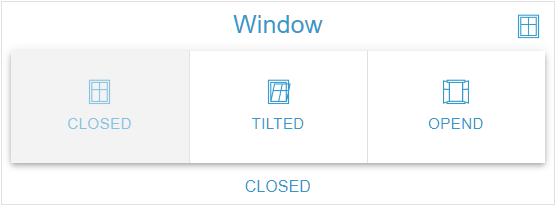

# ButtonGroup Widget

## Description

The ButtonGroup Widget displays the rows of an OID as a button group. A click writes the value of the button to the OID. It accepts the data types boolean, number, string and mixed and offers flexible styling options.

## Settings Hierarchy

This widget uses all **vis-2 Settings** and **Common Settings**. See [Home](En-Home.md) for details.

The widget-specific and value-specific settings override the more general settings.

## Widget-Specific Settings

The fields are in the **Button group** group. The **Active** and **Values** groups are described under [Value-Specific Settings](#value-specific-settings).

| Field Name                           | Type                              | Default      | Description                                                                                                              | Condition                                 |
| ------------------------------------ | --------------------------------- | ------------ | ------------------------------------------------------------------------------------------------------------------------ | ----------------------------------------- |
| Object ID `oid`                      | id                                | -            | OID whose value decides the selection and which is written to; accepts the types boolean, number, string and mixed       | -                                         |
| Unit `unit`                          | text                              | ''           | Unit (taken from the object, can be overridden here, clearing removes it); appears on labels without an alias            | Only when an OID is selected              |
| Only display `onlyDisplay`           | checkbox                          | false        | Locks the buttons, nothing is written. Every OID pick sets the field anew: true with `write: false`, otherwise false     | Hidden when the object has `write: false` |
| Only icon `onlyIcon`                 | checkbox                          | -            | Hides the label                                                                                                          | Hidden with active `onlyText`             |
| Only text `onlyText`                 | checkbox                          | -            | Hides the icons of the buttons                                                                                           | Hidden with active `onlyIcon`             |
| Variant `buttonGroupVariant`         | select (`text`, `outlined`)       | `text`       | Display, see [Variants](#variants)                                                                                       | -                                         |
| Orientation `buttonGroupOrientation` | select (`horizontal`, `vertical`) | `horizontal` | Arrangement, see [Orientation](#orientation)                                                                             | -                                         |
| Color `buttonGroupColor`             | color                             | -            | Solid colors only. Color of the separators and borders. Without a value the text color of the theme, see [Color](#color) | -                                         |

**Note:** In addition to the settings above, the **Write Value** settings (delay/interval) are available. These control how value changes are written to the OID. See [Common Settings - Write Value](En-Home.md#write-value) for details.

### Write Behavior

- **Click**: Writes the value of the button with the **Write Value** settings, converted to the type of the OID (see [Data Types](#data-types)). The selection jumps to the button at once.
- **Repeated click**: A click on a button that is already selected sends the value again. A button cannot be deselected.
- **Selection**: Every button whose value matches the current value of the OID is selected, also after a change from outside. Several rows with the same value are all selected. If no row matches, no button is selected.
- **Lock**: With active `onlyDisplay` or `write: false` on the object, all buttons are disabled and nothing is written. The selection keeps following the value.

## Variants

### Text (Default)

- Buttons without border, between them a 1 px separator in the color `buttonGroupColor`; it stays visible on buttons with a background too
- Lowest visual priority
- Recommended for tertiary actions or dense layouts

### Outlined

- Buttons with a border in the color `buttonGroupColor`, background as with Text from the `background` fields
- Recommended for secondary actions

## Display Options

### Only Icon

- `onlyIcon` hides the label
- Useful for compact displays; icons should be self-explanatory
- A row without an icon results in an empty button

### Only Text

- `onlyText` hides the icons of the buttons, the corner icon stays
- Useful when space is limited, and for accessibility

## Orientation

### Horizontal (Default)

- Buttons are arranged side by side (left to right), the separator runs vertically
- Space-saving in height
- Default for most use cases

### Vertical

- Buttons are arranged one below the other (top to bottom) and share the height equally, the separator runs horizontally
- Space-saving in width
- Good for narrow layouts or many options

## Styling

### Color

`buttonGroupColor` colors only the separators (variant Text) or the borders (variant Outlined), always with alpha 0.6. Without a value the text color of the theme applies; `textColor` and vis-2 `color` have no effect here. The backgrounds and texts of selected buttons are controlled by the fields of the **Active** group.

### Button Background

In the ButtonGroup Widget, `background`, `background{n}` and `backgroundActive` color the buttons, not the content area. The content area keeps the widget surface of the theme, with `noCard` it is transparent. How the button reacts depends on the color value:

- **Hex or rgb(a)**: Lightened by 50 % on hover, by 30 % when selected
- **Gradient**: Not lightened, but drawn with 80 % opacity on hover and in the active state
- **Other color value** (such as a color name or a CSS variable): Paints the button, without a tint of its own on hover or selection

### Group Ends

With `basePadding` `0` or without a value the ends of the group are square, otherwise rounded.

## Data Types

The buttons come from the rows. A row matches the value of the OID when both are equal as text; `1` and `'1'` are therefore the same state. When writing, per type:

### Boolean

- Two fixed rows with the values `true` and `false`: `value{n}` is hidden, rows cannot be added, cloned or deleted
- The alias comes from `common.states`, otherwise `TRUE` and `FALSE`
- Typical application: On/Off, Yes/No

### Number

- Multiple buttons for numeric values, written as a number
- A non-numeric row never becomes active and writes nothing
- Example: Fan speeds (0, 1, 2, 3)

### String

- Multiple buttons for text values, written as text
- Example: Modes (Auto, Manual, Eco, Comfort)

### Mixed

- Any values: `true` and `false` (regardless of case) are written as boolean, number-like values as a number (`007` becomes `7`), everything else as text
- A row whose text changes in the process (`007`, `TRUE`) no longer matches the value of the OID afterwards and does not become active

## Value-Specific Settings

Each button is a row in the state editor, the **Values** group (fields see [Value-specific Settings](En-Home.md#value-specific-settings)). On an OID pick the states from `common.states` are added as rows, existing rows stay. **Recreate from common.states** replaces all rows. Without a row with a value the widget shows no buttons. In this widget the fields work as follows:

- **Label**: `alias{n}`, otherwise the value with unit. HTML is allowed, the text stays on one line and is cut off. Size from `valueSize{n}`, color from `textColor{n}` (gradient possible)
- **Icon**: `icon{n}` or `iconSmall{n}`, otherwise the base icon. The OID pick sets `icon` from the object; it then appears on every button without an icon of its own
- **Icon size**: `iconSize{n}` in percent of the icon area, without a value 100 %. The base field `iconSize` applies to the corner icon only
- **Background**: `background{n}` colors the button, see [Button Background](#button-background)
- **Frame**: `header{n}`, `headerSize{n}`, `footer{n}`, `footerSize{n}` and `frameBackground{n}` apply while the row is active; with several active rows the first one
- **Active group**: The fields with the suffix `Active` apply to every active button and to the frame

## Use Cases

- **Fan Speeds**: number OID with the values 0, 1, 2, 3 (`horizontal`, `text`)
- **Operating Modes**: string OID with the values Auto, Manual, Eco, Comfort (`horizontal`, `outlined`)
- **Favorites**: string OID, selection from predefined scenes (`vertical`, `text`)
- **Light Scenes**: number OID with scene numbers and the aliases Reading, Movie, Relaxation, Party (`horizontal`, `text`)
