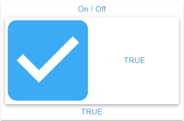

# Checkbox Widget

## Description

The Checkbox Widget shows an OID of type boolean as a checkbox with a label. The label is the displayed text of the active state, its placement is configurable. A click writes the opposite position, delayed through the **Write Value** settings.

## Settings Hierarchy

This widget uses all **vis-2 Settings** and **Common Settings**. See [Home](En-Home.md) for details.

The widget-specific and value-specific settings override the more general settings. What works differently here is described under [Icon](#icon) and [Label Text](#label-text).

## Widget-Specific Settings

| Field Name                               | Type                                     | Default | Description                                                                                                                                | Condition                    |
| ---------------------------------------- | ---------------------------------------- | ------- | ------------------------------------------------------------------------------------------------------------------------------------------ | ---------------------------- |
| Object ID `oid`                          | id                                       | -       | The object dialog offers only the type boolean. An object of another type is discarded, the frame then shows the hint                      | -                            |
| Unit `unit`                              | text                                     | `''`    | Unit (taken from the object, can be overridden here, clearing removes it). Affects the text of label and footer, and only without an alias | Only when an OID is selected |
| Without label `withoutLabel`             | checkbox                                 | false   | Show the checkbox without a label                                                                                                          | -                            |
| Label placement `checkboxLabelPlacement` | select (`top`, `bottom`, `start`, `end`) | `end`   | Position of the label relative to the checkbox                                                                                             | Hidden with `withoutLabel`   |
| Only display `onlyDisplay`               | checkbox                                 | false   | Locks the checkbox, see [Locked](#locked). Every OID pick sets the field anew: `true` with `write: false`, otherwise `false`               | Hidden with `write: false`   |

**Note:** In addition to the settings above, the **Write Value** settings (delay/interval) are available. These control how value changes are written to the OID. See [Common Settings - Write Value](En-Home.md#write-value) for details.

### Position and Toggling

- The checkbox is checked exactly with `true` and the text `"true"`. Any other value shows it unchecked, including `"TRUE"`, `1` or `null`.
- As long as the OID has delivered no value, the widget shows neither checkbox nor label.
- A click on checkbox or label writes the opposite of the displayed position, always as a boolean: `"false"` or `1` becomes `true`.
- The position changes at once, the write follows after the waiting time from [Write Value](En-Home.md#write-value).
- Several clicks within the waiting time result in one write with the last value, even if it equals the initial value.

### Locked

With `onlyDisplay` or an OID with `write: false` the checkbox is disabled. Its appearance does not change, it just no longer reacts to clicks. A binding on `onlyDisplay` delivers text, there `false` and `0` count as off.

### Rows

The state editor has two fixed rows for `true` and `false`: adding, cloning and deleting are not available. Picking the OID creates missing rows, the alias comes from `common.states`, without an entry `TRUE` or `FALSE`. Existing rows stay.

### Icon

- The checkbox shows the icon of the active state: `icon{n}`, `iconSmall{n}`, otherwise `icon`, `iconSmall`. Without an icon it shows a box with a check mark or an empty box.
- An icon in `icon` or `iconSmall` applies to both positions, then only label and color tell them apart. Picking the OID can also fill `icon`. An own icon per position comes from `icon{n}`. A set icon also appears as the corner icon, unless `noHeaderIcon` is active.
- The size follows `iconSize{n}`, `iconSize`, otherwise 100, each in percent of the checkbox area. `iconSize` also controls the corner icon, there in percent of 24 px.
- The color follows `iconColor{n}`, `iconColor`, otherwise the primary color of the theme. The boxes are always colored.
- The checkbox has no ripple.

## Label Placement

The position of the label is controlled via `checkboxLabelPlacement`:

### Top

- Value `top`: label above the checkbox
- Vertical arrangement

### Bottom

- Value `bottom`: label below the checkbox
- Vertical arrangement

### Start

- Value `start`: label to the left of the checkbox (in LTR layout)
- Horizontal arrangement

### End (Default)

- Value `end`: label to the right of the checkbox (in LTR layout)
- Horizontal arrangement

### Without Label

- `withoutLabel` shows only the checkbox, it then takes up the whole area
- Useful for compact displays or when frame header or footer carry the caption

### Label Text

- The label shows the alias of the active row (HTML allowed), otherwise its value, otherwise the current value of the OID, the last two with unit. An alias of only spaces does not count.
- Without an active row the label stays empty for `false`, the footer however shows `false`.
- Without `footer` the footer shows the same text. So the text appears twice, unless `noFooter` is active or `footer` is set.
- Size and color follow `valueSize{n}`, `valueSize` and `textColor{n}`, `textColor`. In every placement the text is left-aligned in its area.

## Use Cases

- **Settings**: Enable/Disable options, the aliases name the option
- **Checklists**: Check off tasks, with `icon{n}` for done and open
- **Filters**: Selection of filter criteria as a boolean state that a script evaluates
- **Consents**: Confirmations/agreements with HTML in the alias
- **Notifications**: Enable/Disable toggle with label, with `noFooter` so the text does not appear twice
