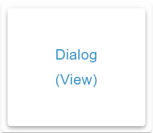

# Dialog Widget



## Description

The Dialog Widget shows a button with icon and text. A click opens a modal window with a selected view. Optionally it closes by itself after a configured time and follows a boolean session OID, which it also writes on its own actions.

## Settings Hierarchy

This widget uses all **vis-2 Settings** and **Common Settings**. See [Home](En-Home.md) for details.

The widget-specific settings override the more general settings.

The widget has no main OID, so neither `oid` nor `unit`, and no value-specific settings.

The Common Settings apply to two frames: the frame of the button and the view frame in the open dialog. Unlike on [Home](En-Home.md):

- **Icon:** The frame of the button shows the icon twice, as corner icon and in the button. `noHeaderIcon` hides only the corner icon, `onlyText` only the icon in the button. The view frame has no corner icon.
- **Icon size:** In the button `iconSize` means percent of the icon area, without a value 100 %.
- **Header without text:** The name of the session OID's object appears.
- **Text color and font size:** `textColor` also colors the button text and the title line, `valueSize` sets the font size of the button text.
- **CSS Background:** `background-color` takes precedence over `background` on the content area of the view frame. It also tints the scrollbar and colors the dividers there.

## Widget-Specific Settings

All fields are in the **Dialog** group.

### View and Title

| Field Name                            | Type         | Default | Description                                                                                       | Condition |
| ------------------------------------- | ------------ | ------- | ------------------------------------------------------------------------------------------------- | --------- |
| View `view`                           | select-views | -       | View shown by the dialog, see [View Selection](#view-selection)                                   | -         |
| Header as title `dialogHeaderAsTitle` | checkbox     | false   | Shows the header in the title line instead of the frame header, see [Dialog Title](#dialog-title) | -         |

### Size Settings

| Field Name                              | Type           | Default | Description                              | Condition |
| --------------------------------------- | -------------- | ------- | ---------------------------------------- | --------- |
| Width `dialogWidth`                     | slider (1-100) | 100     | Width of the dialog                      | -         |
| Height `dialogHeight`                   | slider (1-100) | 100     | Height of the dialog                     | -         |
| Width / height in pixel `dialogInPixel` | checkbox       | false   | Both values in pixels instead of percent | -         |

### Dialog Background

| Field Name                               | Type  | Default | Description                                                                                                               | Condition |
| ---------------------------------------- | ----- | ------- | ------------------------------------------------------------------------------------------------------------------------- | --------- |
| Background color `dialogBackgroundColor` | color | -       | Area behind the dialog, beneath the MUI backdrop (gradient possible). Without a value transparent, the view shows through | -         |

### Button

In the panel below the **Button** divider. The button fills the content area of its frame. Without `onlyIcon` and `onlyText` icon and text share the area side by side; a missing icon or an empty text leaves its part empty.

| Field Name           | Type     | Default | Description                                               | Condition                 |
| -------------------- | -------- | ------- | --------------------------------------------------------- | ------------------------- |
| Text `dialogText`    | html     | -       | Text of the button, HTML allowed. Not shown in the dialog | No effect with `onlyIcon` |
| Only icon `onlyIcon` | checkbox | false   | Button with icon only                                     | Hidden with `onlyText`    |
| Only text `onlyText` | checkbox | false   | Button with text only                                     | Hidden with `onlyIcon`    |

### Close Button

In the panel also below the **Button** divider, but the fields concern the dialog.

| Field Name                                    | Type     | Default | Description                                                                         | Condition |
| --------------------------------------------- | -------- | ------- | ----------------------------------------------------------------------------------- | --------- |
| Close button top `dialogCloseButtonTop`       | checkbox | false   | Close button in the title line                                                      | -         |
| Close button bottom `dialogCloseButtonBottom` | checkbox | false   | Close button below the view                                                         | -         |
| Close button color `dialogCloseButtonColor`   | color    | -       | Color of the close button, solid only. Only takes effect with one of the two fields | -         |

### Auto-Close

| Field Name                        | Type                       | Default | Description                                                        | Condition |
| --------------------------------- | -------------------------- | ------- | ------------------------------------------------------------------ | --------- |
| Auto close [ms] `dialogAutoClose` | slider (0-30000, step 100) | -       | Closes the dialog after this time. Without a value or with `0` off | -         |

### OID Control

| Field Name           | Type | Default | Description                                                                                                   | Condition |
| -------------------- | ---- | ------- | ------------------------------------------------------------------------------------------------------------- | --------- |
| Object ID `dialogId` | id   | -       | Session OID: `true` opens, `false` closes, own actions write it. The object dialog offers only boolean states | -         |

## View Selection

- The panel offers all views of the project, except the one being edited
- The view is fully rendered in the dialog, in the editor as at runtime
- All widgets in the view are interactive
- The view is created only on opening and goes away on closing
- If the view extends beyond the area, it scrolls within the dialog
- Without a selected or existing view the area stays empty

**Note:** Choose views optimized for dialog display (compact layouts).

## Size Settings

### Percent (Default)

- `dialogInPixel = false`
- Width and height in percent of the browser window
- Example: 80 = 80 % of the window width or height
- Follows the window size

### Pixel

- `dialogInPixel = true`
- Width and height in pixels
- Example: 800 = 800 px width. The slider ends at 100, the number field next to it takes larger values
- Does not refer to the window size
- Switching does not convert the values

**Recommendation:** Use percent for responsive designs, pixels for fixed layouts.

## Close Button

### Position

- **Close button top**: right in the title line, with a divider below
- **Close button bottom**: right below the view, with a divider above
- Both at once are possible

### Color

- Adjustable via `dialogCloseButtonColor`
- Without a value `background-color` from CSS Background applies, otherwise the theme's `background.default` color
- The icon is additionally brightened with `brightness(1.5)`
- The dividers use the same order without `dialogCloseButtonColor`

### Without a Button

- With both fields off (default) the dialog has no close button
- User can then close the dialog via the backdrop, Escape, auto-close or the session OID

## Auto-Close

- Dialog closes automatically after configured milliseconds, whether a click or the session OID opened it
- Example: 5000 = dialog closes after 5 seconds
- Useful for notifications or temporary displays
- Without a value or with `0` the dialog stays open until closed another way
- On expiry the widget writes `false` to a writable session OID
- A running timer keeps its duration, even when `dialogAutoClose` changes. Closing another way or removing the widget clears it
- The number field next to the slider and bindings allow further values: below 60 counts as seconds (20 = 20 s), from 60 as milliseconds, `true` as 10 s, a text without a number as 1 s

## OID Control

With `dialogId`, the dialog session follows a boolean OID, the session OID.

The widget writes the OID only on its own open and close (click, X/backdrop/Escape, auto-close) — never in reaction to the state, not even on view load. Only boolean values control the dialog; other values are ignored. A read-only state is only read.

| Event                                    | Dialog    | Writes  |
| ---------------------------------------- | --------- | ------- |
| Click on the button                      | opens     | `true`  |
| Close button, backdrop, Escape           | closes    | `false` |
| Auto-close expiry                        | closes    | `false` |
| State becomes `true`, also on view load  | opens     | nothing |
| State becomes `false`, also on view load | closes    | nothing |
| Other value                              | unchanged | nothing |

Writes go out directly with `ack=false`, without delay and interval from [Write Value](En-Home.md#write-value); the widget does not have these fields. An object counts as read-only with `common.write = false` when picked. Without a valid object in `dialogIdObject` the widget likewise only follows the state. Picking the OID stores only `dialogIdObject` and leaves `icon` and the other fields untouched.

### Open Dialog

- Set the OID to `true`
- Dialog opens automatically, even if the value is already present on view load
- The editor has no special case: `true` opens the dialog there too

### Close Dialog

- Set the OID to `false`
- Dialog closes automatically, without the widget writing back
- If a read-only OID is still `true` after closing, the dialog stays closed. Only a new change to `true` or a click opens it again
- If the widget is removed with the dialog open, it writes no `false`. The OID stays `true`, on the next load the dialog opens again
- Two Dialog widgets on the same OID open and close together

**Use Case:** Open dialog on specific events (e.g., alarms, notifications)

**Example:**

```
dialogId = "javascript.0.showAlarmDialog"
```

Script sets `showAlarmDialog = true` on alarm → dialog opens. With auto-close the widget writes `false` on expiry, the next alarm can set `true` again

## Dialog Title

### With dialogHeaderAsTitle

- `dialogHeaderAsTitle = true`
- The header sits in the title line of the view frame, its frame header is dropped
- Single line, HTML allowed, size `headerSize`, color `textColor`
- Also takes effect with `noHeader`. The frame of the button still follows `noHeader`

### Without dialogHeaderAsTitle

- `dialogHeaderAsTitle = false`
- The header sits in the frame header as on the button, with `noHeader` nowhere
- The title line stays empty and holds only a close button at the top
- Custom titles can be placed within the view

## Use Cases

- **Detail Views**: Click on the button opens a detailed view
- **Settings**: Open a settings view for complex configurations
- **Notifications**: Automatic opening on alarms via the session OID, closing with auto-close
- **Forms**: Input views for user input
- **Media Player**: Detailed control in separate dialog
