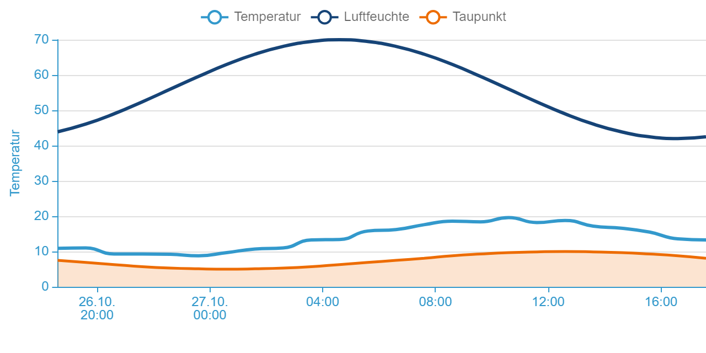
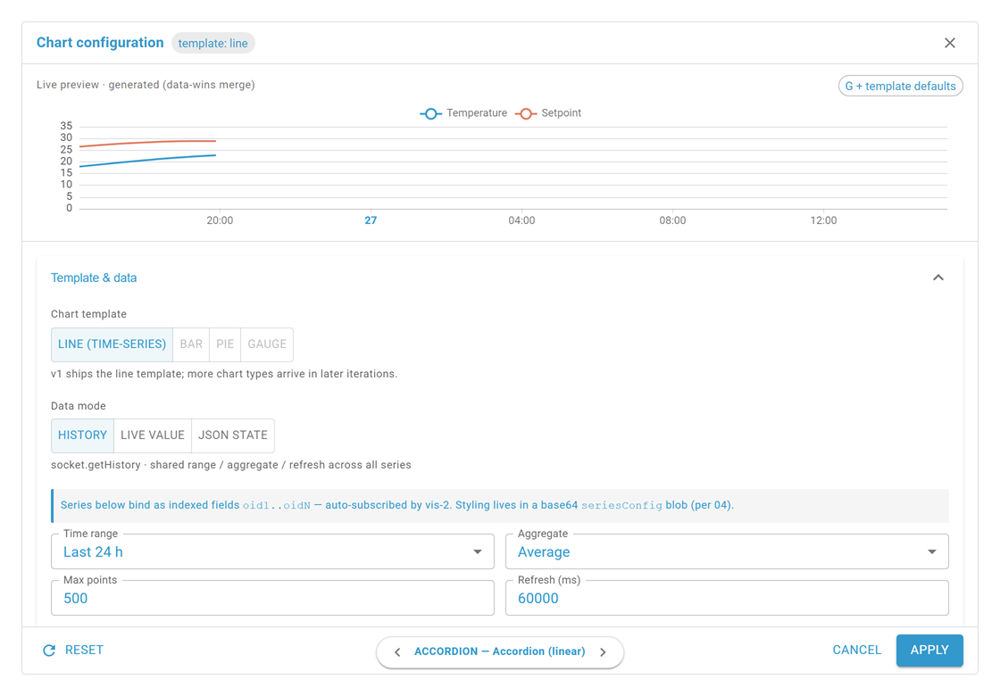

# ECharts Widget

## Description

The ECharts widget ("Chart (ECharts)") renders Apache ECharts charts in vis-2: line charts, bar charts, scatter plots and pie/donut charts. All chart-specific settings live in the configurator, opened by **Edit chart configuration** in the vis-2 attributes panel.

The widget supports two data source modes:

- **History** — fetches history through a history adapter (history, SQL, InfluxDB …). Time window, fetch and refresh apply per chart; aggregation, difference and null values can be overridden per series.
- **JSON** — one data point supplies the data as a JSON payload. The structures are described on [ECharts JSON Formats](En-Echarts-JSON-Formats.md).

## Settings hierarchy

This widget uses all **vis-2 settings** and **common settings**. See [Home](En-Home.md) for details. Deviation: the [Icon](En-Home.md#icon) and [Value](En-Home.md#value) blocks and No header icon `noHeaderIcon` have no effect here and are hidden in the panel.

The widget-specific settings override the more general ones.

> **Configurator, not panel:** Almost every ECharts setting lives in the configurator, not in the vis-2 attributes panel. The panel only shows the open trigger and the four padding sliders (see [below](#vis-2-panel-settings)).

## Concepts

### Chart families

The **chart type** (pinned at the top of the configurator) picks the family at the same time:

| Type    | Family    | Description                                                                                                  |
| ------- | --------- | ------------------------------------------------------------------------------------------------------------ |
| Line    | Cartesian | Series as lines; the area fill is a series property, not a type of its own                                   |
| Bar     | Cartesian | Series as bars; in history optional calendar bucketing via the bar interval                                  |
| Scatter | Cartesian | Series as scattered points                                                                                   |
| Pie     | Pie       | History and finished series: one series = one slice. Table / columns: one Y column = one ring, rows = slices |

Within the cartesian family every series may override the type: the **Type** field appears from two series on and shows the chart type while the series carries no type of its own. Choosing the chart type stores no override.

### Data modes and payload families

The **data mode** (second pinned selector) applies to the whole chart:

- **History** — every series binds its own data point; data is fetched via `getHistory` with time window, aggregation and maximum point count. Requires a history adapter on the data point.
- **JSON** — exactly one JSON data point supplies all series. Under this mode a third pinned selector appears, the **payload family**:
    - **Finished series** — the payload carries finished series (`{ series: […] }`, arrays …). Count and values are owned by the payload alone; in the configurator you style, axis-bind and hide them by name.
    - **Table / columns** — the payload is a list of rows; rows path, X column and Y columns (in the Series section) derive the series from it. Here the user owns the structure, the payload the values.

> **Boundary crossings delete:** Family switches (e.g. line → pie), data-mode switches (history ↔ JSON) and payload-family switches (finished series ↔ table / columns) reset the data path: series, Y axes, style and hiding of the payload series, JSON data point, mapping and markings fall. Title, legend, tooltip, colors, toolbox, X card and zoom stay. After the crossing a notice names what fell (series, axes, markings, JSON data point, active templates; nothing lost, no notice), and its **Undo** restores the state in a single step. The JSON data point itself survives a payload-family switch (same state, read the other way). Line ↔ bar ↔ scatter deletes nothing.

The JSON payload formats with examples: [ECharts JSON Formats](En-Echarts-JSON-Formats.md).

### Per-series value processing (value chain)

Every value passes through a fixed chain on its way into the chart. The stages are series properties on the **Data** tab of the series card:

1. **Value mapping** (`valueMap`) — if the raw value as text matches a key exactly, the mapped number applies; an empty target is a **deliberate gap** that is never filled. Unmapped values pass through unchanged.
2. **Plottable value** — booleans and `"true"`/`"false"` become 1/0, texts are read as the number at the start of the text (`23.5 °C`). A comma without a dot counts as the decimal separator (`23,5`; `1.234,5` yields 1.234). Anything uninterpretable and empty texts become a gap.
3. **Null values** — keep gaps, fill with the last value or fill with 0. Deliberate gaps stay immune.
4. **Y offset** — adds a fixed offset to the value.
5. **Formula** — calculation over the symbol `val` (expr-eval syntax, e.g. `val / 1000 + 3`); the context symbols `smin`, `smax`, `savg`, `sfirst`, `slast` provide the series' min/max/average/first/last value before Y offset and formula, gaps skipped. An invalid formula ⇒ values with the Y offset only, hint at the field. A non-finite or throwing result ⇒ a gap.
6. **Bucketing** — category bars in history only, with the difference.
7. **Moving average** — centered window over N points; clipped at the edges, gaps skipped but not filled.
8. **Cumulative** — running total over the non-null values; gaps stay, no reset.

In history mode the fetch (aggregation, point limit) comes first. **Hide future values** cuts before Y offset and formula and only acts on points with a time X; with table / columns on a category or index X it has no effect.

### Axis model (cartesian)

- **Series follow axes:** an axis exists while at least one series binds it. Every new series gets its own axis; the axes alternate left and right on an 80 px raster.
- **Y-axis binding:** every series binds to exactly one Y axis (**Basics** tab of the series card); the last entry **New axis** creates one. A duplicated series gets its own axis while every series has its own, otherwise the source's axis. When the last series leaves an axis, the axis and its configuration fall: on removing and rebinding a notice offers **Undo**, when the series vanishes from the payload it only informs.
- **Structural events:** adding, duplicating, removing and rebinding re-arrange the bound axes. A manually set side and offset hold until the next event.
- **Name giver:** when several series share an axis, the axis shows the name and color of its name giver; a newly rebound series does not take over the role. When it moves on, the first remaining series takes over.
- **Place memory:** each side (left/right) remembers the pixel values of its places. The offset hangs on the place: an arriving axis takes the remembered value, a new place the raster value.
- **Legend follow:** when all series of an axis are deselected in the legend, the axis vanishes with its reserved space, in the display only.
- **Align ticks** is a per-axis choice, off by default. The switch appears only on follower axes from two displayed axes on; the reference is the first displayed axis. A dedicated value range or tick setting overrides the alignment for that axis, the configurator warns.

The pie has no axes; the "Axes & zoom" section does not exist there.

## The configurator

Open it via: vis-2 attributes panel → group **Chart** → **Edit chart configuration**.

- **Left:** section rail. Pinned on top: **Chart type**, **Data mode** and (in JSON mode) **Payload family**. Below, the collapsible sections, in this order:
    1. Data source
    2. Series
    3. _family-dependent:_ Axes & zoom (cartesian) **or** Pie options (pie)
    4. Title
    5. Legend
    6. Tooltip
    7. Colors
    8. Toolbox
    9. Behavior
- Every section starts collapsed with a summary line; a ⚠ counter in the header reports validation problems (missing OID, missing or text Y column, stale axis binding, Y min ≥ max, scale min ≥ max, stack on the time axis). They never block **Apply**.
- **Right:** preview with real data, at most 200 points per series, polling yes, no re-fetch on value change. The splitter between configuration and preview is draggable and keyboard-operable (320–720 px, start 440, remembered; double-click resets).
- **Header:** **Undo** and redo (Ctrl+Z, Ctrl+Shift+Z, Ctrl+Y), **Maximize** (for the session only), **Close**, a dot for open changes.
- **Footer:** **Reset** returns to the loaded state in one undoable step; the problem counter jumps to the first affected section and its tab; **Cancel** discards; **Apply** writes the rxData patch. **Reset** and **Apply** are disabled without a change. Every way of closing prompts while changes are open; nothing becomes effective in the widget before **Apply**.

### Pinned selectors

| Selector       | Values                            | Description                                                                     |
| -------------- | --------------------------------- | ------------------------------------------------------------------------------- |
| Chart type     | Line · Bar · Scatter · Pie        | Family and type in one (see [concepts](#chart-families))                        |
| Data mode      | History · JSON                    | Chart-global, not per series (see [concepts](#data-modes-and-payload-families)) |
| Payload family | Finished series · Table / columns | Only visible in JSON mode                                                       |

## Data source section

Applies chart-global. Aggregation with its parameters, difference and null values are the **preset for all series**: every series can override them on its card (inherit overrides). Time window, time step, max. points, refresh interval and bar interval apply to all series. On the pie these fields shape the points, the slice aggregation then collapses them.

### History mode

Tabs: **Time window** | **Data retrieval**.

**Tab Time window**

| Setting     | Values / type                                                                                                                                                      | Default  | Description                                                                                                                                                        |
| ----------- | ------------------------------------------------------------------------------------------------------------------------------------------------------------------ | -------- | ------------------------------------------------------------------------------------------------------------------------------------------------------------------ |
| Time window | Relative · Static                                                                                                                                                  | Relative | Relative = moving window; Static = fixed start/end datetimes. Static hides time range, end and refresh interval; polling and the re-fetch on value change drop out |
| Time range  | 10/30 minutes · 1/2/3/6/12 hours · 1/2/3/7/14 days · 1/2/3/6 months · 1/2 years                                                                                    | 1 day    | Months and years count by the calendar, a month end is clamped (`1m` before Mar 31 lands on Feb 28/29)                                                             |
| End         | Now · End of minute · End of 5/10/30 minutes · End of hour · End of 2/3/4/6/8/12 hours · End of day · End of Sunday · End of Saturday · End of month · End of year | Now      | Rounds the window end up to the next boundary; the time range counts back from there                                                                               |
| Start / End | date/time                                                                                                                                                          | –        | Static only. Incomplete or start ≥ end ⇒ the default window applies (now − 24 h), the configurator says so                                                         |

**Tab Data retrieval**

| Setting                                | Values / type                                                                                    | Default          | Description                                                                                                                                                                                                                                                                                                                                                                                                                                                    |
| -------------------------------------- | ------------------------------------------------------------------------------------------------ | ---------------- | -------------------------------------------------------------------------------------------------------------------------------------------------------------------------------------------------------------------------------------------------------------------------------------------------------------------------------------------------------------------------------------------------------------------------------------------------------------- |
| Aggregation                            | Average · Min–Max · Minimum · Maximum · Total · Count · On change · None · Percentile · Integral | Average          | `getHistory` aggregation; percentile/integral bring their own parameters (below)                                                                                                                                                                                                                                                                                                                                                                               |
| Percentile (%)                         | 0–100                                                                                            | 50 (server)      | Only visible under aggregation Percentile                                                                                                                                                                                                                                                                                                                                                                                                                      |
| Unit (seconds)                         | number                                                                                           | 60 (server)      | Only under Integral: integration interval                                                                                                                                                                                                                                                                                                                                                                                                                      |
| Interpolation                          | None · Linear                                                                                    | None (server)    | Only under Integral                                                                                                                                                                                                                                                                                                                                                                                                                                            |
| Time step (seconds, instead of points) | number                                                                                           | –                | Replaces the point count with a fixed grid in seconds; too small a value is raised to span ÷ 5000                                                                                                                                                                                                                                                                                                                                                              |
| Max. points                            | number                                                                                           | 500              | Upper bound per series (widget hard limit: 5000). Disabled with a time step set                                                                                                                                                                                                                                                                                                                                                                                |
| Bar interval                           | Auto (time axis) · 15 minutes · 1 hour · 1 day · 30 days                                         | Auto (time axis) | Chart type Bar only: enforces calendar buckets (`30d` = calendar months, 1st-to-1st), the point count follows the buckets; reduced client-side by average, minimum, maximum or total, otherwise the last value applies. The choice follows the time range (up to 1 h: 15 minutes; up to 1 day: + 1 hour; up to 30 days: + 1 day; otherwise and with Static all); a stored, filtered-out value stays visible. Bar series in a line chart stay without bucketing |
| Difference to the previous bar         | boolean                                                                                          | off              | Only with a chosen bar interval: difference against the previous bucket, one bucket more is fetched for it; the first bar drops                                                                                                                                                                                                                                                                                                                                |
| Null values                            | Keep gaps · Forward-fill gaps · Fill gaps with 0                                                 | Keep gaps        | Preset of the null values stage; every series can override                                                                                                                                                                                                                                                                                                                                                                                                     |
| Refresh interval (ms)                  | number                                                                                           | 60000            | Periodic re-fetch; 0 = never. The widget also re-fetches 1.5 s after a value change                                                                                                                                                                                                                                                                                                                                                                            |

> **Bar stack on the time axis:** without a bar interval echarts stacks by data index instead of timestamp, diverging timestamps draw misassigned stacks. In history the configurator reports this on stacking with at least one stacked bar series, the button **Set bar interval** picks it by the span (up to 12 h 15 minutes, from 3 days 1 day, from 60 days 30 days, otherwise 1 hour).

> **Server aggregation first:** aggregation and point count run server-side — large histories spare the client. "None"/"On change" load raw points; for very large ranges prefer an explicit step or point limit.

### JSON mode

With family **Finished series** the section shows only the data point. With family **Table / columns** the tabs **Data point** | **Mapping** appear:

| Setting               | Values / type | Default     | Description                                                                                                                                                                                                                                                                                         |
| --------------------- | ------------- | ----------- | --------------------------------------------------------------------------------------------------------------------------------------------------------------------------------------------------------------------------------------------------------------------------------------------------- |
| JSON data point (OID) | id            | –           | The data point whose **string value** carries the JSON payload                                                                                                                                                                                                                                      |
| Rows path             | chips         | (top level) | Chips for the top level and every array reachable through object keys, with its length (`plant.strings`). Top level = the payload itself must be the array. If it is none, the longest path carries the badge **Suggested**, it is not set. The runtime also reads array indices (`rows[0].values`) |
| X column              | column        | (row index) | Column for the X dimension; disabled without columns. A date column (badge **Time axis**) ⇒ time axis, sorted ascending, unreadable X values drop the row; otherwise category in payload order, duplicates stay; no column ⇒ row index                                                              |

The configurator analyzes the current payload: columns appear with a type badge (date/number/text/boolean/…), the X column with sample values ("e.g. …"). The search is limited to 10 nesting levels and says so; the runtime resolves any depth. A rows path no longer in the payload stays as a warning chip "No longer in the payload".

Drift at runtime: a missing rows path makes the widget show an error; a missing X column falls back to the row index; a missing Y column renders an empty series, a text column only its values readable as numbers (both with a warning in the configurator).

The Y columns are bound as cards in the Series section (see below). Formats and rules: [ECharts JSON Formats](En-Echarts-JSON-Formats.md).

## Behavior section

Tabs: **Motion** | **Renderer**.

| Setting                 | Values / type                                         | Default | Description                                                                              |
| ----------------------- | ----------------------------------------------------- | ------- | ---------------------------------------------------------------------------------------- |
| Animation               | boolean                                               | on      | Animation while drawing                                                                  |
| Animation duration (ms) | 0–2000 (slider, 50 steps)                             | 600     | Disabled without animation                                                               |
| Animation easing        | Default · Linear · Cubic out · Cubic in-out · Elastic | Default | ECharts easing curve; disabled without animation                                         |
| Renderer                | Canvas · SVG                                          | Canvas  | Canvas = faster for live data and large datasets; SVG = crisp for print, export, scaling |

## Title section

Tabs: **Text** | **Position** | **Style** | **Templates**.

| Setting         | Values / type                                                                                                                      | Default    | Description                                                                                                |
| --------------- | ---------------------------------------------------------------------------------------------------------------------------------- | ---------- | ---------------------------------------------------------------------------------------------------------- |
| Chart title     | text                                                                                                                               | –          | May contain vis-2 bindings `{oid.val}` (e.g. `{0.0.temperature.val}`); vis-2 resolves them, not the widget |
| Title position  | Top/Bottom × left/center/right (3×2)                                                                                               | Top center | When title and legend share an edge, legend and plot move past the title                                   |
| X offset        | px                                                                                                                                 | 0          | Left anchors only (Top left, Bottom left)                                                                  |
| Y offset        | px                                                                                                                                 | 0          | Every anchor; positive points down                                                                         |
| Title color     | color                                                                                                                              | inherited  | Empty = theme text color                                                                                   |
| Title font size | number                                                                                                                             | inherited  |                                                                                                            |
| Font weight     | Normal · Bold · Bolder · Lighter · 100 Thin · 200 Extra Light · 300 Light · 500 Medium · 600 Semibold · 800 Extra Bold · 900 Black | Normal     |                                                                                                            |
| Font style      | Normal · Italic · Oblique                                                                                                          | Normal     |                                                                                                            |

The **Templates** tab carries the title's [advanced JSON](#templates--advanced-json); it also acts without a title text.

## Series section

The layout of this section depends on data mode, payload family and chart type:

| Context                              | View                                                                                                                                     |
| ------------------------------------ | ---------------------------------------------------------------------------------------------------------------------------------------- |
| History (cartesian)                  | Series cards with tabs **Basics \| Data \| Style \| Format \| JSON**; actions sort ▲▼, duplicate, remove                                 |
| JSON, finished series (cartesian)    | One card per payload series with the same tabs, **Data** without fetch fields; the only action is hide. The payload owns count and names |
| JSON, table / columns (cartesian)    | One card per bound Y column with the same tabs, **Data** without fetch fields; actions as in history                                     |
| Pie (history & JSON finished series) | Slice rows: name, series color, (history: one OID per slice)                                                                             |
| Pie, table / columns                 | Ring cards per Y column with tabs **Basics \| Data \| JSON**; the X column names the slices                                              |

**Add first series** or **Add series** opens the OID picker (in history only history-capable OIDs), the series comes into being with the choice. With table / columns the action is **Add column as series**.

With chart type Bar the stack mode sits above the cards in every data mode:

| Setting        | Values / type                  | Default | Description                                                                                                                                                          |
| -------------- | ------------------------------ | ------- | -------------------------------------------------------------------------------------------------------------------------------------------------------------------- |
| Stacking       | None · Stacked · 100 % stacked | None    | Acts on bars without their own stack group. At 100 %: negative values can show a share of 0 %, absolute series on the same axis run against the 0–100 % scale (hint) |
| Sum over stack | on/off                         | off     | Only under Stacked: the per-category sum as a label above every stack with at least two visible series                                                               |

### Series card in history mode

**Tab Basics**

| Setting          | Description                                                                                                                      |
| ---------------- | -------------------------------------------------------------------------------------------------------------------------------- |
| OID              | The series' data point; in history mode restricted to history-capable OIDs                                                       |
| History instance | Auto (from the data point's configuration) or a pinned instance (e.g. `sql.0`); without a history adapter Auto only, with a hint |
| Name             | Display name (legend, tooltip)                                                                                                   |
| Series color     | Color field; empty = palette slot                                                                                                |
| Type             | Line · Bar · Scatter — visible from two series; without its own type it shows the chart type                                     |
| Y axis           | Binding to an axis; last entry **New axis**                                                                                      |

**Tab Data** — fetch overrides (inherit the data-source preset, the entry names its inheritance target) **plus** the value-chain stages:

| Setting                 | Description                                                                                                                                                                                                               |
| ----------------------- | ------------------------------------------------------------------------------------------------------------------------------------------------------------------------------------------------------------------------- |
| Aggregation             | Inherit (→ chart aggregation) or own value. Percentile (%), Unit (seconds) and Interpolation appear alongside and inherit only under the same chart aggregate                                                             |
| Difference              | Inherit · Differentiate · Raw — chart type Bar only, acts only with a bar interval. With mixed difference the first bucket stays, without a value in the difference series                                                |
| X offset                | Seconds (number) · ±1/2/3/6 months · ±1/2 years (calendar; positive = into the past) — shifts the request window, e.g. to overlay last year's values. In a category bar chart the series lands outside the buckets (hint) |
| Formula                 | Calculation over `val` (and `smin`/`smax`/`savg`/`sfirst`/`slast`), e.g. `val / 1000 + 3`. An invalid formula ⇒ values with the Y offset only (hint at the field)                                                         |
| Y offset                | Numeric offset before the formula: `f(val + yOffset)`                                                                                                                                                                     |
| Null values             | Inherit (→ chart setting) · Keep gaps · Forward-fill gaps · Fill gaps with 0                                                                                                                                              |
| Value mapping           | Raw value → Number (empty = gap); exact text match. **Add mapping** creates the next free integer mapped to itself, a cleared raw value removes the row                                                                   |
| Hide future values      | Cuts points after "now"                                                                                                                                                                                                   |
| Moving average (points) | Centered moving window, odd 3–51, switching on sets 5; edges clipped, gaps stay gaps, never interpolated                                                                                                                  |
| Sum cumulatively        | Running total; after the moving average, no reset                                                                                                                                                                         |

**Tab Style** — grouped by type: line and area on lines, bar on bars. **Color scale** and **Only in legend** exist on all types, on scatter only these:

| Setting                    | Description                                                                                                                                          |
| -------------------------- | ---------------------------------------------------------------------------------------------------------------------------------------------------- |
| Smooth curve               | Smooth (spline) curve                                                                                                                                |
| Show symbols / Symbol size | Point symbols on the line / 2–20 px, default 6                                                                                                       |
| Value labels               | Line: sit on the symbols and keep them visible (hint). Bar: see Label position                                                                       |
| Connect gaps               | Draw the line across null gaps (independent of the null values stage)                                                                                |
| Line width                 | 0.5–8 px, default 2                                                                                                                                  |
| Line shadow                | Blur in series color, 0–30 px                                                                                                                        |
| Line style                 | Solid · Dashed · Dotted                                                                                                                              |
| Step                       | None · Step (start) · Step (middle) · Step (end) — staircase display                                                                                 |
| Area fill                  | Off · Flat · Gradient                                                                                                                                |
| Area opacity               | Default 0.15 on Flat, 0.8 on Gradient                                                                                                                |
| Area gradient              | CSS `linear-gradient` for area fill Gradient                                                                                                         |
| Stack group                | Bar: Inherit (→ Stacking) · No stack · Group A/B/C — own groups stack independently of the chart mode. Line: No stack · Group A/B/C, without inherit |
| Label position             | Off · Above bar · Inside, top · Inside, bottom · Inside, middle; unset = middle                                                                      |
| Label size / Label color   | 6–24 px, default 12 / empty = auto contrast                                                                                                          |
| Bar width (px/%)           | E.g. `20` or `30 %`; empty = auto                                                                                                                    |
| Bar gap / Bar category gap | 0–1 (ECharts `barGap`/`barCategoryGap`), default 0.1 / 0.2                                                                                           |
| Bar corner radius          | 0–30 px                                                                                                                                              |
| Color by value             | Color scale: replaces the series color by value; the area keeps its gradient                                                                         |
| Scale min / Scale max      | Empty inherits the axis bound, otherwise the data range. Min ≥ max ⇒ no scale, warning; disabled while **Color by value** is off                     |
| Scale gradient             | Empty = derived from the series color, from light (low) to dark (high); disabled while **Color by value** is off                                     |
| Only in legend             | Hide the series, keep the legend entry (toggleable)                                                                                                  |

**Tab Format** — value presentation. **Text when true / Text when false** and **State names** appear only when the series' OID supplies the type, so only in history:

| Setting                          | Description                                                                                                                                                                      |
| -------------------------------- | -------------------------------------------------------------------------------------------------------------------------------------------------------------------------------- |
| Unit                             | Suffix in tooltip, legend value and labels; an axis inherits it when every bound series carries the same unit                                                                    |
| Decimals                         | Clamps the series' values; 0 is a fact, not "unset"                                                                                                                              |
| Text when true / Text when false | Boolean OIDs: texts for 1/0, prefilled from `common.states`; if one is missing, `TRUE` or `FALSE` applies. A text hit suppresses unit and decimals                               |
| State names                      | OIDs with `common.states` and without a unit: value → text, prefilled, **Add state** adds; exact hit for tooltip/legend/label (a miss stays empty), nearest state for axis ticks |

**Tab JSON** — the series' [advanced JSON](#templates--advanced-json): deep-merged **under** the GUI entries (the GUI wins every collision); data points are force-set. Escape hatch for ECharts keys the GUI does not expose (`markPoint`, `emphasis`, `label.formatter` …).

### JSON: finished series (cartesian)

The payload owns the series — there is no adding or removing, only **styling** (tabs as in history; **Basics** without OID and history instance, an empty name falls back to the payload name; **Data** without aggregation, difference and X offset) and **hiding** ("Hidden series" can be re-enabled as chips). Series sharing a name share style, axis binding and hiding — use unique names in the payload (the configurator warns).

### JSON: table/columns (cartesian)

One card per bound Y column: **Basics** with Y column (picker from the detected column list, an empty name falls back to the last path segment), name, series color, type and Y axis; **Data** without aggregation, difference and X offset; **Style**, **Format** and **JSON** as in history. Rows path and X column live in the Data source section. A Y column missing from the payload renders an empty series (warning, no error); a text column plots only the values interpretable as numbers.

### Pie: slice rows

- **History:** one row per slice — name, OID, series color, remove, expandable advanced JSON. The values collapse via the **slice aggregation** (Pie options section).
- **JSON finished series:** rows per payload series — name (from payload), series color, hide, advanced JSON per slice.
- **JSON table / columns:** one ring card per Y column, ring icon instead of a swatch, tabs **Basics \| Data \| JSON**, without series color, type and Y axis; actions as in history. The X column names the slices and drives the color — same name = same color across all rings; without an X column the slices read "Zeile n".

## Axes & Zoom section (cartesian)

Tabs: **Axes** | **Markings** | **Zoom**.

### X card

Tabs: **Basis** | **Labels** | **Ticks & grid** | **Advanced**.

| Setting                                           | Default                 | Description                                                                                                                                                                                                                                                                                                     |
| ------------------------------------------------- | ----------------------- | --------------------------------------------------------------------------------------------------------------------------------------------------------------------------------------------------------------------------------------------------------------------------------------------------------------- |
| Axis name                                         | –                       | label below the axis                                                                                                                                                                                                                                                                                            |
| Position                                          | bottom                  | top mirrors the axis above the chart                                                                                                                                                                                                                                                                            |
| Offset (px)                                       | 0                       | moves the axis away from the chart (fine-tuning)                                                                                                                                                                                                                                                                |
| Time format                                       | Automatic               | [moment.js](https://momentjs.com/docs/#/displaying/format/) tokens (e.g. `HH:mm`, `ddd`, `HH:mm   DD.MM.`) driving the axis labels **and** the tooltip header. Auto = adaptive (seconds below 30 min span, date on day change). Hidden for JSON tables with a category X (the labels are the payload text) |
| Axis color                                        | theme                   | line, labels and name                                                                                                                                                                                                                                                                                           |
| Rotate labels                                     | 0°                      | angled time labels on narrow widgets                                                                                                                                                                                                                                                                            |
| Label font size (px)                              | 12                      |                                                                                                                                                                                                                                                                                                                 |
| Show ticks / tick color                           | on / inherited          |                                                                                                                                                                                                                                                                                                                 |
| Gridlines / grid color / grid width / stroke type | off / theme / 1 / solid | vertical gridlines                                                                                                                                                                                                                                                                                              |
| Tick segments                                     | 6                       | target tick count                                                                                                                                                                                                                                                                                               |
| Min. interval                                     | –                       | milliseconds (e.g. 3600000 = 1 h)                                                                                                                                                                                                                                                                               |
| Name rotation (°)                                 | 0                       | fine-tuning                                                                                                                                                                                                                                                                                                     |

### Y-axis cards

Tabs: **Basis** | **Values** | **Scale & ticks** | **Presentation** | **Advanced**. Card: axis name (default: the name-giver series), side, place `side · place/total`, "closer to the chart"/"further away", delete.

| Setting                                           | Default                       | Description                             |
| ------------------------------------------------- | ----------------------------- | --------------------------------------- |
| Axis name                                         | –                             | shows the name giver by default         |
| Side                                              | Left (axis 0) / Right         |                                         |
| Offset (px)                                       | 0                             | stacking on the same side               |
| Y min / Y max                                     | auto                          | fixed value range                       |
| Y label format                                    | –                             | string template `{value} kW`            |
| Don't force zero                                  | off                           | `scale`: the axis need not contain 0    |
| Logarithmic Y-axis                                | off                           | `type: 'log'`                           |
| Align ticks                                       | on (from 2 axes)              | see [axis model](#axis-model-cartesian) |
| Tick segments / min. interval                     | auto                          | tick density, e.g. 1 for integer axes   |
| Gridlines / grid color / grid width / stroke type | axis 0: on · others off       | horizontal grid in the full style       |
| Label font size (px)                              | 12                            |                                         |
| Axis color                                        | the name giver's series color |                                         |
| Name position / name gap (px) / name rotation (°) | Middle · 18 · 0               |                                         |
| Advanced JSON                                     | –                             | deep-merge under the GUI (GUI wins)     |

> **Phantom axes:** an axis no series binds anymore does not exist — it drops silently on open. In the JSON series document the editor heals over the overlay names; removed payload series take their axis along (Undo helps).

### Markings

Reference lines and bands with style and labels, anchored to a Y-axis. Per marking:

| Setting                                  | Description                                                                                                                                                                                                                                              |
| ---------------------------------------- | -------------------------------------------------------------------------------------------------------------------------------------------------------------------------------------------------------------------------------------------------------- |
| Upper/lower bound (value or OID)         | number **or** datapoint (resolves live via subscription). Both bounds ⇒ a band (area) plus two styled edge lines; exactly one ⇒ a line                                                                                                                   |
| Axis                                     | the Y-axis the marking belongs to                                                                                                                                                                                                                        |
| Band fill                                | opacity 0–1 (default 0.2)                                                                                                                                                                                                                                |
| Color / line style / line width / shadow | the edge(s) style; width default 2                                                                                                                                                                                                                       |
| Label upper/lower bound                  | one group per edge: text (empty = value fallback: the resolved bound as a fully styled label), position (12 ECharts places: start/middle/end plus the inside\* variants), X offset, font size, text color (empty = marking color or the axis text token) |

### Zoom

| Setting               | Description                                                                    |
| --------------------- | ------------------------------------------------------------------------------ |
| Zoom slider           | dataZoom slider below the chart                                                |
| Mouse/touch zoom      | scroll/pinch zoom without a visible element                                    |
| Reset zoom after idle | off · 10 s … 30 min — resets the zoom to the full window after the idle period |

## Pie options section (pie)

Tabs: **Shape** | **Values** | **Advanced**.

| Setting                  | Values / type                              | Default               | Description                                                                                                                                              |
| ------------------------ | ------------------------------------------ | --------------------- | -------------------------------------------------------------------------------------------------------------------------------------------------------- |
| Donut inner radius (0–1) | 0–1                                        | 0                     | 0 = full pie; 0.5 ≈ ring                                                                                                                                 |
| Rose mode                | None · Radius · Area                       | None                  | radius/area proportional rose                                                                                                                            |
| Slice aggregation        | Latest · Sum · Average · Minimum · Maximum | Latest                | History/JSON time data only: collapses the fetched points per series into one slice value. (Table/columns: every row **is** the value — the field rests) |
| Slice label              | None · Name · Percent · Name + percent     | Name + percent        |                                                                                                                                                          |
| Label color              | color                                      | Inherits (text color) | always emitted explicitly — prevents the ECharts auto-contrast halo on a transparent canvas                                                              |
| Advanced JSON            | –                                          | –                     | whole-pie raw (deep-merge under the GUI; the target for `labelLine`, `emphasis`, `startAngle`, `selectedMode` …). Per slice: raw on the slice row        |

## Legend section

Tabs: **Display** | **Style** | **Templates**.

**Display**

| Setting               | Default    | Description                               |
| --------------------- | ---------- | ----------------------------------------- |
| Show legend           | on         |                                           |
| Legend position       | Top center | 3×3 grid                                  |
| Show values in legend | off        | `name [value]` — live value or last point |

**Style** — groups **Text** · **Symbol** · **Frame / panel**:

| Setting                                                            | Default                | Description                                                                |
| ------------------------------------------------------------------ | ---------------------- | -------------------------------------------------------------------------- |
| Text color / font size / font weight / font style                  | inherited              | legend `textStyle`                                                         |
| Orientation                                                        | Auto                   | Auto follows the edge (top/bottom = row, left/right = column); overridable |
| Symbol shape                                                       | Inherited              | circle, rect, roundRect, triangle, diamond, pin, arrow, none               |
| Symbol width / symbol height / item gap                            | 25 · 14 · 10 (ECharts) |                                                                            |
| Inactive item color                                                | #ccc                   | deselected series                                                          |
| Background / border color / border width / corner radius / padding | – / #ccc / 0 / 0 / 5   | the legend as a panel                                                      |
| X offset / Y offset                                                | 0                      | nudge from the edge; the center column/row ignores it                      |

The legend selection drives the visible series; axes follow the selection (an axis without a visible series disappears).

## Tooltip section

Tabs: **Behavior** | **Values** | **Templates**.

| Setting                     | Default                       | Description                                                                                                                                           |
| --------------------------- | ----------------------------- | ----------------------------------------------------------------------------------------------------------------------------------------------------- |
| Tooltip trigger             | Axis (cartesian) / Item (pie) | Axis = all series at the point in time; None = off                                                                                                    |
| Tooltip template            | –                             | ECharts string template `{a}` series name · `{b}` category/time · `{c}` value · `{d}` share (pie); may contain vis-2 bindings. Live example beside it |
| Decimals                    | 0                             | clamps the tooltip values                                                                                                                             |
| Unit suffix                 | –                             | e.g. ` kW`                                                                                                                                            |
| Tooltip background color    | theme                         |                                                                                                                                                       |
| No interpolation in tooltip | off                           | cartesian only: drops rows whose value at the hovered timestamp is interpolated                                                                       |
| Hide null values in tooltip | off                           | cartesian only                                                                                                                                        |
| Comma as decimal separator  | off                           | applies to all chart values (tooltip, legend, default Y labels); an explicit axis format stays                                                        |

## Colors section

Tabs: **Palette** | **Surface** | **Frame** | **Color scale** (cartesian only).

| Setting                                                                        | Default                             | Description                                                                                                                                      |
| ------------------------------------------------------------------------------ | ----------------------------------- | ------------------------------------------------------------------------------------------------------------------------------------------------ |
| Palette source                                                                 | Theme (auto)                        | Theme follows the vis-2/MUI theme; Preset (pick, default Tableau) or Custom colors (`;`-separated list)                                          |
| Dark mode                                                                      | Auto (follow theme)                 | force light/dark                                                                                                                                 |
| Background                                                                     | transparent                         | CSS color of the chart surface                                                                                                                   |
| Show frame / frame width (px) / frame color / frame style / frame padding (px) | off · 1 · divider token · solid · 0 | container CSS frame **around** the chart surface (not an ECharts object). Frame style: the 8 CSS values (double, groove, ridge, inset, outset …) |
| Value→color scale                                                              | off · 0–100 · theme ramp            | continuous value→color mapping (overrides series colors); color stops `;`-separated, empty = theme ramp (blue→green→orange→red)                  |

## Toolbox section

Off (no toolbox block) or on — then tabs **General** | **Features**.

**General:** position (3×3), orientation (horizontal/vertical), icon size, icon gap, title on hover, icon color, hover color, frame (width/color/corner radius/padding), background.

**Features** (the five ECharts features):

| Feature           | Options                                                                 |
| ----------------- | ----------------------------------------------------------------------- |
| Save as image     | format (png/jpeg/svg), file name (empty = chart title), pixel ratio     |
| Restore           | undo the user's zoom and type switches                                  |
| Data view         | raw data table; read-only defaults **on** (vis is a display)            |
| Data zoom         | icons for range zoom (drives existing dataZoom components); filter mode |
| Chart type switch | cartesian only: types (line/bar/stack/tiled)                            |

## Templates & advanced JSON

Title, legend, tooltip, series, axes and the X card each carry an **advanced JSON** (Templates or Advanced tab): free JSON for ECharts options of **that component**. Rules:

- **Deep-merge under the GUI** — the GUI wins every collision; only keys the GUI does not manage take effect.
- **Template menu:** curated building blocks (grouped by category, searchable). Active templates appear as chips and merge with your own text.
- **Chips follow the text:** deleting a template's keys inside the editor removes its chip; invalid JSON locks the menu and leaves the activations untouched.
- On a family switch, activations the new family does not know are removed on Apply (warning beforehand).

## vis-2 panel settings

In the vis-2 attributes panel (outside the configurator) the widget carries:

| Field                                                   | Type                    | Default | Description                                                                                                                                           |
| ------------------------------------------------------- | ----------------------- | ------- | ----------------------------------------------------------------------------------------------------------------------------------------------------- |
| chartConfig                                             | custom                  | –       | The **Edit chart configuration** button — opens the configurator                                                                                      |
| paddingTop / paddingBottom / paddingLeft / paddingRight | slider (0–10, step 0.1) | 0       | Chart padding in MUI units (1 = 8 px), outside the frame, **additive** beneath the common `basePadding`. 0 = pixel-identical to the previous behavior |

All other settings (modes, series, axes, …) are hidden rxData fields written by the configurator alone — including the base64 configuration blobs (`seriesConfig`, `chartConfig`, `toolboxConfig`, `markLines`, `yAxes`, `xAxis`, `jsonSeriesStyle`, `jsonHidden`). These blobs are the editor's storage format, not a documented contract — editing them by hand is unsupported.

## Related pages

- [ECharts JSON Formats](En-Echarts-JSON-Formats.md) — datapoint payloads with examples
- [Home](En-Home.md) — common settings of all widgets
