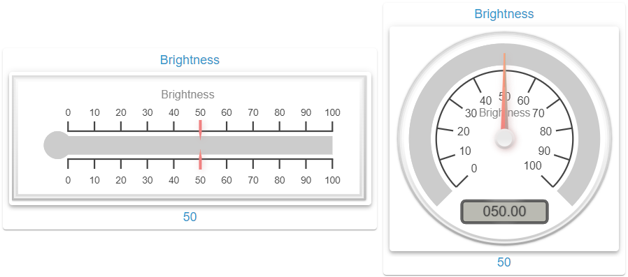

# Gauge Widget

## Description

The Gauge Widget displays the value of an OID of type `number` as a linear or radial instrument. It draws on a canvas with the canvas-gauges library and never writes to the OID, so it has no fields from [Write Value](En-Home.md#write-value).

**Note:** The fields are in the group **Gauge**. The panel shows the sections of the selected gauge type, the sections under [Common Settings](#common-settings) always. The tables follow the order of the panel, only the fields of the two types are separated here.

## Settings Hierarchy

This widget uses all **vis-2 Settings** and **Common Settings**. See [Home](En-Home.md) for details.

The widget-specific settings override the more general settings. Here the rows of the state editor form [highlight zones](#highlight-zones). Unlike [Home](En-Home.md):

- **Canvas title**: The canvas also draws the text from `header` as a title, without HTML and with the object name as fallback. `noHeader` hides only the frame header, the title stays. If `header` consists of markup only, such as `&nbsp;`, there is no title.
- **Corner icon**: It shows the icon of the active highlight zone. Without an active zone there is none, even with `icon` set.
- **Icon fields**: `iconSize`, `iconXOffset`, `iconYOffset` and `enableIconColorMask` concern the corner icon only.
- **Text color**: `textColor` colors frame header and footer and is the fallback for the arcs of the zones. The labels on the canvas do not follow `textColor`, see [Colors](#colors).
- **Font**: The fields from [CSS Font & Text](En-Home.md#css-font--text) other than `color` do not reach the canvas, the [Fonts customization options](#fonts-customization-options) apply there.
- **Value text size**: `valueSize` and `valueSize{n}` have no effect, the size of the value comes from `gaugeFontValueSize`.

## Basic Settings

| Field Name                | Type                                | Default   | Description                                                                                         | Condition                       |
| ------------------------- | ----------------------------------- | --------- | --------------------------------------------------------------------------------------------------- | ------------------------------- |
| Object ID `oid`           | id                                  | -         | Main OID, type `number` only. With another type the frame shows a hint instead of the instrument    | -                               |
| Unit `unit`               | text                                | -         | Unit on the canvas. Picking the OID sets it from the object, the field overrides it. Empty: no unit | Only visible with an OID picked |
| Type `gaugeType`          | select (`linear`, `radial`)         | `linear`  | Gauge type. Stored values of the other type are kept                                                | -                               |
| Min value `gaugeMinValue` | number                              | -         | Lower limit of the scale. Empty: `common.min` of the object, without one there 0                    | -                               |
| Max value `gaugeMaxValue` | number                              | -         | Upper limit of the scale. Empty: `common.max` of the object, without one there 100                  | -                               |
| Padding `gaugePadding`    | number (from 0)                     | 8         | Subtracted in px from the width and height of the content area                                      | -                               |
| Icon fit `gaugeIconFit`   | select (`contain`, `cover`, `fill`) | `contain` | `object-fit` of the icon behind the canvas, see [Highlight Zones](#highlight-zones)                 | -                               |

- **Range from the object**: Picking the OID takes over `common.min` and `common.max` as a copy. A later change on the object applies only after the next OID pick. A set `gaugeMinValue` or `gaugeMaxValue` always takes precedence, `0` included.
- **Value**: A numeric string counts as a number, anything else as 0, a missing value included.
- **Value outside the range**: Needle and bar stop at the end of the range; radial with `gaugeTicksAngle` 360 the needle keeps going. No highlight zone is active.
- **Empty fields**: An empty or non-numeric number field counts as its default, as does an empty select or font field. `0` stays `0`.
- **Size**: The canvas fills the content area minus `gaugePadding`. If the width or height of the canvas is 30 px or less, it does not update, not even the value. After growing it catches up with the latest state.
- **Redraw**: The canvas redraws only when the content of the settings or the value changes, not on a mere move in the editor.

## Linear Gauge Settings

### Linear borders options

| Field Name                        | Type            | Default | Description                       | Condition                      |
| --------------------------------- | --------------- | ------- | --------------------------------- | ------------------------------ |
| Border radius `gaugeBorderRadius` | number (from 0) | 0       | Corner radius of the border rings | Only with `gaugeType` `linear` |

### Linear progress bar options

| Field Name                             | Type            | Default | Description                                                           | Condition                      |
| -------------------------------------- | --------------- | ------- | --------------------------------------------------------------------- | ------------------------------ |
| Bar begin circle `gaugeBarBeginCircle` | number (from 0) | 30      | Size of the circle at the start of the bar in percent. `0`: no circle | Only with `gaugeType` `linear` |
| Bar length `gaugeBarLength`            | number (from 0) | 85      | Length of the bar in percent of the long side                         | Only with `gaugeType` `linear` |

### Linear coloring options

| Field Name                                        | Type  | Default | Description                                                                 | Condition                      |
| ------------------------------------------------- | ----- | ------- | --------------------------------------------------------------------------- | ------------------------------ |
| Color bar end `gaugeColorBarEnd`                  | color | -       | End color of the gradient from `gaugeColorBar`. Empty: single color         | Only with `gaugeType` `linear` |
| Color bar progress end `gaugeColorBarProgressEnd` | color | -       | End color of the gradient from `gaugeColorBarProgress`. Empty: single color | Only with `gaugeType` `linear` |

### Linear element positioning options

| Field Name                    | Type                             | Default | Description                     | Condition                      |
| ----------------------------- | -------------------------------- | ------- | ------------------------------- | ------------------------------ |
| Tick side `gaugeTickSide`     | select (`both`, `left`, `right`) | `both`  | Side of the bar for the ticks   | Only with `gaugeType` `linear` |
| Needle side `gaugeNeedleSide` | select (`both`, `left`, `right`) | `both`  | Side of the bar for the needle  | Only with `gaugeType` `linear` |
| Number side `gaugeNumberSide` | select (`both`, `left`, `right`) | `both`  | Side of the bar for the numbers | Only with `gaugeType` `linear` |

### Linear ticks bar options

| Field Name                               | Type            | Default | Description                                   | Condition                      |
| ---------------------------------------- | --------------- | ------- | --------------------------------------------- | ------------------------------ |
| Ticks width `gaugeTicksWidth`            | number (from 0) | 10      | Extent of the major ticks in percent          | Only with `gaugeType` `linear` |
| Ticks width minor `gaugeTicksWidthMinor` | number (from 0) | 5       | Extent of the minor ticks in percent          | Only with `gaugeType` `linear` |
| Ticks padding `gaugeTicksPadding`        | number (from 0) | 5       | Distance of the ticks from the bar in percent | Only with `gaugeType` `linear` |

## Radial Gauge Settings

### Radial ticks bar options

| Field Name                    | Type           | Default | Description                                                     | Condition                      |
| ----------------------------- | -------------- | ------- | --------------------------------------------------------------- | ------------------------------ |
| Ticks angle `gaugeTicksAngle` | number (0-360) | 270     | Length of the scale arc in degrees                              | Only with `gaugeType` `radial` |
| Start angle `gaugeStartAngle` | number (0-360) | 45      | Start of the scale in degrees. 0 points down, counted clockwise | Only with `gaugeType` `radial` |

### Radial coloring options

| Field Name                                                     | Type  | Default   | Description                                            | Condition                      |
| -------------------------------------------------------------- | ----- | --------- | ------------------------------------------------------ | ------------------------------ |
| Color needle circle outer `gaugeColorNeedleCircleOuter`        | color | `#f0f0f0` | Start color of the gradient in the outer needle circle | Only with `gaugeType` `radial` |
| Color needle circle outer end `gaugeColorNeedleCircleOuterEnd` | color | `#ccc`    | End color of the gradient in the outer needle circle   | Only with `gaugeType` `radial` |
| Color needle circle inner `gaugeColorNeedleCircleInner`        | color | `#e8e8e8` | Start color of the gradient in the inner needle circle | Only with `gaugeType` `radial` |
| Color needle circle inner end `gaugeColorNeedleCircleInnerEnd` | color | `#f5f5f5` | End color of the gradient in the inner needle circle   | Only with `gaugeType` `radial` |

### Radial needle options

| Field Name                                   | Type            | Default | Description                                                                           | Condition                      |
| -------------------------------------------- | --------------- | ------- | ------------------------------------------------------------------------------------- | ------------------------------ |
| Needle circle size `gaugeNeedleCircleSize`   | number (from 0) | 10      | Size of the outer circle in percent, the inner one has three quarters. `0`: no circle | Only with `gaugeType` `radial` |
| Needle circle inner `gaugeNeedleCircleInner` | checkbox        | true    | Draws the inner circle                                                                | Only with `gaugeType` `radial` |
| Needle circle outer `gaugeNeedleCircleOuter` | checkbox        | true    | Draws the outer circle                                                                | Only with `gaugeType` `radial` |

### Radial animation options

| Field Name                              | Type                       | Default  | Description                                                                                         | Condition                      |
| --------------------------------------- | -------------------------- | -------- | --------------------------------------------------------------------------------------------------- | ------------------------------ |
| Animation target `gaugeAnimationTarget` | select (`needle`, `plate`) | `needle` | `needle`: The needle moves. `plate`: The scale turns, the needle stays                              | Only with `gaugeType` `radial` |
| Use min path `gaugeUseMinPath`          | checkbox                   | false    | The needle takes the shorter way. Works only with `gaugeTicksAngle` 360 and active `gaugeAnimation` | Only with `gaugeType` `radial` |

## Common Settings

### Ticks bar options

| Field Name                               | Type     | Default | Description                                                                                                         | Condition |
| ---------------------------------------- | -------- | ------- | ------------------------------------------------------------------------------------------------------------------- | --------- |
| Exact ticks `gaugeExactTicks`            | checkbox | false   | Places the major ticks by their value instead of evenly. `gaugeMinorTicks` then counts as a distance in value units | -         |
| Major ticks `gaugeMajorTicks`            | number   | 10      | Number of sections, evenly across the range and rounded to two decimals. `0` or less: only min and max value        | -         |
| Minor ticks `gaugeMinorTicks`            | number   | 0       | Subdivision per section. `0`: no minor ticks                                                                        | -         |
| Stroke ticks `gaugeStrokeTicks`          | checkbox | true    | Draws a line along the ticks                                                                                        | -         |
| Major ticks integer `gaugeMajorTicksInt` | number   | 1       | Minimum number of integer digits. Works only with `gaugeMajorTicks` `0` or less                                     | -         |
| Major ticks decimal `gaugeMajorTicksDec` | number   | 0       | Number of decimals. Works only with `gaugeMajorTicks` `0` or less                                                   | -         |
| Highlights width `gaugeHighlightsWidth`  | number   | 15      | Width of the arcs of the [highlight zones](#highlight-zones) in percent. `0`: no arcs                               | -         |
| Numbers margin `gaugeNumbersMargin`      | number   | 1       | Distance of the numbers from the ticks in percent                                                                   | -         |

### Progress bar options

| Field Name                             | Type            | Default | Description                                                                             | Condition |
| -------------------------------------- | --------------- | ------- | --------------------------------------------------------------------------------------- | --------- |
| Bar width `gaugeBarWidth`              | number (0-50)   | 20      | Width of the bar in percent. A larger stored value counts as 50. `0`: no bar            | -         |
| Bar stroke width `gaugeBarStrokeWidth` | number (from 0) | 0       | Width of the bar edge. Linear: from `gaugeBarWidth` on, half of `gaugeBarWidth` applies | -         |
| Bar progress `gaugeBarProgress`        | checkbox        | true    | Fills the bar up to the value                                                           | -         |
| Bar shadow `gaugeBarShadow`            | number (from 0) | 0       | Blur of the shadow in the bar. Works only radial                                        | -         |

### Animation options

| Field Name                                  | Type                                                                                                                     | Default | Description                                                                                     | Condition |
| ------------------------------------------- | ------------------------------------------------------------------------------------------------------------------------ | ------- | ----------------------------------------------------------------------------------------------- | --------- |
| Animation `gaugeAnimation`                  | checkbox                                                                                                                 | true    | Animates value changes. Off: The display jumps to the value                                     | -         |
| Animation duration `gaugeAnimationDuration` | number (from 0)                                                                                                          | 500     | Duration in milliseconds                                                                        | -         |
| Animation rule `gaugeAnimationRule`         | select (`linear`, `quad`, `quint`, `cycle`, `bounce`, `elastic`, `dequad`, `dequint`, `decycle`, `debounce`, `delastic`) | `cycle` | Course of the animation                                                                         | -         |
| Animated value `gaugeAnimatedValue`         | checkbox                                                                                                                 | false   | The value box counts along during the animation, otherwise it shows the target value right away | -         |
| Animate on init `gaugeAnimateOnInit`        | checkbox                                                                                                                 | false   | Animates from the min value to the value when the canvas is created                             | -         |

### Coloring options

The section [Colors](#colors) describes the behavior.

| Field Name                                                | Type                               | Default                  | Description                                                                                             | Condition |
| --------------------------------------------------------- | ---------------------------------- | ------------------------ | ------------------------------------------------------------------------------------------------------- | --------- |
| Color plate `gaugeColorPlate`                             | color                              | `rgba(0,0,0,0)`          | Start color of the plate                                                                                | -         |
| Color plate end `gaugeColorPlateEnd`                      | color                              | `rgba(0,0,0,0)`          | End color of the plate. For a single-color area set both fields alike                                   | -         |
| Color major ticks `gaugeColorMajorTicks`                  | color                              | -                        | Without a value `color` of the widget, otherwise the text color of the theme                            | -         |
| Color minor ticks `gaugeColorMinorTicks`                  | color                              | -                        | Without a value `color` of the widget, otherwise the text color of the theme                            | -         |
| Color stroke ticks `gaugeColorStrokeTicks`                | color                              | -                        | Without a value `color` of the widget, otherwise the text color of the theme                            | -         |
| Color title `gaugeColorTitle`                             | color                              | -                        | Color of the canvas title. Without a value `color` of the widget, otherwise the text color of the theme | -         |
| Color units `gaugeColorUnits`                             | color                              | -                        | Without a value `color` of the widget, otherwise the text color of the theme                            | -         |
| Color numbers `gaugeColorNumbers`                         | color                              | -                        | Without a value `color` of the widget, otherwise the text color of the theme                            | -         |
| Color needle `gaugeColorNeedle`                           | color                              | -                        | Start color of the needle. Without a value the primary color of the theme                               | -         |
| Color needle end `gaugeColorNeedleEnd`                    | color                              | -                        | End color of the needle. Without a value the primary color of the theme                                 | -         |
| Color value text `gaugeColorValueText`                    | color                              | `#444`                   | Text in the value box                                                                                   | -         |
| Color value text shadow `gaugeColorValueTextShadow`       | color                              | `rgba(0,0,0,0.3)`        | Works with `gaugeValueTextShadow`                                                                       | -         |
| Color border shadow `gaugeColorBorderShadow`              | color                              | `rgba(0,0,0,0.5)`        | Works with `gaugeBorderShadowWidth`                                                                     | -         |
| Color border outer `gaugeColorBorderOuter`                | color                              | `#ddd`                   | Start color of the outer border                                                                         | -         |
| Color border outer end `gaugeColorBorderOuterEnd`         | color                              | `#aaa`                   | End color of the outer border                                                                           | -         |
| Color border middle `gaugeColorBorderMiddle`              | color                              | `#eee`                   | Start color of the middle border                                                                        | -         |
| Color border middle end `gaugeColorBorderMiddleEnd`       | color                              | `#f0f0f0`                | End color of the middle border                                                                          | -         |
| Color border inner `gaugeColorBorderInner`                | color                              | `#fafafa`                | Start color of the inner border                                                                         | -         |
| Color border inner end `gaugeColorBorderInnerEnd`         | color                              | `#ccc`                   | End color of the inner border                                                                           | -         |
| Color value box rect `gaugeColorValueBoxRect`             | color                              | `#888`                   | Start color of the value box edge                                                                       | -         |
| Color value box rect end `gaugeColorValueBoxRectEnd`      | color                              | `#666`                   | End color of the value box edge                                                                         | -         |
| Color value box background `gaugeColorValueBoxBackground` | color                              | `#babab2`                | Area of the value box                                                                                   | -         |
| Color value box shadow `gaugeColorValueBoxShadow`         | color                              | `rgba(0,0,0,1)`          | Shadow of the value box                                                                                 | -         |
| Color needle shadow up `gaugeColorNeedleShadowUp`         | color                              | `rgba(2,255,255,0.2)`    | Side face of the needle. Works only radial with `gaugeNeedleType` `arrow`                               | -         |
| Color needle shadow down `gaugeColorNeedleShadowDown`     | color                              | `rgba(188,143,143,0.45)` | Shadow of the needle, works with `gaugeNeedleShadow`                                                    | -         |
| Color bar stroke `gaugeColorBarStroke`                    | color                              | `#222`                   | Works with `gaugeBarStrokeWidth`                                                                        | -         |
| Color bar `gaugeColorBar`                                 | color                              | `#ccc`                   | Unfilled part of the bar                                                                                | -         |
| Color bar progress `gaugeColorBarProgress`                | color                              | -                        | Filled part of the bar. Without a value the primary color of the theme                                  | -         |
| Highlights line cap `gaugeHighlightsLineCap`              | select (`butt`, `round`, `square`) | `butt`                   | Ends of the arcs of the [highlight zones](#highlight-zones). Works only radial                          | -         |

### Needle configuration options

| Field Name                        | Type                     | Default | Description                    | Condition |
| --------------------------------- | ------------------------ | ------- | ------------------------------ | --------- |
| Needle `gaugeNeedle`              | checkbox                 | true    | Draws the needle               | -         |
| Needle shadow `gaugeNeedleShadow` | checkbox                 | true    | Draws the shadow of the needle | -         |
| Needle type `gaugeNeedleType`     | select (`arrow`, `line`) | `arrow` | Shape of the needle            | -         |
| Needle start `gaugeNeedleStart`   | number (0-100)           | 5       | Start of the needle in percent | -         |
| Needle end `gaugeNeedleEnd`       | number (0-100)           | 85      | End of the needle in percent   | -         |
| Needle width `gaugeNeedleWidth`   | number                   | 4       | Width of the needle            | -         |

### Borders options

| Field Name                                   | Type            | Default | Description                                                                               | Condition |
| -------------------------------------------- | --------------- | ------- | ----------------------------------------------------------------------------------------- | --------- |
| Borders `gaugeBorders`                       | checkbox        | true    | Off: Outer, middle and inner border disappear, their widths stay stored. The shadow stays | -         |
| Border outer width `gaugeBorderOuterWidth`   | number (from 0) | 3       | Width in px                                                                               | -         |
| Border middle width `gaugeBorderMiddleWidth` | number (from 0) | 3       | Width in px                                                                               | -         |
| Border inner width `gaugeBorderInnerWidth`   | number (from 0) | 3       | Width in px                                                                               | -         |
| Border shadow width `gaugeBorderShadowWidth` | number (from 0) | 3       | Blur of the border shadow                                                                 | -         |

### Value box options

| Field Name                                          | Type                      | Default | Description                                                     | Condition |
| --------------------------------------------------- | ------------------------- | ------- | --------------------------------------------------------------- | --------- |
| Value box `gaugeValueBox`                           | checkbox                  | true    | Draws the value box                                             | -         |
| Value box stroke `gaugeValueBoxStroke`              | number (from 0)           | 5       | Width of the edge in percent. `0`: no edge                      | -         |
| Value box width `gaugeValueBoxWidth`                | number (from 0)           | 0       | Minimum width in percent. `0`: as wide as the text              | -         |
| Value text `gaugeValueText`                         | text                      | -       | Fixed text instead of the value. Empty: the value               | -         |
| Value text shadow `gaugeValueTextShadow`            | checkbox                  | true    | Draws the shadow of the text                                    | -         |
| Value box border radius `gaugeValueBoxBorderRadius` | number (from 0, step 0.1) | 2.5     | Radius of the corners in percent                                | -         |
| Value integer `gaugeValueInt`                       | number (from 0)           | 3       | Minimum number of digits, filled with zeros: `21` becomes `021` | -         |
| Value decimal `gaugeValueDec`                       | number (from 0)           | 2       | Number of decimals                                              | -         |

### Fonts customization options

| Field Name                                   | Type                                                           | Default                        | Description            | Condition |
| -------------------------------------------- | -------------------------------------------------------------- | ------------------------------ | ---------------------- | --------- |
| Font numbers `gaugeFontNumbers`              | fontname                                                       | `Arial, Helvetica, sans-serif` | Numbers of the scale   | -         |
| Font title `gaugeFontTitle`                  | fontname                                                       | `Arial, Helvetica, sans-serif` | Canvas title           | -         |
| Font units `gaugeFontUnits`                  | fontname                                                       | `Arial, Helvetica, sans-serif` | Unit                   | -         |
| Font value `gaugeFontValue`                  | fontname                                                       | `Arial, Helvetica, sans-serif` | Value in the value box | -         |
| Font numbers size `gaugeFontNumbersSize`     | number (from 0)                                                | 20                             | Numbers of the scale   | -         |
| Font title size `gaugeFontTitleSize`         | number (from 0)                                                | 24                             | Canvas title           | -         |
| Font units size `gaugeFontUnitsSize`         | number (from 0)                                                | 22                             | Unit                   | -         |
| Font value size `gaugeFontValueSize`         | number (from 0)                                                | 26                             | Value in the value box | -         |
| Font numbers style `gaugeFontNumbersStyle`   | select (`normal`, `italic`, `oblique`)                         | `normal`                       | Numbers of the scale   | -         |
| Font title style `gaugeFontTitleStyle`       | select (`normal`, `italic`, `oblique`)                         | `normal`                       | Canvas title           | -         |
| Font units style `gaugeFontUnitsStyle`       | select (`normal`, `italic`, `oblique`)                         | `normal`                       | Unit                   | -         |
| Font value style `gaugeFontValueStyle`       | select (`normal`, `italic`, `oblique`)                         | `normal`                       | Value in the value box | -         |
| Font numbers weight `gaugeFontNumbersWeight` | select (`normal`, `bold`, `bolder`, `lighter`, `100` to `900`) | `normal`                       | Numbers of the scale   | -         |
| Font title weight `gaugeFontTitleWeight`     | select (`normal`, `bold`, `bolder`, `lighter`, `100` to `900`) | `normal`                       | Canvas title           | -         |
| Font units weight `gaugeFontUnitsWeight`     | select (`normal`, `bold`, `bolder`, `lighter`, `100` to `900`) | `normal`                       | Unit                   | -         |
| Font value weight `gaugeFontValueWeight`     | select (`normal`, `bold`, `bolder`, `lighter`, `100` to `900`) | `normal`                       | Value in the value box | -         |

## Gauge Types

### Linear Gauge

- Bar with progress and needle
- Orientation follows the canvas: vertical if the height is at least the width, otherwise horizontal
- Ticks, needle and numbers optionally on one or both sides of the bar
- Color gradient for bar and progress
- Circle at the start of the bar via `gaugeBarBeginCircle`

### Radial Gauge

- Circular instrument (speedometer style)
- Needle points to the current value
- Configurable angles (default: from 45° to 315° = 270° arc)
- Ticks with numbers, progress arc in one color
- Animates either the needle or the scale

## Styling Options

### Colors

- **Solid colors**: The canvas draws solid colors only. A gradient draws the color at its middle, the widget computes `var(…)` and other colors that depend on the widget beforehand. A value that cannot be resolved counts as empty.
- **Default colors**: An empty color field with a fixed default takes that default, regardless of the theme.
- **Inherited colors**: Major ticks, minor ticks, stroke line, title, unit and numbers take `color` from [CSS Font & Text](En-Home.md#css-font--text) without a value, otherwise the text color of the theme. Needle and progress bar take the primary color of the theme.
- **Gradients**: Plate, needle, needle circles, border rings and value box edge draw a gradient from the start to the end color. The empty plate end falls back to its default, so a single plate color fades out into transparent.
- **Background**: Own color `gaugeColorBar` for the unfilled area. With the transparent default plate the content area shows through.
- **Ticks**: Own colors for major ticks, minor ticks, stroke line and numbers.

### Fonts

- Own font, size, style and weight each for numbers, title, unit and value
- The font sizes scale with the size of the canvas
- The title is the canvas title, see [Settings Hierarchy](#settings-hierarchy)

### Animations

- Available for both gauge types
- Various courses via `gaugeAnimationRule` (linear, quad, bounce, elastic, etc.)
- Configurable duration
- Radial only: `gaugeAnimationTarget` and `gaugeUseMinPath`

### Highlight Zones

The rows in the group **Values** form the highlight zones, see [Value-specific Settings](En-Home.md#value-specific-settings). Without a row with a value there is no zone.

- **Range**: A zone starts at `value{n}` and reaches up to the value of the next row, the last one up to the max value. The rows must be in ascending order, a zone with a smaller upper limit never becomes active.
- **Limits**: The lower limit belongs to the zone, the upper limit to the next one. The max value itself belongs to the zone ending there; if the last row sits exactly on it, that is the zone before it. `0` is a real limit.
- **No active zone**: Below the first row and above the max value the base colors apply, and both icons disappear.
- **Arc**: Each zone draws an arc in `textColor{n}`, without a value in `textColor`, `color` or the text color of the theme. A value that cannot be resolved draws transparent. The arcs are not limited to the range.
- **Areas**: The active zone colors frame area and content area with `frameBackground{n}` and `background{n}`, without a value the base field applies.
- **Icon**: The active zone shows `icon{n}` or `iconSmall{n}`, otherwise `icon` or `iconSmall`, as corner icon and centered behind the canvas. There it shows only through a transparent plate. `noHeaderIcon` hides only the corner icon.
- **Icon behind the canvas**: `iconSize{n}` sets width and height in percent, without a value 100 %. `iconXOffset{n}` moves positive to the right, `iconYOffset{n}` positive upwards, `gaugeIconFit` sets the fit. The color comes from `iconColor{n}` and `enableIconColorMask{n}`.
- **Exact match only**: `header{n}`, `headerSize{n}`, `footer{n}`, `footerSize{n}` and `alias{n}` follow the active state, not the zone. They work only while the value equals `value{n}` exactly. So the footer of a row appears only on its limit.
- **Value box**: Alias and row value do not reach it, it shows `gaugeValueText` or the formatted value.

## Use Cases

### Linear Gauge

- **Battery Level**: `gaugeMinValue` 0, `gaugeMaxValue` 100, gradient `gaugeColorBarProgress` `#f44336` to `gaugeColorBarProgressEnd` `#4caf50`
- **Volume**: 0-100, `gaugeTickSide`, `gaugeNeedleSide` and `gaugeNumberSide` `left`, `gaugeValueBox` off
- **Download Progress**: 0-100, `gaugeMajorTicks` 4 gives ticks at 25/50/75
- **Fill Level**: 0-100, widget taller than wide for the vertical orientation, `gaugeBarBeginCircle` 0

### Radial Gauge

- **Temperature**: `gaugeMinValue` -20, `gaugeMaxValue` 40, `gaugeMajorTicks` 6, zones `value1` -20 with `textColor1` `#2196f3` and `value2` 25 with `textColor2` `#f44336`
- **Speed**: 0-200 km/h, `gaugeMajorTicks` 10, `gaugeNeedleType` `arrow`
- **Power**: 0-3000 W, `gaugeMajorTicks` 6 gives ticks every 500 W, `gaugeValueDec` 0
- **Humidity**: 0-100 %, `gaugeNeedleCircleSize` 15 for a larger circle base of the needle
