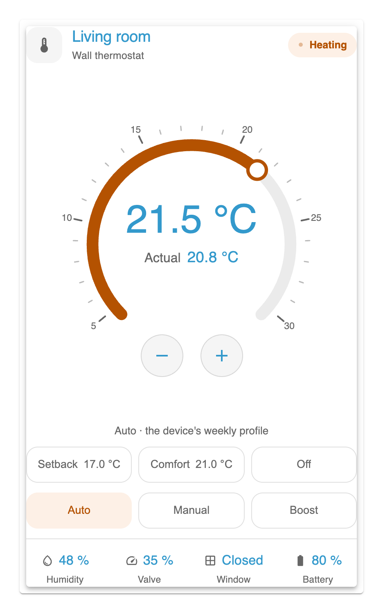

# Room Thermostat

## Description

The room thermostat shows and sets the heating of a room: set point, actual temperature, humidity, valve, window, battery and the state of the thermostat. It is operated through a ring, ± and pills for the setback, comfort and off temperature, the operating mode and Boost. It is the first type of the heating widgets.

The widget knows no device technology. It reads the stored bindings and value mappings and writes only to data points that are writable. Technology knowledge sits in exactly one place, the hint table, which helps with the prefill in the editor (see [Role path and hint table](#role-path-and-hint-table)).

## Requirements and Palette

- **vis-2 2.20.5 or newer.** The heating widgets form a set of their own that older vis-2 versions do not load.
- **Palette:** group "Widget collection · Heating", technical name of the set `vis-2-widgets-collection-heating`. The other collection widgets and the Theme Studio stay in the group "Widget collection" (`vis-2-widgets-collection`).
- **Start size:** 440 × 700 px, whatever the width of the view. So the widget starts in the full arrangement. In the grid layout it takes one section column; the height of 700 px makes 11 grid rows.

## Settings Hierarchy

This widget uses the **vis-2 Settings** and the **Common Settings** with the [widget frame](En-Home.md#widget-frame), see [Home](En-Home.md). It hides some common settings, see [Frame and hidden fields](#frame-and-hidden-fields).

Its own settings sit in two groups: the binding (data points, value mappings, name, valves) and the widget values (`komfort`, `absenk`, `ansicht`, `inhaltsabstand`).

## Binding and Prefill

### The Meanings

Each meaning of the thermostat has a data point field of its own. Only the set point `soll` is required, all others are optional. An unbound meaning is left out of the display.

| Field                  | Meaning                              | Value type     | Value mapping    |
| ---------------------- | ------------------------------------ | -------------- | ---------------- |
| `soll`                 | Set point (required)                 | number         | –                |
| `ist`                  | Actual temperature                   | number         | –                |
| `luftfeuchte`          | Humidity                             | number         | –                |
| `betriebsart`          | Operating mode, read                 | any            | yes              |
| `betriebsartSetzen`    | Operating mode, written only         | any            | yes              |
| `boost`                | Boost on/off                         | any            | yes              |
| `boostBeenden`         | ends a running Boost                 | any            | yes              |
| `boostRestzeit`        | Boost remaining time or end time     | number or text | unit/time format |
| `urlaub`               | Holiday on/off                       | any            | yes              |
| `urlaubEnde`           | End of the holiday                   | number or text | time format      |
| `fenster`              | Window                               | any            | yes              |
| `batterieSchwach`      | Battery low                          | any            | yes              |
| `batteriestand`        | Battery level                        | number         | –                |
| `erreichbarkeit`       | Reachability of the device           | any            | yes              |
| `ventil1`, `ventil2` … | Valve opening, see [Valves](#valves) | number         | –                |

Without a bound set point the widget shows the notice "Choose the set-point data point", with a set point of another type "The set-point data point must be a number". The frame's general OID notice does not appear here.

### Prefill When Picking the Set Point

When you pick the set-point data point in the editor, the widget reads all channels of the device it belongs to and fills in the other meanings with their value mappings. The rules:

- **Empty fields only:** Set fields, mappings, name and sub-line stay as they are.
- **Only on the pick in the editor:** Reading, opening and displaying never write widget data. A widget inserted by the AI assistant is not prefilled (see [Widgets inserted by the AI assistant](#widgets-inserted-by-the-ai-assistant)).
- **Device and channel:** The channel is the data point's parent object of type channel or folder, the device its parent object of type device or folder. Without a device the widget reads only the channel, without a channel nothing.
- **Valves** are never prefilled; you bind them by hand.

When you pick a single other meaning, its pick only fills in its own value mapping if that is empty, by the same two ways.

### Role Path and Hint Table

For every field and every mapping the first way that recognises something counts:

1. **Role path:** role and value list of the data point by the ioBroker standard roles. Examples: `level.temperature` → set point, `value.temperature` → actual, `value.humidity` → humidity, `level.mode.thermostat` with AUTO/MANUAL/VACATION → operating mode, `switch.mode.boost` or `switch.boost` → Boost, `value.window` with CLOSED/TILTED/OPEN or `sensor.window` → window, `indicator.reachable`, `indicator.unreach` or `indicator.maintenance.unreach` → reachability, `indicator.lowbat` → battery low, `value.battery` → battery level. A value list counts only when each of its labels maps to a neutral value. In the prefill `value.voltage` counts as battery level only when the device also has a data point for "battery low".
2. **Hint table:** What the role path does not recognise, the widget looks up in a table that compares the data point name and the channel type (`native.TYPE` of the channel), never the adapter namespace. For now it holds only Homematic IP, channel type `HEATING_CLIMATECONTROL_TRANSCEIVER` (e.g. HmIP-WTH-2):

| Data point       | Meaning             | Mapping                                                    |
| ---------------- | ------------------- | ---------------------------------------------------------- |
| `SET_POINT_MODE` | `betriebsart`       | Auto `0`, Manual `1`, Holiday `2`                          |
| `CONTROL_MODE`   | `betriebsartSetzen` | Auto `0`, Manual `1`                                       |
| `BOOST_TIME`     | `boostRestzeit`     | unit minutes (assumption, see [Assumptions](#assumptions)) |
| `PARTY_MODE`     | `urlaub`            | on `true`, off `false` (read only)                         |
| `PARTY_TIME_END` | `urlaubEnde`        | time format `YYYY_MM_DD HH:mm`                             |

The other data points of the HmIP-WTH-2 (set point, actual, humidity, `BOOST_MODE`, `WINDOW_STATE`, `UNREACH`, `LOW_BAT`, `OPERATING_VOLTAGE`) carry standard roles and go the role path. The device has no data point of its own for ending the Boost; `boostBeenden` stays empty there.

### Ambiguous Data Points

When several data points of the device fit a meaning, those in the set point's channel count first. If several remain there or across the device, the field stays empty, and an info box below the set point lists the candidates per meaning. You then bind the right one by hand. The box disappears as soon as the field is set; the candidates are not stored in the widget data, reloading the editor discards them.

### Name and Sub-line

- **Name** `bezeichnung`: The pick of the set point fills in the room from the enumeration "Rooms" (data point, then channel, then device; the first room wins) in the language of the editor, otherwise the device name.
- **Sub-line** `unterzeile`: the device name when the name came from the room, otherwise it stays empty.

The pick fills both fields only when they are empty. They make up the widget's card head; the frame's header and footer stay untouched. Without a name the card head shows no name line.

### Valves

The valves sit as a small list below the meanings: **Add valve** adds an entry, for each entry you pick the data point of the valve opening, a button per row removes it. Stored are `ventil1`, `ventil2` … with their objects and the count `ventilAnzahl`. Shown is the mean of all bound valves that have reported a value. With several widgets selected that have different valve lists, adding and removing are locked, and an info box names the reason.

## Value Mapping

The value mapping translates the device's values into neutral values the widget works with, such as `0` → Auto. It is stored per meaning in `<meaning>Zuordnung` as one object: the key is the neutral value, the value the list of device values. The first device value is the write value, an empty list means "not available", a missing key "not mapped yet". Example for the operating mode of the HmIP-WTH-2: `{"auto": [0], "manuell": [1], "urlaub": [2]}`.

### Rows in the Panel

- **One row per neutral value** below the data point field, as long as the meaning is bound. The rows show the effective value, also the prefilled one.
- **Selection or free input:** If the data point has a value list (`common.states`), you choose from it, otherwise you type freely; the input applies with Enter or when you leave the field. Several device values sit side by side as chips, the first is the write value.
- **"Not available"** comes first in the selection and replaces all device values of the row. Removing the last chip makes the value unmapped again.
- **Invert value:** A boolean data point shows a switch instead of the rows. Without inverting, `true` counts as on (Boost, holiday), end, open, reachable or low. HmIP `UNREACH` therefore stands on "inverted".
- **Unit or time format** as one row: for the Boost remaining time seconds, minutes, timestamp, ISO 8601 or a pattern, for the holiday end timestamp, ISO 8601 or a pattern. A pattern is made of `YYYY`, `MM`, `DD`, `HH`, `mm` and `ss`, e.g. `YYYY_MM_DD HH:mm`.
- **Info box:** If the pick recognised no mapping, an info box says that without a mapping the widget shows the raw device value.
- **Several widgets:** With several widgets selected the field shows the mapping of the first; a change applies with the whole mapping to all of them.

### Neutral Values per Meaning

| Meaning             | Neutral values                    | Addition                                  |
| ------------------- | --------------------------------- | ----------------------------------------- |
| `betriebsart`       | Auto, Manual, Off, Boost, Holiday | –                                         |
| `betriebsartSetzen` | Auto, Manual, Off                 | –                                         |
| `boost`             | On, Off                           | –                                         |
| `boostBeenden`      | End                               | –                                         |
| `boostRestzeit`     | –                                 | unit (`s`, `min`) or time format          |
| `urlaub`            | On, Off                           | –                                         |
| `urlaubEnde`        | –                                 | time format (`timestamp`, `iso`, pattern) |
| `fenster`           | Closed, Open                      | –                                         |
| `erreichbarkeit`    | Reachable, Unreachable            | –                                         |
| `batterieSchwach`   | Low, OK                           | –                                         |

The stored keys are `auto`, `manuell`, `aus`, `boost`, `urlaub`, `an`, `beenden`, `zu`, `offen`, `erreichbar`, `unerreichbar`, `schwach` and `ok`.

### At Runtime

- **Reading** maps several device values onto one neutral value, **writing** takes the first device value.
- **Device value without a mapping:** It makes no pill active; chip and readings bar show the label from the value list, otherwise the raw value.
- **Pills** exist only for neutral values the widget can write.

### Widgets Inserted by the AI Assistant

The AI assistant sets only the data point IDs; the pick does not run then. When the object or the value mapping of a bound meaning is missing, the widget reads by itself what the pick of that one field would have stored, by the same two ways. It writes nothing to the widget data and fills in no other meanings. The panel shows this effective mapping; your first change there stores it.

## Widget Values

- **Comfort temperature** `komfort` (default 21) and **setback temperature** `absenk` (default 17): The pills Comfort and Setback write these values to the set point, also outside the data point's limits. An emptied field counts as the default.
- **Layout** `ansicht`: `voll` (default) allows all size stages, `einfach` caps at the simple stage, see [Layout](#layout).
- **Content inset** `inhaltsabstand` (default 1.5): the space between the card's edge and the content, all round, in the theme's spacing units (0–4; with the standard theme 1 = 8 px, so 12 px). The full and the simple stage keep all of it, the tile half of it, the Mini dialog all of it again. The frame attribute "Padding", in contrast, lies outside the card. An emptied field counts as the default.

## Display

### Status Chip

The chip in the card head names the state, top to bottom by precedence:

1. "Not reachable" (fault)
2. "Window open" (cool)
3. "Off"
4. "Boost", with the remaining time where known (heating)
5. "Holiday"
6. With a reported valve: "Heating" for a mean above 0 (heating), otherwise "Holding".
7. Otherwise the operating mode, e.g. "Auto" or "Manual".

There is no "Heating" from a set point above the actual temperature; a bound valve without a reported value counts as no valve. If none of this is known, the widget shows no chip. "Battery low" does not change the chip.

### Hint Line

The hint line below the ring names, also by precedence:

1. "No radio connection since 01:52 PM", the time from the last change of the reachability: today only the time of day, otherwise day, month and time.
2. "Battery low, replace soon"
3. "Window open · lowered to 12.0 °C", with the reported set point
4. "Off"
5. "Boost running · 4:59 left", without a known remaining time "Boost running"
6. "Holiday until Sun, 11/29, 06:00 PM", only for an end in the future, otherwise "Holiday running"
7. The operating mode: "Manual · applies until the next change" or "Auto · the device's weekly profile"

Only fault and notice (1 and 2) colour the line and carry the warning triangle. The room thermostat does not read the weekly profile; so it shows no profile texts with times.

### Readings

- **Actual temperature** below the set point in the ring, in the simple stage instead of the hint line, in the tile in the footer line. A fault or a notice replaces it there.
- **Readings bar** (only in the arrangement Large): humidity, valve (mean of the valves), window (Closed/Open, open coloured cool) and battery level (coloured as a notice at "battery low"). The battery element appears only with `batteriestand` bound.
- **Format:** temperatures with one decimal, humidity and valve as whole numbers, in the language of vis-2, with the data point's unit (without one °C or %). The battery level shows as reported with at most two decimals and only with the data point's unit.
- **Not reported yet:** A bound data point without a value, with the quality flag `0x20` or with the host's placeholder for a state without a value shows "–", never a substitute value of the device. There is no age and no threshold for stale values.
- **Not reachable:** Set point and ring appear dimmed and stay operable.

## Operating

Every action writes exactly one data point, through the collection's write chain (optimistic). The widget never writes to a data point that is not writable; a control without a writable target does not appear.

- **Ring and ±:** Dragging the ring shows the value while dragging and writes once on release; a cancelled drag or a release on the reported value writes nothing. With the focus on the ring the arrow keys act like ±. Several quick presses on ± make one write.
- **Step and limits:** The step is the data point's step, otherwise 0.5 K; ± snaps to multiples of it. The limits are the data point's minimum and maximum, a missing side counts as 5 or 30.
- **Set point not reported yet:** Ring and ± are off. The pills still write, since they set absolute values.
- **Setback and Comfort** write `absenk` or `komfort` to the set point and light up when the reported set point equals them.
- **Off** writes the mapped value "Off" of `betriebsartSetzen`, if that field is unbound, that of `betriebsart`. Without a mapped "Off" it writes the real minimum of the set-point data point; if there is none, the pill is missing.
- **Operating-mode segment:** Auto and Manual write to `betriebsartSetzen`, if it is unbound, to `betriebsart`, as far as mapped there; they light up by the operating mode read. Boost writes `boost` = on; while Boost runs a tap writes `boostBeenden` = end, without that field `boost` = off. If the next action is not writable, the Boost pill is missing.
- **Holiday:** A row of its own "Holiday until …" appears only while the holiday runs. Auto or Manual end it; if `urlaub` is writable, a tap on the row writes off there.
- **Place:** pills Setback, Comfort and Off only in the arrangement Large, the operating-mode segment in Large and in Wide from sufficient height, ± in the ring, beside the big set point and in the tile.

## Size Stages

The widget picks its arrangement by the measured content area, i.e. the area after the frame's header, footer and padding and less the content inset, not by the host's size mode. Until the first measurement the content area stays empty.

### Stages and Arrangements

| Stage  | Arrangement | from content area | Content                                                                                                                                                 |
| ------ | ----------- | ----------------- | ------------------------------------------------------------------------------------------------------------------------------------------------------- |
| Full   | Large       | 376 × 576 px      | Card head with symbol, name, sub-line and chip; ring with set point, actual and ±; hint line; pills; operating-mode segment; readings bar               |
| Full   | Medium      | 272 × 376 px      | Name and chip; ring with set point, actual and ±; hint line only for a fault or notice                                                                  |
| Simple | Wide        | 371 × 91 px       | Head block at the top (head stacked with hint line, ± and big set point); operating-mode segment at the bottom once it fits (from 138 px height)        |
| Simple | Compact     | 232 × 116 px      | Name and chip, ± and set point, below it actual or message                                                                                              |
| Mini   | Tile        | below             | Name, warning triangle for a fault or notice, set point; ± from 197 × 64 px; footer line with actual or message from 89 px height, beside ± 199 × 94 px |

With the standard frame the start size 440 × 700 px gives about 416 × 636 px, inside the standard content inset a content area of 392 × 612 px, and so Full, arrangement Large. Card head and hint line stay put; if the middle gets too tight, it scrolls. In the ring, in Compact and in the tile the set point gets smaller when the ring or the area beside ± (and above the footer line) does not hold its full size. Transitions and the click ripple are left out when the system asks for reduced motion.

In Simple, Wide and Compact draw their parts at a scale: set point, ± and gaps grow with the area up to twice the design, card head and hint line damped. The arrangement that can draw larger wins — a flat, wide widget shows Wide, a narrow or tall one Compact. Wide shows the operating-mode segment as soon as it fits; head block and segment then share the height, and set point and ± grow with the height between them. Compact sizes set point and ± by width and height. Below the areas named, ± would be smaller than 40 px; the widget then shows the tile.

The tile follows the same rule: ± appear as soon as they fit at 40 px, then the footer line as soon as its text keeps 11 px; ±, set point and footer line then grow with the area, name and open symbol damped. The tile's values apply to the area inside half the content inset.

### Layout

`ansicht` caps the stage from above: with `einfach` the widget never shows Full, even when the area suffices. The cap never raises; a small widget stays Mini. It does not apply in the Mini dialog.

### Frame and Size Stage

The area after the frame and the content inset counts, without correction. A large padding, header or footer texts, a frame default from the [Theme Studio](En-Theme-Studio.md#widget-frame-section) with a large padding or a large content inset can therefore move the widget one size stage down. Then enlarge the widget or reduce the padding or the content inset. Examples: with the standard content inset a widget about 420 px wide shows Medium instead of Large. The narrowest grid section (320 px) just holds Medium with the standard content inset; with a larger one it shows Compact.

## Mini Dialog

In the stage Mini the whole tile is a button: a tap, Enter or Space opens the Mini dialog with the full arrangement.

- **Layout:** a title line with the type name "Room thermostat" and a close button, below it the content. For screen readers the dialog carries the name as its label, without a name the type name.
- **Size:** 420 × 700 px, the content inset inside it at the sides and below, at most the screen size minus a margin. In the dialog the same rule by the measured area applies, but without the `ansicht` cap and never below Simple; there is no dialog inside the dialog.
- **Closing:** close button, Escape or a tap on the backdrop. The focus returns to the tile. If the widget grows out of Mini, an open dialog stays open.
- **Theme:** The dialog has no collection frame but shows the collection's theme.
- **In the editor:** Mini shows the tile. The vis-2 edit overlay catches clicks; in the editor you open the dialog on a locked widget, otherwise in the runtime view.

## Colors

The heating widgets have no color fields and no theme key of their own. Every colouring comes from the theme's palette, i.e. from the Theme Studio, otherwise from the vis-2 theme:

| Colouring | Theme color                                                | Where                                                                                 |
| --------- | ---------------------------------------------------------- | ------------------------------------------------------------------------------------- |
| Fault     | Error color `palette.error`, filled, with warning triangle | Chip "Not reachable", hint line "No radio connection …", status sign of the tile      |
| Notice    | Error color `palette.error`, tinted, with warning triangle | Hint line "Battery low …", battery value of the readings bar, status sign of the tile |
| Heating   | Warning color `palette.warning`                            | Chips "Heating" and "Boost"                                                           |
| Cool      | Info color `palette.info`                                  | Chip "Window open", window value of the readings bar                                  |
| Neutral   | Neutral shade (see below), without a capsule               | Other chips, quiet hint line                                                          |

What you set or choose takes none of these colourings but the **control accent** from the primary color `palette.primary`: the ring (arc, handle and track), the chosen pill and the operating-mode segment, the ± and the symbol in the card head (without a surface of its own, in the accent's line colour). It shows a setting, not a state, so it stays the same in every state, also with a window open. Its shades are built like the colourings': the primary color itself for arc and handle (at least 3:1 on the card), tinted for surfaces, signs and text on them at least 4.5:1. So the widget matches your other widgets in the default theme as in every Theme Studio preset.

The values themselves — name, set point, actual value and the values of the readings bar — take the widget's text colour: the vis-2 attribute **color** (CSS Font & Text), else the theme's text colour; this also holds in the tile and in the Mini-Dialog. Captions such as „Actual“, the scale and the names of the readings stay muted, and a state with a colouring (open window, battery with a notice) keeps its colouring.

The quiet parts — lines and borders, the scale, captions, the pills not chosen, the neutral chip and the quiet hint line — take the **neutral shade**: the theme's muted text colour with a light touch of the primary color. Lines reach at least 2:1 on the card, the scale's ticks 3:1, captions 4.5:1; the pills not chosen lie on a faint surface in the primary color. There are no dots: chip and tile show a sign only for a fault or a notice, the warning triangle.

The heating widgets take `palette.error` for faults and notices, `palette.warning` for heating (warmth, not a warning) and `palette.info` for cool, such as an open window. The text on these colourings reaches at least 4.5:1 in light and dark: filled it takes black or white, tinted the color is lightened or darkened until the contrast suffices.

- **Example pink cast:** The design shows faults in a red with a pink cast. That is a theme choice: in the [Theme Studio](En-Theme-Studio.md#status--text-section) set the error color to `#FF6B7F` (dark theme) or `#D12C4D` (light theme). Without a choice of your own the error color of the vis-2 theme applies.
- **Shared colors:** Error, warning and info color apply to all collection widgets. A new error color also changes series color 6 in the ECharts widget and the error indicators of the other widgets.
- **Opening the Theme Studio:** The **Theme Studio** button exists only in the palette group "Widget collection", not in "Widget collection · Heating". The theme applies to both groups.

## Frame and Hidden Fields

- **Header and footer** of the frame (`header`, `footer` with their sizes) are empty until you set them. No header and No footer hide only these lines, never the card head or the hint line.
- **Widget frame:** All eight frame settings are declared. Seven act as with the other widgets, inheriting from the Theme Studio (see [Widget frame](En-Home.md#widget-frame)). The setting No header icon has no effect here (see below), so the AI guide names only the other seven. The card is drawn by the collection's frame.
- **Hidden**, because they have no effect here: the icon block with No header icon (the frame shows no corner icon), alias, value and value size (the set point is no `oid`) and square, ellipse and circle (a round shape would cut off card head and hint line). Stored values of these fields stay.

## AI Assistant

The vis-2 AI assistant finds the room thermostat in the set `vis-2-widgets-collection-heating`. Name the set ID literally in the request, as described on the page [AI Assistant](En-AI-Assistant.md#heating-widgets). Example prompts:

- "Add a room thermostat for the bathroom from the set `vis-2-widgets-collection-heating`."
- "In the view 'Heating', add a room thermostat from the set `vis-2-widgets-collection-heating` for the wall thermostat in the living room."
- "Set the comfort temperature of the room thermostat 'Bathroom' from the set `vis-2-widgets-collection-heating` to 22 °C."

By its guide the assistant sets the data points of the meanings itself, leaves the value mappings empty, writes the room name into `bezeichnung` and leaves header and footer empty unless you ask for them. The prefill does not run then; the widget reads the mappings by itself (see [Widgets inserted by the AI assistant](#widgets-inserted-by-the-ai-assistant)).

## Assumptions

Two details rest on assumptions not observed on any device:

- **`BOOST_TIME` is the remaining time in minutes.** The hint table maps the data point to the unit minutes. If your device reports seconds, set the unit in the value mapping of the Boost remaining time to seconds.
- **Window open:** The device reports the lowered temperature for an open window as its set point. The widget computes nothing from device parameters and always shows the reported set point.

Which operating mode a HmIP device reports after a holiday ends is open; the display follows the reported values.

## Related Pages

- [Home](En-Home.md) — common settings and [widget frame](En-Home.md#widget-frame)
- [Theme Studio](En-Theme-Studio.md) — colors, typography and frame defaults of all collection widgets
- [AI Assistant](En-AI-Assistant.md) — set ID, example prompts and limits
