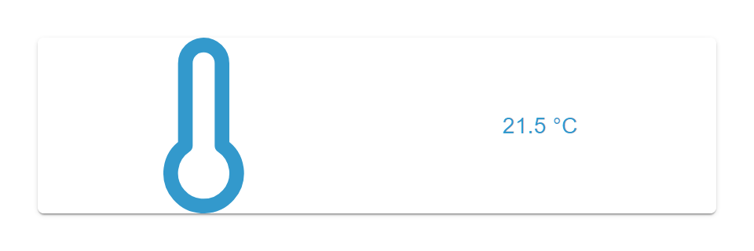

# Input Widget

## Description

The Input Widget displays a text or number value bound to a single OID and allows direct inline editing on click. It accepts the data types string, number, and mixed. In the default mode every keystroke is written (debounced) to the OID; with the OK button enabled the input is buffered and written on confirmation, or on leaving the field if it was changed.

## Settings Hierarchy

This widget uses all **vis-2 Settings** and **Common Settings**. See [Home](En-Home.md) for details.

The widget-specific and value-specific settings override the more general settings.

## Widget-Specific Settings

### Object & Values

| Field Name | Type | Default | Description                                                                          | Condition                    |
| ---------- | ---- | ------- | ------------------------------------------------------------------------------------ | ---------------------------- |
| oid        | id   | -       | Object ID; accepts the types string, number, and mixed                               | -                            |
| unit       | text | ''      | Unit (taken from the object, can be overwritten here, emptying the field removes it) | Only when an OID is selected |

### Input

| Field Name   | Type     | Default    | Description                                                                                                        | Condition |
| ------------ | -------- | ---------- | ------------------------------------------------------------------------------------------------------------------ | --------- |
| showOkButton | checkbox | false      | Show OK button: write the input on OK/Enter, or on leaving the field if it was changed (otherwise every keystroke) | -         |
| inputVariant | select   | 'standard' | Text field variant (standard, outlined, filled)                                                                    | -         |
| inputPadding | number   | 1          | Inner padding of the input field                                                                                   | -         |

### Number Range

Only visible when the bound OID is of type **number**. The range guides the spinner and does not limit the input, see [Spinner and Range](#spinner-and-range).

| Field Name | Type   | Default | Description                                                                | Condition   |
| ---------- | ------ | ------- | -------------------------------------------------------------------------- | ----------- |
| step       | number | 1       | Step size of the spinner                                                   | Only number |
| minValue   | number | -       | Lower limit of the spinner (taken from `common.min`); empty means no limit | Only number |
| maxValue   | number | -       | Upper limit of the spinner (taken from `common.max`); empty means no limit | Only number |

### Display

| Field Name  | Type     | Default | Description                      | Condition            |
| ----------- | -------- | ------- | -------------------------------- | -------------------- |
| onlyDisplay | checkbox | false   | Display only (no inline editing) | Only when write=true |
| noIcon      | checkbox | false   | Do not show an icon              | -                    |
| noValue     | checkbox | false   | Do not show a value              | -                    |

**Note:** In addition to the settings above, the **Write Value** settings (delay/interval) are available. These control how value changes are written to the OID. See [Common Settings - Write Value](En-Home.md#write-value) for details.

## Data Types

The Input Widget supports the following data types:

### String

- Text values, arbitrary strings
- Typical use: status messages, modes, names

### Number

- Numeric values with an optional spinner range (min/max/step)
- Typical use: temperature, brightness, percentages

### Mixed

- Arbitrary values (text or number)
- Typed input is written in the type it looks like: `true`/`false` as a boolean, numeric input as a number (`007` becomes `7`), everything else as text
- Typical use: universal input

## How It Works

### Display-first Inline Editing

The widget shows the value (and optionally an icon) centered. A click on the display switches inline to a text field:

- The icon is hidden while editing
- For a **number** OID a numeric input field with a spinner is used
- The unit is shown as a suffix on the right of the field
- **Enter**, **Escape**, or a click outside ends editing

### Write Mode

**Without OK button** (default): Every keystroke is written to the OID with a delay (see the **Write Value** settings). Enter, Escape, and a click outside only end editing; what was typed stays written.

**With OK button** (`showOkButton`): The input is buffered and nothing is written while typing. What happens next depends on whether the input differs from the value at the start of editing. Typing 41 and going back to 40 on a start value of 40 counts as unchanged.

| Action        | Input changed | Input unchanged                                                                 |
| ------------- | ------------- | ------------------------------------------------------------------------------- |
| Click outside | Written       | Nothing is written                                                              |
| Enter or OK   | Written       | Sent again, unless the conversion would alter the value; then editing just ends |
| Escape        | Discarded     | Nothing is written                                                              |

Enter and OK can therefore re-send a value on purpose, while clicking into the field and away again never triggers a write. A stored text `007` on a mixed OID would become the number `7`, so Enter and OK do not send it unchanged.

In both modes, an input that is not a number (such as an emptied field) is never written to a **number** OID: the object keeps its value, even where this section says "written".

### Spinner and Range

The range guides the spinner (the arrows of the number field and the arrow keys) and does not limit the input: A typed value outside the range is written.

- **Value outside the range**: The limit the value has crossed no longer applies, so the spinner moves by one step instead of jumping to that limit. With a maximum of 100, a value of 500, and a step of 1, arrow down gives 499. The other limit keeps applying.
- **Selecting an OID**: The widget takes only the range the object really declares (`common.min`, `common.max`). A limit the object does not declare stays empty, and a previous one is removed.
- **Empty min/max field**: Means no limit, not 0.
- **Widgets configured earlier**: They may have a stored range of 0 to 100 that the object never declared. It cannot be told apart from a real range and stays until the fields are emptied or the next OID selection replaces it.

### Unit

The unit comes from the bound object. After an OID is selected it appears in the `unit` field, where it can be overwritten; emptying the field removes it. A later OID selection replaces it, and removing the OID empties the field.

The display, the footer, and the suffix of the input field show the unit, also when the value matches no row of the state editor. An alias set in the matching row is shown in the display instead.

In widgets configured earlier the `unit` field may be empty although the object's unit is shown. It fills on the next OID selection; until then, type something into the field and empty it again to remove the unit.

### Read-only Mode

When `onlyDisplay` is active or the OID is not writable (`write=false`), the widget never enters edit mode and displays the value purely.

### Conflict Indicator

The input field turns red when the value has changed significantly from another source (e.g. an adapter or script) since the click into the field:

- A change before the click does not count, however recent it is.
- For numbers and text that reads as a number, changes smaller than 1 such as sensor noise neither turn the field red nor clear the red. For any other text, every change counts.
- Right after your own write, the widget ignores backend changes for the write delay plus 1.5 seconds, so a foreign change in that time does not turn the field red. On a very slow connection, the late confirmation of an older keystroke can turn it red.
- The field stays red until editing ends. Without OK button your own next keystroke clears it, because your value is then in the object; an input that is not written, such as an emptied number field, does not. The next editing session starts without the marking.

Red is only a warning: The foreign value does not replace your input. With OK button, a changed input and a deliberate Enter or OK are still written and overwrite the foreign value; a click outside without a change leaves it alone. Without OK button, your next keystroke overwrites it, while Enter and a click outside leave it alone.

## Value-specific Settings

Individual Common settings can be overridden per value (e.g. icon, background color, text color). They are edited in the state editor, the **Values** group in the attribute panel: a searchable list with one row per value and, below it, the fields of the selected row. Rows can be added, cloned, moved, and deleted.

When an OID is selected, the states from its `common.states` are added as rows and existing rows are kept. **Recreate from common.states** replaces all rows.

The row whose value matches the current value applies its settings. This matches the behavior of the [State Widget](En-State-Widget.md#value-specific-settings) and allows, for example, a distinct background color per state value. The rows do not restrict the input: Any value can still be typed.

## Use Cases

- **Temperature input**: number OID with min/max/step and °C unit
- **Edit status text**: string OID for status messages or scene names
- **Direct volume entry**: number instead of slider, with OK button to avoid writing too often
- **Universal value**: mixed OID for flexible input
