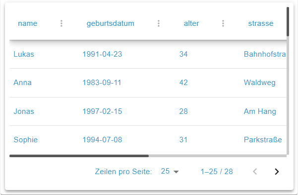

# JSON Table Widget



## Description

The JSON Table Widget displays tabular data from the JSON value of an OID. It uses TanStack Table v8 (headless) for sorting, filtering, pagination, and column customization. Columns are detected from the JSON structure and configured in the column editor. The widget only reads the OID and never writes to it; the [Write Value](En-Home.md#write-value) settings do not exist here.

## Settings Hierarchy

This widget uses all **vis-2 Settings** and **Common Settings**. See [Home](En-Home.md) for details.

The widget-specific settings override the more general settings.

## Data Source

| Field Name      | Type | Default | Description                                                                                                                                                        | Condition |
| --------------- | ---- | ------- | ------------------------------------------------------------------------------------------------------------------------------------------------------------------ | --------- |
| Object ID `oid` | id   | -       | OID for JSON data (type: `string`, `mixed`, or `json`). Clearing the OID deletes `columnConfig` and all other own fields from the sections below. There is no unit | -         |

The JSON data can be:

- **Array of objects**: Each object is a row
- **Single object**: Shown as one row
- **Nested objects**: Flattened down to the flattening depth `tableMaxDepth`
- **JSON string**: Parsed automatically
- **Array elements that are not objects**: End up in the column `_value` (`[1,2]` gives `_value`, `[[1,2]]` gives `_value[0]` and `_value[1]`)

Anything else — a single number, text or boolean (also as JSON), invalid JSON, `[]`, `{}`, `[{}]` — shows _No data available_. With all columns set to `visible: false` it reads _All columns are hidden_. Without an OID or with another object type the widget shows a notice instead of the table.

## Column Configuration

### Column Editor

| Field Name             | Type   | Default | Description                                                                                                                                                         | Condition |
| ---------------------- | ------ | ------- | ------------------------------------------------------------------------------------------------------------------------------------------------------------------- | --------- |
| Columns `columnConfig` | custom | -       | The **Configure Columns** button opens the editor; below it is the number of visible and of all columns. Stored as `b64:` + Base64 JSON, plain JSON is read as well | -         |

The column editor provides:

- **Column list**: Search, reordering by dragging (not during a search), visibility by checkbox or the `v` key, switching columns with the arrow keys
- **Bulk actions**: **Refresh columns from OID**, **Show all**, **Hide all**, **Reset all columns to defaults** (asks first)
- **Column settings**: Sections **Basic Settings**, **Formatting**, **Conditional Styling**, and **Advanced**, each with **Reset to default**
- **Advanced**: Shows the **Table capabilities**, the column's result, and the **Analysis Info** (type, **Confidence**, **Null values**, **Distinct values**, **Range**, **Detected input format**)
- **Data type detection**: Detects `string`, `number`, `boolean`, `date`, `image`, `array`, `object`, `null`, and `mixed`. The **detected type** is a hint; the **format type** may differ from it freely.
- **Saving**: **Save** is only active after a change. **Cancel** and the X discard without asking; a click beside the dialog keeps it open while there are changes and warns.

> **Which columns the table shows:** The saved column configuration and the columns found in the data are merged by one rule, in the editor and at runtime alike (column merge): saved columns still present in the data keep their order and settings; a field the data gains appears right away as a new visible column at the end (default settings) — no need to save in the editor first; a saved column the data no longer carries is left out. Without a saved configuration the table shows every column found. Newly found paths are in byte order (capitals first), not in JSON order. The editor opens with exactly this list; hiding a new column there is saved with the next _Save_.

### Column Properties

Each column can be configured with:

| Property                | Description                                                                                                          |
| ----------------------- | -------------------------------------------------------------------------------------------------------------------- |
| `path`                  | Column identifier: the flattened path in the data                                                                    |
| Header `headerName`     | Display name in the header. The default is the last path segment (`u.n.d` gives `d`), an empty header shows the path |
| Width `width`           | Column width in px, input from 30, 150 without a value. Dragging in the header: 40–2000                              |
| Alignment `align`       | `left` (default), `center`, `right`. A detected image column without a value is `center`                             |
| Visible `visible`       | Show/hide column                                                                                                     |
| Sortable `sortable`     | Sorting for this column — `true` / `false` / `'auto'`                                                                |
| Filterable `filterable` | Filtering for this column — `true` / `false` / `'auto'`                                                              |
| Hideable `enableHiding` | Column can be hidden via the column menu — `true` / `false` / `'auto'`                                               |

> **Smart defaults (`'auto'`):** In **Auto (type-based)** mode (the default), sortability and filterability follow the column's **effective type** — its format type if one is set, otherwise the detected type: `string`/`number`/`date`/`mixed`/`null` → sortable and filterable, `boolean` → filterable only, `image`/`array`/`object` → neither. Every column is hideable by default. An override never allows more than the table: while sorting, column filtering or hiding is off for the whole table, `true` has no effect. The column editor's _Advanced_ section shows the resulting value per column.

### Column Formatting

Each column has at most one active **format type** `format.type` that determines how the raw value is rendered. The default is **Auto** (followed by the detected type in brackets), which sets no format type: the cell shows the raw value as text without formatting, a detected date column too (it still sorts and filters as a date). The only exception is the detected image column, which renders as a graphic. The editor shows the options of the detected and of the chosen type; changing an option sets its type as the format type, switching the type deletes the options of the old one.

| Format Type | Value     | Description                                 | Key Options                                                                                              |
| ----------- | --------- | ------------------------------------------- | -------------------------------------------------------------------------------------------------------- |
| String      | `string`  | Text display                                | `stringCase`, `stringPrefix`, `stringSuffix`, `stringTrim`, `stringMaxLength`, `stringRegex`, font style |
| Number      | `number`  | Numeric formatting with thousands separator | `numberDecimals`, `numberPrefix`, `numberSuffix`, `numberThousandsSeparator`                             |
| Boolean     | `boolean` | Boolean as text                             | `booleanTrue`, `booleanFalse`                                                                            |
| Date        | `date`    | Date/time formatting                        | `dateFormat` (predefined)                                                                                |
| Image       | `image`   | Render the raw value as a graphic           | `imageSize`, `imageObjectFit`, `imageVariant`, `imageTint`, `imagePadding`, …                            |

See the subsections below for the format-type-specific options.

### String Format

The steps run in this order: whitespace, regex, case, length, prefix/suffix.

| Property                                                                                                         | Description                                                                                                  |
| ---------------------------------------------------------------------------------------------------------------- | ------------------------------------------------------------------------------------------------------------ |
| Trim whitespace `stringTrim`                                                                                     | Remove leading/trailing whitespace                                                                           |
| Regex pattern `stringRegex`                                                                                      | Extract a regex sub-match. Invalid pattern, no match, or more than 200 characters: the value stays unchanged |
| Capture group `stringRegexGroup`, Flags `stringRegexFlags`                                                       | Capture group to use (0 = full match) and regex flags                                                        |
| Case `stringCase`                                                                                                | `none`, `upper`, `lower`, `title`                                                                            |
| Max length `stringMaxLength`                                                                                     | Truncate to N characters (appends "…")                                                                       |
| Prefix `stringPrefix`, Suffix `stringSuffix`                                                                     | Prepend/append to the value                                                                                  |
| Bold `stringFontWeight`, Italic `stringFontStyle`, Font size (px) `stringFontSize`, Text color `stringTextColor` | Static font settings (overridable by conditional rules). Font size 8–72                                      |

> **Note — HTML rendering:** All cells except graphics render their display value as HTML (e.g. `<b>`, `<br>`, `<span style="…">`), not only the String format type. The values come from your own ioBroker state and are treated as trusted. If you bind third-party data, be aware of the XSS risk of unfiltered HTML.

### Number and Boolean

| Property                                             | Default         | Description                                                                                                |
| ---------------------------------------------------- | --------------- | ---------------------------------------------------------------------------------------------------------- |
| Decimals `numberDecimals`                            | 2               | 0–10. Numbers stored as text are formatted too; a value that is no number and an empty cell stay unchanged |
| Prefix `numberPrefix`, Suffix `numberSuffix`         | -               | Prepend/append to the value                                                                                |
| Thousands separator `numberThousandsSeparator`       | false           | Comma as the separator, the decimal point is always `.`, no locale                                         |
| True label `booleanTrue`, False label `booleanFalse` | `true`, `false` | Applies only to real booleans, everything else shows as text                                               |

### Date Columns (format type `date`)

A date column reads every raw value as a point in time and shows it in the **Output format** `dateFormat` (default `yyyy-MM-dd`), in the browser's local time. **Detected input format** is display only and is not stored.

- **Detected date columns** (detected type `date`) read exactly the patterns the detection recognises: ISO-8601 with zone (`2024-12-01T10:00:00Z`, `…+02:00`), `YYYY-MM-DD`, `dd.MM.yyyy( HH:mm(:ss))`, `MM/dd/yyyy( HH:mm(:ss))` and epoch numbers (≥ 1e11 → milliseconds, ≥ 1e9 → seconds). A number column with values from 1e9 therefore counts as `date`; to keep it a number, set the format type `number`.
- **Columns you set to `date` yourself** additionally read, as local time: ISO without zone (`2024-12-01T10:00`, `…:00`, `…:00.000`), `YYYY-MM-DD HH:mm(:ss)` and epoch strings (digits only, same thresholds).
- **Anything else is not a date** and shows its raw value as text — e.g. `1.12.2024`, `Dec 1, 2024`, `2024/12/01`. There is no browser guessing.

Sorting, the date filter, the quick filter and conditional rules read dates the same way and compare the **local calendar day**. Values that are not a date sort before all dates. The output format `ISO-8601 (UTC)` shows UTC and may therefore show a different day around midnight.

### Image Column (format type `image`)

An **image column** renders every raw value as a graphic instead of text. The raw value is read as a **visual reference** — never as an icon _name_ (`mdi-*`, `fa-*`); there is no name resolution. Supported:

- **URL or file path** (image or SVG)
- **`data:image/…` URI**
- **UTF-8 character** (a non-ASCII character of at most 2 UTF-16 units, e.g. 💡; an emoji with a variation selector is longer and stays text)

**Icon vs image** is a value-level, runtime distinction — not a separate column type: an _icon_ is a small monochrome glyph (SVG data URI or UTF-8 character), an _image_ is a raster photo (png/jpg/webp/…). A configured color **tint** applies to either via a CSS mask (the source's alpha channel) — exact for monochrome icons.

| Property                                                         | Default | Description                                                                                                                        |
| ---------------------------------------------------------------- | ------- | ---------------------------------------------------------------------------------------------------------------------------------- |
| Image size `imageSize`                                           | 64      | Render size in px (8–256), limited by the cell height                                                                              |
| Object fit `imageObjectFit`                                      | contain | `contain`, `cover`, `fill` (CSS `object-fit`)                                                                                      |
| Shape `imageVariant`                                             | square  | `square`, `rounded`, `circular` (avatar shape)                                                                                     |
| Background `imageBgColor`                                        | -       | Avatar background color                                                                                                            |
| Border color `imageBorderColor`, Border width `imageBorderWidth` | - / -   | Avatar border, only with a color and width > 0 (0–16)                                                                              |
| Tint `imageTint`                                                 | -       | Color tint via CSS mask                                                                                                            |
| Show value as tooltip `imageTooltip`                             | true    | Show raw value as a hover tooltip                                                                                                  |
| Show placeholder for broken images `imageShowBroken`             | true    | Placeholder icon when a URL fails to load, only without `imageTint`: the mask reports no load error. `false` leaves the cell empty |
| Padding `imagePadding` (top/right/bottom/left)                   | 0 8 0 8 | Per-side inner padding in px (0–64). As soon as one side is set, unset sides are 0                                                 |

**Auto-detection:** Only columns with `data:image/…` URIs and with paths or URLs with an image extension (png, jpg, jpeg, gif, svg, webp, avif, bmp, ico, apng, tif, tiff) count as detected type `image`. They render as graphics without manual configuration, even with text beside them in the column. UTF-8 characters and URLs without an extension need the format type `image`.

**Fallback:** If a value cannot be resolved to a graphic, it is rendered as text. An empty value shows an empty cell, a broken URL shows the placeholder. With `imageTint` an image from a foreign origin may stay empty. The graphic is rendered XSS-safe (never via `innerHTML`).

### Conditional Styling

Dynamic styles in the **Conditional Styling** section, with a **Preview** per rule:

- **Conditions**: Compare against fixed values or thresholds (json-logic rules), several conditions combined by **AND**/**OR**. A rule without a complete condition never applies. The rule builder follows the column's effective type; on a date column — detected or set — rules compare the value's local calendar day as `YYYY-MM-DD`.
- **Comparison**: Text operators are case-sensitive, **equals** compares loosely (`1` matches `"1"`). Empty means `null`, a missing value and `""`, not `0` or `false`. An empty cell matches no greater-than or less-than rule, nor **equals** `0` or **is false**; **does not equal** matches it, also against `0`. An unreadable value in a date column counts as empty.
- **Styles**: **Background color** `backgroundColor` and **Text color** `textColor` (both gradient possible), **Bold** `fontWeight`, **Italic** `fontStyle`. A new rule is set to `normal`, which counts as set and overrides a static bold or italic of the column.
- **Evaluation** `cellStyleMode`:

| Mode                               | Description                                                                               |
| ---------------------------------- | ----------------------------------------------------------------------------------------- |
| First rule `first-match` (default) | Stops at the first matching rule.                                                         |
| All rules `all-match`              | All matching rules are applied; on conflicts the higher-priority rule (lower index) wins. |

The rule builder offers per effective type:

| Effective Type   | Operators (besides **is empty** and **is not empty**)                                                                          |
| ---------------- | ------------------------------------------------------------------------------------------------------------------------------ |
| `number`, `date` | **equals**, **does not equal**, **is greater than**, **is greater than or equal**, **is less than**, **is less than or equal** |
| `string`         | **equals**, **does not equal**, **contains**, **does not contain**, **starts with**, **ends with**                             |
| `boolean`        | **is true**, **is false**                                                                                                      |
| `mixed`          | **equals**, **does not equal**, **contains**                                                                                   |
| others           | **equals**, **does not equal**                                                                                                 |

## Features

> **Persistence:** The view state — sorting, active filters, search term, page and rows per page, column widths, and column visibility — is preserved across page reloads (stored locally in the browser per widget ID, for the session only when the storage cannot be read). Row selection is not part of it. A part whose feature is switched off is parked: it is neither applied nor deleted and returns when the feature is switched on again. The same holds for the filter of a column that cannot be filtered (its override or its type default is off) or is not shown; the sorting of a column that is not shown is left out. Dragged widths stay effective with the header hidden, only `tableAutoSize` parks them. A chosen page size or a dragged column width applies until the configured value (`tablePageSize`, or the column's width in the editor) is changed, or the page size is no longer offered. The page stays on live data updates, is limited to the last existing one, and returns to page 1 only when sorting, filters, the search term or the page size change.

> **Header and column menu:** Sorting, column filtering, hiding and the column menu live in the header. With the header hidden (`tableShowHeader`) they are all off; with the column menu off, column filtering and hiding are off too (both are only reachable through the menu). The quick filter, pagination and row selection do not depend on the header.

### Sorting

| Field Name                               | Type     | Default | Description                               | Condition                          |
| ---------------------------------------- | -------- | ------- | ----------------------------------------- | ---------------------------------- |
| Sorting `tableSorting`                   | checkbox | true    | Enable column sorting                     | Header shown                       |
| Multi-column sorting `tableSortingMulti` | checkbox | false   | Enable multi-column sorting (Shift+Click) | Header shown and `tableSorting` on |

A column sorts by its **effective type**:

- `date` chronologically,
- `number` numerically — also number values stored as text when the column's format type is `number` (values that are no number sort like 0),
- `string` in natural text order without case (`Room 2` before `Room 10`) — also number values when the column's format type is `string`,
- every other type in the default order.

The first click on the column header sorts text ascending and everything else descending, based on the value of the first row. The column menu offers **Sort ascending**, **Sort descending**, and **Clear sort**; its sorting replaces all previous sorting.

### Filtering

| Field Name                      | Type     | Default | Description                                                                                                                                                                                                                                | Condition                 |
| ------------------------------- | -------- | ------- | ------------------------------------------------------------------------------------------------------------------------------------------------------------------------------------------------------------------------------------------ | ------------------------- |
| Filtering `tableFiltering`      | checkbox | true    | Enable column filters. Off when the key is missing from the widget data                                                                                                                                                                    | Header and column menu on |
| Quick filter `tableQuickFilter` | checkbox | false   | Show global search field                                                                                                                                                                                                                   | -                         |
| Column menu `tableColumnMenu`   | checkbox | true    | Show column menu. The button appears on columns that can be sorted, filtered, or hidden, and on all of them while a column is hidden                                                                                                       | Header shown              |
| Column hiding `tableHiding`     | checkbox | true    | Allow **Hide column** and **Show all columns** in the menu. The last visible column cannot be hidden; a view state that hides every shown column is not applied. This is the browser's view state, `visible` in the editor stays untouched | Header and column menu on |

> **Column filters compare by the column's effective type:** text columns as text without case (`equals "Room 1"` does not match `Room 01`), number columns only numerically (a cell that is not a number never matches a value operator), date columns by local calendar day, boolean columns by `true`/`false` (also `'true'`/`'false'` and `1`/`0`). Other types (mixed, object, array, image) compare as text, objects as their JSON. A missing cell only matches **Is empty**. The filter dialog offers the operators of that type; a stored filter whose operator the type no longer offers (e.g. after the format type was changed) is discarded.

| Effective Type   | Operators in the filter dialog (besides **Is empty** and **Is not empty**)                                                 |
| ---------------- | -------------------------------------------------------------------------------------------------------------------------- |
| `string`, others | **Contains** (start), **Starts with**, **Ends with**, **Equals**, **Does not equal**                                       |
| `number`         | **Equals** (start), **Does not equal**, **Greater than**, **Greater than or equal**, **Less than**, **Less than or equal** |
| `date`           | **Equals** (start), **After**, **On or after**, **Before**, **On or before**                                               |
| `boolean`        | **Equals** (start), **Does not equal**                                                                                     |

Enter applies the filter, an empty input means no filter. The quick filter searches for a substring without case in the raw value (text, number, boolean, no objects) of all columns, including those hidden via the menu but not those hidden in the editor. In columns with the format type `date` it also matches the display value.

### Pagination

| Field Name                                          | Type     | Default        | Description                                                                                                                              | Condition |
| --------------------------------------------------- | -------- | -------------- | ---------------------------------------------------------------------------------------------------------------------------------------- | --------- |
| Enable pagination `tablePagination`                 | checkbox | true           | Enable pagination                                                                                                                        | -         |
| Page size `tablePageSize`                           | number   | 25             | Initial page size, from 1. Only takes effect with pagination                                                                             | -         |
| Page size options `tablePageSizeOptions`            | text     | '10,25,50,100' | Available page sizes (comma-separated, positive integers, unique, ascending; unreadable: the default). Only takes effect with pagination | -         |
| Virtualization threshold `tableVirtualizeThreshold` | number   | 50             | Without pagination the table body renders only the rows in view above this row count. `0` = never                                        | -         |

### Row Selection

| Field Name                                   | Type     | Default | Description                                                                                                                              | Condition |
| -------------------------------------------- | -------- | ------- | ---------------------------------------------------------------------------------------------------------------------------------------- | --------- |
| Row selection (checkbox) `tableRowSelection` | checkbox | false   | Enable row selection (checkboxes). The header checkbox selects the page. The selection lasts for the session only and is written nowhere | -         |

### Analysis

| Field Name                        | Type   | Default | Description                                 | Condition |
| --------------------------------- | ------ | ------- | ------------------------------------------- | --------- |
| Max nesting depth `tableMaxDepth` | number | 10      | Flattening depth (1–50, 1 = top-level keys) | -         |

At depth N a value on level N+1 stays as it is: an object or array shows as JSON text with the chip `JSON` and the detected type `object` or `array`. A warning then appears above the table and in the editor, even with only simple values on level N+1; the depth it names is capped at N+1.

## Layout

### Table Layout

| Field Name                              | Type     | Default    | Description                                                                                        | Condition    |
| --------------------------------------- | -------- | ---------- | -------------------------------------------------------------------------------------------------- | ------------ |
| Density `tableDensity`                  | select   | 'standard' | Row/header in px: `compact` 36/36, `standard` 52/56, `comfortable` 68/68                           | -            |
| Row height (px) `tableRowHeight`        | number   | -          | Fixed row height from 20, overrides the density                                                    | -            |
| Show header `tableShowHeader`           | checkbox | true       | Show the header. For dependencies see [Features](#features)                                        | -            |
| Header height (px) `tableHeaderHeight`  | number   | -          | Header height from 20                                                                              | Header shown |
| Header elevation `tableHeaderElevation` | slider   | 6          | Header shadow elevation (0-24), flat and transparent with `noCard`                                 | Header shown |
| Auto-size columns `tableAutoSize`       | checkbox | false      | Auto-size columns to fit container. No dragging, configured and dragged widths then have no effect | -            |
| Padding `jsonTablePadding`              | number   | 1          | Inner padding in MUI spacing units, step 0.5                                                       | -            |

### Table Border

| Field Name                   | Type   | Default | Description                                                                                   | Condition |
| ---------------------------- | ------ | ------- | --------------------------------------------------------------------------------------------- | --------- |
| Border width `borderWidth`   | slider | 0       | Outer border width (0-20), a border exists only above 0                                       | -         |
| Border style `borderStyle`   | select | 'solid' | `none`, `dotted`, `dashed`, `solid`, `double`, `groove`, `ridge`, `inset`, `outset`, `hidden` | -         |
| Border color `borderColor`   | color  | -       | Border color. Without a value the theme's divider color                                       | -         |
| Border radius `borderRadius` | text   | -       | Border radius (CSS value)                                                                     | -         |

### Header Style

| Field Name                               | Type   | Default | Description                                                                                                             | Condition    |
| ---------------------------------------- | ------ | ------- | ----------------------------------------------------------------------------------------------------------------------- | ------------ |
| Header background `tableHeaderBgColor`   | color  | -       | Header background color (gradient possible). Without a value the widget surface of the theme, transparent with `noCard` | Header shown |
| Header text color `tableHeaderTextColor` | color  | -       | Header text color. Inherited without a value                                                                            | Header shown |
| Header font size `tableHeaderFontSize`   | number | -       | Header font size in px, from 8                                                                                          | Header shown |
| Header border width `headerBorderWidth`  | slider | 0       | Header bottom border width (0-10)                                                                                       | Header shown |
| Header border color `headerBorderColor`  | color  | -       | Header border color. Without a value the theme's divider color                                                          | Header shown |

### Vertical / Horizontal Borders

| Field Name                                   | Type     | Default | Description                                           | Condition                         |
| -------------------------------------------- | -------- | ------- | ----------------------------------------------------- | --------------------------------- |
| Vertical cell borders `tableShowCellBorders` | checkbox | false   | Show vertical cell borders, not after the last column | -                                 |
| Border width `verticalCellBorderWidth`       | slider   | 1       | Vertical border width (0-10)                          | `tableShowCellBorders` on         |
| Border color `verticalCellBorderColor`       | color    | -       | Vertical border color                                 | `tableShowCellBorders` on         |
| Horizontal row borders `tableShowRowBorders` | checkbox | true    | Show horizontal row borders, not after the last row   | -                                 |
| Border width `horizontalCellBorderWidth`     | slider   | 1       | Horizontal border width (0-10)                        | `tableShowRowBorders` not `false` |
| Border color `horizontalCellBorderColor`     | color    | -       | Horizontal border color                               | `tableShowRowBorders` not `false` |

### Row Style

| Field Name                    | Type  | Default | Description                                                                                 | Condition |
| ----------------------------- | ----- | ------- | ------------------------------------------------------------------------------------------- | --------- |
| Even row color `evenRowColor` | color | -       | Background color for even rows (gradient possible). Counted per page, the first one is even | -         |
| Odd row color `oddRowColor`   | color | -       | Background color for odd rows (gradient possible)                                           | -         |

> Note: The cell font size comes from **Value size** `valueSize` in [Value](En-Home.md#value), per column the **String** format type (`stringFontSize`) overrides it; there is no separate table-level field for the cell font size.

## JSON Data Formats

### Simple Array

```json
[
    { "name": "John", "age": 30, "city": "New York" },
    { "name": "Jane", "age": 25, "city": "London" }
]
```

### Nested Objects

```json
[
    {
        "user": { "name": "John", "email": "john@example.com" },
        "stats": { "logins": 42, "lastLogin": "2024-01-15" }
    }
]
```

Nested paths are flattened to `user.name`, `stats.logins`, etc.

### Array Values

```json
[
    { "id": 1, "tags": ["urgent", "work"] },
    { "id": 2, "tags": ["personal"] }
]
```

Arrays are flattened to index columns `tags[0]` and `tags[1]`, the second row holds `null` in `tags[1]`. An empty array or object gives `null` as well.

### Images & Icons

The column `image` is a detected image column here, `icon` needs the format type `image`:

```json
[
    { "name": "Lamp", "icon": "💡" },
    { "name": "Sensor", "icon": "🌡" },
    { "name": "Camera", "image": "https://example.com/cam1.png" },
    { "name": "Logo", "image": "data:image/svg+xml,%3Csvg …%3E" }
]
```

The format type renders URLs, `data:image/…` URIs, and UTF-8 characters alike, the detection is stricter (see [Image Column](#image-column-format-type-image)).

## Use Cases

### Device List

```
oid: javascript.0.deviceList
tableSorting: true
tableFiltering: true
tableQuickFilter: true
tablePagination: true
tablePageSize: 25
```

JSON structure:

```json
[
    { "device": "Living Room Light", "type": "bulb", "state": "on", "battery": 100 },
    { "device": "Kitchen Sensor", "type": "motion", "state": "idle", "battery": 85 }
]
```

### Log Table

```
oid: javascript.0.logs
tableSorting: true
tableSortingMulti: true
tableFiltering: true
tablePagination: true
tablePageSize: 50
tableDensity: compact
```

### Status Dashboard

```
oid: javascript.0.statusData
tableAutoSize: true
tablePagination: false
tableShowRowBorders: true
evenRowColor: #f5f5f5
```

### Conditional Formatting Example

Column `battery` in the column editor, **Evaluation** set to **First rule**:

- Rule 1: **is greater than** `80`, green background
- Rule 2: **is greater than or equal** `50`, yellow background
- Rule 3: **is less than** `50`, red background

An empty cell matches none of the three rules. **Move rule up** and **Move rule down** change the order.

## Performance Tips

1. **Virtualization**: Applies only without pagination, for tables with more than `tableVirtualizeThreshold` rows after filtering
2. **Pagination**: Use for large datasets to improve render performance
3. **Max Depth**: Lower `tableMaxDepth` for deeply nested JSON to reduce processing time
4. **Column Visibility**: Hide unnecessary columns to reduce DOM elements

## Integration with ioBroker

### Creating JSON Data

Use a JavaScript adapter script to generate JSON data:

```javascript
// Example: Aggregate device data into JSON
const tableData = [];
$('channel[state.id=*.state]').each(id => {
    tableData.push({
        name: getObject(id).common.name,
        state: getState(id).val,
        lastUpdate: new Date(getState(id).ts).toISOString(),
    });
});
setState('javascript.0.deviceTable', JSON.stringify(tableData), true);
```

### Reacting to Row Selection

Row selection has no output: `tableRowSelection` writes to no state and fires no event, a script cannot react to it.
