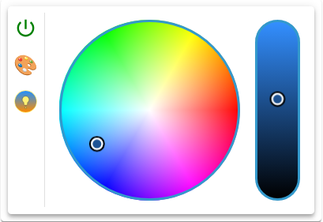

# Light Widget



## Description

The Light Widget steers a lamp with color selection, brightness control, and color temperature control: one switch OID plus up to eight channels, operated through iro.js pickers. It supports RGB, HSV, and CCT (Color Temperature). The light type decides which channels the widget binds and which views it shows. The lamp control, made of power button, view switch and pickers, sits directly in the widget or, in button mode, in a modal.

Only a switch OID of type boolean makes the widget work. Without one the frame shows only the hint "Please select a valid object ID", even with channels set.

## Settings Hierarchy

This widget uses all **vis-2 Settings** and **Common Settings**. See [Home](En-Home.md) for details.

The widget-specific settings override the more general settings.

Rows exist only in button mode, see [Values](#values). Without button mode no row applies, the Icon group then affects only the corner icon, and the header has no text without `header`. Without `footer` the footer has a text only in button mode, the alias of the active row. `valueSize` never applies, because the widget shows no value text.

## Color Light Configuration

All fields are in the **Light** group.

### UI Component

| Field Name                           | Type     | Default | Description                                                                        | Condition                                          |
| ------------------------------------ | -------- | ------- | ---------------------------------------------------------------------------------- | -------------------------------------------------- |
| UI component `colorLightUIComponent` | select   | 'wheel' | Picker of the color view (wheel, box, slider), see [UI Components](#ui-components) | Only with a color view: light type not none or cct |
| Wheel darken `colorWheelLightness`   | checkbox | false   | The color wheel darkens with the brightness slider, otherwise it stays bright      | Only with a color view and UI component wheel      |

### Light Type

| Field Name                  | Type   | Default | Description                                                                                                                                                                                     | Condition |
| --------------------------- | ------ | ------- | ----------------------------------------------------------------------------------------------------------------------------------------------------------------------------------------------- | --------- |
| Light type `colorLightType` | select | 'none'  | What the widget steers of the lamp (none, cct, rgb, rgbcct, r/g/b, r/g/b/cct, h/s/v, h/s/v/cct). The panel shows rgbcct as `rgb & cct`, the other two likewise. See [Light Types](#light-types) | -         |

### Color Temperature (CCT)

| Field Name                                   | Type               | Default | Description                                | Condition                                             |
| -------------------------------------------- | ------------------ | ------- | ------------------------------------------ | ----------------------------------------------------- |
| Color temperature `colorLightTemperatureOid` | id                 | -       | Channel of the color temperature in Kelvin | Only with cct, rgbcct, r/g/b/cct, h/s/v/cct           |
| Color temperature (min) `colorLightCtMin`    | number (500-10000) | 2000    | Lower bound of the Kelvin picker in Kelvin | Only with these light types and color temperature set |
| Color temperature (max) `colorLightCtMax`    | number (500-10000) | 6500    | Upper bound of the Kelvin picker in Kelvin | Only with these light types and color temperature set |

### RGB Configuration

| Field Name                      | Type | Default | Description                        | Condition                  |
| ------------------------------- | ---- | ------- | ---------------------------------- | -------------------------- |
| RGB (hex) `colorLightRgbHexOid` | id   | -       | Channel of the hex value (#rrggbb) | Only with rgb, rgbcct      |
| Red `colorLightRedOid`          | id   | -       | Channel for red (0-255)            | Only with r/g/b, r/g/b/cct |
| Green `colorLightGreenOid`      | id   | -       | Channel for green (0-255)          | Only with r/g/b, r/g/b/cct |
| Blue `colorLightBlueOid`        | id   | -       | Channel for blue (0-255)           | Only with r/g/b, r/g/b/cct |

### HSV Configuration

| Field Name                           | Type | Default | Description                                                             | Condition                                          |
| ------------------------------------ | ---- | ------- | ----------------------------------------------------------------------- | -------------------------------------------------- |
| Color (HUE) `colorLightHueOid`       | id   | -       | Channel of the hue (0-360)                                              | Only with h/s/v, h/s/v/cct                         |
| Saturation `colorLightSaturationOid` | id   | -       | Channel of the saturation (0-100, on the [Hue scale](#hue-scale) 0-254) | Only with h/s/v, h/s/v/cct                         |
| Brightness `colorLightBrightnessOid` | id   | -       | Channel of the brightness (0-100, on the [Hue scale](#hue-scale) 0-254) | Only with cct, rgbcct, r/g/b/cct, h/s/v, h/s/v/cct |

### Button Mode

| Field Name                                  | Type             | Default | Description                                                                                                 | Condition           |
| ------------------------------------------- | ---------------- | ------- | ----------------------------------------------------------------------------------------------------------- | ------------------- |
| Button (UI) `colorLightButton`              | checkbox         | false   | Button mode: a click switches, a long press opens the modal. Also shows the **Values** group                | -                   |
| Long press delay `colorLightDelayLongPress` | number (0-10000) | 500     | From this press duration in milliseconds a press counts as long. With `0` almost every press counts as long | Only in button mode |
| Modal width `colorLightModalWidth`          | number (0-5000)  | -       | Width of the modal in px. Without a value or with `0`: modal height + slider width + 52 px                  | Only in button mode |
| Modal height `colorLightModalHeight`        | number (0-5000)  | 300     | Height of the modal in px. Without a value or with `0`: 300 px                                              | Only in button mode |

### Styling

| Field Name                           | Type                       | Default | Description                                                                                                                                | Condition |
| ------------------------------------ | -------------------------- | ------- | ------------------------------------------------------------------------------------------------------------------------------------------ | --------- |
| Slider width `colorLightSliderWidth` | slider (0-10, step 0.1)    | 1       | Width of the sliders, `1` equals 28 px. `0` counts as `1`                                                                                  | -         |
| Border width `colorLightBorderWidth` | slider (0-100)             | 3       | Border width of the pickers in px                                                                                                          | -         |
| Border color `colorLightBorderColor` | color                      | -       | Border color of the pickers, solid colors only. Without a value and with color names, `transparent` and `var(…)` the theme's primary color | -         |
| Padding `colorLightPadding`          | number (min: 0, step: 0.5) | 1       | Inner padding around the pickers in MUI spacing units                                                                                      | -         |

### Switch OID

| Field Name                            | Type | Default | Description                                                                                                    | Condition |
| ------------------------------------- | ---- | ------- | -------------------------------------------------------------------------------------------------------------- | --------- |
| Switch (ON/OFF) `colorLightSwitchOid` | id   | -       | On/off of the lamp. The object dialog also offers number, string and mixed, the widget works only with boolean | -         |

Picking the switch OID starts the [channel detection](#oid-detection) and creates the rows.

### Values

The **Values** group appears only in button mode and always has the two fixed rows `true` and `false`. [Value-specific Settings](En-Home.md#value-specific-settings) explains the fields.

- Picking the switch OID creates missing rows: power icon, `iconSize{n}` 100, `iconColor{n}` red for `true` and green for `false`, alias from `common.states`, otherwise TRUE and FALSE.
- Existing rows keep order, alias and style.
- When both rows are new, the pick sets `iconSize` to `0`, which hides the corner icon.

**Note:** In addition to the settings above, the **Write Value** settings (delay/interval) are available. These control how value changes are written to the OID. See [Common Settings - Write Value](En-Home.md#write-value) for details. Here they apply to the switch OID and to each channel separately.

## Light Types

### Overview

| Light type | Views                | Channels of the color view  | Channels of the CCT view      |
| ---------- | -------------------- | --------------------------- | ----------------------------- |
| none       | none                 | -                           | -                             |
| cct        | CCT view             | -                           | Color temperature, brightness |
| rgb        | Color view           | RGB (hex)                   | -                             |
| rgbcct     | Color view, CCT view | RGB (hex)                   | Color temperature, brightness |
| r/g/b      | Color view           | Red, green, blue            | -                             |
| r/g/b/cct  | Color view, CCT view | Red, green, blue            | Color temperature, brightness |
| h/s/v      | Color view           | Hue, saturation, brightness | -                             |
| h/s/v/cct  | Color view, CCT view | Hue, saturation, brightness | Color temperature, brightness |

The panel shows only the channels of the chosen light type. With none the lamp control has neither power button nor pickers; in button mode the click still switches, the widget is then a plain on/off button.

### RGB

- **RGB Hex**: Complete color value as hex string (e.g., `#ff0000` for red)
- **Separate Channels**: Red, green, blue each 0-255
- **Usage**: Standard for most RGB lights

### CCT (Color Temperature)

- **Color Temperature**: Warm white at `colorLightCtMin` to cool white at `colorLightCtMax`, in Kelvin
- **White Tones Only**: No color control
- **Usage**: White LED strips, ceiling lights

### HSV (Hue, Saturation, Value)

- **Hue**: 0-360° (color wheel)
- **Saturation**: 0-100% (gray to full color)
- **Value (Brightness)**: 0-100%
- **Usage**: Philips Hue, some smart lights

## UI Components

The UI component applies only in the color view. It changes the display, not the channels: the light type decides what is written.

### Wheel (Color Wheel)

- Circular color selection for hue and saturation
- A brightness slider beside it
- With `colorWheelLightness` the wheel darkens with the slider

### Box (Color Field)

- Rectangular color selection
- Brightness and saturation in one field
- Hue via slider

### Slider

- Always three sliders red, green and blue, also with h/s/v
- No separate brightness slider
- With h/s/v a slider writes the components it changes to the hue, saturation and brightness channels

### CCT View

- Replaces the UI component with two sliders: Kelvin picker and brightness picker
- The Kelvin picker ranges from `colorLightCtMin` to `colorLightCtMax`
- Kelvin coupling: The brightness picker always shows the white of the Kelvin picker at its own brightness. This writes nothing

## OID Detection

The widget can automatically detect the channels of a lamp:

### Automatic Detection

1. Select a switch OID (`colorLightSwitchOid`)
2. The widget reads all states below the parent object of the switch OID
3. It fills every empty channel field from the state with the matching role, see the table, regardless of the light type
4. The light type (`colorLightType`) stays your choice; channels you already chose are left alone

| Role                                                                             | Channel                                      |
| -------------------------------------------------------------------------------- | -------------------------------------------- |
| `level.color.rgb`                                                                | RGB (hex) `colorLightRgbHexOid`              |
| `level.color.red`, `level.color.green`, `level.color.blue`                       | Red, green, blue                             |
| `level.color.hue`, `level.color.saturation`                                      | Color (HUE), saturation                      |
| `level.brightness`, `level.dimmer`, `level.color.luminance`, `level.color.white` | Brightness `colorLightBrightnessOid`         |
| `level.color.temperature`                                                        | Color temperature `colorLightTemperatureOid` |

- If several states match one channel, the first one wins.
- A newly detected color temperature takes `common.min` and `common.max` into `colorLightCtMin` and `colorLightCtMax`, where present and not `0`.
- To have a channel detected again: empty the field and pick the switch OID again.
- If the pick yields no usable object, no detection runs; the rows stay.

### Manual Configuration

- All channels can be set manually
- Useful for unusual devices
- Allows individual assignment
- Picking a channel stores only its object and changes nothing else

## Color Control

Every movement of a slider goes through the [Write Value](En-Home.md#write-value) settings. A channel without a stored object gets no value. Numbers reach the state as whole numbers.

### Power Button

- Writes the inverse value of the switch OID, `true` without a value
- The icon is red with `true` and green otherwise

### RGB Control

**Option 1: RGB Hex**

- Set only `colorLightRgbHexOid`
- Widget writes the hex value in lower case (e.g., `#ff0000`)
- Simplest configuration

**Option 2: Separate Channels**

- Set `colorLightRedOid`, `colorLightGreenOid`, `colorLightBlueOid`
- Widget writes all three values (0-255) on every change
- If one of the three is missing, the widget keeps writing the others, but the picker does not follow the lamp

### HSV Control

- Set `colorLightHueOid`, `colorLightSaturationOid`, `colorLightBrightnessOid`
- Widget writes only the component that changed
- If one of the three is missing, the widget keeps writing the others, but the picker does not follow the lamp

### Hue Scale

A saturation or brightness channel whose object had `common.max` 254 when it was picked is on the Hue scale: the pickers work in percent, the widget converts to 0-254 on read and write. The hue and maximums other than 254 are not converted. What counts is the `common.max` stored with the pick.

### Color Temperature (CCT)

- Set `colorLightTemperatureOid`
- Define min/max in Kelvin
- Slider shows warm white → cool white
- Widget writes the Kelvin value as a whole number; there is no conversion, for example from mired

### View Switch (rgbcct, r/g/b/cct, h/s/v/cct)

Two buttons below the power button switch between the color view (color wheel) and the CCT view (white). The switch switches the lamp, because it writes the stored state of the target view again:

- Switching to the CCT view writes the stored color temperature (whole; 2000 K without a usable value) – the lamp switches to white. Brightness is not written. Without a color temperature channel it writes nothing
- Switching back to the color view writes the stored color values (hex, R/G/B or H/S/V) – the lamp switches to color again. A channel without OID, object or usable value is skipped
- A click on the active view writes nothing
- The widget always starts in the color view, even if the lamp is currently white. The start writes nothing

### External Changes

- A foreign change moves the pickers of the active view: in the color view they follow the color channels, in the CCT view the color temperature and the brightness. Following writes nothing
- A foreign numeric change of less than 1 moves nothing
- The other view reads its channels only on the switch
- Without a usable value the picker shows 2000 K, `#ffffff` or with R/G/B the value 0

## Brightness Control

- Separate channel: `colorLightBrightnessOid`
- Value: 0-100%, on the [Hue scale](#hue-scale) 0-254
- Slider in widget
- Used by the light types `cct`, `h/s/v` and `h/s/v/cct`, and in the CCT view of `rgbcct` and `r/g/b/cct`
- In the color view of `rgb`, `rgbcct`, `r/g/b` and `r/g/b/cct` the brightness is part of the written color value, the channel stays untouched
- With `h/s/v/cct` both views use the same channel
- Without a channel the slider moves but writes nothing

## Button Mode

With `colorLightButton = true`:

- The widget shows a button with the icon of the active row of the switch OID, with its size, offset and color mask, without value text
- Click toggles `colorLightSwitchOid` on/off, like the [power button](#power-button)
- Long press opens the modal with the lamp control and writes nothing
- Long-press delay configurable via `colorLightDelayLongPress`
- If the pointer leaves the button early or the browser cancels the press, for instance when a touch turns into scrolling, this counts as a click and switches, as long as no long press has fired yet

## Modal Dialog

Only in button mode, after a long press:

- Opens the lamp control in the widget's frame
- Size adjustable via `colorLightModalWidth/Height`
- Complete control with power button, view switch and pickers, starting in the color view
- Closes on click outside or Escape; a waiting value goes to the OID at once

## Use Cases

### RGB LED Strip

```
colorLightType: rgb
colorLightUIComponent: wheel
colorLightSwitchOid: hue.0.strip.on
colorLightRgbHexOid: hue.0.strip.rgb
```

### Philips Hue (HSV)

With `common.max` 254 on `sat` and `bri` the [Hue scale](#hue-scale) applies.

```
colorLightType: h/s/v
colorLightUIComponent: wheel
colorLightSwitchOid: hue.0.lamp.on
colorLightHueOid: hue.0.lamp.hue
colorLightSaturationOid: hue.0.lamp.sat
colorLightBrightnessOid: hue.0.lamp.bri
```

### CCT Ceiling Light

No view switch, the start writes nothing.

```
colorLightType: cct
colorLightSwitchOid: zigbee.0.lamp.state
colorLightTemperatureOid: zigbee.0.lamp.color_temp
colorLightBrightnessOid: zigbee.0.lamp.brightness
colorLightCtMin: 2700
colorLightCtMax: 6500
```

### RGB in Button Mode

The rows are created with the pick of the switch OID.

```
colorLightType: rgb
colorLightUIComponent: box
colorLightSwitchOid: hue.0.strip.on
colorLightRgbHexOid: hue.0.strip.rgb
colorLightButton: true
colorLightDelayLongPress: 1000
```
