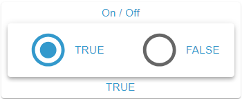

# RadioGroup Widget

## Description

The RadioGroup Widget displays the rows of an OID as radio buttons and writes the value of the row to the OID when one is selected. It accepts the data types boolean, number, string and mixed. All options are simultaneously visible, making selection easier.

## Settings Hierarchy

This widget uses all **vis-2 Settings** and **Common Settings**. See [Home](En-Home.md) for details.

The widget-specific and value-specific settings override the more general settings.

## Widget-Specific Settings

The fields are in the **Radio group** group.

| Field Name                                          | Type                              | Default      | Description                                                                                                                | Condition                                 |
| --------------------------------------------------- | --------------------------------- | ------------ | -------------------------------------------------------------------------------------------------------------------------- | ----------------------------------------- |
| Object ID `oid`                                     | id                                | -            | OID whose value decides the selection and which is written to; accepts the types boolean, number, string and mixed         | -                                         |
| Unit `unit`                                         | text                              | ''           | Unit (taken from the object, can be overridden here, clearing removes it); appears on labels without an alias              | Only when an OID is selected              |
| Orientation `radioOrientation`                      | select (`horizontal`, `vertical`) | `horizontal` | Orientation of the radio group, see [Orientation](#orientation)                                                            | -                                         |
| Hide labels `hideLabels`                            | checkbox                          | false        | Hides the labels, see [Hide Labels](#hide-labels)                                                                          | -                                         |
| Label placement `labelPlacement`                    | select (`start`, `end`)           | `end`        | Position of the label relative to the radio button                                                                         | Hidden with active `hideLabels`           |
| Unchecked icon color `radioGroupUncheckedIconColor` | color                             | -            | Solid colors only. Color of the unselected radio buttons. Without a value the secondary text color of the theme            | -                                         |
| Only display `onlyDisplay`                          | checkbox                          | false        | Locks the radio buttons, nothing is written. Every OID pick sets the field anew: true with `write: false`, otherwise false | Hidden when the object has `write: false` |

**Note:** In addition to the settings above, the **Write Value** settings (delay/interval) are available. These control how value changes are written to the OID. See [Common Settings - Write Value](En-Home.md#write-value) for details.

### Write Behavior

- **Selecting**: Writes the value of the row with the **Write Value** settings, converted to the type of the OID (see [Data Types](#data-types)). The selection jumps to the radio button at once.
- **Repeated click**: A click on a radio button that is already selected writes nothing.
- **Selection**: Every radio button whose value matches the current value of the OID is selected, also after a change from outside. Several rows with the same value are all selected. If no row matches, none is selected.
- **Lock**: With active `onlyDisplay` or `write: false` on the object, all radio buttons are disabled and nothing is written. The selection keeps following the value.

## Orientation

### Horizontal (Default)

- Radio buttons are arranged side by side (left to right), evenly distributed and vertically centered
- Each radio button is square and at most as high as the measured space in the frame
- Space-saving in height
- Good for 2-4 options

### Vertical

- Radio buttons are arranged one below the other (top to bottom) and share the measured space in the frame equally
- Only the value `horizontal` arranges side by side; if the value is missing in the widget, it stacks too
- Space-saving in width
- Good for more than 4 options or long labels

## Label Settings

### Hide Labels

- Enable `hideLabels` to show only the radio buttons without text; `labelPlacement` is hidden then
- Useful for compact displays
- Radio buttons are centered

### Label Placement

The position of the label is controlled via `labelPlacement` (only visible when `hideLabels` is disabled). The text itself is left-aligned in both cases:

#### Start

- Label is displayed to the left of the radio button (in LTR layout)

#### End (Default)

- Label is displayed to the right of the radio button (in LTR layout)

## Icon Colors

### Selected Radio Button

- Displayed in `iconColor{n}`, otherwise in `iconColor`, otherwise in the primary color of the theme; also when locked
- The click animation (ripple) has the same color

### Unselected Radio Buttons

- Color adjustable via `radioGroupUncheckedIconColor`; `iconColor{n}` has no effect here
- Default: Secondary text color of the theme, when locked the color `action.active` of the theme
- Helps with visual distinction

## Data Types

The radio buttons come from the rows. A row matches the value of the OID when both are equal as text; `1` and `'1'` are therefore the same state. When writing, per type:

### Boolean

- Two fixed rows with the values `true` and `false`: `value{n}` is hidden, rows cannot be added, cloned or deleted. The alias comes from `common.states`, otherwise `TRUE` and `FALSE`
- Alternative to Switch/Checkbox with explicit labeling
- Typical application: Yes/No questions

### Number

- Multiple radio buttons for numeric values, written as a number. A non-numeric row never becomes active and writes nothing
- Example: Fan speeds (0, 1, 2, 3)
- Good for discrete values with clear meaning

### String

- Multiple radio buttons for text values, written as text
- Example: Operating modes (Auto, Manual, Eco, Comfort)
- Standard use case

### Mixed

- Multiple radio buttons for any values: `true` and `false` (regardless of case) are written as boolean, number-like values as a number (`007` becomes `7`), everything else as text
- A row whose text changes in the process (`007`, `TRUE`) no longer matches the value of the OID afterwards and does not become active

## Value-Specific Settings

Each radio button is a row in the state editor, the **Values** group (fields see [Value-specific Settings](En-Home.md#value-specific-settings)). On an OID pick the states from `common.states` are added as rows, existing rows stay. **Recreate from common.states** replaces all rows. Without a row with a value the widget shows no radio buttons. In this widget the fields work as follows:

- **Label**: `alias{n}`, otherwise the value with unit. HTML is allowed, the text is cut off after two lines. Size from `valueSize{n}`, color from `textColor{n}` (gradient possible)
- **Icon**: Only the selected radio button shows an icon, in the ring instead of the dot: `icon{n}` or `iconSmall{n}`, otherwise the base icon. Unselected ones show the empty ring. The OID pick sets `icon` from the object
- **Icon size**: The width is half of `iconSize{n}` in percent of the ring, without a value 50 %. The base field `iconSize` applies to the corner icon only
- **Frame**: `background{n}` (content area), `frameBackground{n}`, `header{n}`, `headerSize{n}`, `footer{n}` and `footerSize{n}` apply while the row is active, not on the radio button; with several active rows the first one

**Note:** The label comes from `alias{n}`, not from the header.

## Use Cases

- **Heating Mode**: string OID with the values Auto, Heat, Cool, Eco (`vertical`)
- **Light Scenes**: number OID with scene numbers and the aliases Reading, Movie, Party, Relaxation (`horizontal`)
- **Priority**: number OID with `common.states` Low, Medium, High (`horizontal`)
- **Weekday Selection**: string OID with the values Mon, Tue, Wed, Thu, Fri, Sat, Sun (`horizontal`)
- **Payment Method**: string OID with the values Credit Card, PayPal, Invoice, Prepayment (`vertical`)

## Advantages over Select

- **All options visible**: No interaction needed to see options
- **Faster selection**: One click is enough
- **Better overview**: Especially with 2-5 options

## Disadvantages over Select

- **More space**: All options require space
- **Not for many options**: Becomes cluttered with >7 options
- **Icons**: Only the selected radio button shows its icon, the Select shows it on every option
