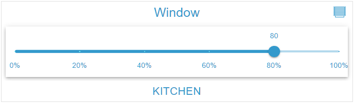
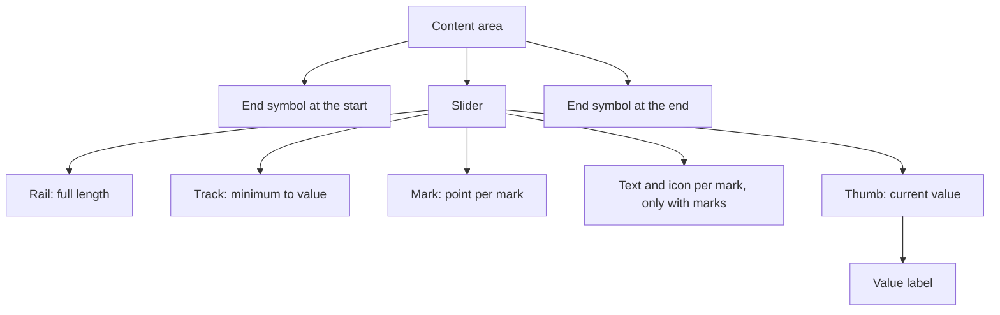

# Slider Widget

## Description

The Slider Widget is a slider for an OID of type number. When moved, it writes the value according to the **Write Value** settings. Orientation, marks, end symbols and all parts of the slider can be configured individually.

## Settings Hierarchy

This widget uses all **vis-2 Settings** and **Common Settings**. See [Home](En-Home.md) for details.

The **Slider** group covers the slider, the marks and the end symbols. On the marks its marker fields take precedence over the base fields, see [Styling](#styling). The slider has no value display: `valueSize` applies to the value label and the marks, `textColor` also to the header and footer. The **Active** group works as described under [Value-specific Settings](En-Home.md#value-specific-settings), its particularities are under [Selected Mark](#selected-mark).

## Widget-Specific Settings

### Basic Settings

| Field Name                                         | Type                              | Default      | Description                                                                                                                                                                                             | Condition                               |
| -------------------------------------------------- | --------------------------------- | ------------ | ------------------------------------------------------------------------------------------------------------------------------------------------------------------------------------------------------- | --------------------------------------- |
| Object ID `oid`                                    | id                                | -            | Accepts only type number. The pick sets `minValue` and `maxValue` to `common.min` and `common.max`, without them to 0 and 100, and adds state rows from `common.states`. It does not take `common.step` | -                                       |
| Unit `unit`                                        | text                              | -            | Unit on the marks and in the footer, not in the value label. Comes from the object, can be overwritten here, emptying removes it                                                                        | Only when an OID is picked              |
| Only display `onlyDisplay`                         | checkbox                          | false        | Locks the slider. The OID pick sets the field to true if the object has `write: false`, otherwise to false                                                                                              | Hidden if the object has `write: false` |
| Size `sliderSize`                                  | select (`small`, `medium`)        | `medium`     | MUI size of the slider. The dimensions of thumb, track and rail come from their own fields                                                                                                              | -                                       |
| Orientation `sliderOrientation`                    | select (`horizontal`, `vertical`) | `horizontal` | See [Orientation](#orientation). Without a value horizontal                                                                                                                                             | -                                       |
| Gap between slider and icons (min/max) `sliderGap` | number (0-100, step 0.1)          | 0            | Gap between the slider and the end symbols in MUI spacing units                                                                                                                                         | -                                       |
| Label `valueLabelDisplay`                          | select (`on`, `off`, `auto`)      | `off`        | Value label at the thumb: `on` always, `auto` on hover, focus and while dragging, `off` never. It shows the number without the unit                                                                     | -                                       |
| Label position `labelPosition`                     | text                              | `-5px`       | CSS length: `top` of the value label on a horizontal slider, `right` on a vertical one                                                                                                                  | Hidden with `valueLabelDisplay` = `off` |
| Slider color `sliderColor`                         | color                             | -            | Color (gradient possible) of all slider parts without their own color. Without a value the primary color of the theme                                                                                   | -                                       |
| Padding `sliderPadding`                            | number (from 0, step 0.5)         | 1            | Inner padding of the content area in MUI spacing units                                                                                                                                                  | -                                       |

### Value Range

| Field Name               | Type     | Default | Description                                                                                                                           | Condition                                   |
| ------------------------ | -------- | ------- | ------------------------------------------------------------------------------------------------------------------------------------- | ------------------------------------------- |
| Min value `minValue`     | number   | 0       | Lower limit. Empty: the smallest value of the state rows, without rows 0. No effect with `onlyStates`                                 | -                                           |
| Max value `maxValue`     | number   | 100     | Upper limit. Empty: the largest value of the state rows, without rows 100. No effect with `onlyStates`                                | -                                           |
| Step `step`              | number   | 10      | Grid of the thumb, counted from `minValue`. Empty: 1. With `0` the thumb snaps to the marks when dragged. No effect with `onlyStates` | -                                           |
| Only states `onlyStates` | checkbox | false   | See [Discrete Values](#discrete-values-onlystates)                                                                                    | Only visible when the widget has state rows |

### Marks

| Field Name                         | Type           | Default | Description                                                                                                    | Condition                   |
| ---------------------------------- | -------------- | ------- | -------------------------------------------------------------------------------------------------------------- | --------------------------- |
| Marks `marks`                      | checkbox       | false   | Shows the text and icon of the marks and reserves space for them. The points on the rail appear without it too | -                           |
| Mark position `markPosition`       | text           | `30px`  | CSS length: `top` of the label on a horizontal slider, `left` on a vertical one                                | Only when `marks` is active |
| Mark step `markStep`               | number         | 10      | Distance of the generated marks. A stored value also decides where points lie while the field is hidden        | Only when `marks` is active |
| State text color `markerTextColor` | color          | -       | Text color of the marks (gradient possible)                                                                    | Only when `marks` is active |
| State text size `markerTextSize`   | slider (0-500) | -       | Text size of the marks. `100` equals 0.875 rem                                                                 | Only when `marks` is active |
| State icon color `markerIconColor` | color          | -       | Icon color of the marks, solid color only                                                                      | Only when `marks` is active |
| State icon size `markerIconSize`   | slider (1-500) | -       | Icon width of the marks in percent of 24 px                                                                    | Only when `marks` is active |

### Start Icon (Min)

| Field Name                        | Type   | Default | Description                                                                                                                             | Condition                       |
| --------------------------------- | ------ | ------- | --------------------------------------------------------------------------------------------------------------------------------------- | ------------------------------- |
| Icon small minimum `iconSmallMin` | icon64 | -       | SVG from the icon picker, stored as a Base64 value                                                                                      | Hidden if `iconMin` is set      |
| Icon minimum `iconMin`            | image  | -       | Image file, takes precedence over `iconSmallMin`                                                                                        | Hidden if `iconSmallMin` is set |
| Icon size `iconSizeStart`         | text   | `24px`  | Width as a CSS length. Empty: 24 px                                                                                                     | Only with one of the two icons  |
| Icon color `startIconColor`       | color  | -       | Solid color only. Colors any icon, an image as a silhouette. Without a value: Base64 icon in the primary color, image in its own colors | Only with one of the two icons  |

### End Icon (Max)

| Field Name                        | Type   | Default | Description                                                                                                                             | Condition                       |
| --------------------------------- | ------ | ------- | --------------------------------------------------------------------------------------------------------------------------------------- | ------------------------------- |
| Icon small maximum `iconSmallMax` | icon64 | -       | SVG from the icon picker, stored as a Base64 value                                                                                      | Hidden if `iconMax` is set      |
| Icon maximum `iconMax`            | image  | -       | Image file, takes precedence over `iconSmallMax`                                                                                        | Hidden if `iconSmallMax` is set |
| Icon size `iconSizeEnd`           | text   | `24px`  | Width as a CSS length. Empty: 24 px                                                                                                     | Only with one of the two icons  |
| Icon color `endIconColor`         | color  | -       | Solid color only. Colors any icon, an image as a silhouette. Without a value: Base64 icon in the primary color, image in its own colors | Only with one of the two icons  |

### Advanced Styling Options

The slider consists of multiple components that can be styled individually:

#### Thumb (Knob)

| Field Name                            | Type            | Default | Description                                                                                                                                | Condition |
| ------------------------------------- | --------------- | ------- | ------------------------------------------------------------------------------------------------------------------------------------------ | --------- |
| Thumb Width `thumbWidth`              | number (from 0) | 20      | Width in px                                                                                                                                | -         |
| Thumb Height `thumbHeight`            | number (from 0) | 20      | Height in px                                                                                                                               | -         |
| Thumb Color `thumbColor`              | color           | -       | Color of the knob (gradient possible). Without a value `sliderColor`. The halo on hover and while dragging uses this color at 32 % opacity | -         |
| Thumb border width `thumbBorderWidth` | number (0-100)  | 0       | Border width in px. Only a positive value draws a border                                                                                   | -         |
| Thumb border color `thumbBorderColor` | color           | -       | Border color (gradient possible). Without a value `thumbColor`, then `sliderColor`                                                         | -         |

#### Track (Active Area)

| Field Name                            | Type            | Default | Description                                                           | Condition |
| ------------------------------------- | --------------- | ------- | --------------------------------------------------------------------- | --------- |
| Track Length `trackLength`            | number (from 0) | 4       | Thickness across the slider in px                                     | -         |
| Track Color `trackBackgroundColor`    | color           | -       | Color of the track (gradient possible). Without a value `sliderColor` | -         |
| Track border width `trackBorderWidth` | number (0-100)  | 1       | Border width in px. Without a value 0                                 | -         |
| Track Border Color `trackBorderColor` | color           | -       | Border color (gradient possible). Without a value `sliderColor`       | -         |

#### Rail (Full Length)

| Field Name                          | Type            | Default | Description                                                          | Condition |
| ----------------------------------- | --------------- | ------- | -------------------------------------------------------------------- | --------- |
| Rail Length `railLength`            | number (from 0) | 4       | Thickness across the slider in px                                    | -         |
| Rail Color `railBackgroundColor`    | color           | -       | Color of the rail (gradient possible). Without a value `sliderColor` | -         |
| Rail border width `railBorderWidth` | number (0-100)  | 0       | Border width in px                                                   | -         |
| Rail border color `railBorderColor` | color           | -       | Border color (gradient possible). Without a value `sliderColor`      | -         |

#### Mark (Marker Points)

| Field Name                       | Type            | Default | Description                                                                           | Condition |
| -------------------------------- | --------------- | ------- | ------------------------------------------------------------------------------------- | --------- |
| Mark Width `markWidth`           | number (from 0) | 2       | Size of the point along the slider in px. Without a value 2, on a vertical slider 3   | -         |
| Mark Height `markHeight`         | number (from 0) | 2       | Size of the point across the slider in px. Without a value 2, on a vertical slider 16 | -         |
| Mark Color `markBackgroundColor` | color           | -       | Color of the points (gradient possible). Without a value `sliderColor`                | -         |

### Write Value

**Note:** In addition to the settings above, the **Write Value** settings (delay/interval) are available. These control how value changes are written to the OID. See [Common Settings - Write Value](En-Home.md#write-value) for details.

- **Operation**: The thumb follows at once. The widget writes a number, and only after an operation, never on load. A movement that does not change the value writes nothing.
- **Lock**: With `onlyDisplay` or an object with `write: false` the slider is disabled.
- **Change from outside**: It sets the thumb to the new value, even for small steps like 0.5. The echo of the own write does not count, see [Write Value](En-Home.md#write-value).
- **No numeric value**: As long as the OID delivers no number, no slider appears. A change from outside to a non-numeric value removes it again.
- **Other OID type**: The frame shows a notice instead of the slider.
- **Value outside the range**: The thumb sits at the limit, this writes nothing.
- **OID change**: The thumb jumps at once to the value of the new OID.

## Terminology

The slider consists of multiple components:

- **Thumb**: The movable knob of the slider, it sits on the current value
- **Track**: The filled area from the minimum to the current value
- **Rail**: The bar along the full length below the track. MUI draws it at opacity 0.38, so it looks paler than its color field
- **Mark**: The point of a mark on the rail. Points within the track are lighter: `brightness(2.5)` and MUI opacity 0.8
- **Mark (with label)**: Point, text and icon at a value, as a state mark or a generated mark, see [Kinds](#kinds)
- **End symbol**: The icon at one end of the slider, see [Min/Max Icons](#minmax-icons)
- **Value label**: The number at the thumb. Color and size follow `textColorActive` and `valueSizeActive`, then the active state row, then `textColor` and `valueSize`, never the marker fields

### Gradient Support

The following slider fields support CSS gradients in addition to solid colors. Borders and the thumb halo draw solid colors only, there the color in the middle of the gradient applies:

- `sliderColor`
- `thumbColor`
- `thumbBorderColor`
- `trackBackgroundColor`
- `trackBorderColor`
- `railBackgroundColor`
- `railBorderColor`
- `markBackgroundColor`
- `markerTextColor`

See [Gradient Syntax](En-Home.md#gradient-syntax) for details. The color picker only creates circular radial gradients, see [Radial Gradients](En-Home.md#radial-gradients).

## Orientation

### Horizontal

- Slider from left to right
- Default orientation
- Value increases to the right
- Minimum width of the slider 200 px

### Vertical

- Slider from bottom to top
- Space-saving for narrow layouts: the slider needs only 200 px of height, no minimum width
- Value increases upward
- The value label and the labels of the marks sit at the side

## Marks

Marks help with orientation on the slider. The points always appear, text and icon only with `marks`.

### Kinds

- **State mark**: One per state row with a numeric value inside the range. The label is `alias{n}` (HTML allowed), otherwise the value with the unit
- **Generated mark**: `minValue`, `maxValue` and the steps of `markStep`, where no state mark lies. The label is the value with the unit
- **Icon**: `icon{n}`, otherwise the base icon. The OID pick sets `icon`, so an object with an icon shows it on every mark

### Step Size

- `markStep` defines the distance between generated marks, counted from `minValue`. A negative value counts as its absolute value, empty or `0` as 1
- Example: With `minValue`=0, `maxValue`=100, `markStep`=10, marks are displayed at 0, 10, 20, ... 100
- `maxValue` is always a mark, even if the step does not fit
- If both range fields are empty and there are no state rows, no marks appear
- The grid of the thumb is set by `step`, not by `markStep`

### Position

- `markPosition` sets the distance of the label from the top edge of a horizontal slider and the left edge of a vertical one
- With `marks` the widget reserves space for the label: 20 px below a horizontal, 44 px to the right of a vertical slider
- This shifts the rail by half of it, the end symbols follow it

### Styling

Text and icons at marks can be styled separately. For each property the first set value applies, a generated mark has no `{n}` tier, the `Active` tier applies to active marks only:

- **Text color**: `textColorActive`, `textColor{n}`, `markerTextColor`, `textColor`, `color` from [CSS Font & Text](En-Home.md#css-font--text), text color of the theme
- **Text size**: `valueSizeActive`, `valueSize{n}`, `markerTextSize`, `valueSize`, `font-size` from [CSS Font & Text](En-Home.md#css-font--text)
- **Icon color**: `iconColorActive`, `iconColor{n}`, `markerIconColor`, `iconColor`, primary color of the theme
- **Icon width**: `iconSizeActive`, `iconSize{n}`, `markerIconSize`, `iconSize`, 24 px. Unlike elsewhere in the content, `iconSize{n}` falls back to the base field here
- **Offset and color mask**: A state mark takes `iconXOffset{n}`, `iconYOffset{n}` and `enableIconColorMask{n}` without a fallback to the base field. A generated mark takes the base fields, which the corner icon uses too

### Selected Mark

A mark is active when its value matches the current value of the OID. The selected mark is the first active mark; if the value lies between two marks, there is none.

- **Alias `aliasActive`**: Replaces the label of the selected mark, HTML allowed. That is its only effect: it shows only with `marks`, further active marks keep their labels, and the footer keeps taking `alias{n}`
- **Offset `iconXOffsetActive`, `iconYOffsetActive`**: A value other than `0px` applies. An emptied field keeps the offset of the mark, a never set field and `0px` yield `0px`. This differs from the order of the other fields
- **State mark**: Every active state mark takes the fields of the **Active** group, `iconActive` too
- **Generated mark**: The selected one takes `iconSizeActive`, `iconColorActive`, `enableIconColorMaskActive`, `textColorActive` and `valueSizeActive`. Its icon stays the base icon, `iconActive` has no effect here

## Min/Max Icons

Icons at the ends of the slider visualize the value range. Icon, color and size follow the source icon, only the position changes with the orientation:

### Start Icon (Minimum)

- Displayed at the start of the slider (left for horizontal, bottom for vertical)
- Example: Speaker icon for volume minimum

### End Icon (Maximum)

- Displayed at the end of the slider (right for horizontal, top for vertical)
- Example: Speaker icon with sound waves for volume maximum

## Discrete Values (onlyStates)

The `onlyStates` setting is only visible when the widget has state rows.

### Functionality

When `onlyStates` is enabled:

- The range spans from the smallest to the largest state value, `minValue` and `maxValue` have no effect
- The thumb snaps to the state marks only, `step` has no effect; intermediate values are not possible
- No generated marks appear, `markStep` has no effect
- Only rows with a numeric value count. A single such row yields no range
- Without `marks` the thumb still snaps, the marks then show their points only

### Example

With `values_count`=3 and the values 0, 50 and 100:

- **onlyStates=false**: Range and grid come from `minValue`, `maxValue` and `step`, the rows are marks only
- **onlyStates=true**: Slider can only take the values 0, 50, or 100 (discrete)

### Use Cases

- **Fan speeds**: Off (0), Low (1), Medium (2), High (3)
- **Brightness levels**: 0%, 25%, 50%, 75%, 100%
- **Presets**: Predefined temperature values

## Use Cases

- **Volume Control**: `iconSmallMin` = quiet speaker, `iconSmallMax` = loud speaker
- **Brightness Control**: `iconSmallMin` = moon, `iconSmallMax` = sun
- **Temperature**: `iconSmallMin` = snowflake, `iconSmallMax` = flame, `step` = 0.5
- **Blinds**: `sliderOrientation` = `vertical`, Min = closed, Max = open
- **Dimmer with range 0 to 1**: `minValue` = 0, `maxValue` = 1, `step` = 0.01
