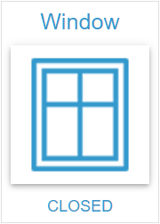

# State Widget

## Description

The State Widget is used to display and control states of various data types (boolean, number, string, mixed). It offers flexible display options, a change dialog and supports push-button functionality.

## Settings Hierarchy

This widget uses all **vis-2 Settings** and **Common Settings**. See [Home](En-Home.md) for details.

The widget-specific and value-specific settings override the more general settings.

## Widget-Specific Settings

| Field Name      | Type     | Default | Description                                                                                                                    | Condition                                                 |
| --------------- | -------- | ------- | ------------------------------------------------------------------------------------------------------------------------------ | --------------------------------------------------------- |
| onlyStates      | checkbox | false   | Show only states (values from values_count)                                                                                    | Only visible when values_count > 0                        |
| statePushButton | checkbox | false   | Push-button mode: Value[1] on press, Value[2] when the press ends, see [Push-Button Functionality](#push-button-functionality) | Only with onlyStates=true and exactly 2 rows with a value |
| onlyDisplay     | checkbox | false   | Display only (no write permissions on OID)                                                                                     | Only when write=true                                      |
| noIcon          | checkbox | false   | Don't show icon                                                                                                                | -                                                         |
| noValue         | checkbox | false   | Don't show value                                                                                                               | -                                                         |

**Note:** In addition to the settings above, the **Write Value** settings (delay/interval) are available. These control how value changes are written to the OID. See [Common Settings - Write Value](En-Home.md#write-value) for details. They are hidden in active push-button mode, see [Immediate Writes](#immediate-writes). When the widget is removed, for example by a view change, it sends a value still waiting at once.

## Data Types

The State Widget supports the following data types:

### Boolean

- Two values: true (Value[1]) and false (Value[2])
- Typical application: On/Off switch, status display

### Number

- Numeric values
- Supports units and formatting
- Typical application: Temperature, brightness, percentages

### String

- Text values
- Any character strings
- Typical application: Status messages, modes

### Mixed

- Any values
- Flexible display of different data types
- Typical application: Universal status display

## Click Behavior

What a click on the button does depends on **onlyStates** and the number of rows with a value. Rows without a value or with nothing but spaces do not count.

| Configuration              | Click                                                                           |
| -------------------------- | ------------------------------------------------------------------------------- |
| onlyStates off             | Opens the [change dialog](#change-dialog)                                       |
| onlyStates on, 1 row       | Writes the value of this row                                                    |
| onlyStates on, 2 rows      | Toggles: If the first row is active, the second is written, otherwise the first |
| onlyStates on, more than 2 | Opens the [change dialog](#change-dialog)                                       |
| Push-button mode           | Writes nothing, see [Push-Button Functionality](#push-button-functionality)     |

If the dialog would have neither a list nor a slider, it does not open and the click does nothing. A locked widget (onlyDisplay or an OID with `write: false`) does not react to the click.

## Push-Button Functionality

Push-button mode is active when **onlyStates** and **statePushButton** are enabled and the widget has exactly **2 rows with a value**. Value[1] and Value[2] are these two rows in their order.

This enables e.g. shutter control (press = Up, release = Stop) or remote control functions.

**Note:** statePushButton is only displayed when onlyStates is enabled and exactly 2 rows have a value. Two rows, one of them blank, make no push button. A row with a binding counts as a row with a value in the editor, even if the binding resolves to nothing at runtime.

### One Press

- **Pressing** with the main button, by touch or with a pen: Value[1] is sent to the OID.
- **Releasing**: Value[2] is sent to the OID.
- **Leaving the whole button while holding**: Acts as a release. Moving between the icon and the text inside the button does not count. A finger sliding off the button counts as leaving too; this is checked in the touch emulation of Chromium, not yet on real devices.
- **A touch cancelled by the browser**: Acts as a release.
- **A short tap**: Sends both values shortly after each other, Value[1] first, then Value[2]. There is no minimum duration.

Value[2] comes only out of a running press, and exactly once per press. So nothing is sent in these cases:

- **Passing over** with the mouse without pressing.
- **Coming back still pressed** after the pointer left the button. Only a new press sends Value[1] again.
- **Right and middle mouse button**.
- **A further finger** while a press is running. Only the first pointer counts.
- **Enter and Space**. Push-button mode does not react to the keyboard.

### Ending from Outside

- **View change**: If the widget is removed while holding, it sends Value[2].
- **Lock taking hold**: If onlyDisplay locks the widget while holding, the press ends and Value[2] is sent. A later release sends nothing more, even if the lock has been lifted by then.
- **OID with `write: false`**: Such an OID takes no value, Value[2] included.

A locked widget starts no press.

### Immediate Writes

Both values go to the OID at once, so a short tap does not lose its Value[1]. A value still waiting in the delay or interval is dropped. That is why **sampleInterval**, **sampleIntervalValue** and **delay**, together with their heading "Write value", are hidden in active push-button mode. The stored values stay and apply again once push-button mode is off.

### Touch and Context Menu

In push-button mode the button's surface does not scroll (`touch-action: none`), and the browser's context menu stays away. Outside push-button mode the button stays as it is.

## Change Dialog

The click opens the dialog when onlyStates is off or more than 2 rows have a value, see [Click Behavior](#click-behavior). It shows the slider at the top and the list below, whichever of them exists. It closes through the cross or a click beside the dialog, not through a choice.

- **Title**: The widget's header text, otherwise the name of the OID, otherwise "Change value".
- **Colors**: The widget's background and text color apply to the surface, the title and the list. With a gradient as text color, the title shows the gradient and the list a solid color taken from it. Without a background, the surface of the theme stays.
- **Writing**: The list and the slider write through the [Write Value](En-Home.md#write-value) settings, only the push button passes them by.
- **Lock taking hold**: If the widget locks while the dialog is open, the list and the slider write nothing more and keep showing the value. The dialog stays open and can be closed.

### List

- **Entries**: One entry per row with a value, in the order of the rows. Rows with the same value stay separate entries.
- **Text**: The alias of the row. If it is empty or consists only of spaces, the value with its unit is shown.
- **Marking**: All entries matching the current value of the OID are marked, including rows with the same value. The marking also follows changes from outside.
- **Choice**: A click writes the value of the entry, and the dialog stays open.

### Slider

The slider appears only for an OID of type **number**, with onlyStates off and when the minimum is below the maximum. With minimum ≥ maximum there is no slider.

- **Range**: When an OID is selected, the widget makes a copy of the object data and takes `common.min` and `common.max` into it. A limit the object does not declare is pre-filled there with 0 or 100. A number OID without a range therefore shows a slider from 0 to 100. The range cannot be set in the widget and limits only the slider, not the list entries.
- **Step**: `common.step` of the object, also from the copy. Without one, or with a value of 0 or below, the step is 1.
- **Later changes to the object**: The copy is made only when an OID is selected. A changed range or step applies after the next OID selection. This also goes for widgets configured earlier whose copy holds no step yet.
- **Position**: On opening, the slider stands at the current value, a numeric string counting as a number. With any other value it stands at 0. If the value changes from outside, the slider follows while the dialog is open. Choosing a list entry with a number sets it to that number. The echo of an own value does not move it.

## Value-Specific Settings

When **values_count > 0**, individual settings can be made for each value that override the Common settings:

| Field Name (Suffix)                     | Description                                     |
| --------------------------------------- | ----------------------------------------------- |
| icon1, icon2, ...                       | Individual large icon for value 1, 2, ...       |
| iconSmall1, iconSmall2, ...             | Individual small icon (SVG) for value 1, 2, ... |
| iconSize1, iconSize2, ...               | Individual icon size for value 1, 2, ...        |
| iconColor1, iconColor2, ...             | Individual icon color for value 1, 2, ...       |
| header1, header2, ...                   | Individual header text for value 1, 2, ...      |
| footer1, footer2, ...                   | Individual footer text for value 1, 2, ...      |
| textColor1, textColor2, ...             | Individual text color for value 1, 2, ...       |
| backgroundColor1, backgroundColor2, ... | Individual background color for value 1, 2, ... |
| ...                                     | All Common fields with suffix                   |

**Example:** For a boolean state with 2 values (true/false):

- `icon1` = Light bulb on (for true)
- `icon2` = Light bulb off (for false)
- `backgroundColor1` = Yellow (for true)
- `backgroundColor2` = Gray (for false)

This gives each state value an individual visual representation.
