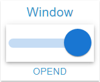

# Switch Widget

## Description

The Switch Widget is a switch for an OID of type boolean, displayed as an MUI Switch with configurable sizes and colors per position. A click writes the opposite position, delayed through the **Write Value** settings. The thumb carries the icon of the active state.

## Settings Hierarchy

This widget uses all **vis-2 Settings** and **Common Settings**. See [Home](En-Home.md) for details.

The widget-specific and value-specific settings override the more general settings. What works differently here is described under [Rows](#rows) and [Icon on the Thumb](#icon-on-the-thumb).

## Widget-Specific Settings

| Field Name                            | Type           | Default | Description                                                                                                                            | Condition                            |
| ------------------------------------- | -------------- | ------- | -------------------------------------------------------------------------------------------------------------------------------------- | ------------------------------------ |
| Object ID `oid`                       | id             | -       | The object dialog offers only the type boolean. An object of another type is discarded, the frame then shows the hint                  | -                                    |
| Unit `unit`                           | text           | `''`    | Unit (taken from the object, can be overridden here, clearing removes it). Only affects the footer text, and only without an alias     | Only when an OID is selected         |
| Only display `onlyDisplay`            | checkbox       | false   | Locks the switch, see [Locked](#locked). Every OID pick sets the field anew: `true` with `write: false`, otherwise `false`             | Hidden with `write: false`           |
| Thumb size `thumbSize`                | slider (0-500) | 62      | Width and height of the thumb in px, limited to the height of the content area. At `0` there is no visible thumb                       | -                                    |
| Thumb color (true) `thumbColorTrue`   | color          | -       | Thumb while the switch is on (gradient possible). Without a value the primary color of the theme                                       | -                                    |
| Thumb color (false) `thumbColorFalse` | color          | -       | Thumb while the switch is off (gradient possible). Without a value white in the light, `grey[300]` in the dark theme                   | -                                    |
| Track size `trackSize`                | slider (1-100) | 10      | Height of the track row in percent of the content area. `0` or no value counts as 10                                                   | -                                    |
| Track color (true) `trackColorTrue`   | color          | -       | Track while the switch is on (gradient possible). Without a value `trackColor`, otherwise the primary color of the theme               | -                                    |
| Track color (false) `trackColorFalse` | color          | -       | Track while the switch is off (gradient possible). Without a value `trackColor`, otherwise black in the light, white in the dark theme | -                                    |
| Track color `trackColor`              | color          | -       | One color for both positions (gradient possible). Applies where `trackColorTrue` or `trackColorFalse` is empty                         | Only visible while a value is stored |

**Note:** In addition to the settings above, the **Write Value** settings (delay/interval) are available. These control how value changes are written to the OID. See [Common Settings - Write Value](En-Home.md#write-value) for details.

## Boolean Options

The position follows the current value of the OID: The switch is on exactly with `true` and the text `"true"`. Any other value shows it off, including `"TRUE"`, `1` or `null`. As long as the OID has delivered no value, the widget shows no switch.

### True State

- Switch is on
- Thumb in `thumbColorTrue`, track in `trackColorTrue`
- Thumb at the right end of the track

### False State

- Switch is off
- Thumb in `thumbColorFalse`, track in `trackColorFalse`
- Thumb at the left end of the track

### Toggling

- A click writes the opposite of the displayed position, always as a boolean: `"false"` or `1` becomes `true`.
- The position changes at once, the write follows after the waiting time from [Write Value](En-Home.md#write-value).
- Several clicks within the waiting time result in one write with the last value, even if it equals the initial value.
- The click area spans the width of the track row and is as high as the thumb.

### Locked

With `onlyDisplay` or an OID with `write: false` the switch is disabled. A binding on `onlyDisplay` delivers text, there `false` and `0` count as off. A thumb without its own color then shows the disabled gray of MUI: off `grey[100]` (light) or `grey[600]` (dark), on the lightened (light) or darkened (dark) primary color. Own thumb colors and the track colors stay, the track takes the locked opacity, see [Track](#track).

### Rows

The state editor has two fixed rows for `true` and `false`: adding, cloning and deleting are not available. Picking the OID creates missing rows, the alias comes from `common.states`, without an entry `TRUE` or `FALSE`. Existing rows stay.

The widget shows no value itself: alias and unit appear only in the footer. `valueSize`, `valueSize{n}` and `textColor{n}` have no effect here.

## Visual Representation

The widget consists of two main components:

### Thumb

- Movable part of the switch
- Size adjustable via `thumbSize`, limited to the height of the content area
- Color depends on the position (`thumbColorTrue`/`thumbColorFalse`)
- Extends 4 px beyond the end of the track in both positions
- The ripple on click has the icon color of the active state

### Track

- Background rail on which the thumb moves
- Height adjustable via `trackSize`, width is that of the content area minus 8 px per side
- Color depends on the position (`trackColorTrue`/`trackColorFalse`, otherwise `trackColor`)
- Opacity is fixed and also applies to own colors: off 0.38 (light) or 0.3 (dark), on 0.5, locked in both positions 0.12 (light) or 0.2 (dark)

### Icon on the Thumb

- In both positions the thumb shows the icon of the active state: `icon{n}`, `iconSmall{n}`, otherwise `icon`, `iconSmall`. The same icon appears as the corner icon, unless `noHeaderIcon` is active.
- The size comes from `iconSize{n}` in percent of the thumb width, without a value 100 %. `iconSize` affects the thumb only while no row is active, otherwise only the corner icon.
- The color follows `iconColor{n}`, `iconColor`, otherwise the primary color of the theme. A colored icon without its own color therefore disappears on the switched-on thumb without `thumbColorTrue`, as both have the primary color.

## Use Cases

- **Light Control**: On/Off switch for lamps, with `icon{n}` for the two positions
- **Device Control**: Enable/Disable devices, with `delay` `0` when the command should go out without waiting
- **Mode Switching**: Automatic/Manual, Day/Night, etc., the alias names the mode in the footer
- **Notifications**: Enable/Disable toggle on a boolean state that a script evaluates
