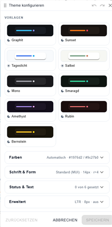

# Theme Studio



## Description

The Theme Studio is the widget collection's collection-wide theme editor: it styles colors, typography, shapes, spacing and the widget frame of **every** widget in this collection (State, Switch, …, ECharts) at once, live on the open vis-2 view.

It is **not a widget**: you do not drop it onto the canvas. In the vis-2 edit mode you open it via the **Theme Studio** button in the widget palette (group "Widget collection"). It appears as a floating, draggable and resizable window. The window itself follows the light/dark mode of the vis-2 editor, not the theme being edited.

The finished theme is stored as JSON in the state `vis-2-widgets-collection.0.theme` (see [below](#the-theme-in-the-datapoint)); every collection widget reads it and layers it over the vis-2 theme. Included presets provide starting points.

## Opening and operating

- **Open:** vis-2 edit mode → widget palette → group "Widget collection" → **Theme Studio**. The window opens instantly with the last known theme and reads the data point in the background; what it reads replaces the draft only while the draft is untouched. While no theme is known yet since the page loaded, a loading indicator shows until the answer arrives. Every open starts fresh: all sections are collapsed, the undo history is empty.
- **Independent of the palette:** the studio stays open when the palette is collapsed, filtered or hidden, when you switch views and in run mode (▶). Clicking the button again does not open a second studio but brings the open one to the front.
- **The live preview is the canvas:** there is no in-window component preview; every collection widget on the open view picks up the changes live, at most every 100 ms. Until **Save** the studio writes nothing to the data point. The draft applies in this browser tab only; other clients see the theme only after saving. On **Cancel** everything snaps back to the saved theme.
- **Title bar:** drag to move; a dot next to the title marks unsaved changes. **Undo/Redo** (up to 50 steps; `Ctrl+Z` / `Ctrl+Shift+Z` / `Ctrl+Y`; consecutive changes of the same setting less than 800 ms apart, e.g. one slider drag, form a single step) and **Close** (same as Cancel; also `Esc`). The shortcuts only act while the focus is inside the studio; outside it, `Esc` and undo stay with the vis-2 editor. In an input field, undo and redo behave as that field does.
- **Size:** eight edge and corner grips resize it like an operating-system window (edges by arrow keys ±16 px, with `Shift` ±64 px, `Home`/`End` for minimum/maximum, double-click resets; corners pointer-only). The window starts at the top right, 380 px wide; the width ranges from 320 px to window width − 48 px, the height from 240 px to window height − 48 px. By default the height follows the content (**Auto**, up to 80 % of the window height); the first vertical grip fixes it, a double-click on a horizontal edge restores Auto. Position and size persist per browser across sessions (localStorage).
- **Footer:**
    - **Reset all to default** — empties **every** value, including loaded Google fonts, CSS variables and the frame presets (`{}` = everything inherits; one undo step, so it is reversible). Inactive while the draft is empty
    - **"1 problem" / "%s problems"** — appears on validation errors; a click expands the affected section and scrolls to the first error
    - **Cancel** — discards the changes (with a confirmation while unsaved changes are open) and closes the studio
    - **Save** — writes the data point once and closes the studio; enabled only when there is something to save and blocked while validation errors are open. A connection failure shows a message and keeps the studio open. A change made during the write is not saved; the studio stays open then as well
- While unsaved changes are open, the browser warns before reloading or closing the tab. Undoing back to the starting point counts as no change.

## Presets

A collapsible section (closed on open). Its summary names the active preset ("Graphite · active"), "custom colours", or "(Default)" while no color is set; a set color mode alone does not count as a color.

Nine curated color themes as cards — **Graphite, Sunset, Daylight, Sage, Mono, Emerald, Amethyst, Ruby, Amber** — with mini color swatches (base surface, widget surface, primary, secondary) and a light/dark icon. Daylight and Sage are light, the others dark. The card marked active is the one whose five values (color mode, primary color, secondary color, base surface, widget surface) all apply; the case of hex values does not matter.

**Colors only:** applying a preset sets **only these five values**. A set divider, status and text colors as well as typography, corner radii, frame presets, spacing unit and the CSS-variables settings survive. Applying a preset is one undo step.

## Color fields

All color fields of the **Colors** and **Status & Text** sections work the same way:

- The field shows the **effective color** — set or inherited, exactly as it appears on the canvas. A set value shows a trash-can button **Reset to default** that returns the field to inheriting.
- A click on the row opens the **color picker**, with solid colors only; it offers the current theme colors as a swatch row.
- Next to it the **color value** is shown in a monospace font, directly editable and copyable: hex in lower case, other notations as typed. `Enter` or leaving the field applies it, `Esc` restores the previous value and does not close the studio, an emptied field resets the color to inheriting. An invalid entry is reported right at the field.
- The **?** next to it explains where the color takes effect.

Derived values are marked in the label: the secondary color reads "· derived from primary" while it is computed from a set primary color; Text (primary) reads "· follows primary" while it inherits.

Gradients are invalid: base surface, widget surface, divider and the text colors report "Must be a color (gradients are not allowed)", primary, secondary and the status colors "Wrong value type". Every color needs a computable value (hex, `rgb()`, `hsl()`): the widgets cannot compute with color names such as `red` or with `transparent`, the studio reports them at the field as an error and does not save them. The color value text keeps the value for correcting it, the swatch meanwhile shows the inherited color that the canvas paints as well.

## Colors section

| Setting         | Theme path                   | Where it takes effect                                                                                                                                                                                                                                                                                              |
| --------------- | ---------------------------- | ------------------------------------------------------------------------------------------------------------------------------------------------------------------------------------------------------------------------------------------------------------------------------------------------------------------ |
| Color mode      | `palette.mode`               | **Auto** · Light · Dark. Auto follows vis-2 and stores nothing; the active mode is shown beneath ("follows vis-2: Dark")                                                                                                                                                                                           |
| Primary color   | `palette.primary.main`       | Main accent: active states, default icon color, first series color of the chart palette "Theme (auto)"; in the heating widgets the ring, the chosen pills and ± ([Colors](En-Heating-Thermostat-Widget.md#colors))                                                                                                 |
| Secondary color | `palette.secondary.main`     | Second accent: second series color of the chart palette "Theme (auto)"; other widgets do not use it. With a set primary color and no own choice computed from it as a triadic partner (hue +120°, saturation at least 40 %), otherwise the secondary color of the vis-2 theme                                      |
| Base surface    | `palette.background.default` | Background of the dialog widget when it has no frame color; then also the color of its close button unless that has its own                                                                                                                                                                                        |
| Widget surface  | `palette.background.paper`   | Frame area and content area of the widgets (default of **Frame background** and **Background** while they inherit) — the main lever for dark themes                                                                                                                                                                |
| Divider         | `palette.divider`            | Borders and separators; default of the table lines in the JSON table widget as well as of chart frames, axes, markings and legend frames. Until set, that of the vis-2 theme; when the theme sets its own surfaces or the other mode, the mode's translucent default, which takes on the hue of the widget surface |

Groups: **Accents** (primary, secondary) and **Surfaces** (base surface, widget surface, divider). The summary shows the mode and the primary and secondary colors.

## Typography & shape section

| Setting                                   | Theme path                                       | Description                                                                                                                                                                                                                                                                                                                                                                                                                                                                                                                                                                                                                                                                                                                                                |
| ----------------------------------------- | ------------------------------------------------ | ---------------------------------------------------------------------------------------------------------------------------------------------------------------------------------------------------------------------------------------------------------------------------------------------------------------------------------------------------------------------------------------------------------------------------------------------------------------------------------------------------------------------------------------------------------------------------------------------------------------------------------------------------------------------------------------------------------------------------------------------------------- |
| Font family                               | `typography.fontFamily`                          | **Default (vis-2 theme)** (inherits the vis-2 font, stores nothing) · **Included** (shipped with the collection, offline and identical everywhere: Inter, JetBrains Mono, Merriweather, Montserrat, Nunito, Open Sans, Oswald, Playfair Display, Roboto, Roboto Slab) · **System** (installed on the viewing device: Arial, Helvetica, Segoe UI, Verdana, Tahoma, Trebuchet MS, Calibri, Georgia, Times New Roman, Palatino, Garamond, Cambria, Courier New, Consolas, Lucida Console, System UI, Sans-serif, Serif, Monospace) · **Custom font…** (any CSS font name in the text field below). The CSS stack is stored with its fallback fonts, e.g. `'Inter', system-ui, sans-serif`. Any other value appears as Custom font… and loads no included font |
| Google Font                               | `googleFonts`, `typography.fontFamily`           | Type the **Name on Google Fonts** (e.g. Roboto, Lato, Open Sans; "Browse fonts" opens fonts.google.com) and click **Load**. The studio fetches the font once from fonts.googleapis.com (request from this browser), embeds Regular and Bold of the Latin subset in the data point, as far as the font has them, a variable font as one file for both weights, and selects it as the font family `'Name', sans-serif` — one undo step. In the selection it then appears as Custom font…. Offline afterwards; the state grows by a few tens of KB per font. If loading fails, the error message appears at the field and the theme stays unchanged                                                                                                           |
| Loaded Google fonts                       | `googleFonts.Name`, `typography.fontFamily`      | Every loaded font appears as a chip: a click selects it as the font family, ✕ removes it. If the font family points to the removed font, it is reset as well                                                                                                                                                                                                                                                                                                                                                                                                                                                                                                                                                                                               |
| Base font size (px)                       | `typography.fontSize`                            | Slider and number field, 8–24 px in steps of 0.5, without a value it shows 14                                                                                                                                                                                                                                                                                                                                                                                                                                                                                                                                                                                                                                                                              |
| Border radius (px)                        | `corners.topLeft` … `corners.bottomLeft`         | **Linked** by default: one slider (0–96 px in steps of 0.5) for all four corners. Without a value it shows 4, and the radius of the vis-2 theme applies. The chain icon unlinks them ("Set corners individually") — then four number fields in corner arrangement (top left, top right, bottom left, bottom right), a missing corner counts as 4. Unequal corners never count as linked. Linking again ("Link corners") sets unequal corners to the top-left value. The four values apply to the frame and content areas of the widgets, other components use the top-left value                                                                                                                                                                           |
| Fine-tuning: Light, Regular, Medium, Bold | `typography.fontWeightLight/Regular/Medium/Bold` | Rarely needed, collapsed: which font weight (100–900, "—" = no value) the widgets use for the roles Light, Regular, Medium and Bold. Note: included fonts ship real 400 and 700 faces only; other weights are synthesised by the browser and can look muddy                                                                                                                                                                                                                                                                                                                                                                                                                                                                                                |
| Fine-tuning: Line height                  | `typography.allVariants.lineHeight`              | Slider and number field, 1–2 in steps of 0.05, without a value it shows 1.43                                                                                                                                                                                                                                                                                                                                                                                                                                                                                                                                                                                                                                                                               |

Only **Undo** or **Reset all to default** clears a single slider value (font size, border radius, line height). The summary shows font, size and corner radius (`r=12`, unequal corners as top left/top right/bottom right/bottom left).

## Widget frame section

The **widget frame** is what every collection widget draws around its content: card, outlines, padding, shadow, header, header icon and footer. In the attribute panel these are eight settings in the **Common** group (see [Widget frame](En-Home.md#widget-frame)). Here you set a **frame preset** for each of them that applies to all collection widgets: a widget follows it wherever it has no own value for the setting.

| Setting          | Theme path                  | Description                                                                                                                                                           |
| ---------------- | --------------------------- | --------------------------------------------------------------------------------------------------------------------------------------------------------------------- |
| Card             | `widgetFrame.noCard`        | Switch. Off shows the widgets without card, like Without border `noCard` in the panel: the frame area fills the widget without the surrounding gap. Off stores `true` |
| Content outlined | `widgetFrame.outlined`      | Switch. On draws the content area with a line instead of a shadow; Shadow then has no effect                                                                          |
| Frame outlined   | `widgetFrame.outlinedFrame` | Switch. On draws the frame area with a line instead of a shadow                                                                                                       |
| Padding          | `widgetFrame.basePadding`   | Slider and number field, 0–10 in steps of 0.1: gap between frame and content area in spacing units. At 0 the content area has square corners                          |
| Shadow           | `widgetFrame.baseElevation` | Slider and number field, 0–24, whole numbers only: MUI elevation of the content area                                                                                  |
| Header           | `widgetFrame.noHeader`      | Switch. Off hides the frame header. Off stores `true`                                                                                                                 |
| Header icon      | `widgetFrame.noHeaderIcon`  | Switch. Off hides the corner icon. Off stores `true`                                                                                                                  |
| Footer           | `widgetFrame.noFooter`      | Switch. Off hides the frame footer. Off stores `true`                                                                                                                 |

Groups: **Card** and **Header & footer**, in the order of the panel. The switches are worded positively ("Header" on = header shown), while the theme stores the meaning of the widget field (`noHeader: false`). The summary counts the set frame presets ("x of 8 preset").

- **Standard:** without a frame preset a setting shows the built-in standard and says so in the label ("· standard"): card, header, header icon and footer on, both outlines off, padding 1, shadow 4. That is the look of the widgets without the Theme Studio. Unlike the other sliders, a set frame preset has a trash-can button **Reset to standard** that removes this one value.
- **Inheritance:** a widget takes its own value, without one the frame preset, without that the built-in standard. You set an own value in the **Common** group; there "As theme" (on/off settings) or × (Padding, Elevation) removes it again, for several selected widgets at once.
- **New and existing widgets:** a newly placed widget stores none of the eight settings and follows the frame presets from the start. A widget placed from the palette before the frame presets existed stored the defaults of that time as own values: it looks unchanged, and a frame preset reaches it only once you set the setting to "As theme" in the panel. The info box of the section says the same.
- **Like every studio value:** a frame preset takes effect live on every inheriting widget of the canvas and counts for undo/redo, **Save** and **Cancel**. A preset sets only colors and leaves the frame presets; **Reset all to default** clears them.
- **Exceptions:** a widget embedded in another widget never shows a card, whatever the frame preset says. A setting a widget does not use stays without effect there, such as the header icon in the ECharts widget and in the view frame of the Dialog widget.

## Status & text section

| Setting          | Theme path               | Where it takes effect                                                                                                                                                                                                                                   |
| ---------------- | ------------------------ | ------------------------------------------------------------------------------------------------------------------------------------------------------------------------------------------------------------------------------------------------------- |
| Error color      | `palette.error.main`     | Series color 6 of the chart palette "Theme (auto)" and error indicators, e.g. the error message in the ECharts widget and the red line of the input field; in the heating widgets faults and notices ([Colors](En-Heating-Thermostat-Widget.md#colors)) |
| Warning color    | `palette.warning.main`   | Series color 3 of the chart palette "Theme (auto)" and warnings, e.g. the depth warning in the JSON table widget; in the heating widgets heating (warmth, not a warning)                                                                                |
| Info color       | `palette.info.main`      | Series color 5 of the chart palette "Theme (auto)"; in the heating widgets cool, e.g. an open window                                                                                                                                                    |
| Success color    | `palette.success.main`   | Series color 4 of the chart palette "Theme (auto)"                                                                                                                                                                                                      |
| Text (primary)   | `palette.text.primary`   | Default of all text colors. Follows the primary color until set, including that of the vis-2 theme                                                                                                                                                      |
| Text (secondary) | `palette.text.secondary` | Secondary text such as units, captions and hints; default of the axis text in charts and of the unselected radio icon. Inherits like the divider                                                                                                        |

Groups: **Status colors** and **Text**. The summary counts the set colors ("x of 6 set").

## Advanced section

| Setting              | Theme path                  | Description                                                                                                                                                                                                      |
| -------------------- | --------------------------- | ---------------------------------------------------------------------------------------------------------------------------------------------------------------------------------------------------------------- |
| Spacing unit (px)    | `spacing`                   | Base unit for all padding and gaps inside the widgets (slider and number field, 0–16 in steps of 0.5, without a value it shows 8). 2 units = 16 px at unit 8                                                     |
| Enable CSS variables | `cssVariables`              | Exposes every theme value as a CSS variable (e.g. `--vis2c-palette-primary-main`) — for your own CSS in vis-2; not needed without custom CSS. Stores `true`, switching off removes the path including the prefix |
| CSS variable prefix  | `cssVariables.cssVarPrefix` | Only with CSS variables enabled. Prefix of the generated variables; empty = `vis2c`. `mui` is reserved (the vis-2 editor defines `--mui-*` itself) and rejected                                                  |

Groups: **Layout** and **CSS variables**. The variables live on `:root` and carry the prefix `--vis2c` by default; custom CSS therefore reads `--vis2c-palette-…`. By default the collection theme sets no `color-scheme` on `:root`, because it would overwrite that of the vis-2 editor.

Here too, only **Undo** or **Reset all to default** clears a single slider value. The summary shows the spacing unit and whether CSS variables are on. There is no text-direction (RTL) toggle; a `direction` in the data point is valid but does not mirror the widgets.

## The theme in the datapoint

The studio saves into the state **`vis-2-widgets-collection.0.theme`** (type `string`): the theme as JSON text. It is a **partial MUI `ThemeOptions` object** plus three custom extensions (`corners`, `googleFonts`, `widgetFrame`). Every collection widget reads and validates the state on start and on every change. A single invalid value is dropped, the rest of the theme applies. If the state is empty, not valid JSON or not an object, the theme counts as `{}` and the widget theme stays at the host default.

Compact example (dark, own accents, Inter, corner radius):

```json
{
    "palette": {
        "mode": "dark",
        "primary": { "main": "#90caf9" },
        "secondary": { "main": "#ce93d8" },
        "background": { "default": "#121212", "paper": "#1e1e1e" },
        "text": { "primary": "#ede7f6", "secondary": "#9e9e9e" },
        "success": { "main": "#81c784" }
    },
    "typography": { "fontFamily": "'Inter', system-ui, sans-serif", "fontSize": 14 },
    "corners": { "topLeft": 12, "topRight": 12, "bottomRight": 12, "bottomLeft": 12 },
    "spacing": 8
}
```

Rules and notes for script authors:

- **Sparse:** cleared fields disappear completely (the studio prunes empty paths). Missing paths inherit; a minimal valid theme is `{}`.
- **Validation:** colors must be plain and computable (hex, `rgb()` or `hsl()`; no gradients, no color names, no `transparent`), numbers numbers, values in range (e.g. corner radii 0–96, `typography.fontSize` 1–100; the studio reports "out of range (0–96)"). Unknown paths produce a warning ("unknown setting — ignored") but no block. Warnings and errors without a field of their own appear with their path at the bottom of the window. Errors block saving from the studio.
- **Invalid values in the state:** if a state written via script holds an invalid value, a color name for instance, only that value is dropped: the widgets show the rest of the theme, and the studio opens with the rest; the next save writes the state without it. For primary, secondary and the status colors an invalid main color (`main`) drops the color as a whole, an invalid variant (`light`, `dark`, `contrastText`) only itself; in a list (`shadows`, the faces of a Google font) the whole list. If the state is not valid JSON or not an object, the studio opens with the empty theme.
- **Studio stricter than the widgets:** the widgets replace the prefix `mui` for CSS variables by `vis2c`; the rest of the theme still applies. The studio shows it as an error and saves only after the correction.
- **Writing directly** works: `setState('vis-2-widgets-collection.0.theme', JSON.stringify(theme), true)` — the studio reads the state on open and follows it while it is open. An open studio without unsaved changes takes the written value over, the canvas shows it, and the undo history is empty afterwards. With unsaved changes the draft stays in the studio and on the canvas; it still counts as changed, now measured against the written value, and saving overwrites it.
- **`widgetFrame`** holds the frame presets under the names of the widget fields: `noCard`, `outlined`, `outlinedFrame`, `noHeader`, `noHeaderIcon` and `noFooter` take `true` or `false` in the meaning of the field (`"noCard": true` = without card), `basePadding` a number from 0 to 10, `baseElevation` a whole number from 0 to 24 (otherwise "must be a whole number"). A missing value means no frame preset, the built-in standard applies; an invalid value is dropped alone.
- **`googleFonts`** (a map of font name → list of `weight`, with a variable font `weightMax`, and `data`, the embedded woff2 data URI) is managed by the studio alone when loading a Google font; do not edit by hand (large base64 blobs).

## Related pages

- [Home](En-Home.md) — common settings of all widgets; [Widget frame](En-Home.md#widget-frame) explains own value and "As theme" in the panel
- [ECharts Widget](En-Echarts-Widget.md) — its Colors section uses this theme as the palette source "Theme (auto)"
