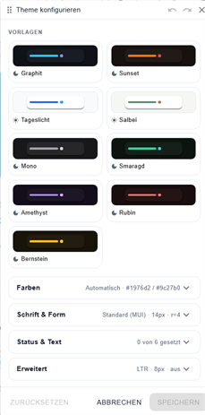

# Theme Studio



## Description

The Theme Studio is the widget collection's collection-wide theme editor: it styles colors, typography, shapes and layout details of **every** widget in this collection (State, Switch, …, ECharts) at once — live on the open vis-2 view.

It is deliberately **not a widget**: you do not drop it onto the canvas. In the vis-2 edit mode you open it via the **Configure theme** button in the widget palette (the collection group's "Theme configuration" entry). It appears as a floating, draggable and resizable panel.

The finished theme is stored as JSON in the ioBroker state `vis-2-widgets-collection.0.theme` (see [below](#the-theme-in-the-datapoint)); every collection widget reads it and applies it layered over the vis-2 host theme. Shipped presets ("Templates") provide starting points.

## Opening and operating

- **Open:** vis-2 edit mode → widget palette → collection group → **Configure theme**. The panel opens instantly with the last known theme.
- **The live preview IS the canvas:** there is deliberately no in-panel component preview — every collection widget on the open view re-themes live while you edit. On **Cancel**/discard everything snaps back to the saved theme.
- **Panel window:** drag the title bar to move it, **Undo/Redo** (up to 50 steps; `Ctrl+Z` / `Ctrl+Shift+Z` / `Ctrl+Y`; continuous edits — e.g. one slider drag — coalesce into a single step), maximize, close. Eight edge/corner grips resize it like an OS window (edges keyboard-operable: arrows ±16/±64 px, `Home`/`End`, double-click resets; corners pointer-only). By default the height follows the content (**Auto** up to 80 % of the window height) — the first vertical grip fixes it, a double-click on a horizontal edge restores Auto. Position and size persist across sessions.
- **Footer:**
    - **Reset** — empties **every** value (`{}` = everything inherits; one undo step, so it is reversible)
    - **Cancel** — discards the changes (confirmation prompt while unsaved changes are open) and closes the panel
    - **Save** — validates and writes the datapoint; a connection failure shows a message. Validation errors block saving ("%s problems"; the affected section expands and scrolls to the field)
- While unsaved changes are open the panel shows "Unsaved changes".

## Templates (preset cards)

Nine curated color themes as cards — **Graphite, Sunset, Daylight, Sage, Mono, Emerald, Amethyst, Ruby, Amber** — with mini color swatches (background/paper/primary/secondary) and a light/dark icon. The card whose palette is the current one is marked active.

**Palette-only merge:** applying a preset card replaces **only the colors** (including the color mode) — typography, corner radii, spacing factor, text direction and the CSS-variables settings survive. Applying a preset is one undo step.

## Colors section

The color mode and the hero colors. Every field shows the **effective** value (inheritance resolved) and marks explicit overrides; the color picker offers the current theme colors as a swatch row.

| Setting              | Theme path                   | Description                                                                                          |
| -------------------- | ---------------------------- | ---------------------------------------------------------------------------------------------------- |
| Color mode           | `palette.mode`               | Light · Dark · **Auto** (follows the vis-2 host; the effectively active mode is shown beneath)       |
| Primary color        | `palette.primary.main`       | main accent (buttons, active states); default = the color mode's MUI value                           |
| Secondary color      | `palette.secondary.main`     | second accent; until first set manually it is **derived** (triadic from primary, marked "· derived") |
| Background (default) | `palette.background.default` | canvas surfaces                                                                                      |
| Background (paper)   | `palette.background.paper`   | card/panel surfaces — the lever for dark themes                                                      |
| Divider              | `palette.divider`            | borders and dividers                                                                                 |

Non-plain colors (gradients) are invalid here — validation reports "must be a color".

## Typography & shape section

| Setting            | Theme path                                                                            | Description                                                                                                                                                                                                                                                                                                                                                                                                                        |
| ------------------ | ------------------------------------------------------------------------------------- | ---------------------------------------------------------------------------------------------------------------------------------------------------------------------------------------------------------------------------------------------------------------------------------------------------------------------------------------------------------------------------------------------------------------------------------- |
| Font family        | `typography.fontFamily`                                                               | Sources: **Bundled** (shipped with the collection, offline and identical everywhere: Inter, JetBrains Mono, Merriweather, Montserrat, Nunito, Open Sans, Oswald, Playfair Display, Roboto, Roboto Slab) · **System** (installed on the viewing device) · **Google** (loaded once from the catalog and embedded as woff2 — permanent, shared across devices, offline-capable after the first load) · **Custom** (any CSS font name) |
| Font size          | `typography.fontSize`                                                                 | base size in px (default 14, shows "Default (MUI)" until set)                                                                                                                                                                                                                                                                                                                                                                      |
| Corner radius (px) | `corners.topLeft` … `corners.bottomLeft`                                              | four corners individually; **Link corners** ties them together. Applies to the widgets' card/panel surfaces                                                                                                                                                                                                                                                                                                                        |
| Fine-tuning ↓      | `typography.fontWeightLight/Regular/Medium/Bold`, `typography.allVariants.lineHeight` | rare expert knobs: the four font-weight selects and the line-height slider. Note: bundled fonts ship real 400/700 faces only — other weights are synthesized by the browser (quickly looks dirty)                                                                                                                                                                                                                                  |

## Status & text section

| Setting          | Theme path               | Description    |
| ---------------- | ------------------------ | -------------- |
| Success color    | `palette.success.main`   | semantic green |
| Error color      | `palette.error.main`     | semantic red   |
| Info color       | `palette.info.main`      |                |
| Warning color    | `palette.warning.main`   |                |
| Text (primary)   | `palette.text.primary`   |                |
| Text (secondary) | `palette.text.secondary` |                |

The summary line counts the explicit overrides ("x of 6 set").

## Advanced section

| Setting              | Theme path                  | Description                                                                                                                                                                     |
| -------------------- | --------------------------- | ------------------------------------------------------------------------------------------------------------------------------------------------------------------------------- |
| Spacing factor       | `spacing`                   | MUI's spacing factor (default 8) — drives every padding, gap and margin of the components; higher = more generous                                                               |
| Text direction       | `direction`                 | `ltr` (default) or `rtl` (e.g. Arabic/Hebrew)                                                                                                                                   |
| Enable CSS variables | `cssVariables`              | Produces a CSS variable for every theme value (e.g. `--mui-palette-primary-main`) plus real light/dark via `color-scheme` — only needed if your own CSS references theme colors |
| CSS variables prefix | `cssVariables.cssVarPrefix` | prefix of the generated variables                                                                                                                                               |

## The theme in the datapoint

The studio saves into the state **`vis-2-widgets-collection.0.theme`** (type `string`): the theme as JSON text. It is a **partial MUI `ThemeOptions` object** plus two custom extensions (`corners`, `googleFonts`). Every collection widget reads and validates the state on start and on every change; if it is invalid the widget theme falls back to the host default (fallback `{}`).

Compact example (dark, own accents, Inter, corner radius — this is roughly what the state looks like):

```json
{
    "palette": {
        "mode": "dark",
        "primary": { "main": "#90caf9" },
        "secondary": { "main": "#ce93d8" },
        "background": { "default": "#121212", "paper": "#1e1e1e" },
        "text": { "primary": "#ede7f6", "secondary": "#9e9e9e" },
        "success": { "main": "#81c784" }
    },
    "typography": { "fontFamily": "Inter", "fontSize": 14 },
    "corners": { "topLeft": 12, "topRight": 12, "bottomRight": 12, "bottomLeft": 12 },
    "spacing": 8,
    "direction": "ltr"
}
```

Rules and notes for script authors:

- **Sparse:** cleared fields disappear completely on save (the studio prunes empty paths). Missing paths inherit — a minimal valid theme is `{}`.
- **Validation:** colors must be plain (no gradients), numbers numbers, values in range; unknown paths produce a warning ("may be ignored by MUI") but no block. Errors block saving from the studio; a state written invalidly via script falls back to the host default in the widgets.
- **Writing directly** works: `setState('vis-2-widgets-collection.0.theme', JSON.stringify(theme), true)` — the studio reads the state on open and continues from it.
- **`googleFonts`** (a map of font name → weight + embedded woff2 data URIs) is managed by the studio alone when loading a Google font — do not edit by hand (large base64 blobs).

## Related pages

- [Home](En-Home.md) — common settings of all widgets
- [ECharts Widget](En-Echarts-Widget.md) — its Colors section uses this theme as the palette source "Theme (auto)"
